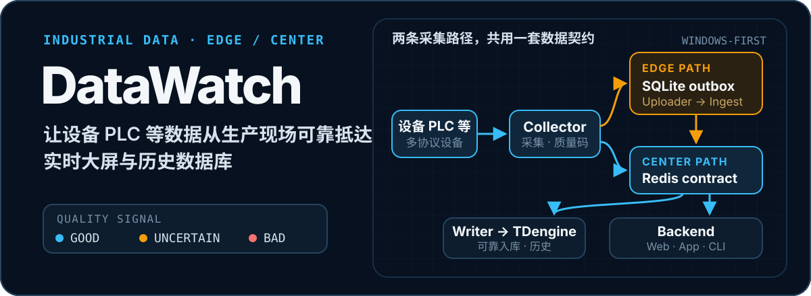

<p align="center">
  
</p>


<p align="center">
  <code>Windows-first</code>&nbsp;&nbsp;·&nbsp;&nbsp;<code>Python 3.14t</code>&nbsp;&nbsp;·&nbsp;&nbsp;<code>Vue 3</code>&nbsp;&nbsp;·&nbsp;&nbsp;<code>Tauri</code>&nbsp;&nbsp;·&nbsp;&nbsp;<code>Redis + TDengine + MySQL</code>
</p>

<p align="center">
  <a href="LICENSE"></a>
  
  
</p>

DataWatch 是面向自动化码头的工业设备数据采集与监控平台。它把现场 PLC / OPC 点位转换为统一数据流，在网络抖动、设备断连或中心短暂不可用时保留明确的交接边界，并向 Web、桌面端和 CLI 提供实时与历史数据。

> 项目是多进程、部署型平台，不是单体 Web 示例。开始运行前需要准备对应的数据库、free-threaded Python 与 Windows 驱动环境。

## 能做什么

- **接入多种工业协议**：S7、GE SRTP、OPC UA、OPC DA 与 HTTP Push；OPC DA 通过独立的 C# x86 sidecar / proxy 隔离 COM 与 DCOM 依赖。
- **覆盖中心式与分布式现场**：中心式采集直接进入 Redis；分布式边缘先写 SQLite outbox，再由 Uploader 经 Ingest 汇入中心。
- **分离实时态与历史事实**：Redis 承载 latest、window、stream 与 DLQ，Writer 消费 Stream 并批量写入 TDengine；MySQL 保存设备拓扑、映射、用户与权限。
- **传递数据质量**：Good / Uncertain / Bad 质量码从驱动层贯穿 Redis、Writer、TDengine、Backend 与前端，区分真实零值和采集失败。
- **面向不同使用者交付**：Vue Web 控制台服务业务用户，Tauri 桌面端服务现场运维，CLI 面向人工、脚本和 AI Agent。

## 两条路径，一套契约

```text
中心式
PLC / OPC → Collector → Redis → Writer → TDengine
                              └→ Backend → Web / App / CLI

分布式边缘
PLC / OPC → Collector → Edge Storage → SQLite outbox
                                      → Uploader → Ingest → Redis
                                                               ├→ Writer → TDengine
                                                               └→ Backend → Web / App / CLI
```

关键交接点是可恢复的：边缘侧以 Storage 的本地持久化确认为边界，中心侧以 Redis 的接纳确认为边界。Collector、Storage、Uploader、Ingest 和 Writer 可以独立重启，已完成交接的数据由所在持久层继续保留。

## 组件地图

| 目录 | 角色 | 主要职责 |
| --- | --- | --- |
| [`collector/`](collector/) | 采集端 | 驱动、调度、解析、质量码与 Redis / Edge Storage 写出 |
| [`edge/`](edge/) | 边缘数据面 | SQLite 单写者、配置快照、outbox 与可靠上传 |
| [`ingest/`](ingest/) | 中心汇聚端 | 节点认证、契约校验、去重、逐项 ACK 与 Redis 原子接纳 |
| [`writer/`](writer/) | 历史入库端 | Redis consumer group、批写 TDengine、重试与 DLQ |
| [`backend/`](backend/) | 中心控制面 | REST / WebSocket、RBAC、实时读取与历史查询 |
| [`frontend/`](frontend/) | Web 业务端 | 设备、点位、实时监控、历史查询、日志与系统管理 |
| [`agent/`](agent/) | Windows 本机代理 | 角色约束、进程管控、凭据、配置同步与日志 |
| [`app/`](app/) | 桌面运维端 | Tauri 控制台、首装、启停、健康、指标与日志 |
| [`cli/`](cli/) | 自动化客户端 | 机器可读命令、权限预检、实时订阅与签名更新 |
| [`deploy/`](deploy/) / [`installer/`](installer/) | 交付 | 中心 Docker 栈、离线镜像与三种 Windows 角色包 |

## 快速开始（已配置开发机）

根目录的启动脚本只拉起 Backend 与 Web 前端，适合 UI / API 联调；它不会启动 Agent、Collector、Writer、Ingest 或 Edge 运行时。

### 前置条件

- Windows 开发环境；现场角色包依赖 Windows 服务与驱动生态。
- Backend 使用 free-threaded Python 3.14t；CLI 源码开发使用 Python 3.11+。
- Node.js 22 与 pnpm；桌面端开发还需要 Rust、Tauri 2 和 WebView2。
- MySQL 8.4、Redis 7.4 与 TDengine 3.4.0.9。Compose 的 `infra` 模式可托管三库；首次部署仍需先恢复完整 MySQL 业务库，步骤见[运维部署](docs/04-运维部署/README.md)。
- OPC DA 场景需要 .NET Framework 4.8、x86 COM / DCOM 环境。

### 1. 准备配置

本地 Backend 使用 `backend/.env`；中心容器部署从模板复制环境变量文件：

```powershell
Copy-Item .\deploy\backend.env.example .\deploy\backend.env
```

至少检查 MySQL、Redis、TDengine、`AUTH_SECRET_KEY` 与 Agent service token。不要提交真实密码或密钥。

### 2. 安装 Web 依赖

```powershell
Set-Location .\frontend
pnpm install
Set-Location ..
```

### 3. 启动 Backend + Frontend

```powershell
.\start-dev.ps1
```

启动后访问：

- Web：<http://127.0.0.1:5173>
- Backend：<http://127.0.0.1:8000>
- 健康检查：<http://127.0.0.1:8000/healthz>

`start-dev.ps1` 会优先查找开发机 Python 路径，也支持 `backend/.venv-314t/Scripts/python.exe`。如果找不到 Python，请先按 [`docs/04-运维部署/README.md`](docs/04-运维部署/README.md) 准备运行环境；不要把普通 CPython 当作 3.14t 打包基线。

## 部署形态

| 形态 | Windows 角色 | 中心服务 |
| --- | --- | --- |
| 中心式 | App + Agent + Collector + Writer | Backend、Frontend、MySQL、Redis、TDengine |
| 分布式边缘 | Edge App + Edge Agent + Storage + Edge Collector + Uploader | 通过统一入口连接分布式中心 |
| 分布式中心 | Center App + Agent + Ingest + Writer | Backend、Frontend、MySQL、Redis、TDengine |

采集端涉及 PLC 网络、OPC DA、COM / DCOM 与现场驱动，不进入 Docker。Backend 与 Frontend 使用独立中心镜像；完整构建、离线镜像、角色安装包与验收步骤见[运维部署文档](docs/04-运维部署/README.md)。

## CLI

CLI 只访问 Backend API，不直连数据库，也不输出模拟业务数据。

```powershell
python -m pip install -r .\cli\requirements.txt
python -m cli.main config set-url http://127.0.0.1:8000
python -m cli.main system health
python -m cli.main auth login --username admin
python -m cli.main devices status --device QC100
```

凭据默认存入 Windows Credential Manager；自动化调用可通过 stdin 传递密码。命令组、权限、JSON / JSONL 输出、退出码与签名更新见 [`cli/README.md`](cli/README.md)。

## 文档入口

- [文档总索引](docs/README.md)：按总体、模块、契约与运维组织的权威入口。
- [系统架构总览](docs/01-总体设计/系统架构总览.md)：数据流、模块职责、故障域与关键取舍。
- [分布式系统技术架构](docs/01-总体设计/分布式系统技术架构.md)：三角色边界与控制面 / 数据面 / 查询面。
- [数据与契约](docs/03-数据与契约/README.md)：REST、WebSocket、CLI 输出与数据库结构。
- [运维部署](docs/04-运维部署/README.md)：开发启动、中心镜像、离线交付、升级回滚与验收。
- [问题排查](docs/04-运维部署/问题排查.md)：Web、API、Agent、采集、上传、入库与数据库故障定位。

## 验证与仓库卫生

各 Python 组件按自己的 `requirements.txt` 建立环境；Backend 必须使用 free-threaded Python 3.14t，并优先加载仓库内的 ABI 兼容依赖：

```powershell
$env:PYTHONPATH = (Resolve-Path .\backend\.py314t-site).Path
py -3.14t -X utf8 -m pytest .\backend\app\tests -q
Remove-Item Env:PYTHONPATH

python -m pytest .\cli\tests -q
pnpm --dir .\frontend test
pnpm --dir .\frontend build
pnpm --dir .\app test
pnpm --dir .\app build
cargo check --manifest-path .\app\src-tauri\Cargo.toml
```

Collector、Edge、Ingest、Writer 与 Agent 的测试应在安装各自依赖后，从模块目录运行 `python -m pytest tests -q`。构建前还应运行对应前端测试和 Rust `cargo check`。

`dist/`、`build/`、`artifacts/`、`outputs/`、日志、虚拟环境、`node_modules/` 与 Tauri `target/` 都是可再生或运行期内容，不应提交。需要本地保留的历史交付物统一移入 `docs/_archive/`；正式版本应通过发布流程保存。

## 当前边界

- 当前项目没有设备点位告警引擎；CLI 的 `system-alerts` 指真实系统 / 操作日志中的高等级事件，不代表阈值越限或通讯中断告警。
- `frontend` 是业务 Web 控制台，`app` 是现场桌面运维端；两者的身份流程和职责不同。
- 生产进程应由 Agent 按角色启动，不要手工重复启动 Collector 或 Writer，以免重复采集、消费或入库。
- 仓库当前未提供许可证文件。使用、修改或分发前，请先向维护者确认授权范围。
