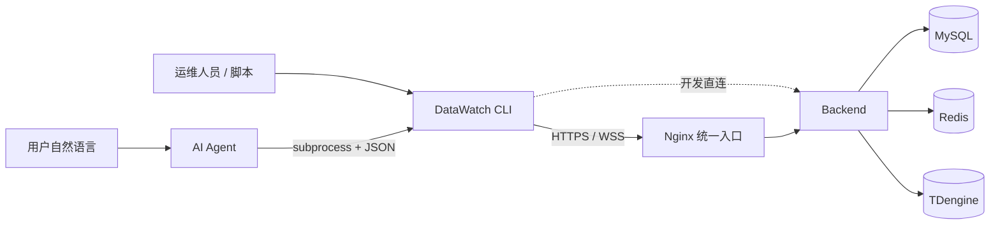

# Data Watch AI 调用与 CLI 总体方案

> 状态：CLI 工程改造已完成。当前 CLI 版本为 `0.3.0`，输出契约版本为 `1.0`。MCP Server 不属于本次已完成范围，后续按独立方案评估。

## 1. 建设结论

DataWatch CLI 已成为人工运维、自动化脚本和 AI Agent 访问系统的正式客户端。它通过 Nginx 统一入口或开发环境 Backend 直连方式调用 REST/WebSocket API，不访问前端代码，也不直接连接 MySQL、Redis、TDengine、Collector、Writer 或 Edge Agent。

CLI 与 Web/桌面端共享同一套账号、JWT 和 Backend 权限体系。CLI 的本地权限检查用于提前阻止不可用命令，Backend 仍是鉴权和业务规则的最终权威。

## 2. 已完成范围

| 阶段 | 状态 | 交付内容 |
|---|---|---|
| M0 | 已完成 | `/api/user/info` 同时返回 `buttons` 和 `permissions`，明确 `auth_mark` 与 `permission_code` 的边界 |
| M1 | 已完成 | Profile、登录、Windows Credential Manager、统一 JSON、退出码、权限发现 |
| M2 | 已完成 | 设备状态、点位解析、实时/历史、模块诊断、系统日志告警和 Resolver 缓存 |
| M3 | 已完成 | 设备、点位、驱动、节点、日志、用户、角色和菜单管理命令 |
| M5 | 已完成 | 稳定机器契约、Token 刷新、重试/分页、Windows 离线包、签名自更新、回滚和 CI 发布 |
| M4 | 延期 | MCP Server 单独评估，不影响 AI 通过 CLI 使用系统 |

当前实现包含 128 个叶子命令，每个命令都具有且仅具有一条访问策略。命令和参数的机器事实源由 `data-watch commands list` 与 `data-watch commands schema` 提供。

## 3. 关键设计决策

1. **Backend 权威**：CLI 不复制设备校验、删除约束、驱动生命周期或权限决策。
2. **机器输出优先**：成功写 stdout，失败写 stderr；默认 JSON，持续订阅使用 JSON Lines。
3. **业务标识优先**：用户和 AI 使用 `QC100`、`轨道吊701陆侧`、`AGV801`、`I101`、`DB1702.DBW0`、`CraneID` 等现场称呼；CLI 内部解析数据库 ID、`varSeq` 和采集组。
4. **权限双层执行**：CLI 使用 `permissions` 做本地预检查，Backend 对每次请求再次鉴权。
5. **高风险显式确认**：删除、卸载、授权、停用和清理等操作必须满足资源确认；无人值守调用还必须显式使用 `--yes`。
6. **凭据不进 URL**：实时 WebSocket 连接后发送认证消息，不使用 `?token=`。
7. **可信更新**：更新清单使用 Ed25519 签名，安装包同时校验 SHA-256 和大小，版本切换失败自动回滚。

## 4. 业务边界

- `deviceStatus` 表示设备管理启停状态，`connectStatus` 表示采集连接状态，`lastCollectTime` 表示最后采集时间，三者不得混用。
- `system-alerts` 只表示真实 `system_log` / `operation_log` 中的高等级事件。
- 当前未实现设备点位告警引擎，CLI 不提供阈值越限、通讯中断、状态位告警、确认或恢复命令，也不输出 Dashboard synthetic 告警数据。
- CLI 自更新适用于 Windows 安装脚本部署的 one-folder 版本；源码运行方式只支持检查和下载，不直接替换源码目录。
- 生产 HTTPS、终端安全软件白名单和现场网络验收属于部署活动，不改变 CLI 代码完成状态。

## 5. 文档入口

- [CLI 模块说明](../02-模块设计/cli/README.md)
- [总体设计与架构](../02-模块设计/cli/总体设计与架构.md)
- [命令与权限参考](../02-模块设计/cli/命令与权限参考.md)
- [AI 调用指南](../02-模块设计/cli/AI调用指南.md)
- [CLI 输出契约](../03-数据与契约/契约/CLI输出契约.md)
- [CLI 安装与更新](../04-运维部署/CLI安装与更新.md)

原始分阶段实施基线仅保留在本机 `docs/_archive/` 和 Git 历史中，供追溯使用，不再作为现行实现依据。

## 6. MCP 决策

当前 AI 已可通过 subprocess 调用 CLI，并获得参数 schema、权限要求、稳定 JSON、退出码和有界实时窗口，因此 MCP 不是 CLI 完成的前置条件。

只有在需要标准工具发现、跨 Agent 框架接入、长驻连接复用或统一流式任务管理时，才单独建设 MCP Server。届时应复用 CLI 的 Client、Resolver、权限和错误模型，不再复制 Backend 调用逻辑。
