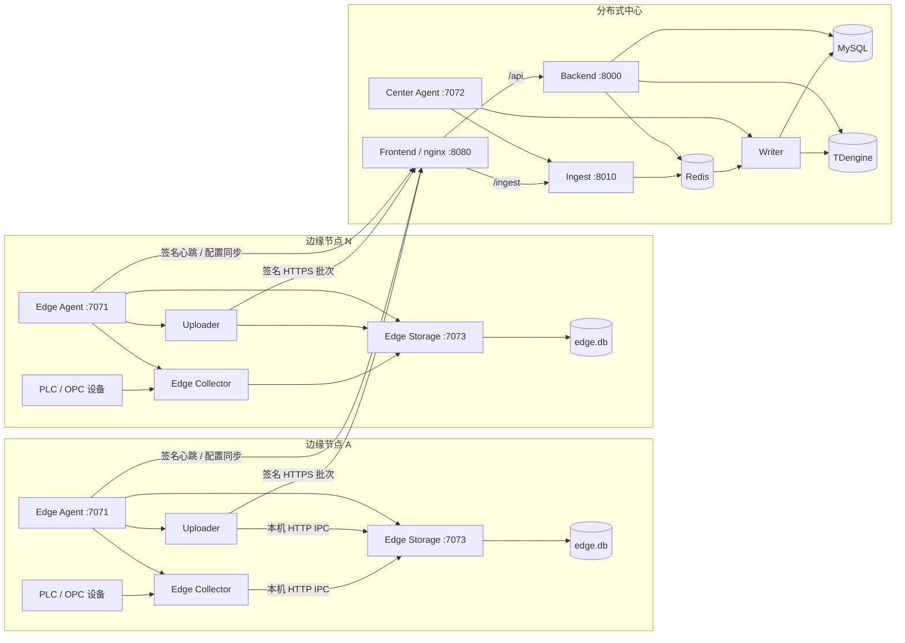
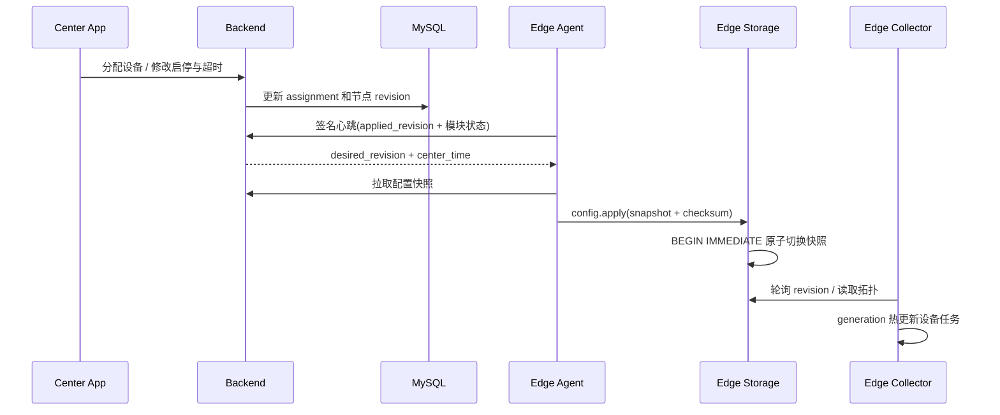
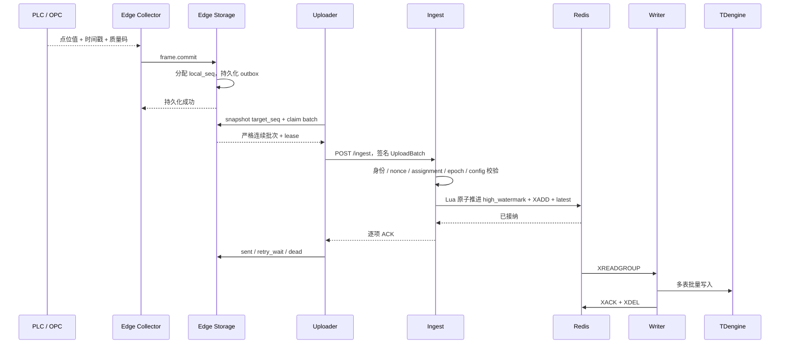
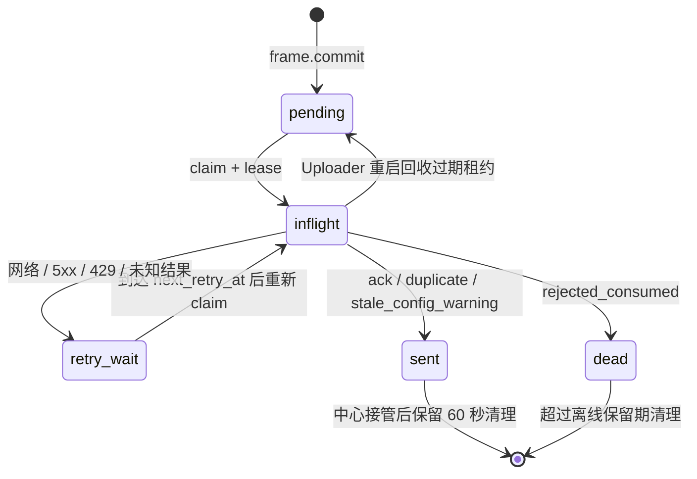

# 分布式系统技术架构

> 本文面向架构评审、技术交底、实施和后续演进，说明 DataWatch 分布式形态的现行技术架构、关键机制、工程创新点和能力边界。具体字段与错误码以《分布式部署架构方案》和《03-数据与契约》为准，模块实现细节以 `02-模块设计` 为准。
>
> 当前基线：2026-08-12。阶段 1 至阶段 4 的研发能力已经落地，当前进入目标机验收与试运行。工程创新点用于说明系统设计特色，不等同于已经完成专利新颖性检索或形成法律意义上的专利结论。

---

## 1. 建设目标

DataWatch 从单机中心式演进为“一个中心、多个边缘”的工业数据采集平台，同时保留原中心式部署。分布式改造需要同时满足：

- 采集靠近 PLC / OPC 设备，单台边缘故障不扩大到其他节点；
- 网络中断期间继续采集，恢复后自动补传；
- 中心统一维护设备、点位、用户、权限和历史数据；
- 边缘不暴露中心 Redis，不保存第二套业务账号；
- 中心式与分布式复用 Redis、Writer、TDengine 和业务查询链路；
- 同一代码仓库生成固定角色安装包，避免运行时误切换；
- 点位采集周期保持可配置，不用统一固定周期代替业务配置。

---

## 2. 部署形态与角色边界

系统由统一代码仓库构建三种 Windows 角色，中心 Docker 服务独立交付：

| 角色 | Windows 组件 | 外部依赖 | 数据入口 |
|------|--------------|----------|----------|
| 中心式 | App、Agent、Collector、Writer、OPC DA proxy | Backend、Frontend/nginx、MySQL、Redis、TDengine | Collector 直接写中心 Redis |
| 分布式边缘 | Edge App、Edge Agent、Storage、Edge Collector、Uploader、OPC DA proxy | 分布式中心统一 HTTP(S) 入口 | Collector 先写本机 Storage |
| 分布式中心 | Center App、Agent、Ingest、Writer | Backend、Frontend/nginx、MySQL、Redis、TDengine | Ingest 接收边缘批次后写 Redis |

三种 Windows 包都不包含 Docker 镜像、Compose、MySQL、Redis 或 TDengine。角色在构建时固定，安装后不提供中心/边缘切换开关。

---

## 3. 总体技术架构

### 3.1 物理架构



### 3.2 逻辑分层

| 层 | 组件 | 核心职责 |
|----|------|----------|
| 设备接入层 | Collector、协议驱动、OPC DA proxy | 周期调度、批读、解析、质量码、设备状态 |
| 边缘持久层 | Edge Storage、SQLite WAL | 配置快照、采集帧、最新值、outbox 状态和本地历史 |
| 可靠传输层 | Uploader、nginx、Ingest | 签名传输、严格顺序、幂等接纳、限流和逐项 ACK |
| 中心缓冲层 | Redis latest / stream / dlq | 实时态、入库队列、消费恢复与死信 |
| 历史存储层 | Writer、TDengine | 永久映射解码、多表批写、质量窄表和异常隔离 |
| 控制与查询层 | Backend、MySQL | 节点、设备、点位、权限、实时和历史统一查询 |
| 本机运维层 | Agent、App | 进程编排、首装、凭据、监控、日志和故障处置 |

---

## 4. 三条核心链路

### 4.1 控制面：中心配置下发到边缘



控制面采用双版本：

- 节点级 `desired_revision / applied_revision` 判断边缘是否需要拉取快照；
- 组级 `config_version` 随采集帧进入数据面供 Ingest 校验和 Writer 上下文使用；Writer 的物理映射来自按设备/分组的永久 `point_storage_mapping`，不按版本失效。

中心 MySQL 是设备、点位、assignment 和账号权限的唯一事实源。边缘 SQLite 是本节点可运行快照，不是第二个中心数据库。

### 4.2 数据面：设备数据进入中心历史库



关键语义：

- Collector 只有在 Storage 确认本地持久化后，才认为采集帧完成交接；
- Uploader 的 ACK 表示 Redis 已接纳，不表示 TDengine 已落盘；
- Writer 只有在 TDengine 成功落库或坏数据成功进入 DLQ 后才 XACK Stream，并在 ACK 成功后 XDEL 已终态条目；XDEL 失败只重试清理，不触发重复入库；
- 中心式与分布式从 Redis Stream 开始复用同一个 Writer 和 TDengine 写入模型。

### 4.3 查询面：中心优先、本地兜底

边缘 App 只展示分配给本节点的设备：

```text
正常联网
  Edge App -> Backend -> Redis latest / TDengine / MySQL

中心网络错误或 5xx
  Edge App -> Edge Agent -> edge.db 配置快照 / local_latest / outbox 历史

中心返回 401/403
  不回退本地，保持中心权限判定
```

该策略同时保证全局口径一致和断网现场可观测。边缘不维护第二套用户名密码；登录由 Edge Agent 校验中心 MySQL 中的用户和角色。

---

## 5. 关键技术架构

### 5.1 Edge Storage 单写者

Storage 是边缘包内的独立进程，默认只监听 `127.0.0.1:7073`。Collector、Uploader 和 Edge Agent 不再各自持有 SQLite 写连接，而是通过持久 HTTP 连接调用 Storage。

Storage 内部使用一个容量为 2048 的有界命令队列和一个专用写线程串行执行：

- 采集帧持久化与 `local_seq` 分配；
- 本机 latest 写入；
- outbox claim、租约、重试和终态更新；
- 配置快照切换与计划启停刷新；
- 设备通信状态更新与存储维护。

SQLite 仍启用 WAL、`synchronous=NORMAL` 和 `busy_timeout=5000`。单写者消除了 Collector 与 Uploader 跨进程争抢写锁的主路径，同时保留多个只读查询者；队列有界使压力可观测，避免无限堆积转化为内存故障。

### 5.2 SQLite-first 与 outbox 状态机

每条需要上传的采集帧在本机获得不可变的 `batch_id`、`upload_session_id` 和 `local_seq`。主要状态为：



租约由 `lease_owner`、`inflight_at`、`lease_until` 组成。Uploader 崩溃后，新实例回收不属于自己的或已过期的 inflight 记录。正常重试始终复用原三元组，不重新编号。

### 5.3 严格有序上传与会话围栏

Uploader 遵循“严格按序 + 单批次在途”：

1. 每个上传节拍读取 `target_seq=last_seq`；
2. 只 claim 当前 session 中不超过该水位的连续记录；
3. 当前批次得到明确结果后，才处理下一批；
4. 网络或 5xx 视为结果未知，使用原三元组重试；
5. 中心通过 `(node_uuid, upload_session_id)` 保存 `high_watermark`；
6. `seq == hw + 1` 才能推进，已接纳序号按 duplicate 收敛，越序请求拒绝。

当本地队列永久损坏、超过离线保留能力或发生不可修复序号空洞时，系统受控切换新的 `upload_session_id`，放弃旧积压并重新从 `local_seq=1` 开始。中心以 active session 围栏阻止旧 session 被随机 UUID 重新激活。

### 5.4 Ingest 原子接纳

Ingest 是独立进程，不承担业务查询和 TDengine 写入。单条 Lua 在 Redis 内原子完成：

- nonce 防重放；
- active session 与 high watermark 校验；
- 严格序号推进；
- Redis Stream 多字段 `XADD`；
- latest 按时间戳和 assignment epoch 防倒退更新；
- 批次变化事件发布和近似裁剪计数。

因此不会出现“已推进序号但未写 Stream”或“latest 已更新但 Stream 缺失”的半成功状态。第一阶段明确使用单实例 Redis；Redis Cluster 跨槽原子性需要后续独立设计。

### 5.5 永久点位映射与 Writer 复用

`point_storage_mapping` 冻结点位到 TDengine 的物理坐标，包含设备类型、稳定名、子表、组、列名和变量类型。历史 config version 仍可通过永久映射解码，避免旧离线数据因点位重命名或配置升级失去落库位置。

Ingest 写出的 Stream 字段与中心式 Collector 保持一致，Writer 不区分数据来自中心式 Collector 还是分布式 Ingest。这使分布式改造停在 Redis 之前，降低中心历史链路的分叉成本。

### 5.6 自适应节拍与慢设备隔离

- 点位 `scan_rate` 是首选采集周期；仅点位未设置时才使用设备默认周期；
- Uploader 取本节点已启用 assignment 中最小有效点位周期作为实时上传节拍；
- 不等待固定设备数，也不等待最慢设备形成同步屏障；
- 同一设备只允许一个读取请求在途，不同设备独立运行；
- `read_timeout_ms` 可选且独立于 `scan_rate`，未配置时沿用协议驱动默认。

采集频率、上传频率和控制面心跳频率是三个独立概念。现场最快点位为 100ms 时可按 100ms 上传；全部设备为 1s 时无需维持 100ms 空轮询上传。

### 5.7 节点身份与安全边界

- 首次注册生成稳定 `node_uuid` 和 Ed25519 密钥对；
- 私钥经 Windows DPAPI 加密，仅保存在节点；
- 请求签名覆盖 method、path、timestamp、nonce 和规范 JSON body hash；
- 中心校验节点批准状态、current/previous 公钥、时间窗和 nonce；
- 边缘不直连 Redis，中心 Redis 只对中心组件开放；
- Uploader 使用 OS/文件锁保证单实例，避免同一 session 双重发送；
- 密钥轮换保留 pending 状态，响应丢失后可复用同一候选密钥重试。

### 5.8 三角色构建隔离

统一源码在构建时注入 `VITE_DATAWATCH_ROLE` 和 Tauri identifier，安装器按角色裁剪二进制、页面、服务名、端口、安装目录和 ProgramData：

- 中心式 Agent：`127.0.0.1:7070`；
- Edge Agent：`127.0.0.1:7071`，Storage：`127.0.0.1:7073`；
- 分布式中心 Agent：`127.0.0.1:7072`，Ingest：`0.0.0.0:8010`。

安装、升级或卸载一个角色不应停止其他角色进程，也不应操作 Docker 容器、镜像或数据卷。

---

## 6. 工程创新点

| 创新点 | 传统做法中的问题 | DataWatch 的实现价值 |
|--------|------------------|----------------------|
| 多进程共享 SQLite 的单写者服务化 | 多个进程直接写同一 SQLite，锁等待与超时难以控制 | Storage 将所有写操作串行化并暴露队列深度、P99 和错误数，保持模块独立同时消除写锁竞争主路径 |
| SQLite-first + 中心严格序号的两级可靠性 | 直接上传受网络影响；普通重试可能重复或乱序 | 边缘先持久化，中心用 session + high watermark 原子收敛，实现断网不停采、恢复按序追赶 |
| 无逐消息去重键的有界幂等 | 每条消息一个 Redis 去重 key 会随数据量线性增长 | 每节点每 session 只维护 high watermark，以单批次在途换取常量级中心幂等状态 |
| 配置双版本与永久物理映射 | 配置升级后旧积压无法按新点位名称解码 | 节点 revision 管同步，组 config version 管数据，永久 mapping 保证历史离线帧仍可落库 |
| Redis 前路径可替换、Writer 后路径完全复用 | 分布式常另建一套中心入库链路，长期产生语义分叉 | Ingest 输出与 Collector 相同的 StreamEnvelope，中心式与分布式共享 Writer、DLQ 和 TDengine schema |
| 中心优先、本地兜底且不绕过鉴权 | 纯中心查询在断网时不可用；纯本地账号容易漂移 | 网络/5xx 才回退本机数据，401/403 不回退；账号只维护中心一套 |
| assignment epoch 严格时间窗 | 设备迁移期间两个边缘可能同时产生数据 | 旧 epoch 只接受切换点前数据，新 epoch 只接受切换点后数据，不把迁移字段扩散到 Writer/TDengine |
| 采集、存储、上传独立故障域 | 合并单进程虽减少 IPC，却使任一故障拖垮整条边缘链路 | 三进程由 Agent 独立管控；Storage 作为稳定持久化边界，Collector/Uploader 可分别重启 |
| 一库三包的角色固化 | 运行时模式开关会形成大量无效配置组合 | 共享实现降低维护成本，固定包和独立 AppId/服务/目录降低现场误装与相互覆盖风险 |

---

## 7. 一致性与可靠性边界

| 位置 | 一致性语义 | 明确边界 |
|------|------------|----------|
| Collector -> Storage | 本地持久化确认 | Storage 不可用时不得假装成功；队列满应显式报错 |
| Storage -> Uploader | lease + 严格顺序 | 同一 session 单批次在途，不提供任意并发乱序上传 |
| Uploader -> Ingest | 至少一次请求、幂等接纳 | 网络失败结果未知，必须原三元组重试 |
| Ingest -> Redis | Lua 原子接纳 | ACK 是 Redis 已接收，不是 TDengine 已落盘 |
| Redis -> Writer | consumer group + PEL | Writer 可重放，TDengine 写入按时间与表模型容忍重复 |
| Writer -> TDengine | LANDED/DLQ 才 ACK | Redis AOF everysec 仍存在约 1 秒基础设施持久化窗口 |
| 中心配置 -> 边缘 | checksum + 单事务快照 | 中心不可达时继续使用上一版已应用快照 |

---

## 8. 故障域与恢复策略

| 故障 | 影响范围 | 自动恢复 |
|------|----------|----------|
| 单台设备超时/断连 | 当前设备 | 同设备串行、重连退避；其他设备继续采集 |
| Collector 崩溃 | 停止产生新帧 | Storage 与 Uploader 可继续运行；Agent 可单独重启 Collector |
| Storage 崩溃 | 新帧无法持久化、Uploader 无法改状态 | Agent 先恢复 Storage；SQLite WAL 保留已提交数据 |
| Uploader 崩溃 | 积压增长 | 新实例回收租约并从原序号继续 |
| 边缘到中心断网 | 本节点积压增长 | Collector/Storage 继续工作，恢复后连续追赶 |
| nginx 统一入口停止 | 所有边缘心跳与上传失败 | `restart: unless-stopped` 可恢复非人为停止；运维需监控 8080 和容器状态 |
| Ingest 崩溃 | 所有边缘上传重试 | Redis/Writer 和已接纳数据不受影响；Agent 单独重启 Ingest |
| Redis/Writer/TDengine 故障 | 中心实时或历史链路降级 | Stream、PEL、重试和 DLQ 按所在层恢复 |

`Frontend/nginx :8080` 当前同时承载 Web 静态资源、Backend `/api` 和 Ingest `/ingest` 统一入口。停止该容器会同时导致 Web、边缘心跳和上传不可达，这是当前部署边界，不应把 Frontend 容器仅当作可随时关闭的展示层。

---

## 9. 性能模型与容量口径

设第 `i` 个边缘节点最快有效点位周期为 `p_i` 毫秒，则理想上传请求率上界近似为：

```text
edge_qps_i ≈ 1000 / p_i
center_qps ≈ Σ edge_qps_i
```

实际 QPS 会受“无数据不发空批”、设备响应时间、批次大小和离线追赶影响。以 100 个边缘、每节点最快周期 100ms 为例，稳态上界约为 1000 QPS，而不是按设备总数逐点发送请求。

当前共享机器已完成 1000 QPS 稳态基线；2000 QPS、5 分钟达到 1999.99 QPS 且零错误，但 HTTP P99 为 125.64ms，未达到 100ms 门槛。2000 QPS 的最终上线结论仍需独立压测机在目标中心资源上复核。

边缘侧还必须观察：

- Storage `writer_queue_depth / capacity`；
- `commit_p99_ms`、`errors_total`；
- outbox backlog、最老积压时间和数据库大小；
- 磁盘 70% / 85% / 95% 水位；
- Uploader ACK 速率、重试数和中心端 Ingest P99。

---

## 10. 当前限制与后续演进

- 第一阶段中心 Redis 为单实例；Cluster 跨槽 Lua 需要重新设计 key slot 与原子边界；
- Ingest 可多 worker，但多实例部署、统一限流和压测门禁仍需在目标环境验证；
- 中心统一入口当前依赖 Frontend/nginx 容器，后续可将 ingress 拆为独立基础服务，降低展示层运维动作对数据面的影响；
- 完全断网且 Edge Agent 登录会话已过期时，无法使用中心账号重新登录；
- outbox 超过离线保留期或磁盘溢出时采用“放弃旧积压并切换 session”，不承诺无限离线保存；
- 设备迁移依赖中心与边缘时钟偏差门禁，现场必须配置可靠时间同步；
- 2000 QPS、P99 小于 100ms 仍是目标环境上线门禁，不应由共享开发机结果替代。

---

## 11. 验证入口

| 目标 | 验证入口 |
|------|----------|
| Storage 单写者与状态机 | `edge/tests/test_storage_service.py`、`edge/tests/test_outbox.py` |
| Agent 三模块编排与本地监控 | `agent/tests/test_local_edge.py`、`agent/tests/test_viewer.py` |
| Ingest 协议、迁移和 Redis 原子接纳 | `ingest/tests/` |
| 中心节点状态与点位解析 | `backend/app/tests/test_device_activity.py`、`test_module_monitor_device_status.py`、`test_point_resolver.py` |
| 三角色页面与双数据源 | `app/tests/edge-role-pages.test.mjs`、`realtime-monitor.test.mjs`、`history-device-fidelity.test.mjs` |
| 容量门禁 | `04-运维部署/Ingest容量压测.md` |
| 安装与端到端 | `04-运维部署/三角色安装包验收清单.md` |

---

## 相关文档

- [分布式部署架构方案](分布式部署架构方案.md)
- [系统架构总览](系统架构总览.md)
- [架构决策记录](架构决策记录.md)
- [边缘运行时实现说明](../02-模块设计/edge/边缘运行时实现说明.md)
- [Central Ingest 实现说明](../02-模块设计/ingest/Central%20Ingest实现说明.md)
- [分布式节点控制面实现说明](../02-模块设计/backend/分布式节点控制面实现说明.md)
- [三角色安装包构建与隔离](../04-运维部署/三角色安装包构建与隔离.md)
- [三角色安装包验收清单](../04-运维部署/三角色安装包验收清单.md)
