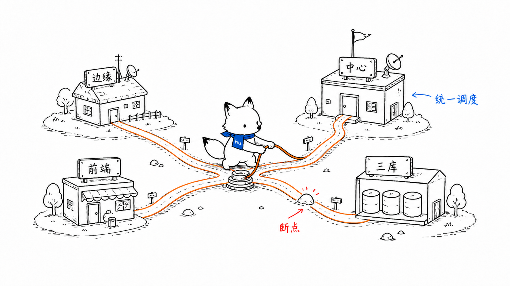
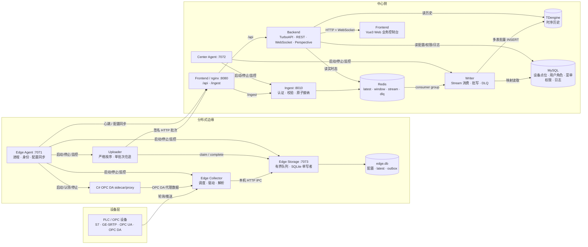
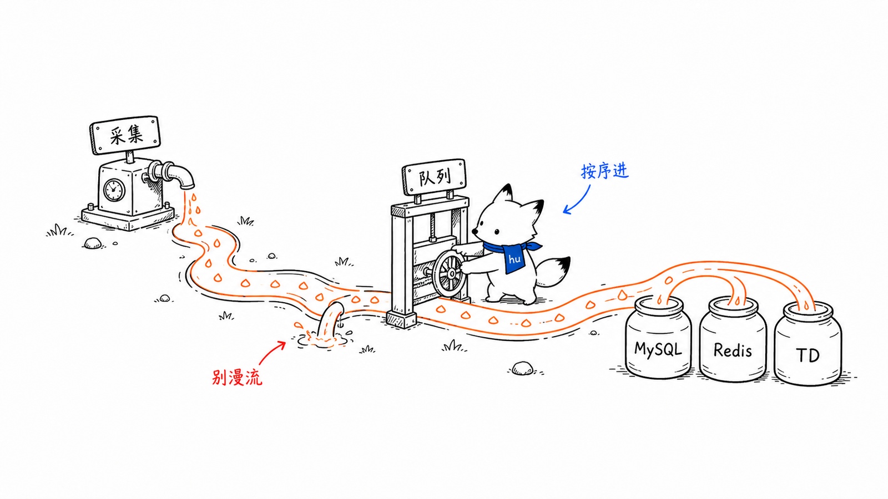
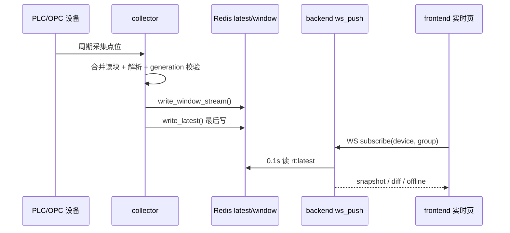
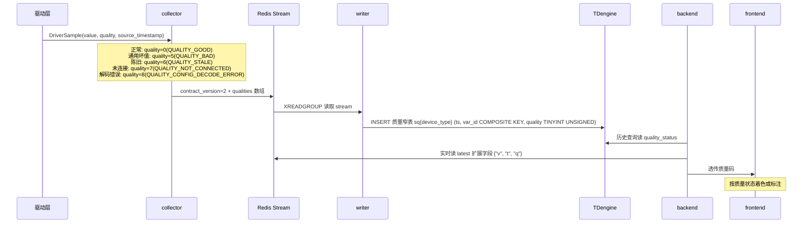

# 系统架构总览
<!-- xiaohu-illustration:architecture-overview-01-city -->


> 本文是 data_watch 文档体系的入口与全局地图。阅读本文可建立对整个平台的整体认知；各模块、数据契约、运维部署的细节，见文末「文档地图」指向的分篇。

---

## 1. 系统概述

data_watch 是面向自动化码头的**工业设备数据采集与监控平台**。它从现场 PLC / OPC 设备持续采集点位数据，经实时缓冲与异步入库后，对外提供实时监控、历史查询、设备与点位管理、用户与权限管理、系统日志与边缘进程管控等能力。

系统在物理上分为两侧：

- **边缘侧**：贴近现场设备运行，负责采集、本地持久化、可靠上传、本机进程管控、OPC DA 代理编排与首装配置。
- **中心侧**：负责数据存储、业务服务、Web 可视化、认证授权与统一查询。
- **运维终端**：通过桌面端 app 对接本机 agent 与中心 backend，完成首装、启停、状态观测与日志排查。

核心诉求是在**高频采集**（数百台设备、百毫秒级扫描）的压力下，做到采集不被入库拖垮、入库失败可恢复、实时页面低延迟、历史查询可控、部署现场可运维。

---

## 2. 设计背景与约束

| 约束 | 对架构的影响 |
|------|--------------|
| 自动化码头设备类型多、协议多 | collector 做协议驱动抽象，S7 / GE SRTP / OPC UA / OPC DA / HTTP Push 分流处理 |
| 目标规模高，存在 305 台设备、100ms 级扫描的容量语境 | 采集调度要错峰、有界背压；入库要批写；实时读取不能直接压 TDengine |
| PLC / OPC 连接可能慢、抖动、断连 | 设备级连接管理、熔断、重连、同设备单 in-flight，避免一台设备拖垮全局 |
| TDengine 写入可能抖动或局部坏数据失败 | collector 不直写 TDengine；writer 通过 Redis Stream + PEL + DLQ 恢复 |
| OPC DA 依赖 Windows COM / 32 位生态 | 通过 C# x86 sidecar/proxy 隔离，Python 主链路不直接加载 COM |
| Windows 节点需要固定角色交付、凭据不明文散落 | 构建时固化中心式/分布式边缘/分布式中心角色；agent 按角色管理本机进程并用 DPAPI 保护敏感配置 |
| Web 业务与现场运维是两类用户 | frontend 面向业务控制台；app 面向边缘运维与进程管控 |

这些约束决定了系统不是单体 Web 应用，而是一个多进程、分层解耦的数据采集平台：**MySQL 管配置，Redis 扛实时与队列，TDengine 存历史，backend 统一供数，agent 管边缘运行时**。

---

## 3. 总体架构

系统采用**分层 + 消息解耦 + 边缘持久化 + 中心统一入库**架构。中心式由 Collector 直接写 Redis；分布式边缘由 Collector 经 Edge Storage 先写 SQLite outbox，再由 Uploader 通过 Ingest 进入同一 Redis 契约。两种形态从 Redis Stream 开始复用 Writer 和 TDengine。



> 关键解耦点：分布式边缘以 Storage 的本地持久化确认为交接边界，中心以 Redis 为 Ingest 与 Writer 的交接边界。Collector、Storage、Uploader、Ingest 和 Writer 均可独立重启，已完成交接的数据由所在持久层继续保留。

---

## 4. 模块构成与职责

| 模块 | 角色 | 主要职责 | 技术栈 |
|------|------|----------|--------|
| `collector` | 采集端 | 中心式从 MySQL 加载拓扑并写 Redis；分布式边缘从 Storage/SQLite 快照加载拓扑并提交采集帧 | 单进程部署；free-threaded Python 3.14t；asyncio + 有界线程池；S7/GE-SRTP/OPC UA/OPC DA |
| `edge/storage` | 边缘持久层 | 作为 SQLite 唯一写者，处理配置快照、local latest、outbox、上传状态与设备状态 | Python；localhost HTTP IPC；有界队列；专用写线程；SQLite WAL |
| `edge/uploader` | 边缘上传端 | 严格按序领取 outbox，签名上传 Ingest，按逐项 ACK 更新状态 | Python；httpx 持久连接；Ed25519；单实例锁 |
| `ingest` | 中心汇聚端 | 验证节点和业务契约，以 Redis Lua 原子完成去重、Stream 和 latest 写入 | Python；ASGI；MySQL 控制面缓存；Redis Lua |
| `writer` | 入库端 | 消费 Redis Stream，按 MySQL 映射转 TDengine 列，批量入库，失败重试或进 DLQ | Python；Redis consumer group；TDengine；MySQL |
| `backend` | 中心后端 | 统一 REST / WebSocket 服务，实时读 Redis，历史读 TDengine，配置/权限读 MySQL | Python；TurboAPI；SQLAlchemy；Redis asyncio；Perspective |
| `agent` | Windows 本机代理 | 按构建角色管理 collector+writer、storage+edge-collector+uploader 或 ingest+writer；按需管理 OPC DA proxy，提供 bootstrap/local/viewer/admin API | Python；FastAPI；psutil；DPAPI；NSSM |
| `app` | 桌面监控端 | 面向运维，首装配置、进程启停、状态指标、日志查看 | Tauri + React/TS + Rust HTTP proxy |
| `frontend` | Web 业务端 | 面向业务用户，设备/点位、实时监控、历史查询、日志、系统管理 | Vue3 + TypeScript + Pinia + Element Plus |
| `deploy` / `installer` | 部署运维 | 独立中心 Docker 发布、nginx 代理、可选离线镜像包、三个纯 Windows 角色安装包 | Docker Compose / nginx / Inno Setup / PowerShell |

> 系统含**两套前端**：`frontend` 是面向业务用户的 Web 控制台；`app` 是面向运维的桌面端，侧重边缘首装、进程管控、模块指标和日志。

---

## 5. 端到端主数据流
<!-- xiaohu-illustration:architecture-overview-02-river -->


### 5.1 配置流：MySQL 是拓扑事实源

```text
backend / 初始化脚本 / 管理页面
  -> 写 MySQL device / device_variable / device_point_group / comm_protocol
  -> collector ConfigDBManager 加载设备与点位
  -> DeviceManager 创建驱动与 ScanTask
  -> writer MysqlMapper 读取 var_id -> td_column_name 映射
```

- collector 本地 TOML 只保留运行参数；设备和变量拓扑以 MySQL 为准。
- writer 从 MySQL 动态发现 `(device_type, group_code)` 对应的 Redis Stream 范围，不靠固定 `stable_names` 配置。
- writer 以 `(device_code, group_code)` 缓存永久 `point_storage_mapping`；`device_point_group.config_version` 仅随消息进入数据面作上下文，热缓存遇到新点位时运行期 reload。

### 5.2 采集到实时上屏



**latest 最后写**是实时链路的一致性关键：只有 window/stream 已写成功后才刷新 latest，避免前端看到新值但入库流缺失。

### 5.3 采集到历史入库


writer 的可靠性原则是：**已落库才 ACK，已成功进入 DLQ 的坏数据才 ACK，其余全部保留重试**。

### 5.4 历史查询与 Perspective

```text
frontend 历史页
  -> backend HistoryService
  -> MySQL 查询设备/点位元数据
  -> TDengine 查询 device_data.<device_code> 的 td_column_name 列
  -> REST 返回原始/降采样/矩阵数据
  -> 可选 Perspective WebSocket 推送 snapshot 给大表/图表运行时
```

Perspective Table 只是 backend 内存中的临时分析副本；历史事实源仍是 TDengine。

### 5.5 质量码端到端传递

从 v0.1.0 起，系统支持 **质量码（Quality Codes）** 全链路透传，用于标记数据点的质量状态（正常/不确定/坏值）：



**关键设计**：

- **驱动层**：`DriverSample` 携带 `quality`（平台质量码）与 `protocol_quality`（协议原始质量，仅诊断）。平台码是**冻结常量**：`0 QUALITY_GOOD`、`2 QUALITY_UNCERTAIN`、`5 QUALITY_BAD`、`6 QUALITY_STALE`、`7 QUALITY_NOT_CONNECTED`、`8 QUALITY_CONFIG_DECODE_ERROR`，另有保留码 `1/3/4`；定义在 `collector/core/quality_codes.py`，与 writer、backend 三处同值。驱动读取失败时返回 `quality=<坏质量>` + `value=None`（可见但不伪造值），而不是抛异常；"本轮无新样本"用 `MISSING_RESULT` 哨兵表达，**不要**用裸 `None`。
- **Redis Stream v2 契约**：`contract_version=2` 引入 `qualities` 数组（与 `values` 一一对应）。**缺 `qualities`（含 v1）不会补 `0`（GOOD）**：writer 的质量行数 = `qualities` 条目数（`writer/consumer.py` 的 `quality_rows_count += sum(len(row.qualities))`），因此 **v1 不产生任何质量行**；契约层 `validate_envelope` 还规定 `contract_version=1` **不得**携带 `qualities`（带则报错），且版本只接受 1/2（其它值报错）。
- **TDengine 入库**：writer 将 `qualities` 数组写入**质量窄表** `sq{device_type}`（schema: `ts, var_id COMPOSITE KEY, quality`），与值宽表 `sd{device_type}` 平行存储。窄表每行一个点位质量，避免宽表列数爆炸（3072 个点位 × 2 列 = 6144 列超 TDengine 4096 列上限）。
- **实时/历史查询**：backend 从 Redis `latest` 读实时值的 `q` 字段、从 TDengine 质量窄表读历史质量码，透传给前端；前端根据质量码用颜色/图标区分数据状态。

质量码的引入使系统能**区分"数值为 0"与"读取失败"**，为设备诊断、数据审计和故障定位提供关键依据。详见 `02-模块设计/collector/README.md § 4.2 质量码体系`。

---

## 6. 异常路径与故障域

| 故障 | 隔离/恢复设计 | 用户可见表现 |
|------|---------------|--------------|
| 单台 PLC 断连 | DeviceManager 设备级熔断、指数退避重连；同设备单 in-flight 防并发堆积 | 实时页该设备可能 offline，其他设备不受影响 |
| PLC 读池饱和 | 读取前拒绝该周期，避免事件循环阻塞 | 指标出现 skipped/saturated，后续周期恢复 |
| 解析池/Redis 池饱和 | 等待槽位并向采集任务施加背压，不丢已读样本 | 监控 wait_count、采集延迟和池 pending |
| collector 热更新期间旧任务迟到 | generation/tombstone 校验贯穿读写，旧代次数据不写 Redis | 避免旧配置污染新配置 |
| Redis 写 window/stream 失败 | latest 不刷新；本批不会被误判为完整实时态 | 实时页不会看到“只 latest 成功”的假新值 |
| writer 崩溃或重启 | Redis PEL 保留未 ACK 消息，启动 drain pending，XAUTOCLAIM 重认领 | 可能重复写，但不丢消息 |
| TDengine 连接失败 | writer 将批次标 RETRY，退避重连，不 ACK | Stream pending 增长，模块监控可见 backlog |
| 单条坏数据导致 SQL 失败 | TDengineWriter 对白名单数据错误二分隔离，坏行进 DLQ，好行照常落库 | DLQ 增长，需要人工排查具体点位/载荷 |
| ACK 失败 | writer 记录 pending ACK，下一轮先补偿 ACK 再 drain pending | 避免已落库消息被重复重认领 |
| backend Redis 不可用 | MonitorService 返回 degraded 标志，区分“无数据”和“Redis 故障” | 实时页提示降级/不可用 |
| WebSocket 断开 | 前端指数退避重连，页面可见性恢复时重连 | 短暂断流后恢复 snapshot/diff |
| agent 重启 | 重新加载 config，认领仍存活 OPC DA proxy，基于 PID+create_time 校验受管进程 | app 重新连接后可继续观测/管控 |
| Edge Storage 崩溃或队列饱和 | Collector 不确认未持久化帧；Uploader 保留已提交积压；Agent 独立恢复 Storage | 存储监控显示异常，恢复后继续原 outbox |
| Uploader 或边缘网络中断 | SQLite outbox 持续积压；原 session/seq 不变 | 本机采集继续，联网后严格按序追赶 |
| Ingest 崩溃 | Uploader 按原三元组重试；已接纳 Stream 不受影响 | 所有边缘上传暂时重试，中心 Writer 继续处理已有数据 |
| Frontend/nginx 容器停止 | 统一入口 8080 消失，Web、心跳和上传同时不可达 | 边缘显示中心离线并积压；恢复容器后自动追赶 |

---

## 7. 部署拓扑与边界

### 7.1 中心镜像部署

中心侧可用镜像部署 backend + frontend，并可选择用 compose 的 `infra` profile 托管 MySQL / Redis / TDengine：

```text
deploy/docker-compose.yml
  mysql      -> data-watch-mysql      127.0.0.1:3306   (profile: infra)
  redis      -> data-watch-redis      127.0.0.1:6379   (profile: infra)
  tdengine   -> data-watch-tdengine   127.0.0.1:6041   (profile: infra)
  backend    -> data-watch-backend    :8000
  frontend   -> data-watch-frontend   :8080 -> nginx -> backend / host Ingest
```

- `backend/Dockerfile` 基于 `data-watch-python314t:latest`，使用 free-threaded Python 3.14t，复制 TDengine `libtaos.so`，以 uvicorn 暴露 8000。
- `frontend/Dockerfile` 使用 Node 22 构建 Vite 静态文件，再由 nginx 1.27 托管。
- `deploy/nginx.conf` 将 `/api/` 和实时 WebSocket 反代到 Backend，将 `/ingest` 反代到宿主机 Ingest 8010，并对其他路径回退 `index.html`。因此该容器也是分布式统一入口，不只是静态页面。
- `deploy/data-watch-images.zip` 保存离线镜像包，适合现场无公网环境导入；发布时解包到发布根的 `docker-images\` 目录，仓库内没有 `deploy/images/` 目录。

### 7.2 Windows 三角色部署

统一代码仓库由 Inno 构建三个固定角色包，均不包含 Docker 镜像：

```text
centralized             -> App + Agent(:7070) + Collector + Writer + OPC DA proxy
edge                    -> Edge App + Agent(:7071) + Storage(:7073) + Edge Collector + Uploader + OPC DA proxy
distributed-center      -> Center App + Agent(:7072) + Ingest + Writer
DATAWATCH_INSTALL_ROOT  -> 只读安装根，按角色放对应可执行文件
DATAWATCH_DATA_ROOT     -> 可写数据根，按角色隔离 config / runtime / logs
```

agent 是本机进程编排入口：中心式和分布式中心按需解密数据库凭据并注入子进程；分布式边缘先启动 Storage，再管理配置同步、Edge Collector 和 Uploader，不保存中心数据库密码。

---

## 8. 为什么这样拆模块

| 拆分 | 设计理由 |
|------|----------|
| collector / writer 分离 | 采集是实时 I/O，入库是批量存储；用 Redis 解耦后，TDengine 抖动不会直接阻塞 PLC 采集 |
| Edge Storage 独立单写者 | 保留 Collector/Uploader 独立故障域，同时消除两个进程直接写同一 SQLite 的锁竞争主路径 |
| backend 不直接参与采集入库 | backend 面向查询与管理，避免业务请求与高频采集/入库抢资源 |
| agent 独立于 app | agent 必须常驻且可作为 Windows 服务；app 可退出、升级或重启，不影响边缘进程 |
| Web frontend 与桌面 app 分离 | Web 承载业务管理，桌面承载现场运维；权限、交互和部署边界不同 |
| MySQL / Redis / TDengine 分工 | MySQL 强关系与权限，Redis 低延迟实时态与队列，TDengine 高吞吐时序历史 |
| OPC DA sidecar 独立 | 32 位 COM 环境与 64 位 Python/主流程隔离，降低稳定性和部署风险 |

---

## 9. 非功能需求与验证口径

| 维度 | 设计口径 | 验证入口 |
|------|----------|----------|
| 吞吐 | collector 错峰调度、有界池；writer 多表批写、按 SQL 字节预算分块 | collector/writer 性能日志、module-monitor/rates、压测脚本 |
| 可靠性 | 边缘 SQLite-first + lease；中心 Redis Stream + PEL + XAUTOCLAIM；LANDED/DLQ 才 ACK | Storage/outbox、Uploader ACK、writer pending、DLQ、TDengine 行数与日志 |
| 实时性 | backend 0.1s 轮询 Redis latest 推 diff；前端增量合并 | 实时页 snapshot/diff 延迟、Redis latest 时间戳 |
| 可恢复 | agent 管进程，shutdown flag 优雅停机；writer pending drain | app 模块状态、runtime 日志、XINFO GROUPS |
| 安全 | backend JWT/RBAC；agent DPAPI；敏感配置不落多处明文 | 登录/权限测试、config.toml、环境变量注入检查 |
| 可部署 | 中心 Docker 发布 + 三个纯 Windows 角色包；离线镜像包与 EXE 分离 | compose 启动、三角色 Setup.exe、bootstrap 测连 |

---

## 10. 关键设计决策（摘要）

以下为影响全局的架构性决策摘要，详细背景与权衡见《01-总体设计/架构决策记录》：

- **采集与入库经 Redis 解耦**：削峰填谷、互不阻塞，单侧故障不扩散。
- **Redis latest/window/stream/dlq 四类结构**：分别服务实时最新值、短窗口、历史入库队列和死信排查。
- **collector 采用自由线程 Python 3.14t**：collector 仍是单进程部署，但通过 asyncio + 有界线程池显式并行 PLC 读、解析与 Redis 写等阶段，在多设备阻塞 I/O 与解析场景下提升多核利用空间；依赖必须兼容 free-threaded。
- **writer 多表批写 + 二分降级**：兼顾吞吐、坏行隔离与消息仍在 Stream/PEL 时的终态可靠性；上游 Stream 裁剪、AOF/卷故障和边缘有损切换另按部署策略处理。
- **TDengine 宽表模型只增不减**：列名以 `td_column_name` 为准，简化 schema 演进与配置版本降级。
- **Agent 作为边缘中枢**：进程、凭据、OPC DA proxy、bootstrap 均由 agent 统一编排。
- **双前端分工**：Web 服务业务，桌面服务运维。
- **Docker 与 Windows 角色包分轨交付**：Backend/Frontend/数据库容器独立部署，中心式、分布式边缘、分布式中心由三个固定 Windows 安装包交付。
- **Edge Storage 单写者**：边缘多个进程通过 localhost IPC 使用同一持久化服务，SQLite 写操作有界串行，模块仍可独立重启。

---

## 11. 文档地图

| 主题 | 文档 |
|------|------|
| 分布式技术架构 | `01-总体设计/分布式系统技术架构.md` |
| 模块设计 | `02-模块设计/`：collector · edge/storage/uploader · ingest · writer · backend · agent · app · frontend |
| 模块细节拆分 | `02-模块设计/*-*.md`：调用链、可靠性、页面权限、进程编排等深水区 |
| 数据与契约 | `03-数据与契约/`：数据库设计 · Redis 流与点位分组 · API 契约 · WebSocket 协议 |
| 架构决策 | `01-总体设计/架构决策记录.md` |
| 运维部署 | `04-运维部署/README.md` |
| 历史文档 | `_archive/`：旧版设计/联调/过程文档，仅供追溯，不作为现行依据 |

> 注：本文以当前代码与部署文件为事实源；旧文档用于补充背景和设计思路，凡与当前代码冲突的旧口径不迁入现行文档。
