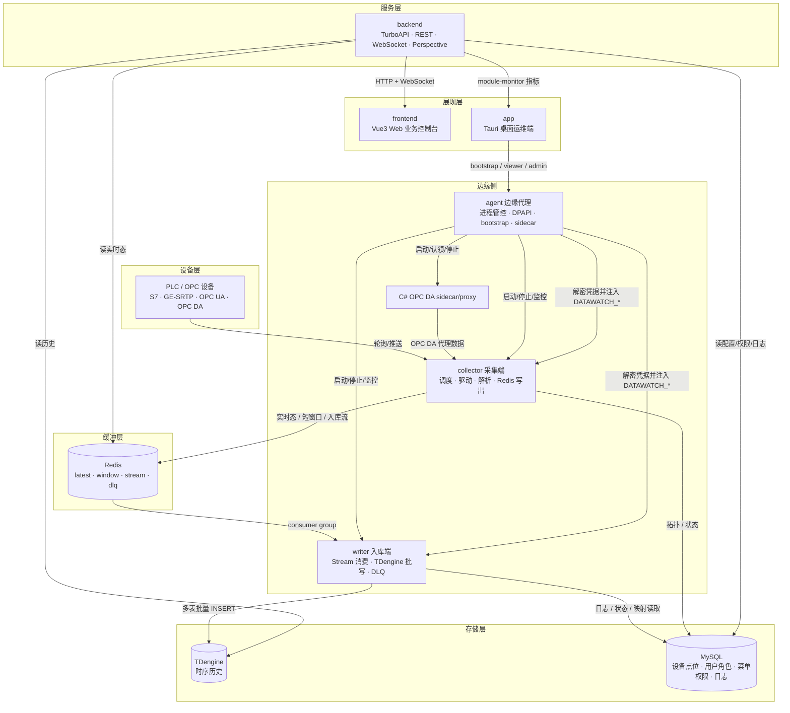
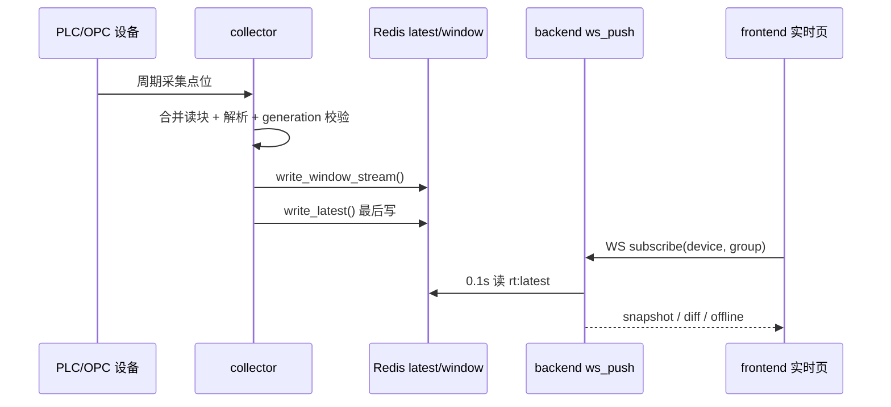
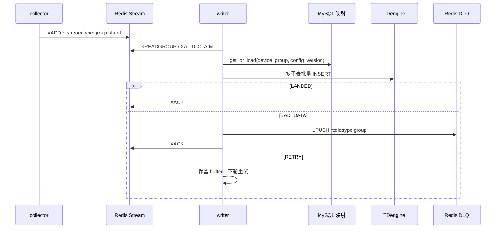

# 系统架构总览
<!-- xiaohu-illustration:architecture-overview-01-city -->


> 本文是 data_watch 文档体系的入口与全局地图。阅读本文可建立对整个平台的整体认知；各模块、数据契约、运维部署的细节，见文末「文档地图」指向的分篇。

---

## 1. 系统概述

data_watch 是面向自动化码头的**工业设备数据采集与监控平台**。它从现场 PLC / OPC 设备持续采集点位数据，经实时缓冲与异步入库后，对外提供实时监控、历史查询、设备与点位管理、用户与权限管理、系统日志与边缘进程管控等能力。

系统在物理上分为两侧：

- **边缘侧**：贴近现场设备运行，负责采集、入库、本机进程管控、OPC DA 代理编排与首装配置。
- **中心侧**：负责数据存储、业务服务、Web 可视化、认证授权与统一查询。
- **运维终端**：通过桌面端 app 对接本机 agent 与中心 backend，完成首装、启停、状态观测与日志排查。

核心诉求是在**高频采集**（数百台设备、百毫秒级扫描）的压力下，做到采集不被入库拖垮、入库失败可恢复、实时页面低延迟、历史查询可控、部署现场可运维。

---

## 2. 设计背景与约束

| 约束 | 对架构的影响 |
|------|--------------|
| 自动化码头设备类型多、协议多 | collector 做协议驱动抽象，S7 / GE SRTP / OPC UA / OPC DA / HTTP Push 分流处理 |
| 目标规模高，存在 305 台设备、100ms 级扫描的容量语境 | 采集调度要错峰、有界背压；入库要批写；实时读取不能直接压 TDengine |
| PLC / OPC 连接可能慢、抖动、断连 | 设备级连接管理、熔断、重连、同设备单 in-flight，避免一台设备拖垮全局 |
| TDengine 写入可能抖动或局部坏数据失败 | collector 不直写 TDengine；writer 通过 Redis Stream + PEL + DLQ 恢复 |
| OPC DA 依赖 Windows COM / 32 位生态 | 通过 C# x86 sidecar/proxy 隔离，Python 主链路不直接加载 COM |
| 现场部署需要一包多机、凭据不明文散落 | agent 作为边缘凭据单一来源，DPAPI 加密后运行时注入 collector/writer |
| Web 业务与现场运维是两类用户 | frontend 面向业务控制台；app 面向边缘运维与进程管控 |

这些约束决定了系统不是单体 Web 应用，而是一个多进程、分层解耦的数据采集平台：**MySQL 管配置，Redis 扛实时与队列，TDengine 存历史，backend 统一供数，agent 管边缘运行时**。

---

## 3. 总体架构

系统采用**分层 + 消息解耦 + 边缘管控**的架构：采集层与入库层之间以 Redis 解耦，互不阻塞；服务层统一对接存储，向两类前端供数；边缘侧由 agent 统一管理进程、凭据和 OPC DA sidecar。



> 关键解耦点：`collector` 与 `writer` 之间**没有代码级调用关系**，完全通过 Redis 传递数据。任一侧的抖动或重启都不会直接拖垮另一侧。

---

## 4. 模块构成与职责

| 模块 | 角色 | 主要职责 | 技术栈 |
|------|------|----------|--------|
| `collector` | 采集端 | 从 MySQL 加载拓扑，按周期采集 PLC/OPC 点位，解析后写 Redis latest/window/stream | 单进程部署；free-threaded Python 3.14t；asyncio + 有界线程池；S7/GE-SRTP/OPC UA/OPC DA；C# sidecar 由 agent 外部管理 |
| `writer` | 入库端 | 消费 Redis Stream，按 MySQL 映射转 TDengine 列，批量入库，失败重试或进 DLQ | Python；Redis consumer group；TDengine；MySQL |
| `backend` | 中心后端 | 统一 REST / WebSocket 服务，实时读 Redis，历史读 TDengine，配置/权限读 MySQL | Python；TurboAPI；SQLAlchemy；Redis asyncio；Perspective |
| `agent` | 边缘代理 | Windows 服务常驻，管理 collector/writer/OPC DA proxy，DPAPI 保存并注入凭据，提供 bootstrap/viewer/admin API | Python；FastAPI；psutil；DPAPI；NSSM |
| `app` | 桌面监控端 | 面向运维，首装配置、进程启停、状态指标、日志查看 | Tauri + React/TS + Rust HTTP proxy |
| `frontend` | Web 业务端 | 面向业务用户，设备/点位、实时监控、历史查询、日志、系统管理 | Vue3 + TypeScript + Pinia + Element Plus |
| `deploy` / `installer` | 部署运维 | 中心镜像编排、nginx 代理、离线镜像包、Windows 一体安装包 | Docker Compose / nginx / Inno Setup / PowerShell |

> 系统含**两套前端**：`frontend` 是面向业务用户的 Web 控制台；`app` 是面向运维的桌面端，侧重边缘首装、进程管控、模块指标和日志。

---

## 5. 端到端主数据流
<!-- xiaohu-illustration:architecture-overview-02-river -->


### 5.1 配置流：MySQL 是拓扑事实源

```text
backend / 初始化脚本 / 管理页面
  -> 写 MySQL device / device_variable / device_point_group / comm_protocol
  -> collector ConfigDBManager 加载设备与点位
  -> DeviceManager 创建驱动与 ScanTask
  -> writer MysqlMapper 读取 var_id -> td_column_name 映射
```

- collector 本地 TOML 只保留运行参数；设备和变量拓扑以 MySQL 为准。
- writer 从 MySQL 动态发现 `(device_type, group_code)` 对应的 Redis Stream 范围，不靠固定 `stable_names` 配置。
- `device_point_group.config_version` 是 writer 映射缓存失效依据。

### 5.2 采集到实时上屏



**latest 最后写**是实时链路的一致性关键：只有 window/stream 已写成功后才刷新 latest，避免前端看到新值但入库流缺失。

### 5.3 采集到历史入库



writer 的可靠性原则是：**已落库才 ACK，已成功进入 DLQ 的坏数据才 ACK，其余全部保留重试**。

### 5.4 历史查询与 Perspective

```text
frontend 历史页
  -> backend HistoryService
  -> MySQL 查询设备/点位元数据
  -> TDengine 查询 device_data.<device_code> 的 td_column_name 列
  -> REST 返回原始/降采样/矩阵数据
  -> 可选 Perspective WebSocket 推送 snapshot 给大表/图表运行时
```

Perspective Table 只是 backend 内存中的临时分析副本；历史事实源仍是 TDengine。

---

## 6. 异常路径与故障域

| 故障 | 隔离/恢复设计 | 用户可见表现 |
|------|---------------|--------------|
| 单台 PLC 断连 | DeviceManager 设备级熔断、指数退避重连；同设备单 in-flight 防并发堆积 | 实时页该设备可能 offline，其他设备不受影响 |
| PLC 读池/解析池/Redis 池饱和 | BoundedExecutor 抛饱和异常，丢本周期而不是无限排队 | 指标中出现 skipped/saturated，后续周期恢复 |
| collector 热更新期间旧任务迟到 | generation/tombstone 校验贯穿读写，旧代次数据不写 Redis | 避免旧配置污染新配置 |
| Redis 写 window/stream 失败 | latest 不刷新；本批不会被误判为完整实时态 | 实时页不会看到“只 latest 成功”的假新值 |
| writer 崩溃或重启 | Redis PEL 保留未 ACK 消息，启动 drain pending，XAUTOCLAIM 重认领 | 可能重复写，但不丢消息 |
| TDengine 连接失败 | writer 将批次标 RETRY，退避重连，不 ACK | Stream pending 增长，模块监控可见 backlog |
| 单条坏数据导致 SQL 失败 | TDengineWriter 对白名单数据错误二分隔离，坏行进 DLQ，好行照常落库 | DLQ 增长，需要人工排查具体点位/载荷 |
| ACK 失败 | writer 记录 pending ACK，下一轮先补偿 ACK 再 drain pending | 避免已落库消息被重复重认领 |
| backend Redis 不可用 | MonitorService 返回 degraded 标志，区分“无数据”和“Redis 故障” | 实时页提示降级/不可用 |
| WebSocket 断开 | 前端指数退避重连，页面可见性恢复时重连 | 短暂断流后恢复 snapshot/diff |
| agent 重启 | 重新加载 config，认领仍存活 OPC DA proxy，基于 PID+create_time 校验受管进程 | app 重新连接后可继续观测/管控 |

---

## 7. 部署拓扑与边界

### 7.1 中心镜像部署

中心侧可用镜像部署 backend + frontend，并可选择用 compose 托管 Redis / TDengine：

```text
deploy/docker-compose.yml
  redis      -> data-watch-redis      :6379
  tdengine   -> data-watch-tdengine   :6030/:6041/:6043/:6062
  backend    -> data-watch-backend    :8000
  frontend   -> data-watch-frontend   :8080 -> nginx -> backend
```

- `backend/Dockerfile` 基于 `data-watch-python314t:latest`，使用 free-threaded Python 3.14t，复制 TDengine `libtaos.so`，以 uvicorn 暴露 8000。
- `frontend/Dockerfile` 使用 Node 22 构建 Vite 静态文件，再由 nginx 1.27 托管。
- `deploy/nginx.conf` 将 `/api/` 和 `/api/device-monitor/ws/` 反代到 backend，并对非 API 路径回退 `index.html`。
- `deploy/images/` 与 `deploy/data-watch-images.zip` 保存离线镜像包，适合现场无公网环境导入。

### 7.2 边缘 Windows 部署

边缘侧走 Inno 一体安装包，包含 app、agent、collector、writer、OPC DA proxy 与必要静态依赖：

```text
DATAWATCH_INSTALL_ROOT  -> 只读安装根，放 app / agent / collector / writer / proxy 可执行文件
DATAWATCH_DATA_ROOT     -> 可写数据根，默认 C:\ProgramData\DataWatch，放 config.toml / runtime / logs
agent Windows Service   -> 127.0.0.1:7070，NSSM 常驻
app                     -> 连接 agent 做 bootstrap/管控，连接 backend 看指标
```

agent 是边缘侧生产凭据单一来源：DB 密码用 DPAPI 加密保存，启动 collector/writer 时解密成 `DATAWATCH_<DB>_<FIELD>` 环境变量注入。

---

## 8. 为什么这样拆模块

| 拆分 | 设计理由 |
|------|----------|
| collector / writer 分离 | 采集是实时 I/O，入库是批量存储；用 Redis 解耦后，TDengine 抖动不会直接阻塞 PLC 采集 |
| backend 不直接参与采集入库 | backend 面向查询与管理，避免业务请求与高频采集/入库抢资源 |
| agent 独立于 app | agent 必须常驻且可作为 Windows 服务；app 可退出、升级或重启，不影响边缘进程 |
| Web frontend 与桌面 app 分离 | Web 承载业务管理，桌面承载现场运维；权限、交互和部署边界不同 |
| MySQL / Redis / TDengine 分工 | MySQL 强关系与权限，Redis 低延迟实时态与队列，TDengine 高吞吐时序历史 |
| OPC DA sidecar 独立 | 32 位 COM 环境与 64 位 Python/主流程隔离，降低稳定性和部署风险 |

---

## 9. 非功能需求与验证口径

| 维度 | 设计口径 | 验证入口 |
|------|----------|----------|
| 吞吐 | collector 错峰调度、有界池；writer 多表批写、按 SQL 字节预算分块 | collector/writer 性能日志、module-monitor/rates、压测脚本 |
| 可靠性 | Redis Stream + PEL + XAUTOCLAIM；LANDED/DLQ 才 ACK | writer pending、DLQ、TDengine 行数与日志 |
| 实时性 | backend 0.1s 轮询 Redis latest 推 diff；前端增量合并 | 实时页 snapshot/diff 延迟、Redis latest 时间戳 |
| 可恢复 | agent 管进程，shutdown flag 优雅停机；writer pending drain | app 模块状态、runtime 日志、XINFO GROUPS |
| 安全 | backend JWT/RBAC；agent DPAPI；敏感配置不落多处明文 | 登录/权限测试、config.toml、环境变量注入检查 |
| 可部署 | 中心镜像部署 + 边缘 Inno 安装包；离线镜像包支持无公网现场 | compose 启动、Setup.exe、bootstrap 测连 |

---

## 10. 关键设计决策（摘要）

以下为影响全局的架构性决策摘要，详细背景与权衡见《01-总体设计/架构决策记录》：

- **采集与入库经 Redis 解耦**：削峰填谷、互不阻塞，单侧故障不扩散。
- **Redis latest/window/stream/dlq 四类结构**：分别服务实时最新值、短窗口、历史入库队列和死信排查。
- **collector 采用自由线程 Python 3.14t**：collector 仍是单进程部署，但通过 asyncio + 有界线程池显式并行 PLC 读、解析与 Redis 写等阶段，在多设备阻塞 I/O 与解析场景下提升多核利用空间；依赖必须兼容 free-threaded。
- **writer 多表批写 + 二分降级**：兼顾吞吐、坏行隔离与不丢数据。
- **TDengine 宽表模型只增不减**：列名以 `td_column_name` 为准，简化 schema 演进与配置版本降级。
- **Agent 作为边缘中枢**：进程、凭据、OPC DA proxy、bootstrap 均由 agent 统一编排。
- **双前端分工**：Web 服务业务，桌面服务运维。
- **中心支持镜像部署，边缘支持 Windows 一体安装包**：分别适配中心服务器与现场 Windows 工控机。

---

## 11. 文档地图

| 主题 | 文档 |
|------|------|
| 模块设计 | `02-模块设计/`：collector · writer · backend · agent · app · frontend |
| 模块细节拆分 | `02-模块设计/*-*.md`：调用链、可靠性、页面权限、进程编排等深水区 |
| 数据与契约 | `03-数据与契约/`：数据库设计 · Redis 流与点位分组 · API 契约 · WebSocket 协议 |
| 架构决策 | `01-总体设计/架构决策记录.md` |
| 运维部署 | `05-运维部署/README.md` |
| 历史文档 | `_archive/`：旧版设计/联调/过程文档，仅供追溯，不作为现行依据 |

> 注：本文以当前代码与部署文件为事实源；旧文档用于补充背景和设计思路，凡与当前代码冲突的旧口径不迁入现行文档。
