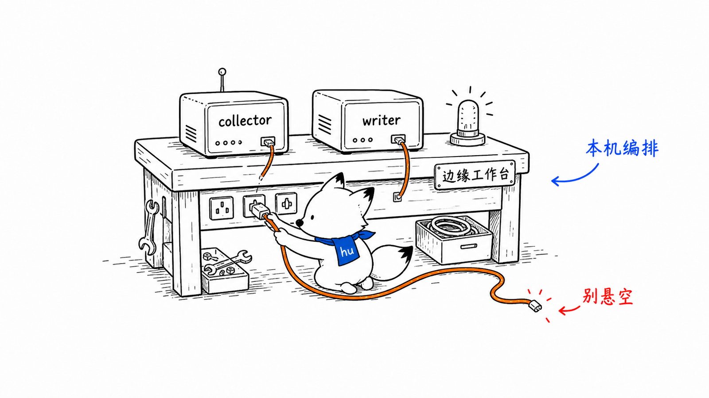
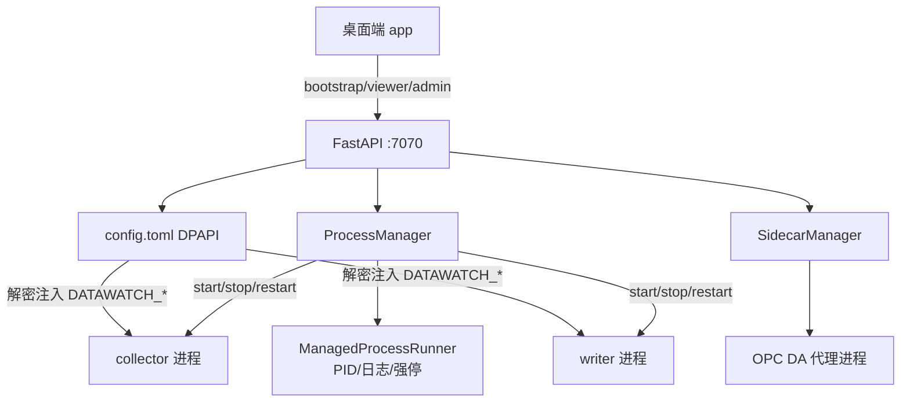
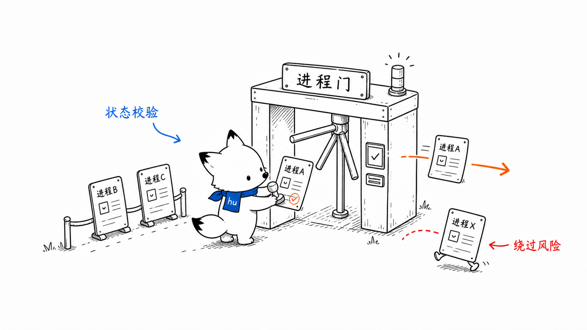
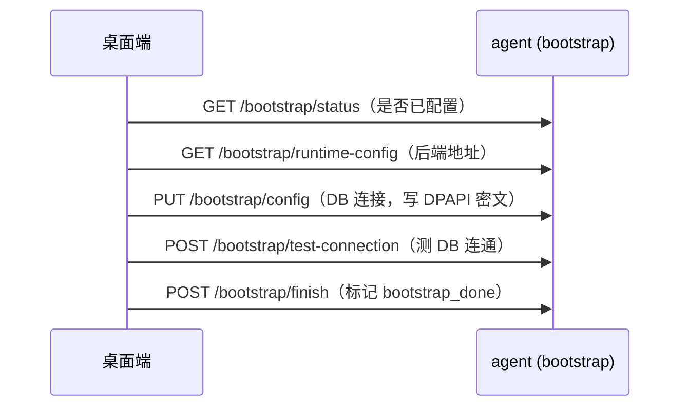
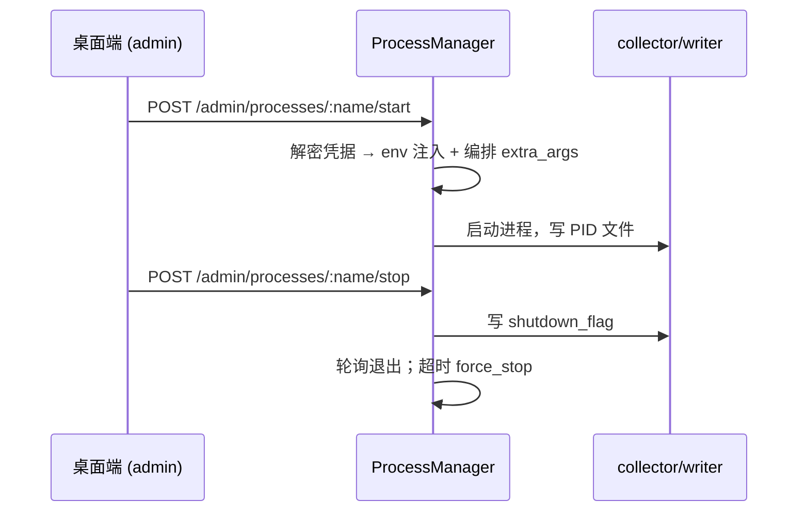

# Windows 本机代理 agent 设计文档
<!-- xiaohu-illustration:agent-readme-01-workbench -->


> agent 是三个 Windows 固定角色共用的本机中枢，以角色独立的 Windows 服务常驻：中心式管理 Collector/Writer，分布式边缘管理 Edge Collector/Uploader，分布式中心管理 Ingest/Writer；只有包含 Collector 的角色管理 OPC DA proxy。
>
> 本文原有的 `collector/writer`、`:7070` 和数据库 DPAPI 章节描述中心式基线。分布式边缘差异见 [边缘运行时实现说明](../edge/边缘运行时实现说明.md)，分布式中心使用端口 7072；三角色完整边界见 [三角色安装包构建与隔离](../../04-运维部署/三角色安装包构建与隔离.md)。

---

## 1. 概述

agent 是一个基于 **FastAPI** 的本机 HTTP 服务，以 Windows 服务方式开机自启；中心式、分布式边缘、分布式中心分别监听 `127.0.0.1:7070`、`:7071`、`:7072`。其公共职责与角色特定职责包括：

- **进程管控**：启动/停止/重启 collector 与 writer，监控其存活、CPU、内存；
- **边车管理**：管理 OPC DA 代理（sidecar）进程，认领重启前存活的代理；
- **凭据保管**：用 Windows DPAPI 加密保存数据库口令，运行时解密并注入子进程；
- **首装引导**：通过 bootstrap 接口完成首次配置（DB 连接、后端地址等）。

注意：agent 用 FastAPI，与 backend 的 TurboAPI 是两个不同的 Python 服务，职责与端口均不同。

入口：`agent/app/factory.py:108`（`create_app()`）；Windows 服务封装见 `agent/service/install_service.py`。

---

## 2. 设计目标与范围

| 目标 | 实现要点 |
|------|----------|
| 本机进程可管可控 | ProcessManager：start/stop/restart/status + 健康循环 |
| 优雅停机 | 写 `shutdown_flag` 文件让子进程自退，超时才强杀 |
| 凭据不落明文 | DPAPI 加密存 `password_enc`，运行时解密注入 |
| 部署位置解耦 | install_root（只读）/ data_root（可写）双根，环境变量覆盖 |
| 首装零绑定 | 后端地址、DB 连接运行期录入，不打包进二进制 |
| 桌面端可观测可管控 | viewer（只读）/ admin（写）分层接口 |

**不在本模块范围**：实际采集与入库逻辑（collector/writer 自身）、中心数据服务（backend）。

---

## 3. 核心概念与术语

| 术语 | 含义 |
|------|------|
| **三层接口** | bootstrap（首装）/ viewer（只读观测）/ admin（写操作与管控），按权限分层 |
| **install_root / data_root** | 只读安装根（exe）/ 可写数据根（config.toml、运行目录），双根解耦 |
| **config.toml** | agent 的 DPAPI 配置，落 data_root（默认 `C:\ProgramData\DataWatch`） |
| **password_enc** | DB 口令的 DPAPI 密文；运行时解密注入子进程 |
| **shutdown_flag** | agent 写给子进程的优雅停机信号文件 |
| **ManagedProcessRunner** | 进程监管内核：PID 文件、日志重定向、存活校验、强停 |
| **sidecar / proxy** | OPC DA 代理进程，center 采集经其远程取数 |

---

## 4. 架构与目录结构

```
agent/
├── app/
│   ├── factory.py            # create_app + lifespan 装配（FastAPI）
│   ├── routers/              # bootstrap / auth / viewer / admin 接口
│   ├── services/
│   │   ├── process_manager.py        # collector/writer 进程管控
│   │   ├── managed_process_runner.py # 进程监管内核（PID/日志/强停）
│   │   ├── sidecar_manager.py        # OPC DA 代理管理
│   │   ├── opcda_detect.py           # OPC DA 探测
│   │   ├── health_checker.py         # 健康检查
│   │   └── log_manager.py            # 子进程日志 tail
│   ├── core/                # config(DPAPI 双根) / security(JWT+DPAPI) / deps / exceptions
│   └── schemas/models.py    # 请求/响应模型
└── service/install_service.py  # Windows 服务注册/运行
```

组件协作：



---

## 5. 关键组件

### 5.1 应用装配与生命周期

`agent/app/factory.py`。`create_app()` 创建 FastAPI 应用，注册异常处理器与四个路由（bootstrap/auth/viewer/admin）。`lifespan` 启动时：加载 config → 按 `module_paths` 解析 collector/writer 的 exe 与工作目录 → 构建 ProcessManager / LogManager / SidecarManager → **认领重启前仍存活的代理**（`claim_existing_proxies`）→ 启动健康检查循环；关闭时按序停子进程、detach 日志、取消健康任务。

### 5.2 ProcessManager（进程管控）

`agent/app/services/process_manager.py`。管控 collector/writer：

- **start**（`process_manager.py:142`）：校验未在运行（PID 文件 + 存活校验）后，用 `spec.args + extra_args` 启动；`extra_args`（如 `--config`/`--port-mapping`）由 agent 运行期编排拼入、不写回 config。
- **stop**（`process_manager.py:200`）：写 `shutdown_flag` 让子进程优雅退出，轮询超时后 `force_stop`。
- **restart**：stop + start，并原子递增持久化 `restart_count`（`state/process_state.json`）。
- **status**：基于 PID 文件与 `verify_alive` 返回 running/stopped/crashed。
- **health_check_loop**（`process_manager.py:345`，2s）：崩溃检测 + CPU 采样。**CPU 归一化**：`cpu_percent / 逻辑核数`，换算为占整机 0–100%（`_sample_cpu` `process_manager.py:319`，复用同一 psutil.Process 对象做增量）。

进程监管的底层机制（PID 文件、日志重定向、launch、强停）委托 `ManagedProcessRunner`。

### 5.3 SidecarManager（OPC DA 代理）

`agent/app/services/sidecar_manager.py`。管理 center 采集所需的 OPC DA 代理进程：按 collector 的 settings 路径与 MySQL 配置拉起代理，生成端口映射（供 collector 以权威只读方式消费），并在 agent 重启后认领仍存活的代理，避免重复拉起。

### 5.4 配置与路径契约（DPAPI 双根）

`agent/app/core/config.py`。

- **双根**：`install_root()`（只读，exe 所在）与 `data_root()`（可写，config.toml 与运行目录），均优先取环境变量 `DATAWATCH_INSTALL_ROOT` / `DATAWATCH_DATA_ROOT`（由安装器/NSSM 注入），缺失时按 frozen/dev 推导。
- **config.toml** 落 `data_root`（默认 `C:\ProgramData\DataWatch`），原子写（tmp + fsync + replace）。
- **module_paths**：exe 在 `install_root/<name>/`，工作目录在 `data_root/<name>`——config.toml 不存绝对路径，按目标机动态派生。
- **DPAPI 凭据**：redis/mysql/tdengine 三段口令以 `password_enc`（DPAPI 密文）保存，`apply_db_patch`（`config.py:98`）做增量更新（无 password 键保留原值、空串报错、非空则加密）。

### 5.5 安全与凭据下发

`agent/app/core/security.py` 提供 DPAPI 加解密与 JWT。在中心式基线中，agent 是本机 DB 凭据的**单一来源**：运行时解密 `password_enc`，经 `DATAWATCH_<DB>_<FIELD>` 环境变量注入 collector/writer 进程（`start(env=...)`），子进程据此连接数据库（见《采集-collector》《入库-writer》的 env 覆盖）。

---

## 6. 主要流程
<!-- xiaohu-illustration:agent-readme-02-door -->


### 6.1 首次安装引导（bootstrap）



### 6.2 子进程启停



---

## 7. 对外接口与契约

按权限分三层（路径来自调用图中桌面端→agent 的真实调用）：

| 层 | 接口 | 用途 |
|----|------|------|
| bootstrap | `/bootstrap/status`、`/runtime-config`、`/config`、`/test-connection`、`/finish` | 首次安装配置向导 |
| viewer（只读） | `/viewer/status`、`/viewer/health`、`/viewer/processes/:name/status`、`/metrics` | 运行状态与指标观测 |
| admin（写） | `/admin/processes/:name/start\|stop\|restart`、`/admin/config`、`/admin/health/check` | 进程管控与配置变更 |
| auth | `/auth/login` | 登录获取令牌 |

其他契约：写 `runtime/<name>.shutdown_flag` 控制子进程停机；生成端口映射文件供 collector 只读消费；经环境变量向子进程注入解密后的 DB 连接。

---

## 8. 配置说明

`config.toml`（落 data_root，DPAPI 加密）默认结构（`config.py:123`）：

- `[agent]`：host/port（默认 7070）、jwt_secret、jwt_expire_hours、bootstrap_done、log_level、runtime_dir；
- `[redis]`/`[mysql]`/`[tdengine]`：host/port/user/database + `password_enc`；
- `[backend]`：base_url（明文，桌面端经 `/bootstrap/runtime-config` 读取）；
- `[collector]`/`[writer]`：args 等运行参数。

环境变量：`DATAWATCH_INSTALL_ROOT`、`DATAWATCH_DATA_ROOT`（安装器/NSSM 注入）。详见《05-运维部署》。

---

## 9. 设计决策与权衡

| 决策 | 理由 / 权衡 |
|------|-------------|
| 双根路径契约 | 只读 exe 与可写数据分离，适配 Program Files 只读 + ProgramData 可写 |
| DPAPI 加密凭据 | 口令不落明文，绑定本机/账户；代价是迁移需重新加密 |
| 凭据单一来源 + env 注入 | collector/writer 不各自存库密码，避免配置漂移 |
| shutdown_flag 优雅停 | 让子进程自行收尾（drain），超时才强杀 |
| CPU 归一整机口径 | 与任务管理器一致，避免多核下 >100% 误读 |
| 代理认领 | agent 重启不重复拉起仍存活的 OPC DA 代理 |
| 后端地址运行期录入 | 二进制不绑定部署环境，一包多机 |

---

## 10. 已知问题与技术债

> 仅记录，供后续评估。

- **bootstrap 目标机实测待真机**：首装在真实目标机 + OPC 硬件环境下的端到端验证尚未完成（不可单元化）。
- **单机 agent**：每个 Windows 角色实例只有一个本机 agent，按构建角色管控对应进程；无跨机进程编排。
- **DPAPI 绑定本机/账户**：迁移机器或更换服务账户后，`password_enc` 需重新配置。

---

## 11. 扩展方式

- **新增受管模块**：在 `_MODULE_NAMES` 与 `module_paths` 的 `_MODULE_EXE` 注册模块名与 exe，并在 lifespan 的 modules 装配中加入 `ModuleSpec`。
- **新增接口**：在 `app/routers/` 下按层（viewer 只读 / admin 写）新增路由，复用 `core/security` 的鉴权依赖。
- **扩展凭据/配置项**：在 `config.py` 的默认结构与 `apply_db_patch` 中处理新字段，敏感项走 DPAPI。

---

## 相关文档

- 《01-总体设计/系统架构总览》
- 《02-模块设计/采集-collector》《入库-writer》（被管控对象）
- 《02-模块设计/agent-边缘进程编排与凭据》（bootstrap、DPAPI、env 注入、shutdown flag、OPC DA proxy）
- 《02-模块设计/桌面端-app》（agent 的主要调用方）
- 《05-运维部署》（双根路径、安装与 NSSM 注册）
