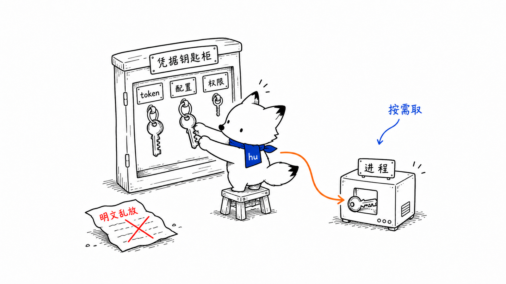
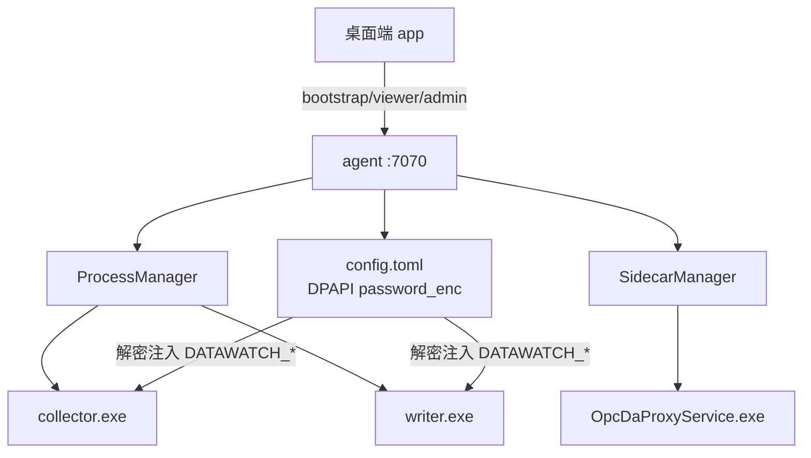
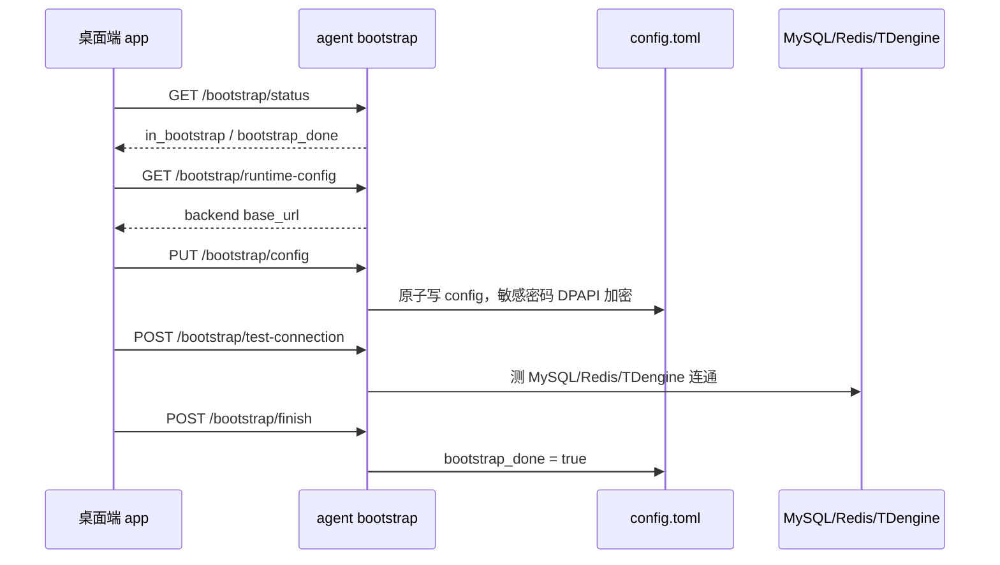
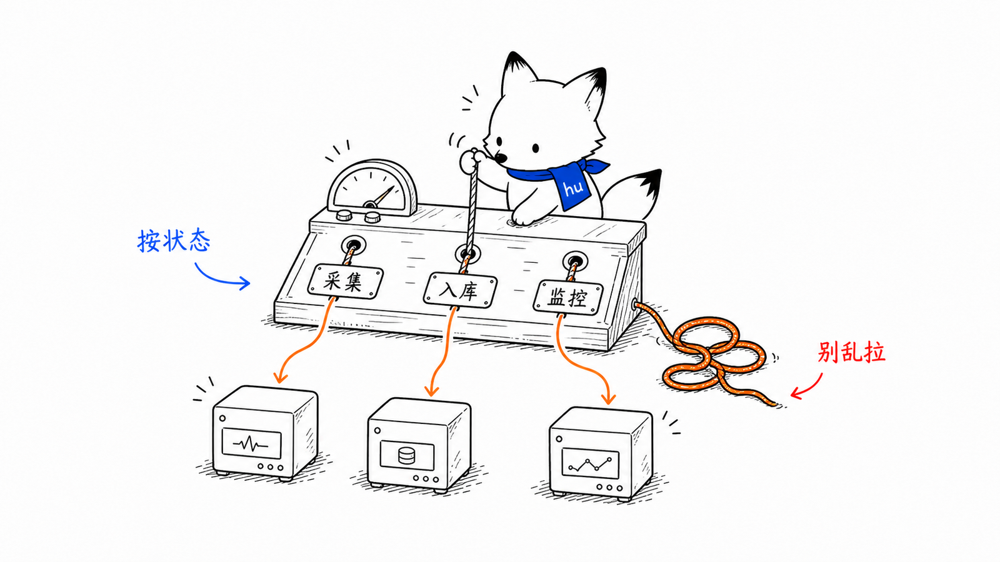
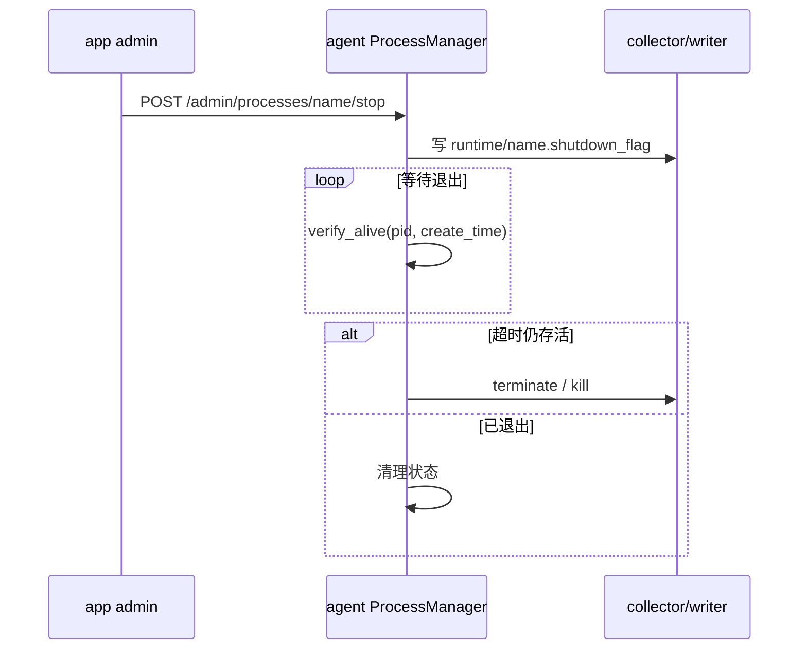
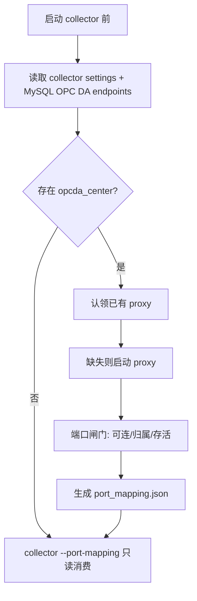

# agent 中心式进程编排与凭据
<!-- xiaohu-illustration:agent-credential-01-keys -->


> 本文保留中心式角色的深度流程：bootstrap、DPAPI 数据库凭据、Collector/Writer 管控、shutdown flag、OPC DA proxy 和日志指标。分布式边缘不带 Writer，使用 Storage + Edge Collector + SQLite outbox + Uploader，见 [边缘运行时实现说明](../edge/边缘运行时实现说明.md)；分布式中心使用 Ingest + Writer。

---

## 1. agent 的边缘定位

agent 是边缘机上唯一长期常驻的控制面进程，默认监听：

```text
http://127.0.0.1:7070
```

它不采集点位、不写 TDengine、不提供业务 Web 页面。它的职责是让边缘侧的其他进程“可配置、可启动、可停止、可观测、可恢复”。



---

## 2. 双根路径契约

边缘 Windows 机上，安装文件和运行数据必须分离：

| 路径 | 用途 | 默认/来源 |
|------|------|-----------|
| `install_root` | 只读安装根，放 exe、资源、proxy | `DATAWATCH_INSTALL_ROOT` 或 frozen/dev 推导 |
| `data_root` | 可写数据根，放 config、runtime、日志、状态 | `DATAWATCH_DATA_ROOT`，默认 `C:\ProgramData\DataWatch` |

典型结构：

```text
install_root/
  agent/data-watch-agent.exe
  collector/data-watch-collector.exe
  writer/data-watch-writer.exe
  opcda/OpcDaProxyService.exe
  app/DataWatch Console.exe

data_root/
  config.toml
  runtime/
    collector.pid
    writer.pid
    collector.shutdown_flag
    port_mapping.json
  collector/
  writer/
  logs/
```

设计理由：

- Program Files 通常只读，不适合写 config/log/runtime。
- ProgramData 可写，适合服务账户和普通运维流程。
- config 不保存绝对 exe 路径，目标机安装目录变化时仍可运行。

---

## 3. bootstrap 首装流程



bootstrap 的目的不是启动采集，而是把目标机运行所需配置写成安全、可复用的本机配置。完成后 app 才进入登录与运维页面。

---

## 4. DPAPI 凭据模型

agent `config.toml` 中三类数据库口令不保存明文：

```toml
[mysql]
host = "..."
port = 3306
user = "..."
database = "device_watch"
password_enc = "<DPAPI ciphertext>"

[redis]
password_enc = "..."

[tdengine]
password_enc = "..."
```

更新规则：

- 请求中无 `password` 字段：保留原密文；
- `password` 为空串：拒绝，避免误清空；
- `password` 非空：用 DPAPI 加密成 `password_enc`；
- 写文件采用 tmp + fsync + replace，避免半写配置。

DPAPI 密文绑定本机/账户，复制到另一台机器或换服务账户后不可解密，需要重新 bootstrap 或重新保存密码。

---

## 5. 凭据注入子进程

collector/writer 不各自保存生产 DB 密码。agent 启动它们时解密配置并注入环境变量：

```text
DATAWATCH_MYSQL_HOST
DATAWATCH_MYSQL_PORT
DATAWATCH_MYSQL_USER
DATAWATCH_MYSQL_PASSWORD
DATAWATCH_MYSQL_DATABASE

DATAWATCH_REDIS_HOST
DATAWATCH_REDIS_PORT
DATAWATCH_REDIS_PASSWORD
DATAWATCH_REDIS_DB

DATAWATCH_TDENGINE_HOST
DATAWATCH_TDENGINE_PORT
DATAWATCH_TDENGINE_USER
DATAWATCH_TDENGINE_PASSWORD
DATAWATCH_TDENGINE_DATABASE
```

collector/writer 启动时用这些环境变量覆盖本地 settings.toml。这样做到：

- 生产凭据只有 agent 明文持有瞬时内存；
- settings.toml 可作为开发回退，不承载生产秘密；
- 修改凭据只需更新 agent config，不需要修改多个模块文件。

---

## 6. 进程启动链路
<!-- xiaohu-illustration:agent-credential-02-conductor -->


```text
POST /admin/processes/{name}/start
  -> 鉴权与模块名校验
  -> ProcessManager.start(name)
       -> verify_alive(pid + create_time)
       -> 组装 ModuleSpec(args, cwd, env)
       -> collector 额外拼 --config / --runtime-dir / --port-mapping
       -> writer 额外拼 --config / --runtime-dir
       -> ManagedProcessRunner.launch()
            -> stdout/stderr 重定向
            -> 写 PID 文件
            -> CREATE_NO_WINDOW
       -> verify_alive()
```

PID 文件必须包含 `pid + create_time`。只看 pid 不安全，因为 Windows 可能复用 pid；加入 create_time 可避免误杀新进程。

---

## 7. 优雅停机协议



优雅停机优先级高于强杀：

- collector 需要停调度、drain 有界池、断设备连接；
- writer 需要 flush buffer、处理 ACK、释放连接；
- 只有超时未退出才强制终止。

---

## 8. OPC DA proxy 编排

OPC DA center 采集需要 agent、proxy、collector 三方协作。



关键设计：

- **粘性端口映射**：同一 endpoint 尽量复用旧端口，减少配置漂移。
- **agent 重启认领**：agent 自身重启后不重复拉起仍存活的 proxy。
- **端口归属校验**：端口可连还不够，要确认监听进程属于被管理 proxy 子树。
- **collector 只读映射**：collector 不自己起 proxy，避免职责混乱。

---

## 9. viewer/admin 接口边界

| 层 | 语义 | 示例 |
|----|------|------|
| `bootstrap` | 首装未完成前的配置向导 | `/bootstrap/status`、`/bootstrap/config`、`/bootstrap/finish` |
| `viewer` | 只读观测，不改变运行状态 | `/viewer/status`、`/viewer/health`、`/viewer/processes/{name}/metrics` |
| `admin` | 写操作和进程管控 | `/admin/processes/{name}/start`、`/admin/config` |
| `auth` | 登录获取 agent token | `/auth/login` |

前端隐藏按钮不是安全边界。涉及启动、停止、改配置的操作必须走 admin 层鉴权。

---

## 10. 日志与指标

agent 提供两类观测：

- **进程指标**：running/stopped/crashed、pid、restart_count、CPU、内存；CPU 已归一化为整机 0–100% 口径。
- **日志 tail**：读取 agent 管理的 stdout/stderr 日志文件，供桌面端实时日志面板展示。

注意：collector/writer 是单进程 exe，外部 sidecar 由 agent 单独管理，不算它们的子进程内存；不要把 `children(recursive=True)` 求和写成当前指标口径。collector 虽然是单进程部署，但内部有 asyncio 与多个线程池，CPU 指标应按整个主进程采样并归一到整机 0–100%。

---

## 相关文档

- [Windows 本机代理 agent](README.md)
- [桌面端 app 控制台设计](../app/控制台页面与双数据源.md)
- [采集 collector](../collector/README.md)
- [入库 writer](../writer/README.md)
- [运维部署](../../04-运维部署/README.md)
