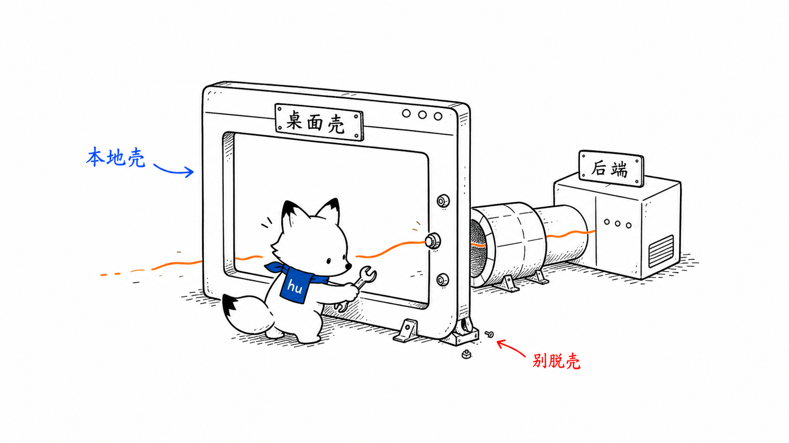
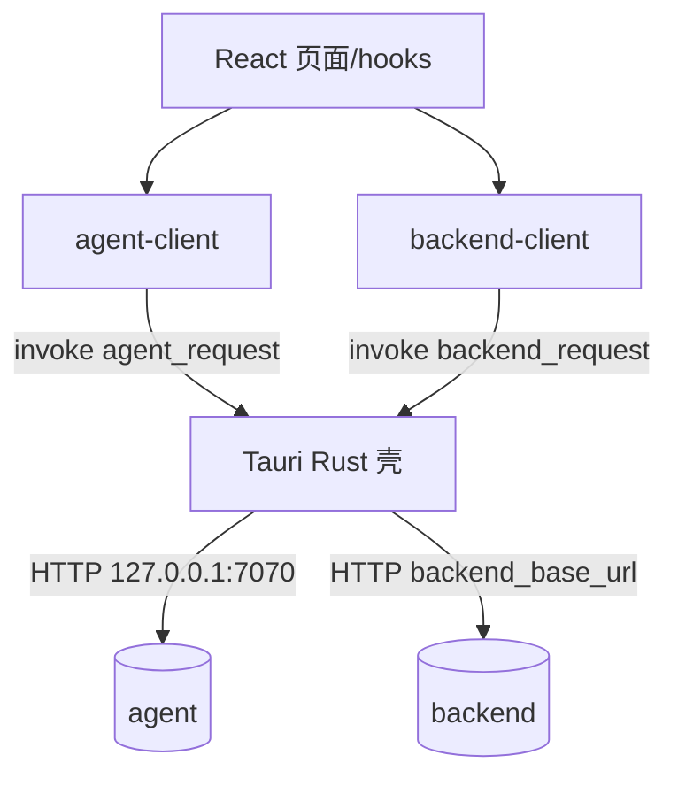
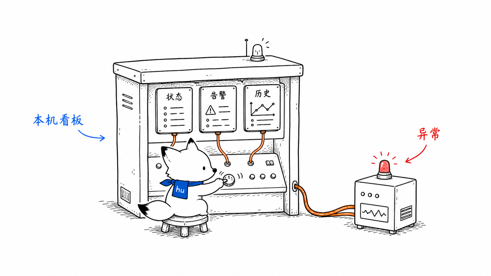
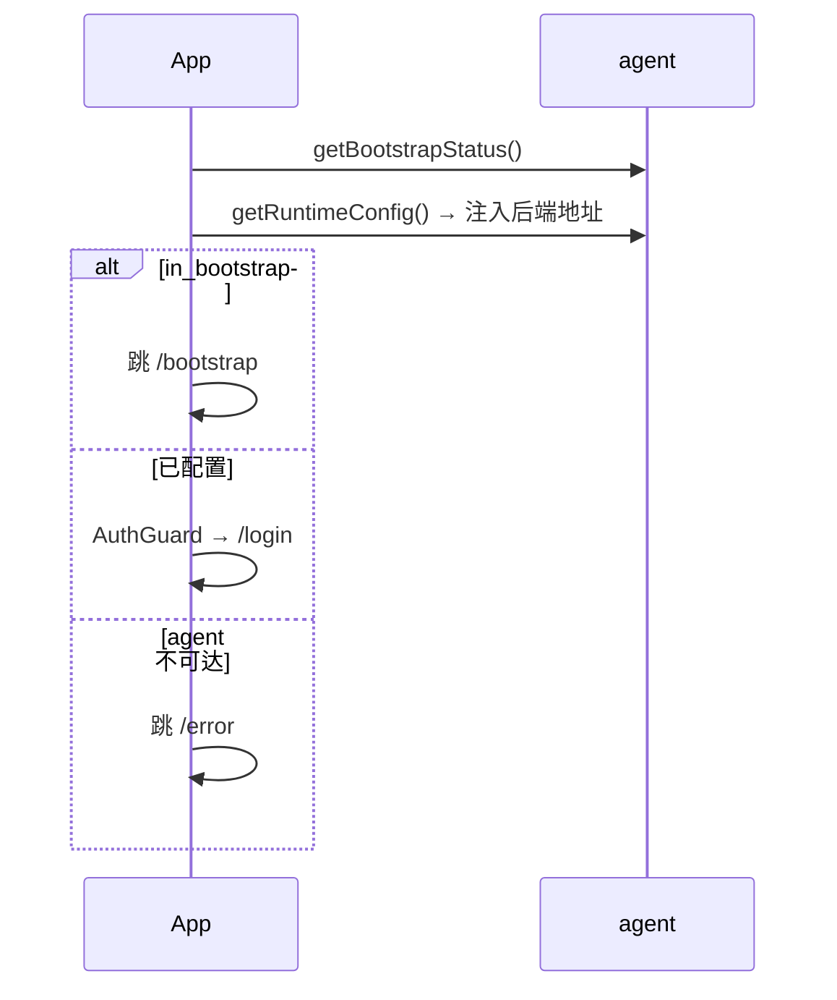
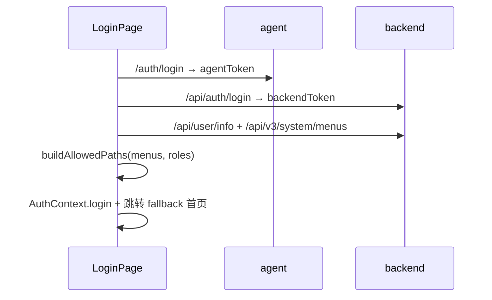

# 桌面端 app 设计文档
<!-- xiaohu-illustration:app-readme-01-shell -->


> app 是面向运维的 Tauri + React 桌面监控台，由同一代码库构建为中心式、分布式边缘、分布式中心三种固定角色。每个 App 只连接本角色本机 Agent，并按构建角色裁剪进程页和导航；中心业务数据仍由独立 Docker Backend 提供。
>
> 它调用的服务见《02-模块设计/边缘代理-agent》《后端-backend》。

---

## 1. 概述

app 是一个 **Tauri + React + TypeScript** 桌面应用（Rust 外壳 + WebView 前端）。定位是**运维 + 设备监控控制台**，与面向业务用户的 Web 前端（frontend）互补；本机管控对象由构建角色固定：中心式为 Collector/Writer，边缘为 Storage/Edge Collector/Uploader，分布式中心为 Ingest/Writer。核心特征：

- **双数据源**：本机 `agent`（首装、进程管控、连接健康）+ 中心 `backend`（工作台、设备监控、系统管理、模块指标与日志）；
- **Rust 壳转发**：HTTP 经 Tauri 命令（`agent_request` / `backend_request` / `backend_download`）在 Rust 侧发起，规避 WebView CORS；
- **侧栏导航壳**：分组侧栏 + 顶栏标题/刷新/连接状态/设置入口；设置页进入时**侧栏切换为设置菜单**，返回后还原业务导航；
- **角色菜单过滤**：登录后拉取 `/api/user/info` 与 `/api/v3/system/menus`，按 Web 菜单映射桌面 path；桌面专有页与管理员控制台有额外规则；
- **一包多机**：后端地址不打包写死，启动时从 agent `runtime-config` 注入。

入口：`app/src/App.tsx`；Rust 壳：`app/src-tauri/`。

---

## 2. 设计目标与范围

| 目标 | 实现要点 |
|------|----------|
| 本机运维集中可视 | 控制台按角色聚合 Collector/Storage/Uploader 或 Ingest/Writer 的状态、指标和日志 |
| 设备与系统管理 | 驱动/设备/点位、实时与历史、用户/角色/菜单、系统日志 |
| 首次安装零门槛 | Bootstrap 向导对接 agent 完成 DB/后端配置 |
| 进程可管控 | 经 agent admin 启停/重启本角色模块；边缘遵守 Storage 依赖顺序 |
| 按角色显隐菜单 | 后端菜单树 → 桌面 path；管理员强制可见控制台 |
| 一包多机 | 后端地址运行期注入 |
| 规避 CORS / 桌面集成 | HTTP / 文件下载经 Tauri Rust 转发 |

**不在本模块范围**：实际采集入库逻辑、Web 端 Art Design Pro 主题体系。

---

## 3. 核心概念与术语

| 术语 | 含义 |
|------|------|
| **Tauri 壳** | Rust 外壳 + WebView；前端经 `invoke` 调 Rust 命令转发 HTTP |
| **双数据源** | 本角色 agent（7070/7071/7072）+ backend（中心，地址运行期注入） |
| **导航壳** | `AppLayout`：可折叠侧栏 + 顶栏；配置见 `src/config/navigation.ts` |
| **allowedPaths** | 登录后写入 `AuthStore` 的可访问桌面 path 列表 |
| **桌面专有页** | 本角色采集链路监控、控制台和 `/settings`，按构建目标裁剪 |
| **管理员附加页** | `R_SUPER` / `R_ADMIN` 额外可见 `/dashboard/console` |
| **设置态侧栏** | 进入 `/settings` 时侧栏替换为「返回 + 基础/数据库/Collector/Writer」 |
| **双鉴权** | agent token（管控）与 backend token（业务/指标）各自维护 |

---

## 4. 架构与目录结构

```
app/
├── src/
│   ├── App.tsx                 # 路由 + AuthGuard + MenuAccessGuard
│   ├── config/navigation.ts    # 侧栏分组与页面元数据
│   ├── pages/                  # 业务页（工作台/控制台/设备/系统/采集/设置…）
│   ├── components/
│   │   ├── AppLayout.tsx       # 导航壳；设置态侧栏切换
│   │   ├── layout/             # sidebar-state、settings-tabs
│   │   ├── charts/             # 工作台等图表
│   │   └── ui/*                # shadcn 组件
│   ├── contexts/               # AuthContext / ThemeContext / PageRefreshContext
│   ├── hooks/                  # 模块监控、工作台、实时 WS、后端查询等
│   ├── lib/
│   │   ├── agent-client.ts / backend-client.ts / mock-agent.ts
│   │   ├── navigation-access.ts  # 菜单→path、权限过滤
│   │   └── agent-auth-token.ts   # Agent token 热更新隔离
│   └── types/
└── src-tauri/                  # agent_request / backend_request / backend_download
```

数据来源与转发：



---

## 5. 关键组件

### 5.1 启动流程

`AppStartup`：挂载后调 `agent.getBootstrapStatus()` —— 若 `in_bootstrap` 跳 `/bootstrap`；否则交由 `AuthGuard`；agent 不可达跳 `/error`。期间读取 `runtime-config` 注入 `setBackendBaseUrl`。

受保护路由外包：`AuthGuard` → `PageRefreshProvider` → `AppLayout` → `MenuAccessGuard` → 页面。

### 5.2 导航壳（AppLayout）

- 展开宽 240px / 折叠 64px；折叠状态持久化 `localStorage`（`data-watch-sidebar-collapsed`）。
- 分组导航来自 `navigation.ts`，再经 `filterNavigationGroups(allowedPaths)` 过滤。
- 顶栏：面包屑/标题、刷新、连接状态、用户、设置齿轮、主题。
- **设置页**：顶部分类 tabs **已移除**；侧栏切换为设置菜单（`SETTINGS_TABS`），「返回」退出设置后还原业务侧栏。

### 5.3 角色与菜单权限

实现：`src/lib/navigation-access.ts` + 登录页拉取权限。

| 规则 | 说明 |
|------|------|
| 菜单映射 | Web `component` / `path` → 桌面 path（如 `/device_monitor/point/index` → `/device/points`） |
| 桌面专有 | Collector / Writer 始终加入 `allowedPaths`；Settings 与控制台仅管理员可见 |
| 管理员 | `R_SUPER`、`R_ADMIN` 额外加入 `/dashboard/console`（控制台）与 `/settings` |
| 路由守卫 | `MenuAccessGuard`：无权限则跳转 `pickFallbackPath` |
| 失败降级 | 权限接口失败不阻断登录，侧栏仅桌面专有页 |

登录成功后：`user`（含 `roles`）与 `allowedPaths` 写入内存态 `AuthStore`（不落盘）。

### 5.4 agent-client / backend-client

- **agent-client**：bootstrap / auth / viewer / admin；密码脱敏；mock/real 动态 import。
- **backend-client**：登录、用户信息、菜单、设备监控 CRUD、工作台、模块指标、日志、导入导出下载等；统一取 `{code,msg,data}.data`。
- Agent token 经 `agent-auth-token.ts` 与 `AuthContext` 解耦，避免 mock 热更新导致 Context 失配崩溃。

### 5.5 主要页面与数据源

| 分组 | 页面 | 路径 | 主要数据源 |
|------|------|------|-----------|
| 仪表盘 | 工作台 | `/dashboard/workbench` | backend dashboard |
| 仪表盘 | 控制台 | `/dashboard/console` | agent + backend rates（管理员+） |
| 数据采集 | 采集/存储/上行或汇聚/入库监控 | `/collection/*` | agent + 本机 Storage + backend module-monitor |
| 设备监控 | 通讯/驱动/设备/点位/实时/历史 | `/device/*` | backend device-monitor |
| 日志 | 系统日志 | `/logs/system` | backend log |
| 系统管理 | 用户/角色/菜单 | `/system/*` | backend system |
| — | 设置 | `/settings?tab=` | agent admin config |

---

## 6. 主要流程
<!-- xiaohu-illustration:app-readme-02-console -->


### 6.1 启动与首装判定



### 6.2 登录与权限注入



### 6.3 进程管控

模块页启停 → agent `/admin/processes/:name/{start|stop|restart}` → viewer 刷新状态。edge 角色中启动 Collector/Uploader 会先确保 Storage 可用，停止 Storage 会先处理依赖模块。

---

## 7. 对外交互

app 是纯消费端。消费：

- **agent**：bootstrap、auth、viewer、admin（启停/配置/健康）；
- **backend**：鉴权、菜单/用户信息、设备监控、工作台、模块指标、系统日志等。

契约见《边缘代理-agent》《后端-backend》《03-数据与契约》。

---

## 8. 配置说明

- **后端地址**：agent `runtime-config` 注入；开发可用 `VITE_BACKEND_URL` 作兜底说明，以运行期为准；
- **mock 开关**：`VITE_USE_MOCK`（仅非生产）；
- **侧栏折叠**：`localStorage` key `data-watch-sidebar-collapsed`。

---

## 9. 设计决策与权衡

| 决策 | 理由 / 权衡 |
|------|-------------|
| HTTP 经 Rust 壳转发 | 规避 WebView CORS；多一层 invoke |
| 后端地址运行期注入 | 一包多机 |
| 双数据源 + 双鉴权 | 管控走本机、业务走中心 |
| 菜单权限对齐 Web | 同一 RBAC 源；桌面专有页不依赖菜单配置 |
| 管理员强制控制台 | Web 菜单可能未映射控制台 component，避免超管侧栏缺失 |
| 设置用侧栏替换顶栏 tabs | 与业务导航交互一致，减少顶栏信息密度 |
| mock/real 动态切换 | 无服务也能开发；动态 import 保证 mock 不进生产包 |

---

## 10. 已知问题与技术债

> 仅记录，供后续评估。

- **双 token 维护**：agent 与 backend 各一套登录与令牌。
- **指标以轮询为主**：模块状态/指标多为轮询（日志/实时另有 WS）。
- **mock-agent 与真实接口需手动同步**。
- **backend `/api/user/info` 多为 snake_case**，前端类型为 camelCase；`roles` 字段名一致可用，其它展示字段需注意映射。

---

## 11. 扩展方式

- **新增业务页**：`pages/` + `App.tsx` 路由 + `config/navigation.ts`；若应对齐 Web 权限，在 `navigation-access.ts` 增加 component→path 映射。
- **新增桌面专有页**：加入 `DESKTOP_ALWAYS_PATHS`。
- **新增 agent/backend 接口**：同步改 client 与 mock。

---

## 相关文档

- 《01-总体设计/系统架构总览》
- 《02-模块设计/边缘代理-agent》《后端-backend》
- 《02-模块设计/app-控制台页面与双数据源》
- 《02-模块设计/Web前端-frontend》
- 设计稿：`docs/superpowers/specs/2026-07-17-desktop-navigation-shell-design.md` 等
