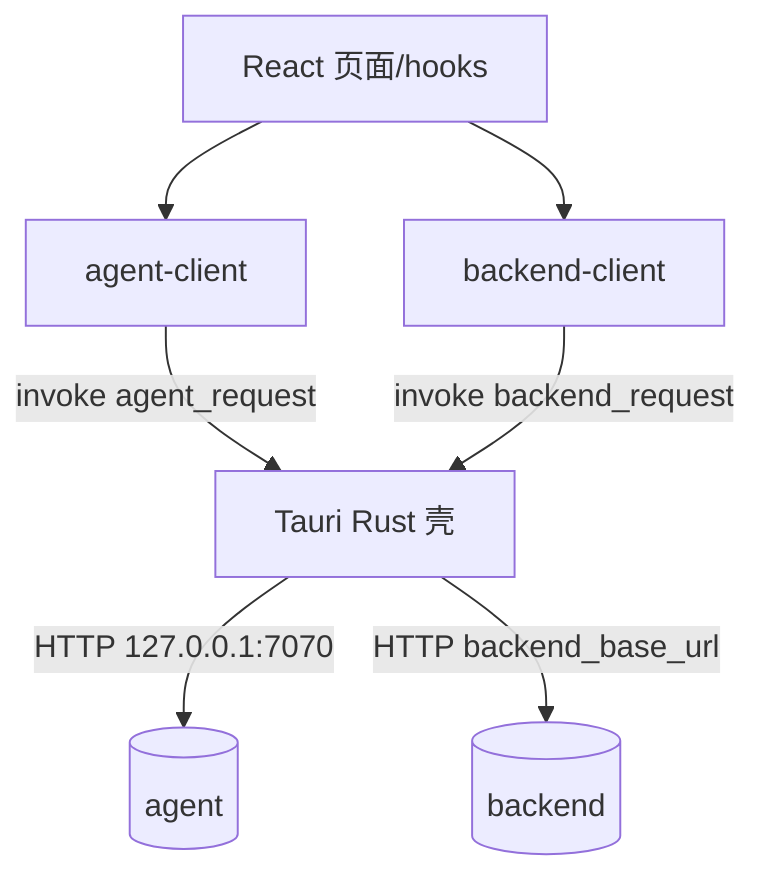
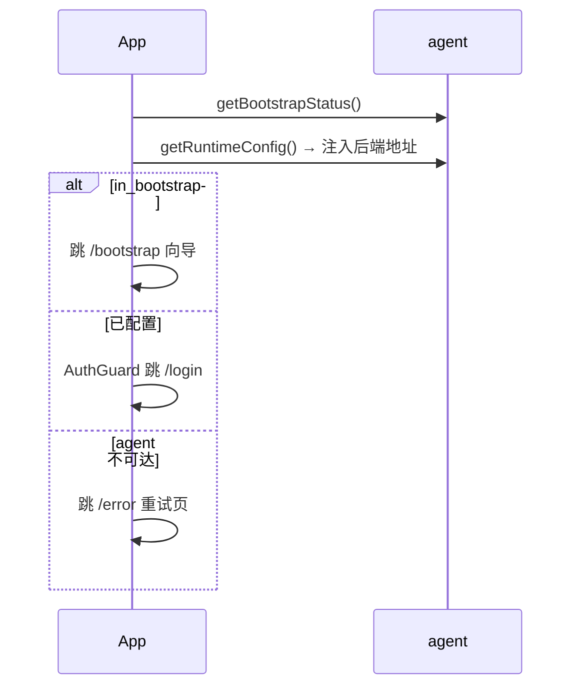

# 桌面端 app 设计文档

> app 是面向运维的桌面监控台（Tauri + React）。它运行在边缘机上，通过本机 agent 完成首装配置与进程管控，通过中心 backend 获取模块指标与日志，给运维人员一个集中的观测与操作界面。本文覆盖其技术栈、双数据源对接、启动流程、页面结构与设计决策。
>
> 它调用的服务见《02-模块设计/边缘代理-agent》《后端-backend》。

---

## 1. 概述

app 是一个 **Tauri + React + TypeScript** 桌面应用（Rust 外壳 + WebView 前端）。定位是**运维监控台**，与面向业务用户的 Web 前端（frontend）分工不同。核心特征：

- **双数据源**：本机 `agent`（首装、进程管控、连接健康）+ 中心 `backend`（模块指标、系统日志）；
- **Rust 壳转发**：所有 HTTP 经 Tauri 命令（`agent_request` / `backend_request`）在 Rust 侧发起，前端不直接 fetch，规避浏览器 CORS 并复用桌面能力；
- **一包多机**：后端地址不打包写死，启动时从 agent 的 `runtime-config` 读取后注入。

入口：`app/src/App.tsx`；Rust 壳：`app/src-tauri/src/main.rs`。

---

## 2. 设计目标与范围

| 目标 | 实现要点 |
|------|----------|
| 边缘运维集中可视 | Overview/Collector/Writer 页聚合状态、指标、日志 |
| 首次安装零门槛 | Bootstrap 向导对接 agent 完成 DB/后端配置 |
| 进程可管控 | 经 agent admin 接口启停/重启 collector/writer |
| 一包多机 | 后端地址运行期注入，安装包不绑定环境 |
| 规避 CORS / 桌面集成 | HTTP 经 Tauri Rust 命令转发 |

**不在本模块范围**：业务数据展示（frontend）、实际采集入库与服务端逻辑。

---

## 3. 核心概念与术语

| 术语 | 含义 |
|------|------|
| **Tauri 壳** | Rust 外壳 + WebView；前端经 `invoke` 调 Rust 命令转发 HTTP |
| **双数据源** | agent（本机 127.0.0.1:7070）+ backend（中心，地址运行期注入） |
| **agent_request / backend_request** | Rust 侧 HTTP 转发命令，前端统一经其访问两个服务 |
| **runtime-config** | 启动时从 agent 读取后端地址，注入 backend-client |
| **mock/real** | 开发期可切换 mock 实现，经动态 import 保证 mock 不进生产包 |
| **双鉴权** | agent token（管控）与 backend token（指标/日志）各自维护 |

---

## 4. 架构与目录结构

```
app/
├── src/                       # React 前端
│   ├── App.tsx                # 路由 + 启动检查
│   ├── pages/                 # Bootstrap/Login/Overview/Collector/Writer/Settings
│   ├── components/            # AppLayout/TitleBar/ConnectionStatusBar/
│   │                          #   ModuleSummaryCard/TrendChart/LogPanel + ui/*
│   ├── contexts/              # AuthContext / ThemeContext
│   ├── hooks/                 # useModuleStatus/Metrics/Rates/DbLogs/
│   │                          #   ConnectionHealth/WebSocketLog
│   └── lib/                   # agent-client / backend-client / mock-agent
└── src-tauri/                 # Rust 外壳
    ├── src/main.rs            # Tauri 命令：agent_request / backend_request
    └── build.rs
```

数据来源与转发：



---

## 5. 关键组件

### 5.1 启动流程

`app/src/App.tsx` 的 `AppStartup`：挂载后调 `agent.getBootstrapStatus()` —— 若 `in_bootstrap` 跳 `/bootstrap` 首装向导；否则交由 `AuthGuard` 跳 `/login`；agent 不可达跳 `/error`（专门的重试页）。期间读取 `agent.getRuntimeConfig()` 拿后端地址并 `setBackendBaseUrl` 注入。

路由分两类：公开（`/bootstrap`、`/login`、`/error`）与受保护（`AuthGuard` + `AppLayout` 下的 Overview / Collector / Writer / Settings）。

### 5.2 agent-client（本机管控对接）

`app/src/lib/agent-client.ts`。封装 agent 的 bootstrap/auth/viewer/admin 全部接口，经 `invoke("agent_request", {method, path, body, token})` 转发。要点：

- 统一错误归类（`agent_unreachable` / `unauthorized` / `api_error`）；
- 日志对 `password`/`password_enc` 脱敏，不打印 token；
- mock/real 经动态 import 选择，生产构建中 mock 为死代码被 Rollup 消除。

### 5.3 backend-client（中心指标对接）

`app/src/lib/backend-client.ts`。封装 backend 的 `login`、`logList`、`collectorMetrics`、`writerMetrics`、`moduleRates`，经 `invoke("backend_request")` 转发。要点：

- 后端地址运行期注入（`setBackendBaseUrl`），去尾斜杠；
- token 规范化为单一 `Bearer ` 前缀（backend 返回的 token 已带前缀）；
- 后端统一响应 `{code, msg, data}`，客户端取 `data`。

### 5.4 页面与数据 hooks

| 页面 | 职责 | 主要数据源 |
|------|------|-----------|
| Bootstrap | 首装向导：填 DB/后端、测连、完成 | agent bootstrap |
| Login | 登录 | agent + backend 鉴权 |
| Overview | 总览：模块状态、连接健康、速率趋势 | agent viewer + backend rates |
| Collector / Writer | 单模块指标、日志、启停管控 | agent admin/viewer + backend metrics/log |
| Settings | 连接配置查看/修改、主题 | agent admin config |

数据 hooks：`useModuleStatus`/`useModuleMetrics`/`useModuleRates`/`useConnectionHealth`（轮询），`useWebSocketLog`/`useModuleDbLogs`（实时日志 / DB 日志）。

---

## 6. 主要流程

### 6.1 启动与首装判定



### 6.2 进程管控

运维在 Collector/Writer 页点击启停 → `agent-client` 调 `/admin/processes/:name/{start|stop|restart}` → agent 的 ProcessManager 执行 → 页面经 viewer 状态/指标接口刷新展示。

---

## 7. 对外交互

app 是纯消费端，不对外提供接口。它消费：

- **agent**：bootstrap（首装）、auth（登录）、viewer（状态/健康/指标）、admin（启停/配置）；
- **backend**：登录、模块指标（collector/writer/rates）、系统日志列表。

接口契约分别见《边缘代理-agent》《后端-backend》。

---

## 8. 配置说明

- **后端地址**：运行期经 agent `runtime-config` 注入，不依赖打包变量；
- **mock 开关**：`VITE_USE_MOCK`（仅非生产）；
- **Tauri 配置**：窗口、命令白名单等在 `src-tauri`（自定义无边框标题栏 `TitleBar`）。

---

## 9. 设计决策与权衡

| 决策 | 理由 / 权衡 |
|------|-------------|
| HTTP 经 Rust 壳转发 | 规避 WebView CORS，集中错误处理与桌面集成；代价是多一层 invoke |
| 后端地址运行期注入 | 一个安装包可用于多目标机，无需重新打包 |
| 双数据源 + 双鉴权 | 管控走本机 agent、指标走中心 backend，各自 token |
| mock/real 动态切换 | 无 agent/后端时也能开发联调；动态 import 保证 mock 不进生产包 |
| 自定义标题栏 | 无边框窗口统一视觉；需自行实现拖动/最小化/关闭 |

---

## 10. 已知问题与技术债

> 仅记录，供后续评估。

- **双 token 维护**：agent 与 backend 各一套登录与令牌，前端需同时管理。
- **指标以轮询为主**：模块状态/指标多为轮询 hooks（日志为 WS），高频刷新有开销。
- **mock-agent 与真实接口需手动保持同步**：契约变更时两侧都要改。

---

## 11. 扩展方式

- **新增页面**：在 `src/pages/` 新增并在 `App.tsx` 注册受保护路由；数据访问走对应 hook + client。
- **新增 agent/backend 接口对接**：在 `agent-client` / `backend-client` 增加方法（同时更新 mock）。
- **新增受管模块视图**：复用 ModuleSummaryCard/TrendChart 与 useModule* hooks。

---

## 相关文档

- 《01-总体设计/系统架构总览》
- 《02-模块设计/边缘代理-agent》《后端-backend》（被调用方）
- 《02-模块设计/app-控制台页面与双数据源》（页面结构、双数据源、双 token、降级策略）
- 《02-模块设计/Web前端-frontend》（另一前端，面向业务）
