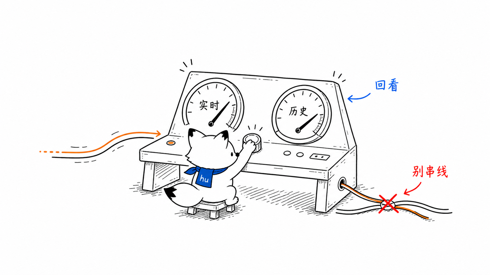
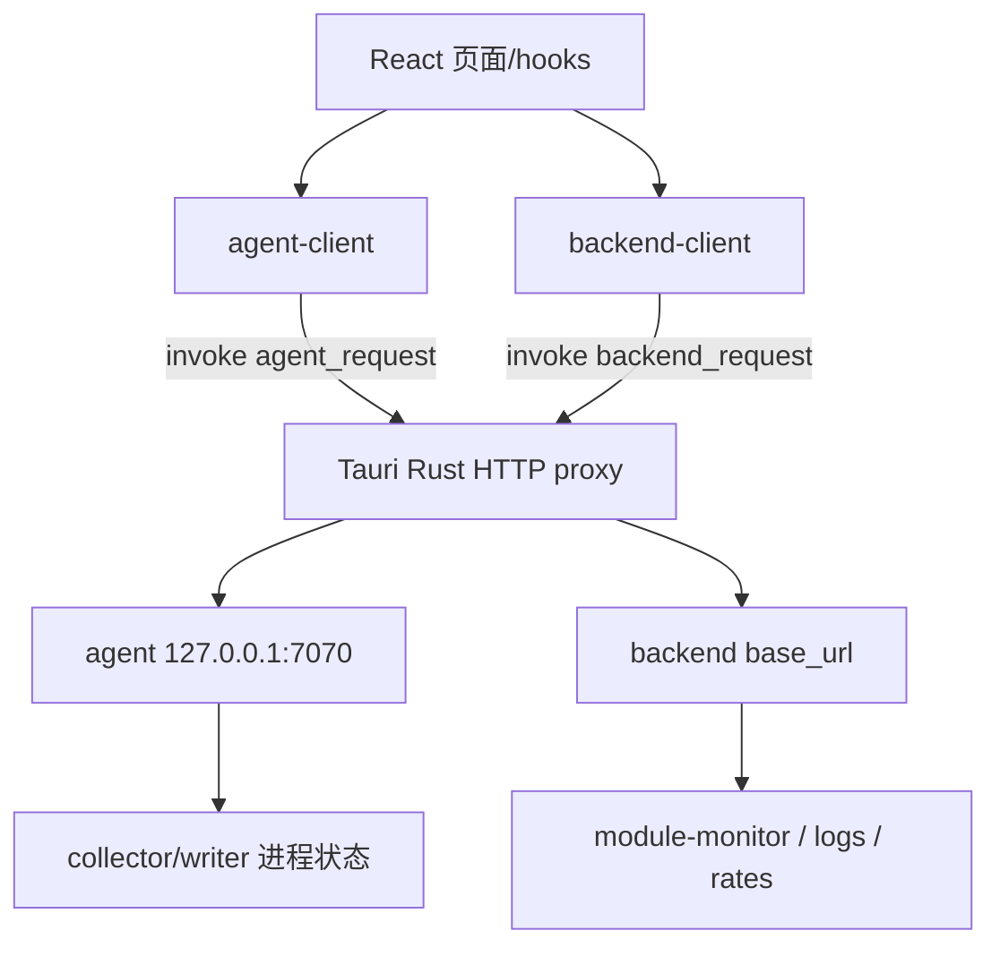
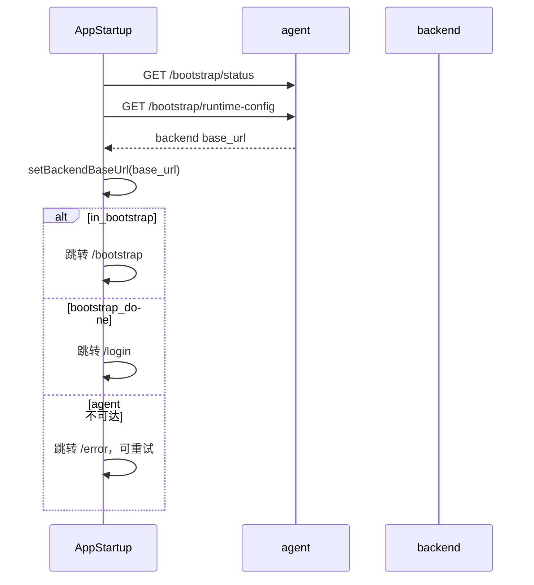
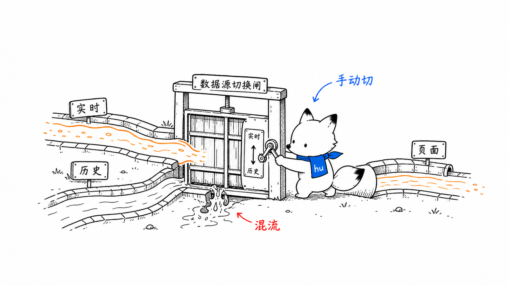
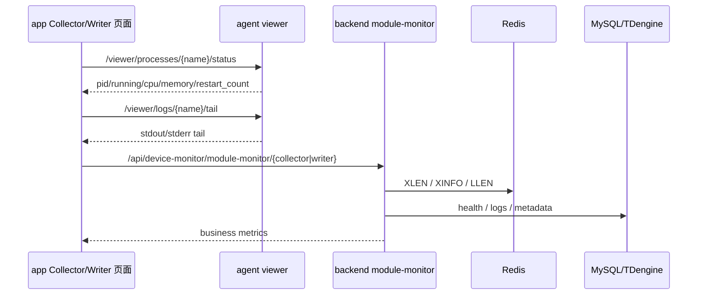

# app 控制台页面与双数据源
<!-- xiaohu-illustration:app-console-data-01-dashboard -->


> 本文是《桌面端-app》的深度展开，聚焦 Tauri + React 桌面端的页面结构、启动流程、agent/backend 双数据源、双 token、Rust HTTP 转发、模块监控与降级策略。

---

## 1. app 的定位

app 是 Windows 节点的现场运维控制台，不是业务 Web 控制台。中心式、分布式边缘、分布式中心分别构建独立 App；下文 `collector/writer` 与 7070 流程是中心式基线，边缘角色替换为 Storage/Edge Collector/Uploader 与 7071，Storage 另监听 7073；分布式中心替换为 Ingest/Writer 与 7072。



两类服务分工：

| 服务 | app 用它做什么 |
|------|----------------|
| agent | bootstrap、连接配置、进程启停、进程状态、进程指标、实时日志 tail |
| backend | 登录、collector/writer 业务指标、速率趋势、系统日志/数据库日志 |

---

## 2. 启动流程



这个流程保证安装包不绑定中心 backend 地址。后端地址由 agent 配置提供，目标机可在 bootstrap 或 settings 中更新。

---

## 3. 页面信息架构

桌面端已从「顶栏三页」演进为**侧栏分组导航壳**（见 `AppLayout` + `config/navigation.ts`）。

| 页面 | 路径 | 核心问题 | 主要接口 |
|------|------|----------|----------|
| Bootstrap | `/bootstrap` | 边缘机如何连接中心与三类数据库？ | agent `/bootstrap/*` |
| Login | `/login` | 是否有 agent/backend 权限？菜单可见哪些页？ | agent `/auth/login` + backend `/api/auth/login`、`/api/user/info`、menus |
| 工作台 | `/dashboard/workbench` | 全局运行概览？ | backend dashboard |
| 控制台 | `/dashboard/console` | 边缘数据链路是否健康？ | agent viewer + backend rates（`R_SUPER`/`R_ADMIN`） |
| 角色模块监控 | `/collection/*` | 本角色进程、队列、速率与错误是否正常？ | agent process/local + backend module-monitor |
| 设备监控族 | `/device/*` | 驱动/设备/点位/实时/历史 | backend device-monitor |
| 系统日志 | `/logs/system` | 系统级日志检索 | backend log |
| 系统管理族 | `/system/*` | 用户/角色/菜单 | backend system |
| Settings | `/settings?tab=` | DB/进程路径/主题是否正确？ | agent `/admin/config`、health check |

设计原则：

- 首装页只解决配置闭环，不混入业务监控。
- 控制台给链路总览；工作台给运营看板；二者分流。
- 各角色模块提供启停/重启，操作需明确二次确认；edge 的 Storage 是 Collector/Uploader 的本地持久化依赖。
- Settings **不进系统管理分组**；从顶栏齿轮或用户菜单进入。进入后**左侧导航替换为设置分类**（基础/数据库/Collector/Writer），点「返回」还原业务侧栏；顶栏不再放设置分类 tabs。
- 侧栏与路由按 `allowedPaths` 过滤；桌面专有页（采集/写入/设置）始终可见。

---

## 4. 双 token 模型

app 同时面对两个服务，因此有两套 token：

```text
agent token   -> 调 /viewer/* /admin/* /bootstrap 后续受保护接口
backend token -> 调 /api/*（设备监控、工作台、系统管理、module-monitor、log 等）
```

要点：

- backend 登录返回 token 已带 `Bearer ` 前缀，客户端只做规范化，不重复加 Bearer。
- agent token 经 `setAgentAuthToken` 写入内存模块（与 AuthContext 解耦），hooks 调 agent 时可省略显式传 token。
- agent token 与 backend token 失效应分别提示；不能因为 backend 掉线就阻止本机 agent 管控。
- 若 agent 可用但 backend 不可用，页面应保留进程启停与本机日志能力，同时把业务指标标为 degraded。
- 若 backend 可用但 agent 不可用，桌面端失去边缘管控能力，应进入错误/重试状态。

---

## 5. Rust HTTP 转发层

Tauri WebView 前端不直接 `fetch` agent/backend，而是通过 Rust 命令：

```text
agent-client.ts
  -> invoke("agent_request", { method, path, body, token })
  -> Rust http_proxy
  -> http://127.0.0.1:7070

backend-client.ts
  -> invoke("backend_request", { method, path, body, token })
  -> Rust http_proxy
  -> backend_base_url

导出/下载
  -> invoke("backend_download", ...)
```

设计收益：

- 避免 WebView CORS 限制（生产与开发均走代理，不再依赖 backend 对 `localhost:1420` 开 CORS）。
- 统一处理本机地址、后端地址和错误类型。
- 可在 Rust 层屏蔽浏览器环境差异。
- token 与敏感请求日志可集中脱敏。

---

## 6. 模块指标数据流
<!-- xiaohu-illustration:app-console-data-02-switch -->




agent 指标是 OS/进程视角，backend 指标是中心数据链路视角。edge 角色再通过 `/local/storage` 和 `/local/outbox` 提供本机持久化与积压指标，三者互补：

- 进程 running 但 Redis stream 不增长，说明采集链路可能卡在设备/Redis 之前。
- writer running 但 pending 增长，说明 TDengine 或 ACK/消费能力存在问题。
- storage running 但队列持续升高或 `commit_p99_ms` 上升，说明本机持久化能力不足或磁盘异常。
- uploader running 但 backlog 不下降，结合 Uploader 日志和中心 Ingest 状态区分网络、认证、统一入口或中心接纳故障。
- backend 不可用时，app 仍可通过 agent 判断本机进程是否存活。

---

## 7. 日志视图设计

app 可展示两类日志：

| 日志 | 来源 | 用途 |
|------|------|------|
| 实时进程日志 | agent tail 本角色模块 stdout/stderr | 看启动失败、连接失败、队列和实时异常 |
| DB 系统日志 | backend 查询 MySQL `system_log` | 看结构化历史事件、DLQ、重连、降级 |

两类日志不能互相替代：实时 tail 适合现场快速定位，DB 日志适合按时间/级别/模块检索历史。

---

## 8. 降级策略

| 场景 | app 行为 |
|------|----------|
| agent 不可达 | 进入 error/retry；不能执行本机管控 |
| backend 不可达 | 保留 agent 本机状态和启停；业务指标、DB 日志显示 degraded |
| agent token 失效 | 要求重新登录 agent；admin/viewer 禁用 |
| backend token 失效 | 只禁用 backend 指标/日志；agent 管控仍可用 |
| 本角色模块未运行 | 操作区显示启动按钮，指标区显示空态而非异常堆栈 |
| 配置未 bootstrap | 强制进入 Bootstrap，不进入主页面 |

---

## 9. 与 Web frontend 的边界

| 能力 | app | frontend |
|------|-----|----------|
| 边缘首装 bootstrap | 是 | 否 |
| collector/writer 启停 | 是，经 agent | 否 |
| 进程 CPU/内存/日志 tail | 是 | 否 |
| 设备/点位管理 | 否 | 是 |
| 实时业务监控 | 只看模块级指标 | 是，点位级实时页 |
| 历史查询与 Perspective | 否或仅指标入口 | 是 |
| 用户/角色/菜单管理 | 否 | 是 |

---

## 相关文档

- [桌面端 app](README.md)
- [agent 边缘进程编排与凭据](../agent/边缘进程编排与凭据.md)
- [后端服务分层与实时历史通道](../backend/服务分层与实时历史通道.md)
- [运维部署](../../04-运维部署/README.md)
