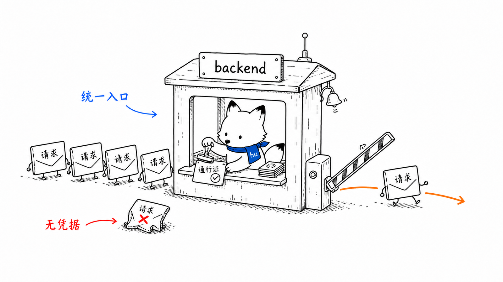
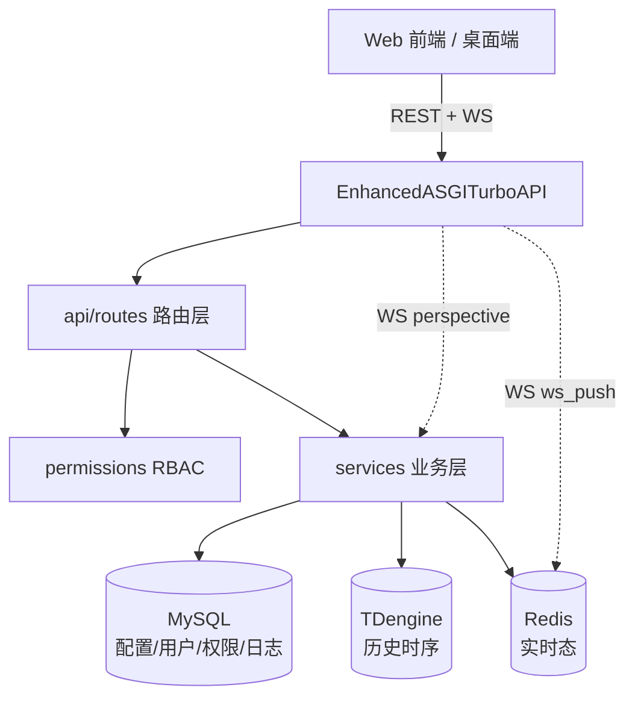
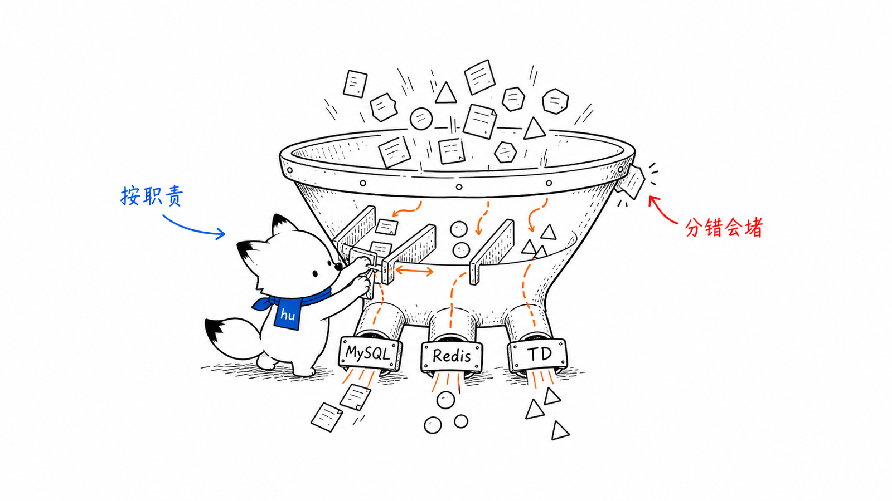
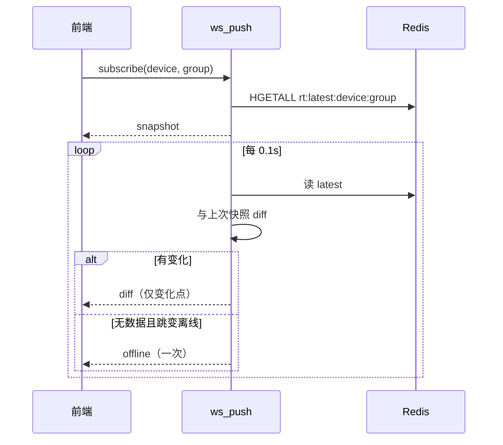
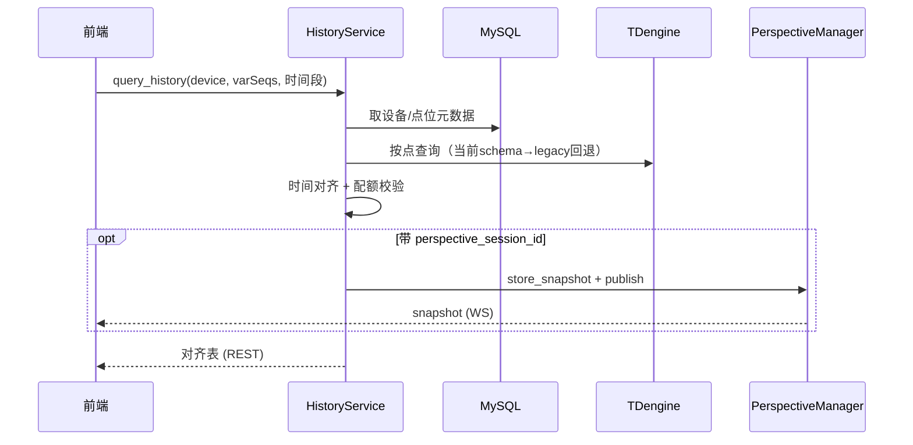

# 中心后端 backend 设计文档
<!-- xiaohu-illustration:backend-readme-01-gatehouse -->


> backend 是平台的中心数据服务：统一对接 MySQL / TDengine / Redis 三类数据源，向 Web 前端与桌面端提供 REST 接口与两条 WebSocket 实时通道，并承担鉴权、权限、系统日志、设备与点位管理等职责。本文覆盖其框架与分层、鉴权权限、实时与历史两条数据通路、对外契约、配置与扩展方式。
>
> 全局视图见《01-总体设计/系统架构总览》；接口与数据结构契约见《03-数据与契约》。

---

## 1. 概述

backend 是一个基于 **TurboAPI** 的 ASGI 服务（自定义增强层 `EnhancedASGITurboAPI`）。它是系统中扇入最高的核心模块，对外职责：

- **供数**：实时态（Redis）、历史时序（TDengine）、配置与权限（MySQL）三源统一服务；
- **实时**：两条 WebSocket 通道——设备实时监控（diff 推送）与历史数据快照（Perspective）；
- **安全**：自实现 JWT 鉴权 + RBAC 权限校验；
- **管理**：设备/点位目录、用户/角色/菜单、系统日志、仪表盘、模块监控。

入口：`backend/app/main.py:726`（`create_app()`）。

---

## 2. 设计目标与范围

| 目标 | 实现要点 |
|------|----------|
| 三数据源统一服务 | MySQL（SQLAlchemy async）/ TDengine（WebSocket）/ Redis（async）分层封装 |
| 实时低延迟监控 | WebSocket 按设备分组订阅，Redis `rt:change` 事件驱动 diff 推送，1s 轮询兜底 |
| 大体量历史查询可控 | 降采样聚合 + 分页 + 查询配额（点数/范围/记录数）保护 |
| 安全可控 | JWT(HS256) + PBKDF2 口令哈希 + RBAC 权限码 |
| 可观测 | 系统日志落库、速率采样、模块运行指标 |

**不在本模块范围**：数据采集与入库（collector/writer）、边缘进程管控（agent）。

---

## 3. 核心概念与术语

| 术语 | 含义 |
|------|------|
| **TurboAPI / EnhancedASGITurboAPI** | Web 框架；后者是项目自定义的 ASGI 增强层，统一处理 HTTP/WebSocket/lifespan/CORS/异常 |
| **三数据源** | MySQL（配置/用户/权限/日志）、TDengine（历史时序）、Redis（实时态） |
| **实时监控通道** | `ws_push`：按 (device_code, group_code) 订阅，`rt:change` 唤醒后读取 Redis latest 做 diff 推送 |
| **历史快照通道** | Perspective：会话化管理，历史查询结果以 snapshot 经 WS 推送 |
| **RBAC** | 用户→角色→权限码；接口按所需权限码校验交集 |
| **降采样 interval** | 历史图表按时间桶聚合（avg/last 等），支持 auto 自适应 |
| **HistoryService 多层回退** | 当前 writer schema（device_data.<device_code> + 列）优先，legacy 子表/超级表回退 |

---

## 4. 架构与目录结构

```
backend/app/
├── main.py              # 应用装配、生命周期、ASGI 增强层、CORS、异常、WS 注册
├── api/
│   ├── router.py        # 聚合 9 个路由模块
│   ├── permissions.py   # RBAC 权限校验
│   └── routes/          # auth/system/system_manage/catalog/dashboard/
│                        #   history/log/monitor/module_monitor/perspective
├── services/            # 业务逻辑：auth/auth_bootstrap/perspective/history/
│                        #   dashboard/catalog/monitor/module_monitor/system_manage/
│                        #   log/tdengine_log/health/ws_push/rate_sampler/task_manager
├── core/                # security/config/logging/log_writer/log_scheduler/
│                        #   audit/responses/exceptions/time_utils/status_thresholds
├── db/                  # mysql / redis / tdengine 连接封装
├── models/              # auth / log / base ORM 模型
└── schemas/             # auth 请求/响应模型
```

分层与数据源：



---

## 5. 关键组件

### 5.1 应用装配与生命周期

`backend/app/main.py`。`create_app()` 构建 `EnhancedASGITurboAPI`，挂 CORS 中间件、注册异常处理器、挂载聚合路由、注册两个 WebSocket 端点（ws_push、perspective）。

- **EnhancedASGITurboAPI**（`main.py:272`）：自定义 ASGI `__call__`，分发 lifespan / WebSocket / HTTP；自己实现 CORS 预检、路由匹配、参数绑定（路径/查询/头/体）、依赖解析、异常分发、响应编码。
- **lifespan**（`main.py:608`）：启动时配置日志、（可选）bootstrap 鉴权 schema、启动日志调度器与速率采样器，并对不安全的 `AUTH_SECRET_KEY` 告警；关闭时按序释放 Redis、采样器、日志调度、TDengine、MySQL。

### 5.2 路由层

`backend/app/api/router.py` 聚合 9 个路由模块：`auth`、`system`、`catalog`、`dashboard`、`log`、`monitor`、`module_monitor`、`history`、`system_manage`。两个 WebSocket 端点在 `create_app` 单独注册（不经 HTTP 路由表）。

### 5.3 鉴权与权限

- **口令与令牌**（`backend/app/core/security.py`）：口令用 `pbkdf2_sha256`（600000 次迭代）哈希；令牌为自实现 JWT（HS256），签发时带 `Bearer ` 前缀，校验签名与过期。
- **权限校验**（`backend/app/api/permissions.py`）：`require_permissions` 经 `AuthService` 解析 principal 并取用户权限码集合，与接口所需权限码求交集，无交集抛 403（RBAC）。
- **安全自检**：`AUTH_SECRET_KEY` 命中不安全默认/占位值时启动告警（开发态不阻断，生产须配强随机值）。

### 5.4 三数据源

`backend/app/db/`：

- **MySQL**（`db/mysql.py`）：SQLAlchemy async session 工厂，承载配置、设备/点位目录、用户/角色/权限、系统日志。
- **TDengine**（`db/tdengine.py`）：`TDengineClient`，承载历史时序查询。
- **Redis**（`db/redis.py`）：async 客户端，读 collector 写入的实时态。

### 5.5 实时监控通道（ws_push）

`backend/app/services/ws_push.py`。`WsPushManager` 按 `(device_code, group_code)` 维护订阅：

- 全局只创建一个 Redis Pub/Sub 监听，订阅 `rt:change`；消息只唤醒匹配的 `(device_code, group_code)` 推送循环；
- 推送循环读取 `rt:latest:{device}:{group}` 计算 diff，并保留每 1 秒一次的兜底读取；
- 首次发 `snapshot`，之后只发**变化点的 diff**；
- 设备无数据时只在"在线→离线"跳变推一次 `offline`（去重防刷屏）；
- 附带 TDengine 健康标志（30s TTL 缓存）。

### 5.6 历史快照通道（Perspective）

`backend/app/services/perspective.py`。`PerspectiveSessionManager` 管理历史数据会话：

- 会话按 owner（身份 hash）+ session_id 组织，绑定 WebSocket 传输；
- **会话保护**：每 owner / 全局会话数上限、空闲 TTL、断连重存 TTL、查询点数/时间范围/记录数上限；
- 历史查询结果存为 snapshot 并 `publish_snapshot` 推送给该会话的连接；
- Perspective runtime（perspective-python）为可选依赖，`runtime_available()` 探测。

### 5.7 历史查询（HistoryService）

`backend/app/services/history.py`。基于 TDengine 的历史数据服务：

- `query_history`：多点位时间对齐的原始表；
- `get_chart_data`：按 interval 降采样聚合（avg/max/min/last…，bool 强制 last），支持 auto 自适应间隔；
- `get_raw_data`：游标分页原始数据；
- `get_raw_matrix_data`：按 100ms/500ms/1s 对齐的分桶矩阵（范围 ≤24h）；
- `export_history_csv` / `create_export_task`：同步导出与异步分块导出任务。
- **schema 多层回退**：优先当前 writer schema（`device_data.<device_code>` 的 `td_column_name` 列），失败回退 legacy 的按点子表与超级表，兼容历史数据。

### 5.8 其他服务

| 服务 | 职责 |
|------|------|
| `auth_bootstrap` | 启动时初始化鉴权 schema 与菜单/权限种子 |
| `rate_sampler` | 采集/入库速率与趋势的内存滚动采样 |
| `module_monitor` | collector/writer 等模块运行指标（供桌面端 `module-monitor` 接口） |
| `log` / `tdengine_log` / `core.log_scheduler` | 系统日志查询、写入与定时清理 |
| `dashboard` / `catalog` / `system_manage` | 仪表盘聚合、设备点位目录、用户角色菜单管理 |
| `task_manager` | 异步导出任务的状态管理 |

---

## 6. 主要流程
<!-- xiaohu-illustration:backend-readme-02-funnel -->


### 6.1 实时监控订阅推送



### 6.2 历史查询 + 快照推送



---

## 7. 对外接口与契约

| 类别 | 接口 |
|------|------|
| 鉴权 | `/api/auth/login`、`/logout`、`/api/user/password/change` |
| 用户/角色/菜单 | `/api/user`、`/api/role`、`/api/v3/system/menu`（system_manage） |
| 设备/点位目录 | `/api/device-monitor/device`、`/point`、`/import`（catalog） |
| 仪表盘 | `/api/device-monitor/dashboard/*` |
| 历史 | `/api/device-monitor/history/*`、`/export` |
| 日志 | `/api/device-monitor/log/*` |
| 模块监控 | `/api/device-monitor/module-monitor/{collector\|writer\|rates}`（桌面端消费） |
| 实时 WS | ws_push 端点（设备实时 diff） |
| 历史 WS | perspective 端点（历史快照） |

响应统一经 `core/responses.py` 包装；异常经 `core/exceptions.py` 的 `ApiError` 与注册的处理器转标准错误体。完整字段见《03-数据与契约/契约/API契约》《WebSocket协议》。

---

## 8. 配置说明

配置来自 `backend/.env`（经 `app/core/config.py` 的 `get_settings()` 读取）：

- 数据源：`mysql_*`、`tdengine_*`、Redis 连接；
- 鉴权：`AUTH_SECRET_KEY`（生产必配强随机值）、令牌有效期；
- CORS：`cors_origins`；
- Perspective 保护：会话数/TTL/查询点数/范围/记录数等上限；
- 运行：`app_name`、`log_level`、`auth_auto_bootstrap`。

运行时为 free-threaded Python 3.14t，`PYTHONPATH` 含 `.py314t-site`，经 uvicorn 启动。详见《05-运维部署》。

---

## 9. 设计决策与权衡

| 决策 | 理由 / 权衡 |
|------|-------------|
| TurboAPI + 自定义 ASGI 增强层 | 贴合性能与定制需求；代价是偏离标准生态，维护成本higher |
| 三数据源按特征分工 | 实时读 Redis、历史读 TDengine、配置读 MySQL，各取所长 |
| 两条独立 WS 通道 | 实时 diff 与历史快照诉求不同，分离更清晰 |
| 自实现 JWT/PBKDF2 | 无重依赖、可控；需自行保证算法与密钥安全 |
| 历史降采样 + 查询配额 | 大范围查询可控，防止超大结果拖垮服务 |
| 历史 schema 多层回退 | 兼容 writer schema 演进与历史遗留数据 |

---

## 10. 已知问题与技术债

> 仅记录，供技术债清理阶段评估。

- **自定义 ASGI 增强层**：`EnhancedASGITurboAPI` 自行实现路由/参数绑定/CORS/异常，逻辑集中且与框架耦合深，是维护与升级的重点。
- **历史查询多层回退复杂**：当前 + 多个 legacy 命名/表结构分支并存，SQL 以字符串拼接（已做标识符 sanitize/quote），可读性与维护成本偏高。
- **ws_push 每订阅独立轮询**：每个 (device, group) 0.1s 轮询 Redis，订阅量大时轮询循环数线性增长。
- **Perspective runtime 可选**：perspective-python 未安装时仅会话管理可用，运行能力降级。
- **AUTH_SECRET_KEY 弱值仅告警**：开发态不阻断启动，依赖运维在生产正确配置。

---

## 11. 扩展方式

- **新增 REST 接口**：在 `api/routes/` 下新增/扩展路由模块，业务写入对应 `services/`，在 `api/router.py` 注册；需鉴权的接口用 `permissions.require_permissions` 声明所需权限码。
- **新增数据源访问**：在 `db/` 下封装连接，经 services 调用，避免路由层直连。
- **扩展历史查询能力**：在 `HistoryService` 增加聚合/分页方法，复用 `_fetch_*` 与时间/标识符工具。
- **新增 WebSocket 通道**：实现处理器并在 `create_app` 注册（参考 `register_ws_push_websocket`）。

---

## 相关文档

- 《01-总体设计/系统架构总览》
- 《02-模块设计/backend-服务分层与实时历史通道》（ASGI 分层、三数据源、RBAC、WS、HistoryService）
- 《02-模块设计/采集-collector》《入库-writer》（数据生产侧）
- 《02-模块设计/Web前端-frontend》《桌面端-app》（消费侧）
- 《03-数据与契约/契约/API契约》《WebSocket协议》《数据库设计》
