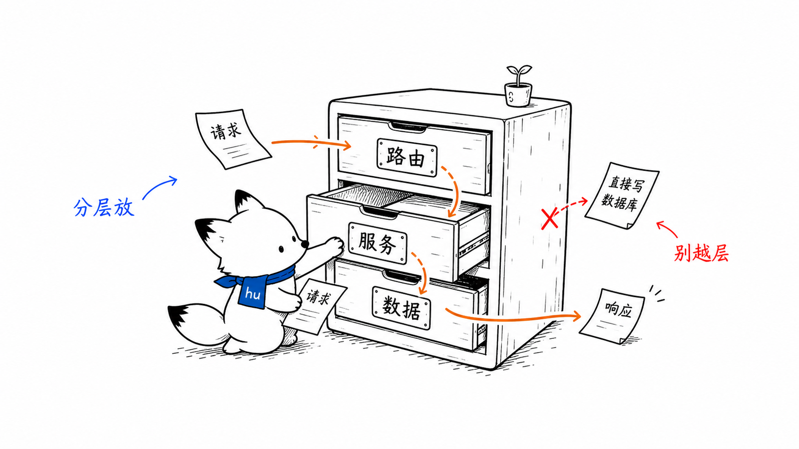
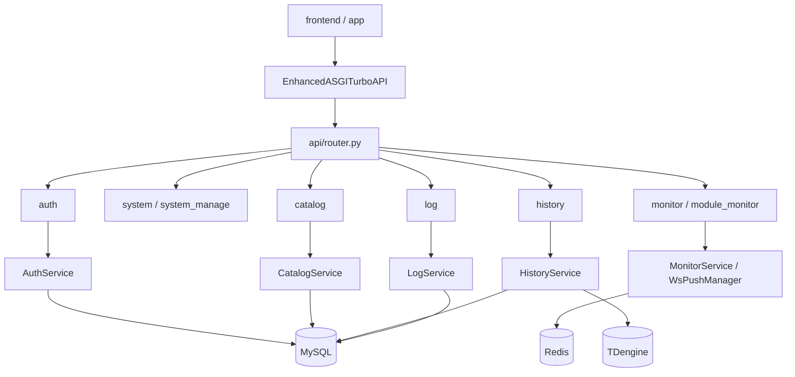
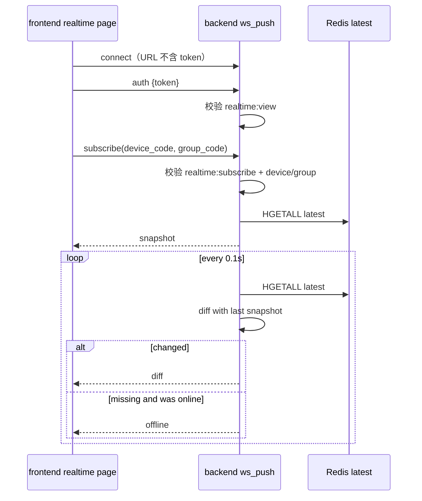
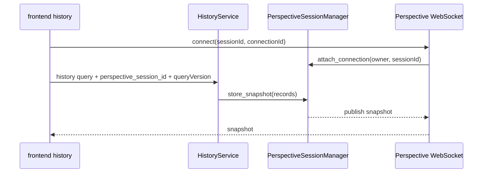

# backend 服务分层与实时历史通道
<!-- xiaohu-illustration:backend-channels-01-layers -->


> 本文是《中心后端-backend》的深度展开，聚焦 backend 的 ASGI 装配、路由分层、三数据源选择、RBAC 权限、实时 WebSocket、历史查询与 Perspective 会话。

---

## 1. 启动与应用装配

```text
backend/main.py
  -> _inject_workspace_site_packages()
  -> create_app()

backend/app/main.py
  -> create_app()
       -> EnhancedASGITurboAPI(...)
       -> add CORS middleware
       -> register exception handlers
       -> include api/router.py
       -> register_ws_push_websocket()
       -> register_perspective_websocket()
       -> lifespan startup/shutdown
```

backend 使用项目自定义的 `TurboAPI` / `EnhancedASGITurboAPI`，不是标准 FastAPI。增强层承担：

- ASGI `lifespan` 分发；
- HTTP 请求路由、参数绑定、响应编码；
- WebSocket 分发；
- CORS 预检；
- 统一异常处理；
- 依赖解析与权限校验入口。

设计取舍：定制能力强、依赖轻，但框架增强层逻辑集中，是后续维护重点。

---

## 2. 路由与服务分层



路由层只做：请求解析、权限声明、调用 service、返回响应。业务逻辑应放在 `services/`；数据库连接封装在 `db/`。

---

## 3. 三数据源选择原则

| 场景 | 数据源 | 原因 |
|------|--------|------|
| 当前点位值、短窗口 | Redis | collector 已写 latest/window，延迟最低 |
| 入库历史、图表、导出、矩阵 | TDengine | 高吞吐时序存储，按时间范围查询 |
| 设备/点位/分组/协议 | MySQL | 关系配置事实源 |
| 用户/角色/菜单/权限 | MySQL | RBAC 关系模型 |
| 系统日志、操作日志 | MySQL / TDengine 日志卷 | 应用日志入 MySQL，TDengine 服务日志来自挂载目录 |
| 模块速率 | Redis Stream 累计计数 + 内存采样 | 不侵入 collector/writer，仅观测队列变化 |

backend 的职责是对前端屏蔽三类数据源差异。前端不直接访问 Redis、TDengine 或 MySQL。

---

## 4. 鉴权与 RBAC

```text
POST /api/auth/login
  -> AuthService 校验 sys_user.password_hash
  -> 签发 JWT(HS256)，token 字符串自带 Bearer 前缀
  -> 返回用户、角色、权限、菜单相关信息

受保护接口
  -> require_permissions([...])
  -> 解析 Authorization
  -> AuthService 加载用户权限码集合
  -> 与接口所需权限码求交集
  -> 无交集返回 403
```

权限设计要点：

- `sys_role` 字段是 `role_code`，不是旧文档中的 `role_key`。
- 菜单可见性与按钮权限都来自后端 RBAC，不应只靠前端隐藏。
- backend token 返回已带 `Bearer ` 前缀，调用端不要重复拼接。
- `AUTH_SECRET_KEY` 生产必须使用强随机值；默认/占位值只适合开发。

---

## 5. 实时监控通道 ws_push
<!-- xiaohu-illustration:backend-channels-02-telescope -->


### 5.1 服务端链路

```text
register_ws_push_websocket()
  -> WebSocket accept + auth
  -> receive subscribe/unsubscribe/ping
  -> WsPushManager.subscribe(device_code, group_code, transport)
  -> 全局 _change_loop SUBSCRIBE rt:change
       -> 唤醒匹配的 _push_loop(subscription_key)
       -> Redis HGETALL rt:latest:{device}:{group}
       -> first frame snapshot
       -> compare with previous snapshot
       -> changed values -> diff
       -> no data transition -> offline
```



### 5.2 为什么不直接推 collector 数据

- collector 与 backend 不直接相连，降低耦合。
- Redis latest 是实时态事实源，backend 可随时重建订阅快照。
- WebSocket 断线重连后，客户端先拿 snapshot，再继续 diff，不依赖 collector 进程内状态。

### 5.3 已知压力点

所有订阅键共享一个 `rt:change` Pub/Sub 连接，事件只唤醒匹配键；每键仍保留 1 秒兜底读取，用于 Pub/Sub 短暂断线、通知丢失和离线状态检测。Redis 读取量主要随实际变更事件增长，兜底读取量仍随活跃订阅键线性增长。

---

## 6. 历史查询链路

```text
HistoryService.query_history(...)
  -> 校验时间范围/点位数量/记录上限
  -> MySQL 查询设备与点位元数据
  -> 生成 TDengine 标识符：child table = device_code，column = td_column_name
  -> 查询当前 writer schema
  -> 必要时 fallback legacy schema
  -> 对齐时间和值
  -> REST 返回
  -> 可选 PerspectiveSessionManager.store_snapshot() + publish_snapshot()
```

历史接口覆盖：

| 方法 | 用途 |
|------|------|
| `query_history` | 多点对齐原始表 |
| `get_chart_data` | 按 interval 降采样图表 |
| `get_raw_data` | 游标/分页原始数据 |
| `get_raw_matrix_data` | 按 100ms/500ms/1s 时间桶对齐矩阵 |
| `export_history_csv` / export task | 同步/异步导出 |

当前 schema 优先：`device_data.<device_code>` 子表 + `td_column_name` 列。legacy fallback 只为兼容历史数据，不应成为新写入模型。

---

## 7. Perspective 会话

Perspective 通道解决的是“历史查询结果已生成，如何让前端大表/图表高效接收和恢复”的问题。



保护策略：

- owner 维度会话数上限；
- 全局会话数上限；
- 空闲 TTL；
- 断连恢复 TTL；
- 查询点数、时间范围、记录数上限；
- `queryVersion` 防旧查询结果覆盖新结果。

Perspective runtime 是可选依赖；未安装时应降级提示，而不是影响普通历史 REST 查询。

---

## 8. 模块监控与速率采样

桌面端 app 的 Overview / Collector / Writer 页面通过 backend module-monitor 接口获取业务指标：

```text
GET /api/device-monitor/module-monitor/collector
GET /api/device-monitor/module-monitor/writer
GET /api/device-monitor/module-monitor/rates
```

典型来源：

- Redis Stream `XLEN` / `XINFO GROUPS`：队列长度、pending、消费者状态；
- Redis DLQ `LLEN`：死信数量；
- MySQL / TDengine 健康检查；
- `RateSampler` 内存滚动窗口：采集/入库速率趋势。

这些指标是“观测链路”，不参与 collector/writer 主流程，避免监控反过来影响数据面。

---

## 9. 异常与响应约定

- 成功响应经统一包络：`{code, msg, data}`。
- 业务异常用 `ApiError` 进入统一异常处理器。
- 401 表示未认证或 token 失效。
- 403 表示已认证但权限不足。
- Redis 故障下实时接口应返回 degraded 语义，避免把系统故障伪装成“设备无数据”。
- 导出文件流可不走 JSON 包络，客户端按 Blob/下载处理。

---

## 10. 扩展检查清单

新增后端能力时，按以下顺序检查：

1. 是否已有 service 可复用，避免路由层直连数据库。
2. 是否需要权限码，若需要则同步 RBAC 菜单/按钮权限。
3. 是否影响 API 契约文档与前端类型。
4. 是否涉及 Redis/TDengine/MySQL 的事实源边界。
5. 是否需要 module-monitor 或系统日志观测。
6. 是否需要 WebSocket 协议版本兼容。

---

## 相关文档

- [后端 backend](README.md)
- [API 契约](../../03-数据与契约/契约/API契约.md)
- [WebSocket 协议](../../03-数据与契约/契约/WebSocket协议.md)
- [数据库设计](../../03-数据与契约/数据库/MySQL结构与字段.md)
