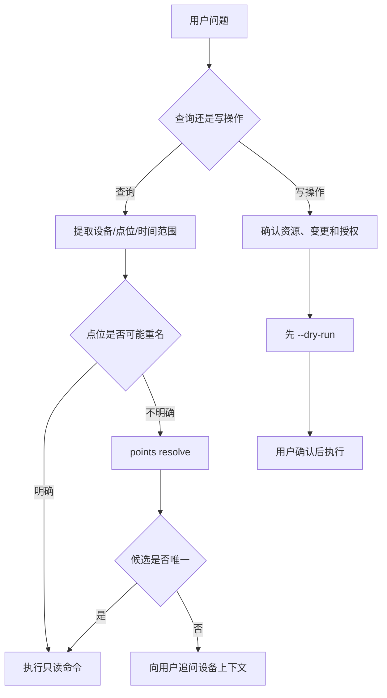

# AI 调用 CLI 指南

## 1. 适用方式

AI Agent 通过 subprocess 调用 `data-watch`，读取 stdout/stderr 和退出码。CLI 已提供命令发现、参数 schema、权限发现和稳定 JSON，因此无需 MCP 也能安全使用系统。

推荐进程模型：一次用户意图对应一个或少量短命令；实时持续读取优先使用 `realtime window`，只有用户明确要求持续监视时才使用 `realtime watch`。

## 2. 会话准备

安装后由用户或管理员完成一次配置和登录：

```powershell
data-watch config set-url https://data-watch.internal
data-watch system health
data-watch auth login --username 1514
data-watch auth capabilities
```

AI 启动任务前可执行：

```powershell
data-watch doctor
data-watch commands list
```

不要要求用户在对话中提供 Token。登录密码应由终端安全输入，或由受控自动化通过 stdin 传递。

## 3. 意图到命令的决策流程



## 4. 现场语言映射

AI 对用户展示设备和点位的现场名称，不暴露内部 ID、`varSeq` 或 `g001`。

| 用户表达 | 推荐命令 |
|---|---|
| “看看桥吊100是否在线” | `devices status --device 桥吊100` |
| “QC100 的 CraneID 现在是多少” | `realtime get --device QC100 --point CraneID` |
| “不管平台，现场 PLC 里 QC100 的 CraneID 此刻是多少” | `plc get --device QC100 --point CraneID` |
| “看轨道吊701陆侧 I101” | `realtime get --device 轨道吊701陆侧 --point I101` |
| “DB1702.DBW0 最近 10 秒变化” | `realtime window --point DB1702.DBW0 --seconds 10` |
| “AGV801 的 CraneID 9点到10点历史” | `history query --device AGV801 --point CraneID --start ... --end ...` |
| “采集和入库模块正常吗” | `modules status` |
| “最近系统错误” | `system-alerts list --level ERROR` |
| “有哪些命令我能用” | `auth capabilities` |

设备归一化示例：

- `桥吊100`、`qc100`、`QC100`；
- `轨道吊701L`、`轨道吊701陆侧`；
- `轨道吊701S`、`轨道吊701海侧`；
- `AGV801`。

点位支持 IO 地址和名称，例如 `I101`、`DB1702.DBW0`、`CraneID`。

### 现场直连（不经平台缓存）

用户明确要「现场 PLC 此刻的值」，或平台实时链路不可用时，用 `plc get`。未声明现场直连时，仍用 `realtime get`，避免无故占用 PLC 连接。

- 命令仍要先 `auth login`。没有 JWT 会拒绝，MVP 没有本机白名单。
- 结果里的 `source` 固定为 `direct_plc`，并带与采集相同的质量码。这不是 Redis `latest`。
- `topologySource` 标明拓扑来自 `mysql`、`snapshot` 或 `explicit`。MySQL 只用只读账号；库不可用时才降级到本地快照。`--endpoint` / `--address` 只在 `--topology explicit` 时生效，`auto` 不会拿它们去连任意 IP。
- MVP 只支持 S7，并且只在 Windows + Python 3.14t 上装载驱动。
- 同一 PLC（`host:port`）有最小间隔，全局并发有上限。总超时包含 MySQL 解析和断开。被限流时改回 `realtime get`。
- 不要把直连结果写回平台，也不要在命令或日志里放数据库密码和 Token。

## 5. 歧义处理

当点位可能属于多台设备时，先调用：

```powershell
data-watch points resolve CraneID
```

若返回 `ambiguous_resource`，读取 `error.details.candidates`，向用户展示设备名称、点位名称、IO 地址和描述，并询问具体设备。禁止：

- 默认使用第一条候选；
- 猜测 `PLC001`、数据库 ID 或采集组；
- 因用户没说设备而静默扩大到多台设备；
- 把内部 `deviceCode` 当作用户唯一可用名称。

## 6. 只读调用规则

1. 优先使用最窄的查询命令。
2. 历史查询必须有明确起止时间；用户使用“刚才”“最近一小时”等表达时，由 Agent 换算为绝对时间再调用。
3. 列表默认使用服务端分页；确需全量时使用 `--all-pages --max-items N`。
4. 只需要少数字段时使用 `--select`，但保留 CLI 外层输出包络。
5. AI 需要短时间实时上下文时使用 `realtime window`，避免无限运行。

示例：

```powershell
data-watch --select "item.{name:deviceName,status:connectStatus,last:lastCollectTime}" `
  devices status --device QC100
```

## 7. 写操作规则

写操作分两步：

1. 使用相同参数执行 `--dry-run`，检查解析后的资源、路径和请求体；
2. 用户明确确认后，执行真实命令并提供精确 `--confirm`，或在受控无人值守场景使用全局 `--yes`。

```powershell
Get-Content device.json -Raw | data-watch --dry-run devices create --file -
Get-Content device.json -Raw | data-watch --yes devices create --file -
```

AI 不得因为拥有 `R_SUPER` 就自行执行删除、停用、授权、密码重置、驱动卸载或日志清理。

## 8. 输出处理

成功：

- 退出码 0；
- stdout 是一个 JSON 文档；
- `ok=true`；
- 业务结果位于 `data`。

失败：

- stdout 为空；
- stderr 是一个 JSON 文档；
- `ok=false`；
- 根据退出码和 `error.type` 决定重试、追问或停止。

`realtime watch` 每行是独立 JSON 文档。调用方应逐行解析，收到 Ctrl+C/退出码 130 视为用户取消，不视为系统故障。

详细字段见 [CLI 输出契约](../../03-数据与契约/契约/CLI输出契约.md)。

## 9. 错误决策

| 错误 | AI 行为 |
|---|---|
| `usage_error` | 修正参数；缺少业务条件时追问用户 |
| `auth_required` / `unauthorized` | 请求用户重新登录，不索取 Token |
| `permission_denied` | 明确告知账号权限不足，不尝试绕过 CLI 直调 Backend |
| `resource_not_found` | 核对现场称呼或时间范围 |
| `ambiguous_resource` | 展示候选并追问，禁止默认取第一条 |
| `rate_limited` | 停止连打 PLC，改用 `realtime get` |
| `unsupported_runtime` | 说明直连 MVP 只支持 Windows + Python 3.14t |
| `unsupported_protocol` | 说明当前只支持 S7 |
| `driver_unavailable` | 说明本机没有可用的 S7 驱动包 |
| `network_error` / `timeout` | 先执行 `doctor`，只读操作可在有界次数内重试 |
| `confirmation_required` | 等待用户明确确认 |
| `api_error` / `internal_error` | 保留 requestId，停止自动写操作并报告 |

## 10. 安全规则

- 不把密码、Token、Refresh Token 写入 Prompt、命令参数、日志或聊天回复。
- 不使用 WebSocket `?token=`。
- 不把 `buttons` 当成权限码。
- 不用 `--yes` 代替用户授权。
- 不把系统日志告警解释成设备点位告警。
- 不调用 Dashboard synthetic 告警数据回答真实告警问题。
- 自动化主体使用独立账号和最小权限 Profile，便于审计与吊销。

## 11. MCP 关系

CLI 是独立可用的 AI 工具接口。MCP 的主要增益是标准化工具发现、长驻进程和跨框架接入，不会增加 Backend 业务能力。未来 MCP 应在 CLI 契约稳定基础上复用相同 Client/Resolver，不改变本文的权限、安全和歧义处理规则。
