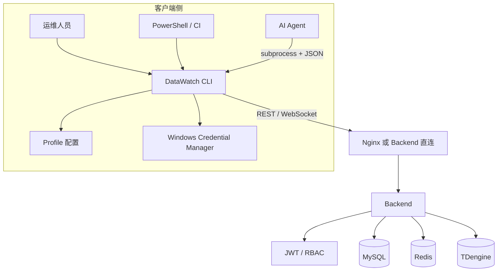
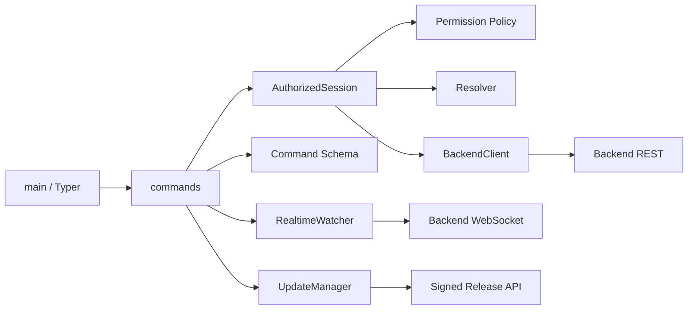
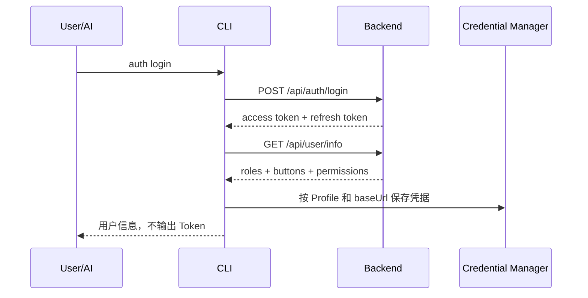
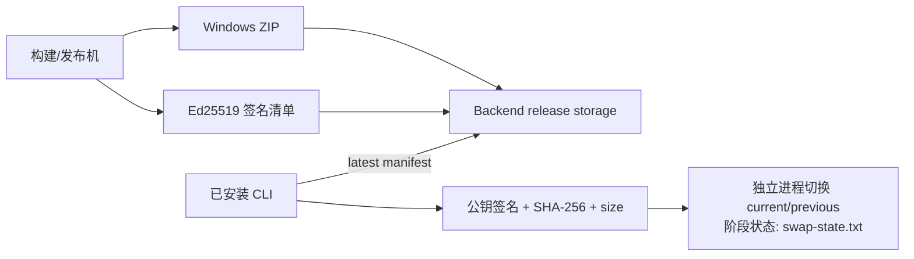

# CLI 总体设计与架构

## 1. 目标

DataWatch CLI 为三类调用方提供同一套系统能力：

- 运维人员在 PowerShell 中查询、诊断和管理；
- 自动化脚本使用退出码、JSON 和文件接口编排任务；
- AI Agent 将用户自然语言映射为可审计的 CLI 调用。

设计目标是复用 Backend 能力，而不是在本地形成第二套业务系统。

## 2. 系统位置



生产环境建议使用 Nginx HTTPS/WSS 入口。开发环境可通过 `--api-url http://127.0.0.1:8000` 直连 Backend。CLI 不请求 Vue 页面，Nginx 在这里承担 API 网关角色。

## 3. 内部分层



| 层 | 主要职责 |
|---|---|
| 入口层 | 解析全局选项，创建 requestId，统一 stdout/stderr |
| 命令层 | 参数校验、业务命令编排、文件输入输出 |
| 会话层 | 载入凭据、权限预检查、dry-run、自动分页 |
| Resolver | 把业务名称、IO 地址、点位名称解析为 Backend 所需标识 |
| Client | HTTP 包络解析、401 刷新、只读重试、原子下载 |
| Realtime | 无 Token URL 连接、认证消息、订阅、重连和点位过滤 |
| Schema | 导出命令、参数类型、必填项和权限要求 |
| Update | 验证签名/哈希，启动独立切换进程并支持回滚 |

## 4. 认证与权限

### 4.1 登录流程



`buttons` 是前端按钮可见性使用的 `auth_mark`；`permissions` 是 Backend 和 CLI 使用的 `permission_code`。CLI 不使用 `buttons` 做鉴权。

访问令牌失效时，HTTP Client 最多自动调用一次 `/api/auth/refresh`，保存轮换后的访问令牌和刷新令牌，再重放原请求。环境变量提供的 Token 不写回 Windows Credential Manager。

### 4.2 权限执行

每个叶子命令有一条 `CommandPolicy`：

- `authenticated`：是否必须登录；
- `permissionsAny`：满足任一权限码即可；
- `rolesAny`：满足任一角色即可。

CLI 预检查失败返回退出码 4，不发送业务请求。即使 CLI 放行，Backend 仍必须执行同等或更严格的鉴权。

## 5. 业务标识解析

用户不需要知道 `deviceId`、`varSeq` 或内部 `groupCode`。

| 用户输入 | CLI 处理 |
|---|---|
| `桥吊100`、`QC100` | 归一化为同一设备查询键 |
| `轨道吊701L`、`轨道吊701陆侧` | 归一化为 ASC 陆侧编码规则 |
| `轨道吊701S`、`轨道吊701海侧` | 归一化为 ASC 海侧编码规则 |
| `AGV801` | 按设备编码/名称匹配 |
| `I101`、`DB1702.DBW0` | 按 IO 地址解析点位 |
| `CraneID` | 按点位名称解析 |

匹配顺序是精确、前缀、包含。只有最佳候选唯一时才自动选择；歧义时返回结构化候选，调用方必须补充设备上下文，不能默认取第一条。

Resolver 在单次 CLI 进程内缓存设备、历史点位和业务点位查询结果。普通 CLI 不承诺跨进程缓存，未来常驻服务可复用同一 Resolver。

## 6. 读写调用链

### 6.1 只读命令

1. 解析 Profile、URL 和超时；
2. 载入当前 Backend 作用域的凭据；
3. 获取并缓存用户信息，执行本地权限预检查；
4. Resolver 按需要解析业务标识；
5. GET/HEAD 遇到瞬时网络错误或 429/502/503/504 时有限重试；
6. 将 Backend `data` 包装为 CLI 输出契约。

### 6.2 写命令

写请求默认不自动重试，避免重复创建或重复修改。高风险命令先校验 `--confirm` 或全局 `--yes`；`--dry-run` 只完成参数、权限和请求构造，不发送写请求。

`--idempotency-key` 会作为 `X-Idempotency-Key` 随写请求发送，目前用于跨层追踪；只有 Backend 对应端点实现去重时才具有业务幂等语义。

## 7. 实时通道

CLI 连接不含 Token 的 WebSocket URL，连接成功后依次发送：

```json
{"type":"auth","token":"<登录接口返回的原值>"}
```

```json
{"action":"subscribe","device_code":"QC100","group_code":"g001"}
```

`realtime get/window/watch` 面向用户时优先接收点位名称或 IO 地址，设备和采集组由 Resolver 推断。`watch` 使用 JSON Lines 持续输出，连接异常时最多重连 3 次并重新认证、重新订阅；`window` 提供适合 AI 的有界时间和事件数。

实时连接要求 `device_monitor:monitor:view` 或 `device_monitor:realtime:view` 任一权限；每次订阅还要求 `device_monitor:realtime:subscribe`，并由 Backend 校验设备/分组授权。CLI 认证首帧后再发送订阅，收到 403 时不重复请求。

## 8. 可靠性与安全

- 凭据按 Profile 保存到 Windows Credential Manager，并绑定规范化 Backend URL；切换 URL 会清理旧凭据。
- 密码通过交互输入或 stdin 传递，不作为命令参数。
- 成功输出不包含 access token、refresh token 或密码；dry-run 会脱敏敏感字段。
- 文件下载先写 `.tmp`，完成后原子替换目标文件。
- `--all-pages` 有 `--max-items` 上限，避免 AI 无限拉取。
- 通用异常默认不暴露堆栈和内部消息；`--debug` 只额外返回异常类型。
- WebSocket 不使用 query token，避免凭据进入 shell history、进程列表和代理日志。

## 9. 安装与更新

CLI 以 Windows x64 one-folder ZIP 交付，安装目录采用 `current` / `previous` 双版本结构。安装脚本和更新脚本都在切换失败时恢复旧版。自动更新的切换过程把已完成阶段写入 `<InstallRoot>\swap-state.txt`，失败时只撤销已完成的步骤、不无条件删除仍有效的 `current`（任何失败路径下都至少留一份可运行旧版本），崩溃后下一次运行按该状态文件重建。

更新信任链：



私钥不进入仓库或安装包；客户端只内置受信任公钥。详细步骤见 [CLI 安装与更新](../../04-运维部署/CLI安装与更新.md)。

## 10. MCP 扩展边界

AI 目前通过 CLI subprocess 即可完成工具发现、权限检查和系统操作。未来 MCP 若立项，应复用 Client、Resolver、CommandPolicy 和错误契约，并单独设计 WebSocket 长任务、取消、背压和流式输出；不得再实现一套平行业务逻辑。
