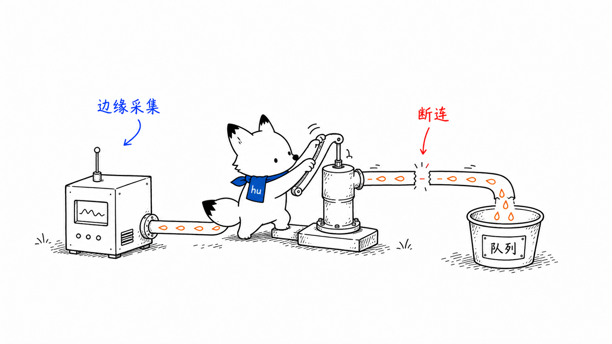
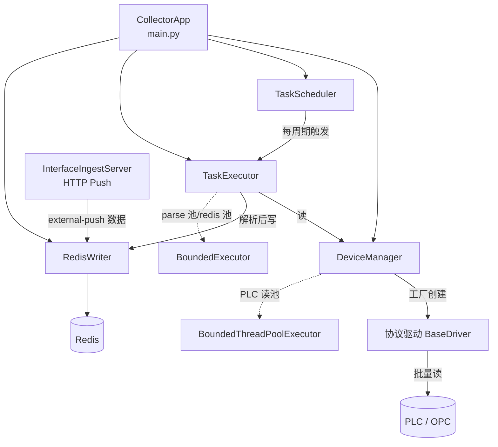
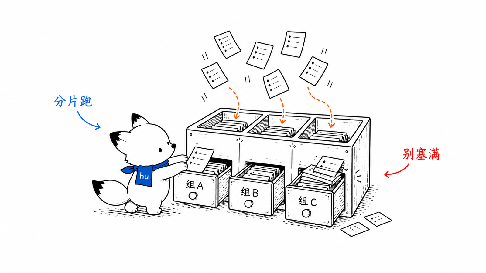
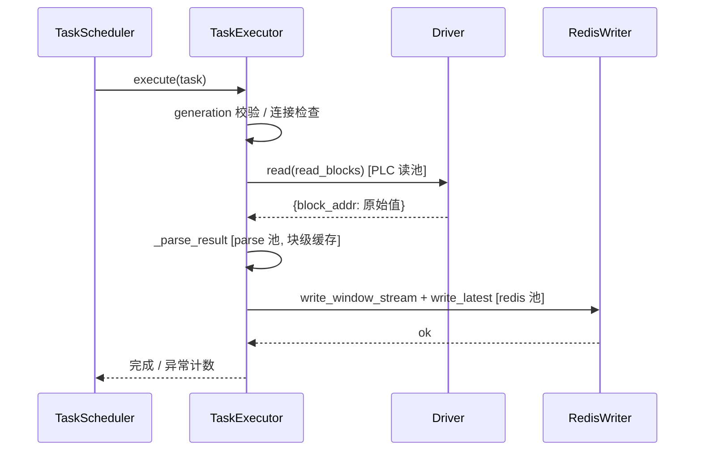
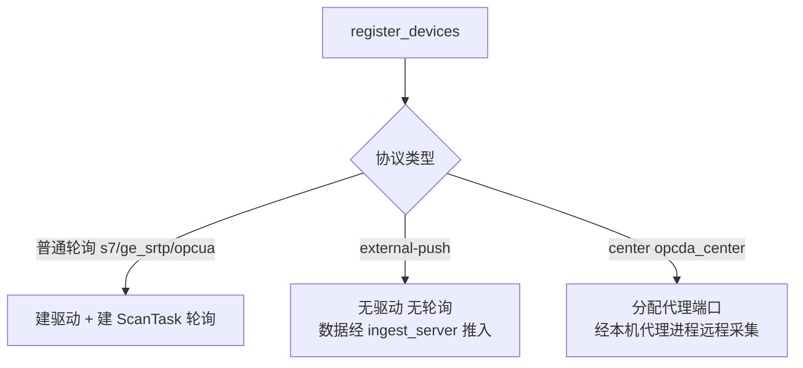

# 采集端 collector 设计文档
<!-- xiaohu-illustration:collector-readme-01-pump -->


> collector 是平台的数据源头：按周期从现场 PLC/OPC 设备采集点位，解析为统一数据点后写入 Redis，供入库端与后端消费。本文覆盖其架构、核心组件、采集流水线、对外契约、配置与扩展方式。
>
> 上游全局视图见《01-总体设计/系统架构总览》；Redis 数据结构的完整契约见《03-数据与契约/数据库/Redis结构与字段》。

---

## 1. 概述

collector 是一个**单 OS 进程、多协程、多线程池**的采集服务，运行在边缘侧、贴近现场设备。它不是“每台设备一个进程”，也不是“单线程轮询”：主进程内由 asyncio 调度周期任务，并把 PLC 读、解析、Redis 写入等阻塞/耗 CPU 阶段交给有界线程池；运行时使用 free-threaded Python 3.14t，使这些显式线程池中的 Python 代码具备更好的多核并行空间。

> 进程边界说明：`data-watch-collector.exe` 自身是单进程部署形态；OPC DA proxy / sidecar 是由 agent 管理的外部辅助进程，不计入 collector 主进程，也不作为 collector 的子进程内存口径。

collector 的职责边界是：

- **采集**：按设备配置的扫描周期，通过协议驱动批量读取 PLC/OPC 点位；
- **解析**：把合并读块的原始字节/字按点位定义还原为具体值；
- **下发**：将结果写入 Redis 的实时态、滑动窗口与消费队列三种结构；
- **自治**：设备连接的建立、健康检查、断线重连、配置热更新，全部在进程内自管。

collector **只写 Redis**，不直接落库；入库由下游 writer 异步完成。两者通过 Redis 解耦，无代码级调用关系。

入口：`collector/main.py:574`（`main()`）。

---

## 2. 设计目标与范围

| 目标 | 实现要点 |
|------|----------|
| 高频、多设备并发采集 | 单进程部署 + asyncio 调度 + 有界线程池；free-threaded Python 3.14t 提供线程池多核并行空间 |
| 采集互不干扰 | 单设备 in-flight 串行；设备级熔断与独立重连 |
| 削峰、不堆积 | crc32 相位错开；周期补偿调度；三段有界池背压 |
| 配置可热更新 | 10 秒轮询 MySQL，按设备增/删/改增量重建，不停整机 |
| 数据不谎报 | generation 失效校验贯穿读/写；写序保证 latest 最后落 |

**不在本模块范围**：数据落库（writer）、对前端供数（backend）、进程启停管控（agent）。

---

## 3. 核心概念与术语

| 术语 | 含义 |
|------|------|
| **设备 Device** | 一台被采集的物理/逻辑设备，绑定一种协议与一组变量。`collector/device/device.py` |
| **变量 / 点位 Variable** | 设备上的一个采集点，含地址、数据类型、扫描周期、点位分组、是否入库 |
| **扫描任务 ScanTask** | 同一扫描周期下、同设备的一批变量 + 合并读块。一个设备可有多个周期 → 多个 ScanTask |
| **合并读块 ReadBlock** | 把连续地址的多个点位合并为一次批量读取，降低 I/O 次数。`collector/drivers/base.py:8` |
| **采集任务 CollectTask** | 调度的最小单位 = 一个设备的一个 ScanTask；构造时把扫描元数据冻结为不可变快照 |
| **点位分组 group_code** | 点位按业务分组组织，Redis 键以分组为粒度 |
| **generation 代次** | 设备的单调递增版本号，用于热重载时让旧周期数据失效 |
| **三类协议** | 普通轮询（s7/ge_srtp/opcua）、外部推送 external-push、中心采集 center（经代理进程） |

---

## 4. 架构与目录结构

```
collector/
├── main.py                  # 入口：配置加载 + CollectorApp 装配 + 生命周期
├── collector/               # 采集核心
│   ├── scheduler.py         # TaskScheduler 周期调度
│   ├── task.py              # CollectTask / ScanTaskSnapshot 任务与快照
│   ├── executor.py          # TaskExecutor 采集执行（读→解析→写）
│   └── bounded_executor.py  # BoundedExecutor 有界线程池（背压）
├── device/
│   ├── device.py            # Device / ScanTask / Variable 模型，读块合并
│   └── manager.py           # DeviceManager 设备/驱动生命周期、generation、重连、端口映射
├── drivers/                 # 协议驱动
│   ├── base.py              # BaseDriver 抽象接口
│   ├── s7_driver.py         # 西门子 S7（纯 Python snap7）
│   ├── ge_srtp_driver.py    # GE SRTP
│   ├── opcua_driver.py      # OPC UA
│   ├── opcda_center_driver.py # OPC DA（经本机代理）
│   └── gesrtp-py-main/      # GE SRTP 协议库
├── sidecars/                # C# 边车（OPC DA 经 Windows COM）
│   ├── opcda_proxy_service/ # 代理服务（center 采集）
│   ├── opcda_push_service/  # 推送服务（external-push）
│   └── opcda_sidecar/       # 探针
├── storage/
│   ├── redis_client.py      # Redis 连接池
│   └── redis_writer.py      # RedisWriter 三结构写入
├── core/                    # 配置、日志、重试、系统日志、OPC DA 映射等
├── monitor/                 # health / performance / ingest_server
└── data_queue/types.py      # DataPoint 等数据类型
```

组件协作关系：



### 4.1 分层边界：核心 / 驱动 / 协议库

采集链路分三层，职责不要混谈：

| 层 | 谁 | 负责什么 | 不负责什么 |
|----|----|----------|------------|
| **采集核心** | `TaskScheduler` / `TaskExecutor` / `DeviceManager` / `RedisWriter` | 周期调度、错峰、单设备 in-flight、有界池背压、generation、读块合并编排、解析后写 Redis | 不直接调用 snap7 / 协议厂商 SDK |
| **协议驱动** | `BaseDriver` 实现（如 `S7Driver`） | `connect` / `disconnect` / `read(blocks)` / `write` / 可选 `ping`；把统一接口翻译成具体协议读写 | 不实现调度、不写 Redis、不管跨设备并发策略 |
| **协议库** | snap7、自研 GE SRTP、OPC UA 客户端等 | 驱动**内部**调用的底层读写（单点、连续段、连接） | 不被调度器直接引用 |

调用关系固定为：

```text
TaskScheduler
  → TaskExecutor.execute
      → driver.read(read_blocks)     # 只认 BaseDriver
          → 驱动内部再调 snap7 / 其它协议库
```

因此：调度器调度的是「驱动接口上的函数」，不是「snap7 的某个 API」。新增协议时实现并注册一个 `BaseDriver` 即可接入同一套并发与入库链路；协议库细节封装在驱动内部。

地址合并（连续点合成 `ReadBlock`）当前在核心的 `Device.build_scan_tasks`；解析还原在 `TaskExecutor._parse_result`。驱动侧主要交付「按块读回原始值」。

---

## 5. 关键组件

### 5.1 CollectorApp（装配与生命周期）

`collector/main.py:85`。在构造期完成全部组件装配并注入依赖：性能指标、系统日志、专用 PLC 读线程池、DeviceManager、TaskScheduler、RedisWriter、parse/redis 有界池、TaskExecutor、健康检查、OPC DA 映射器、可选 HTTP 接入服务。

启动顺序（`start()` `main.py:169`）：ping Redis → 注册设备 → 连接所有设备 → 为每设备每 ScanTask 建 CollectTask 并入调度 → 启动调度器 → 启动 HTTP 接入 → 健康检查 → 配置热更新轮询 → 性能日志循环。

停机（`shutdown()` `main.py:257`）：取消热更新/性能/健康任务 → 停调度器 → 停接入服务 → drain parse/redis 池 → 断开设备 → 关 PLC 读池 → 关连接池。整个过程有 `SHUTDOWN_DRAIN_TIMEOUT` 上限，超时则放弃等待并记未完成 job 数。

> **停机信号**：除信号量外，collector 还监听 `runtime/collector.shutdown_flag` 文件（`_watch_shutdown_flag` `main.py:73`）。agent 通过写该文件来停止 collector 进程；启动时会先清理上一轮残留 flag。

### 5.2 DeviceManager（设备与驱动生命周期）

`collector/device/manager.py:248`。负责设备注册、驱动创建、连接、健康检查、重连、generation 管理、center 协议端口映射。

- **驱动工厂** `_create_driver` (`manager.py:792`)：按协议名映射到内置驱动（s7 / ge_srtp / opcua / opcda_center）。**新增协议在此注册。**
- **连接保护**：每设备一个熔断器 `CircuitBreaker`（5 次失败 OPEN、60s 恢复）+ `with_retry`（3 次指数退避）+ 全局连接信号量（并发 10）。
- **重连**：`schedule_reconnect` (`manager.py:853`) 启动每设备重连协程，延迟按 `_next_reconnect_delay` 指数退避（30s→上限 300s）叠加 0.2 抖动，避免重连风暴。
- **generation 机制**：`_activate_device`/`_advance_device_generation`/`invalidate_device` 维护每设备单调代次，配 per-device `threading.RLock`。`is_current_generation` / `run_if_current_generation` 保证热重载后旧周期不写、且 invalidate 与写入不交错。

### 5.3 TaskScheduler（周期调度）

`collector/collector/scheduler.py:30`。为每个 CollectTask 起一个独立 asyncio 循环。三个关键策略：

1. **相位错开**（`_initial_phase_seconds` `scheduler.py:95`）：初始相位 = `crc32(device_id) % 周期`，把同周期设备的首发时刻打散，避免齐发尖峰。
2. **单设备 in-flight 串行**（`_try_begin_device_execution` `scheduler.py:66`）：同一设备同一时刻只允许一个采集在飞行，其余进等待队列或跳过（计 `device_inflight_skip_count`）。这与 PLC 单连接不可并发的约束一致。
3. **周期补偿 + deadline 监控**（`_run_loop` `scheduler.py:141`）：执行耗时 < 周期则补足等待，≥ 周期则立即进入下一轮（不堆积）；deadline 滞后超阈值计入 `deadline_miss_count`。

热重载用 `reload_device_tasks` (`scheduler.py:240`)：取消该设备旧循环、清状态、注册新任务，不影响其他设备。

### 5.4 TaskExecutor（采集执行）

`collector/collector/executor.py:38`。单周期采集的核心流水线 `execute()` (`executor.py:77`)：

1. **generation 校验** → 失效则丢弃（计 `stale_generation_drop_count`）；
2. **连接检查** → 未连接则抑制日志并调度重连；
3. **批量读** `driver.read(read_blocks)`（PLC 读池）→ 池满（`ExecutorSaturatedError`）视为背压、丢本周期、不标设备错误、不触发重连；
4. **解析** `_parse_result`（parse 池）→ S7 合并块用块级缓存，同块只转一次 bytearray（O(N²)→O(N)，即历史 CPU 热点的修复点）；
5. **写 Redis** `_write_to_redis`（redis 池）→ 先 `write_window_stream` 合并写，再 `write_latest`。

值还原：`_extract_mapped_s7_value` (`executor.py:425`) 按 byte/bit 偏移与类型（BYTE/INT/WORD/REAL/DINT/DWORD/BOOL）解码；`_extract_mapped_ge_value` (`executor.py:455`) 按 word 偏移与字序解码 GE 寄存器/离散量。bool 统一转 `"1"/"0"`，避免下游 `float()` 解析失败。

> **写序不变式**：window+stream 必须先于 latest 落库。latest 是"本批次已落库"的信号，若先刷新 latest 而 stream 失败，下游会误判批次完整。

### 5.5 BoundedExecutor（有界池背压）

`collector/collector/bounded_executor.py`。collector 用三类有界池隔离不同阶段：**PLC 读池**（阻塞型 snap7/GE 读，避免与 Redis 写抢线程）、**parse 池**、**redis 池**。池满即抛 `ExecutorSaturatedError`，上层据此丢弃当前周期而非排队堆积——以丢单周期换取系统不雪崩。

### 5.6 InterfaceIngestServer（外部推送接入）

`collector/monitor/ingest_server.py`。对 external-push 协议（如 OPC DA push、HTTP push）提供 HTTP 接入端点：外部进程把数据推入，经 OPC DA 映射器转换后走同一条 RedisWriter 链路。这类设备在 collector 内无轮询任务、无 PLC 驱动。

---

## 6. 主要流程
<!-- xiaohu-illustration:collector-readme-02-shards -->


### 6.1 单周期采集流水线



### 6.2 配置热更新

`_config_reload_loop` (`main.py:373`)：每 10 秒查 MySQL 的设备配置版本表，对比得出 added / removed / changed：

- **新增** → `add_device` + 连接 + 注册任务；
- **删除/禁用** → `invalidate_device`（先 tombstone）+ 取消调度 + `remove_device`；
- **版本变更** → 若设备连接字段变了则整设备重建，否则仅重建变量与任务。

每轮以一次完整快照为权威，刷新内存配置、OPC DA 映射器与接入元数据；单台失败不中断整轮。

### 6.3 协议分流



---

## 7. 对外接口与契约

### 7.1 Redis 写出（主输出）

`collector/storage/redis_writer.py`。三种结构（键名以 device_code / group_code 为粒度）：

| 结构 | 键 | 内容 |
|------|-----|------|
| latest（Hash） | `rt:latest:{device_code}:{group_code}` | 各点位最新值 `{v, t, q}`，无 TTL |
| window（List） | `rt:window:{device_code}:{group_code}:{scan_rate_ms}` | 最近 10 帧完整帧 |
| stream（Stream） | `rt:stream:{device_type}:{group_code}:{shard}` | 入库消费队列，`shard=crc32(device_code)%N`；过滤 STRING 与 is_storage=0 |

序列化用 `msgspec`；window 与 stream 合并进一个非事务 pipeline（每设备每周期 Redis 往返 3→2）。完整字段定义见《03-数据与契约/数据库/Redis结构与字段》。

### 7.2 其他接口

- **HTTP 接入**（external-push）：`InterfaceIngestServer` 暴露的接入端点（host/port/path/api_key 可配）。
- **设备状态回写**：经 `status_reporter` 回写 MySQL 设备在线状态（注入自 `config_db_manager.update_device_status`）。
- **停机 flag**：`runtime/collector.shutdown_flag` 文件（agent → collector 停机信号）。
- **端口映射**：center 协议读取 agent 生成的权威 `port_mapping.json`（`--port-mapping` 或 `COLLECTOR_PORT_MAPPING`），权威模式只读、缺失即 fail-fast。

---

## 8. 配置说明

配置来源分两层（`main.py` `main()`）：

1. **运行参数**：`config/settings.toml`（或 `COLLECTOR_CONFIG`）——日志、Redis/MySQL 连接、扫描与池参数、`interface_ingest`、`enable_fake_bootstrap` 等。
2. **设备与点位拓扑**：以 **MySQL 为准**，启动时由 `ConfigDBManager.load_config` 加载并**覆盖** TOML 中的 devices/variables。

数据库凭据为单一来源，由 agent 经环境变量（`DATAWATCH_<DB>_<FIELD>`）注入；settings.toml 仅作开发期回退。详见《03-数据与契约/数据库/MySQL结构与字段》与《05-运维部署》。

命令行：`--dry-run`（只做配置预检，输出设备/点位/合并块统计，不启动采集）、`--config`、`--runtime-dir`、`--port-mapping`。

MySQL 不可用且 `enable_fake_bootstrap=true` 时，回退为假拓扑（`_build_fake_topology` `main.py:535`）用于联调验证 Redis 链路。

---

## 9. 设计决策与权衡

| 决策 | 理由 / 权衡 |
|------|-------------|
| 只写 Redis、与 writer 解耦 | 采集与入库互不阻塞，单侧故障不扩散；代价是端到端多一跳缓冲 |
| 自由线程 Python 3.14t | collector 仍是单进程部署，但 PLC 读、parse、Redis 写等显式线程池不再受传统 GIL 限制；收益来自明确的 executor 并行，不是 event loop 自动变多核 |
| msgspec 序列化 | orjson 在自由线程下不兼容；msgspec 兼容且高效 |
| 三段有界池 + 丢周期背压 | 宁可丢单个采集周期，也不让任务堆积引发雪崩与重连风暴 |
| generation 失效协议 | 热重载/下线瞬间，旧周期的迟到数据不得污染新配置下的 Redis |
| 单设备 in-flight 串行 | PLC 单连接不可并发；串行是正确性约束而非性能选择 |
| crc32 相位错开 / 稳定分片 | 内置 `hash()` 受 `PYTHONHASHSEED` 影响每进程不同，crc32 跨进程稳定 |
| center 端口权威只读 | agent 生成权威映射，collector 只读、缺失即报错，避免动态分配漂移 |
| 外置驱动 `datawatch_ext` 合成包 | 隔离驱动自身模块名；**不是**第三方依赖多版本隔离（pymodbus 仍进全局 `sys.modules`，一进程单版本） |
| `CONFIG_ERROR` 与热重载回滚 | 单设备非法配置不拖垮进程；热重载失败保留上一代 tasks，禁止先删旧再报错 |
| Modbus `unit_id`=`slot`（仅 None→1） | 合法范围 `[1,247]`；禁止 `slot or 1` 吞掉 `0` |

---

## 10. 已知问题与技术债

> 以下为代码注释与运行约束中明确标注的待办项，供技术债清理阶段参考（此处只记录，不在本文处理）。

- **GE SRTP 字序与码表待真机校准**：`_extract_mapped_ge_value` 当前仅支持 `word_order="low_high"`，REAL/DINT/DWORD 字序需现场已知值校验后固化（`executor.py:474`）。
- **S7 多变量批量读为"假批量"**：底层 snap7 的 `read_multi_vars` 实为循环单读；按 DB 号合并连续块为第一层优化，multi_vars 第二层暂缓。
- **OPC DA 依赖 Windows COM**：center/external-push 经 C# sidecar，受 Windows 平台与 COM 环境约束。

---

## 11. 扩展方式：新增一个协议驱动

> 前提见上文「4.1 分层边界」：你扩展的是**驱动层**，不是改调度器去直接调协议库。

### 11.1 外置驱动包（推荐，试点：Modbus TCP）

完整制作、打包与安装步骤见：[外置驱动包制作指南](外置驱动包制作指南.md)。

1. 在 `DATAWATCH_DATA_ROOT/drivers/<id>/` 放置 `driver.toml` + Python 包 + 可选 `vendor/` + `vendor_meta.toml`（版本/许可/哈希）。
2. 实现 `create_driver(context: DriverContext)`；声明 `batch_contiguous` 时提供 `build_read_plan` / `decode_read_results`。
3. collector 启动扫描注册表经 `datawatch_ext.<id>` 加载；导入期临时使用 vendor 路径，禁止永久污染 `sys.path`。
4. 非法地址/类型 → 设备 `CONFIG_ERROR`（禁连、禁采、禁重连），并暴露 `config_error`。

### 11.2 内置驱动（S7 / GE 等既有路径）

1. 在 `collector/drivers/` 新建驱动类，继承 `BaseDriver`（`drivers/base.py`），实现 `connect` / `disconnect` / `read(blocks)->{address: value}` / `write`，按需重写 `ping`。同连接的批量读需持有 `_read_lock`。协议库只在本驱动类内部调用。
2. 在 `DeviceManager._create_driver` 注册协议名 → 驱动类。
3. 若新协议是外部推送或中心采集，按需把协议名加入 `EXTERNAL_PUSH_PROTOCOLS` 或 `CENTER_COLLECTION_PROTOCOLS`，以走对应的分流分支。
4. 若读取需要按地址合并块或自定义解析，扩展 `device.build_scan_tasks` 的块合并与 `TaskExecutor._parse_result` 的还原分支。
5. 补充对应单元测试（参考 `collector/tests/test_s7_driver.py`、`test_runtime_topology.py`）。

---

## 相关文档

- [系统架构总览](../../01-总体设计/系统架构总览.md)
- [writer 入库端](../writer/README.md)（下游消费方）
- [调用链与协议设计](调用链与协议设计.md)（调用链、协议分流、读块合并、热更新）
- [外置驱动包制作指南](外置驱动包制作指南.md)（ZIP 清单、打包、安装与 checklist）
- [Redis 流与点位分组](../../03-数据与契约/数据库/Redis结构与字段.md)（Redis 结构完整契约）
- [数据库设计](../../03-数据与契约/数据库/MySQL结构与字段.md)（设备/点位配置表)
