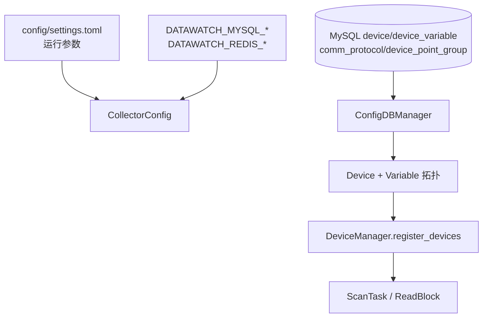
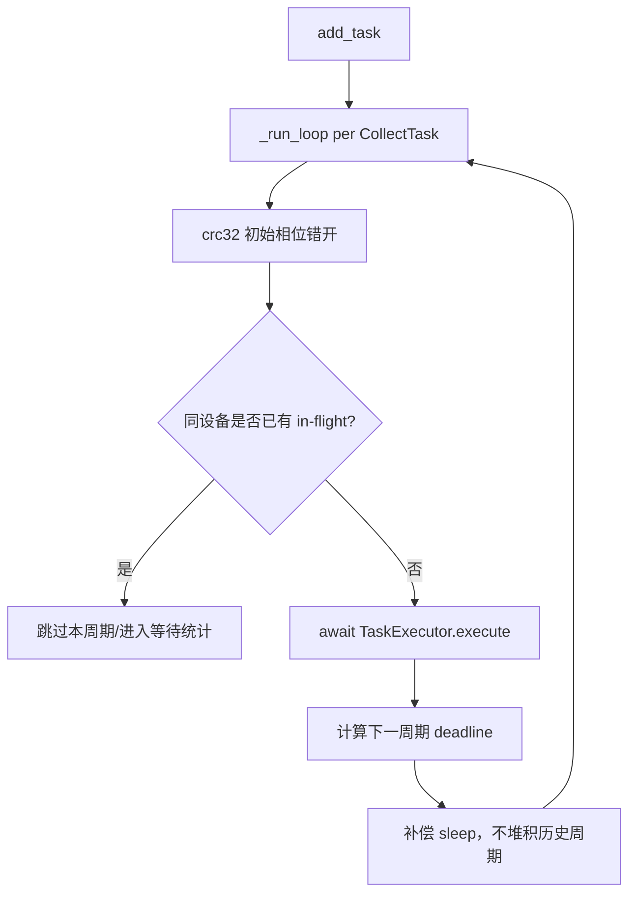
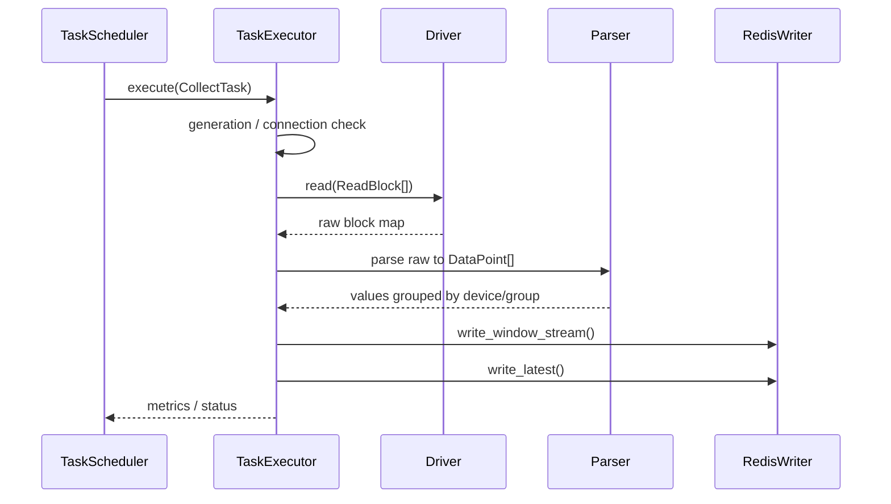
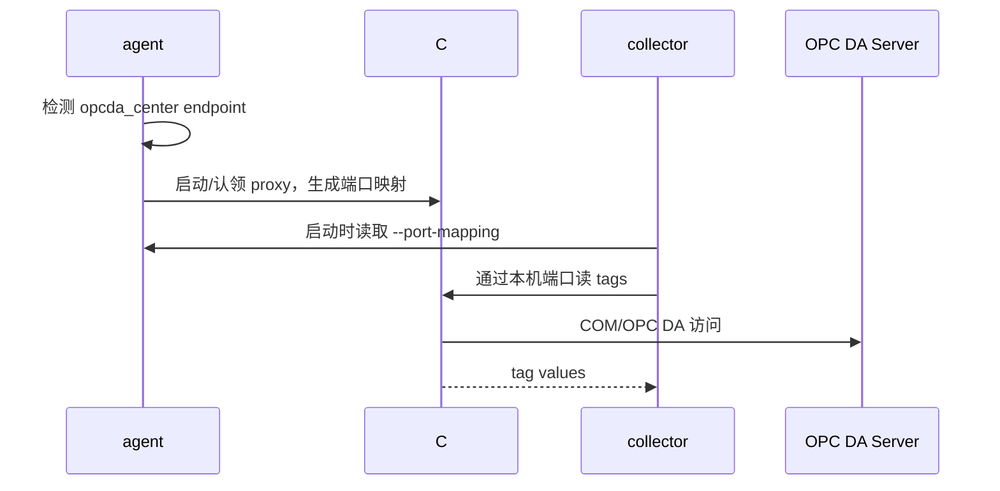
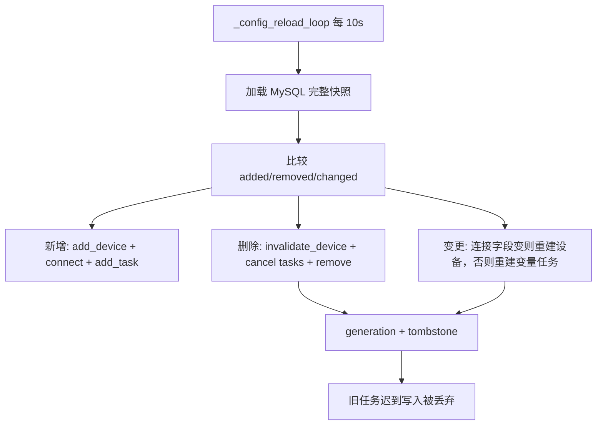

# collector 调用链与协议设计

> 本文是《采集-collector》的深度展开，聚焦 collector 从启动、配置加载、设备注册、周期调度、协议读取、结果解析到 Redis 写出的完整调用链，以及多协议接入的设计边界。

---

## 1. 启动调用链

collector 的启动不是“读一个配置然后循环采集”，而是先建立运行时、再从 MySQL 权威拓扑生成任务。部署形态上它是一个 `data-watch-collector.exe` 主进程；并发模型上则是 asyncio 任务调度 + 多个有界线程池。free-threaded Python 3.14t 的价值在这些显式线程池中体现：它让 PLC 读、解析、Redis 写等阶段具备更好的多核执行空间，但不会把单个 event loop 自动变成多进程或自动并行。

```text
collector/main.py
  -> main()
  -> load_collector_config_from_env()
  -> ConfigDBManager.load_config()
  -> ConfigDBManager.load_devices_and_variables()
  -> validate_config()
  -> CollectorApp(...)
  -> CollectorApp.start()
       -> Redis ping
       -> DeviceManager.register_devices()
       -> DeviceManager.connect_all()
       -> build CollectTask per device/scan_rate
       -> TaskScheduler.start(TaskExecutor.execute)
       -> InterfaceIngestServer.start()       # external-push 可选
       -> health / config_reload / perf loops
```

关键设计：

- TOML 只承载运行参数，设备、点位、协议、分组以 MySQL 为准。
- `CollectorApp` 在构造期完成依赖注入，避免调度循环中临时拼装对象。
- 启动时先注册所有设备与 ScanTask，再交给调度器按周期运行。
- agent 停机时写 `runtime/collector.shutdown_flag`，collector watchdog 观察到后触发优雅 shutdown。

### 1.1 运行时并发模型

```text
data-watch-collector.exe
└─ collector 主进程
   ├─ asyncio event loop / TaskScheduler 周期任务
   ├─ DeviceManager 设备连接、重连、generation 管理
   ├─ PLC 读线程池
   ├─ parse 有界执行器
   ├─ redis 写有界执行器
   └─ InterfaceIngestServer（可选 HTTP push）

agent 管理的外部辅助进程
└─ OPC DA proxy / sidecar（不计入 collector 主进程）
```

因此，“collector 单进程”只描述 OS 进程部署边界；性能和并发能力来自单进程内的 asyncio 调度、有界线程池和 free-threaded Python 3.14t。若现场要隔离故障域，应该在 agent/部署层评估多 collector 实例或设备分区，而不是误以为当前 collector 内部已经是一设备一进程。

---

## 2. 配置加载与拓扑生成



### 2.1 运行参数

运行参数包括：日志、Redis/MySQL 连接、线程池/有界池大小、采集间隔、HTTP ingest 开关、fake bootstrap 等。这些参数可以通过 TOML 或环境变量覆盖。

### 2.2 拓扑事实源

MySQL 中的表决定采集对象：

- `device`：设备编号、类型、协议、endpoint、启用状态；
- `comm_protocol`：协议名与连接参数；
- `device_point_group`：点位分组与 `config_version`；
- `device_variable`：点位地址、类型、扫描周期、是否入库、TDengine 列名。

collector 会按设备 + 扫描周期把变量分组为 `ScanTask`，同一扫描周期的一组变量再被合并成若干 `ReadBlock`。

---

## 3. 设备注册与驱动工厂

`DeviceManager.register_devices()` 负责把 MySQL 拓扑变成内存设备对象。核心分流在 `_create_driver()` 与协议分类常量：

| 协议形态 | 代表协议 | collector 行为 |
|----------|----------|----------------|
| 普通轮询 | `s7` / `ge_srtp` / `opcua` | 创建驱动，建立连接，生成周期 ScanTask |
| 中心采集 | `opcda_center` | 读取 agent 生成的端口映射，通过本机 proxy 采集 |
| 外部推送 | `http_push` / `opcda_sidecar` | 不建轮询驱动，外部进程经 HTTP ingest 推入 |

驱动必须继承 `BaseDriver`，实现：

```text
connect()
disconnect()
read(read_blocks) -> {block_address: raw_value}
write(...)        # 当前内置采集主链路默认只读或拒绝写
ping()            # 可选健康检查
```

设计边界：collector 是采集系统，不是 PLC 控制系统。内置驱动的生产主路径以只读采集为核心，避免把写 PLC 的高风险动作混入实时采集链路。

---

## 4. 周期调度逻辑

`TaskScheduler` 为每个 `CollectTask` 创建独立循环，核心目标是“稳定周期、错峰、不过载”。



关键点：

- **CRC32 相位错开**：同周期设备不会全部在同一时刻发起读请求。
- **同设备单 in-flight**：PLC 单连接场景下，并发读同一设备不是提速，而是错误风险。
- **周期补偿而非堆积**：一次采集超过周期时，下一轮尽快执行，但不会补跑过去错过的所有周期。
- **deadline 监控**：周期滞后计入指标，用于判断是否需要扩容或降低扫描频率。

---

## 5. 单周期采集执行链

```text
TaskExecutor.execute(task)
  -> _task_is_current()                 # generation 校验
  -> DeviceManager.get_driver()
  -> driver.read(task.read_blocks)      # PLC 读池
  -> _parse_result(raw, task.snapshot)  # parse 池
  -> _write_if_current(points)          # 写前再次校验 generation
  -> _write_to_redis(points)            # redis 池
       -> RedisWriter.write_window_stream()
       -> RedisWriter.write_latest()
```



### 5.1 为什么读、解析、Redis 写分池

- PLC 读可能阻塞，不能占满事件循环。
- 解析阶段可能有大量点位解码，历史上 S7 解析出现过每变量重建整块 bytearray 的 O(N²) 热点，已通过块级缓存优化为 O(N)。
- Redis 写失败和延迟不应让 PLC 读线程无限堆积。

有界池满时丢弃当前周期，而不是排队到内存爆炸。这是实时采集系统常见取舍：**宁可少一个周期，也不能让旧周期排队污染当前实时性**。

---

## 6. 多协议读块合并

### 6.1 S7

- DB 区按 DB 号合并连续 BYTE 范围。
- I/Q/M 区按字节范围合并。
- 解析时用块级 bytearray 缓存，同一块只转换一次。
- BOOL 按 byte + bit 提取，数值类型按大端解析。

### 6.2 GE SRTP

- `%R` / `%AI` / `%AQ` 按 word 区间合并。
- `%I` / `%Q` / `%M` 按 bit 区间合并。
- REAL / DINT / DWORD 的字序需要按现场真机校准，文档与代码保留这个风险提示。

### 6.3 OPC UA

- 以节点读取为核心，适合标准 OPC UA server。
- 连接、ping、重连仍由 DeviceManager 统一管理。

### 6.4 OPC DA center / sidecar

OPC DA 的特殊性在于传统 COM 生态通常依赖 Windows 与 32 位组件，因此不让 64 位 Python 主进程直接访问 COM。



agent 是端口映射权威，collector 只读映射；映射缺失时 fail-fast，避免 collector 自己动态分配端口导致漂移。

---

## 7. Redis 写出顺序与一致性

collector 每个周期按点位分组写 Redis：

```text
DataPoint[]
  -> group by (device_code, group_code, scan_rate)
  -> write_window_stream()
       - LPUSH/LTRIM rt:window:...
       - XADD rt:stream:...
  -> write_latest()
       - HSET rt:latest:...
```

**不变式：latest 必须最后写。**

原因：backend 实时 WebSocket 以 latest 为“当前批次可读”的信号。如果 latest 先成功而 stream/window 失败，前端会看到新值，但 writer 和短窗口缺这批数据，造成实时态与入库链路语义不一致。

---

## 8. 配置热更新与 generation



generation 是 collector 热更新的核心安全线：

- 设备变更、删除、禁用时推进 generation 或 tombstone。
- 采集前、写 Redis 前都检查任务携带的 generation 是否仍是当前代次。
- 旧任务即便在 PLC 读之后才返回，也不能写入 Redis。

---

## 9. 观测与排障入口

| 现象 | 优先看什么 |
|------|------------|
| 某设备离线 | DeviceManager 连接日志、熔断/重连日志、backend 实时页 offline |
| 全局采集变慢 | deadline miss、executor saturated、PLC 读池占用、CPU 归一化指标 |
| Redis 没有 latest | RedisWriter 错误、window/stream 是否先失败、设备是否 generation stale |
| writer 没消费到数据 | stream key 是否匹配 `device_type/group_code/shard`，collector/writer `stream_shard_count` 是否一致 |
| OPC DA center 不通 | agent sidecar 端口映射、proxy 进程、COM/DCOM 环境 |

---

## 相关文档

- [采集-collector](采集-collector.md)
- [Redis 流与点位分组](../../03-数据与契约/数据库/Redis结构与字段.md)
- [writer 可靠入库与 TDengine 写入](writer-可靠入库与TDengine写入.md)
- [agent 边缘进程编排与凭据](agent-边缘进程编排与凭据.md)
