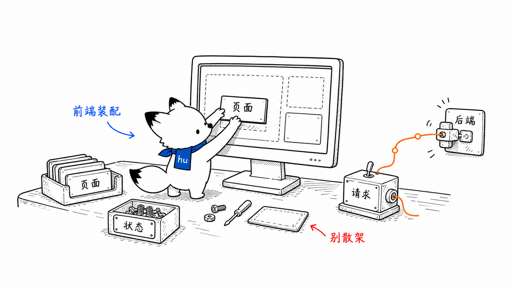
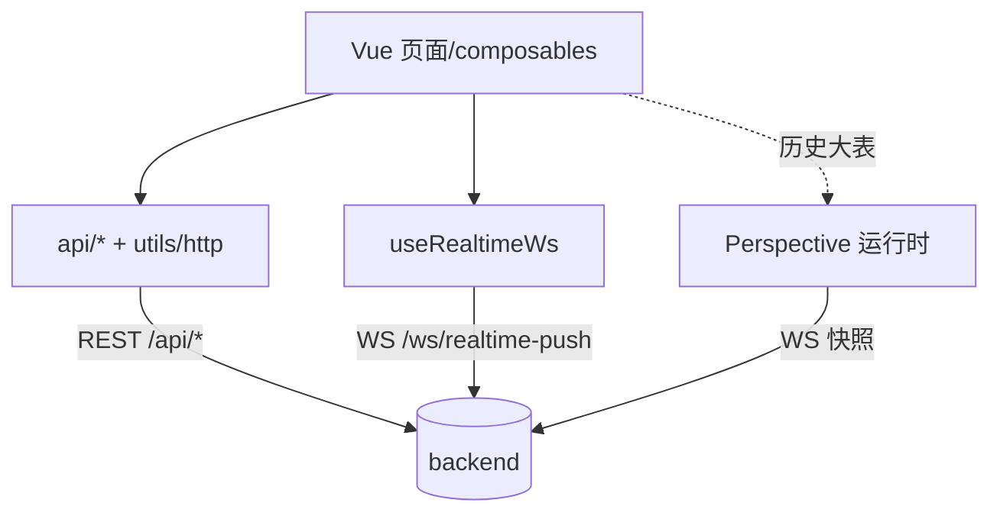
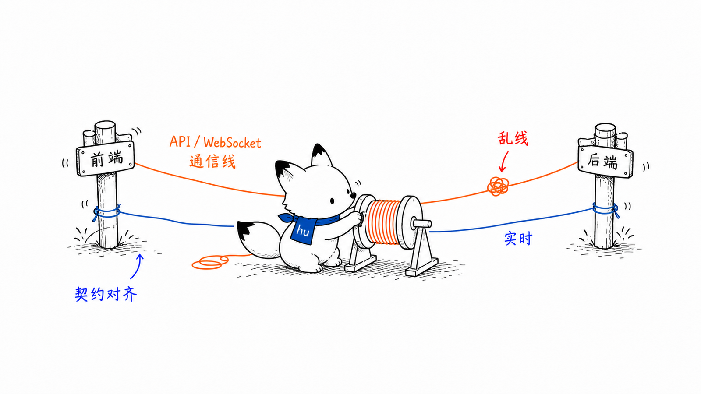
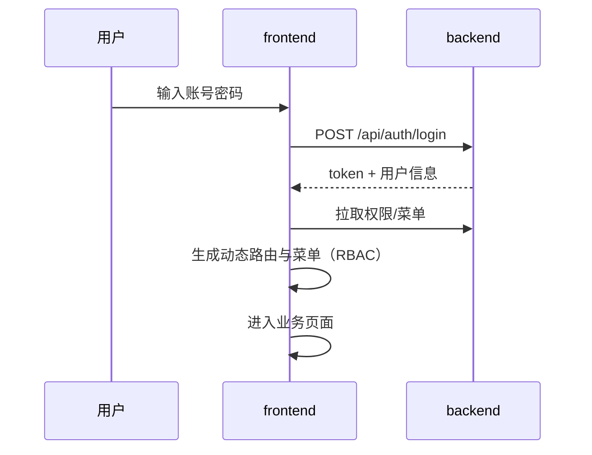

# Web 前端 frontend 设计文档
<!-- xiaohu-illustration:frontend-readme-01-screen -->


> frontend 是面向业务用户的 Web 控制台，基于 [Art Design Pro](https://www.artd.pro/docs/zh/)（Vue3 + TypeScript 管理后台模板）二次开发，提供设备与点位管理、实时监控、历史查询、系统管理（用户/角色/菜单）、仪表盘与系统日志等完整业务功能。它是与桌面端 app 分工不同的另一前端：app 面向运维（边缘监控与管控），frontend 面向业务。本文覆盖其技术栈、对接、实时通道、路由权限与设计决策。
>
> 它调用的服务见《02-模块设计/后端-backend》；接口契约见《03-数据与契约/契约/API契约》《WebSocket协议》。

---

## 1. 概述

frontend 是基于 [Art Design Pro](https://www.artd.pro/docs/zh/) 的 Vue3 管理后台模板二次开发的业务 Web 应用（Vite + TypeScript + Pinia + vue-router + i18n）。功能覆盖：

- **配置管理**：驱动、设备、点位（含 Excel 导入导出与模板）；
- **实时监控**：设备点位实时数据（WebSocket diff 推送）；
- **历史查询**：原始/降采样图表/分页/对齐矩阵/导出（部分经 Perspective）；
- **系统管理**：用户、角色、菜单与权限（RBAC）；
- **仪表盘与日志**：概览、趋势、告警分布、系统日志。

所有数据经 backend 的 `/api/*` REST 与两条 WebSocket 通道获取。

入口：`frontend/src/main.ts`；路由：`frontend/src/router/index.ts`。

---

## 2. 设计目标与范围

| 目标 | 实现要点 |
|------|----------|
| 业务全功能控制台 | views 覆盖 dashboard/device_monitor/system/auth 等 |
| 基于权限的导航 | RBAC 动态路由/菜单 + 路由守卫 |
| 实时数据低延迟 | WebSocket 订阅 + diff 增量更新 |
| 大体量历史可视 | 降采样图表 + 分页 + 矩阵对齐 |
| 敏感数据不持久化 | Pinia 持久化仅白名单保存 `language`/`searchHistory`；access/refresh token、密码和用户态不落盘 |

**不在本模块范围**：边缘进程管控（app + agent）、服务端数据逻辑（backend）。

---

## 3. 核心概念与术语

| 术语 | 含义 |
|------|------|
| **http 封装** | `@/utils/http`（axios）统一请求/鉴权头/错误处理 |
| **RBAC 动态路由** | 登录后按权限生成可见路由与菜单，路由守卫拦截 |
| **实时 WS** | `useRealtimeWs` 连 backend `/ws/realtime-push`，订阅设备分组 |
| **Perspective** | 历史数据可视化运行时（`public/perspective`），大表快照渲染 |
| **Pinia store** | 全局状态（用户/权限/主题等），`store/modules/*` |

---

## 4. 架构与目录结构

```
frontend/src/
├── main.ts                # 应用入口
├── api/                   # 后端接口：auth / device-monitor / system-manage
├── router/                # index + routes + guards(beforeEach/afterEach) + modules
├── store/modules/         # Pinia：user 等
├── views/                 # 页面：dashboard / device_monitor / system / auth / exception ...
├── composables/           # useRealtimeWs 等组合式逻辑
├── components/            # core / device-monitor 业务组件
├── utils/                 # http / socket / storage / router 等
├── config/ hooks/ directives/ locales/ plugins/ enums/ types/
```

数据来源：



---

## 5. 关键组件

### 5.1 HTTP 封装与鉴权

`frontend/src/utils/http`（axios）。统一注入鉴权头（token，backend 登录返回的 token 已带 `Bearer ` 前缀）、统一处理 `{code, msg, data}` 响应与错误提示。`api/device-monitor.ts` 等按业务域组织接口（驱动/设备/点位/实时/历史/日志/仪表盘）。

### 5.2 路由与权限（RBAC）

`frontend/src/router/`。hash history + `staticRoutes`，`beforeEach`/`afterEach` 守卫做登录校验、按权限生成动态路由/菜单、顶部进度条。菜单与权限来自 backend 的 `system_manage`（`/api/v3/system/menu` 等）。

### 5.3 实时监控（useRealtimeWs）

`frontend/src/composables/useRealtimeWs.ts`。浏览器 WebSocket 直连 backend `/api/device-monitor/ws/realtime-push`，URL 不携带 token：

- 连接后第一条消息发 `{"type":"auth","token":"<token>"}`，再发 `subscribe {device_code, group_code}`；
- 处理 `snapshot`（全量）/ `diff`（增量合并）/ `offline`（置离线）——与 backend `ws_push` 协议一致；
- 指数退避重连（3s→30s）、页面可见性恢复时重连、`switchGroup` 切换分组、卸载时 `unsubscribe`。

### 5.4 历史查询与 Perspective

`api/device-monitor.ts` 提供 `history/query|chart|raw|raw-matrix|export`。历史页大表可用 Perspective（`public/perspective` 运行时）渲染，配合 backend 的 Perspective 会话快照通道。

### 5.5 视图与状态

`views/` 按业务域组织（dashboard/device_monitor/system/auth/exception/result/outside）；`store/modules/user` 等保存用户与权限状态；i18n（`locales`）、主题（`config`/directives）。

---

## 6. 主要流程
<!-- xiaohu-illustration:frontend-readme-02-wire -->


### 6.1 登录与动态导航



### 6.2 实时监控

进入监控页 → `useRealtimeWs` 连 backend WS → `subscribe` 设备分组 → 首帧 `snapshot` 全量、之后 `diff` 增量更新 → 切换设备/分组 `switchGroup` → 离开页面 `unsubscribe`。

---

## 7. 对外交互

frontend 是消费端：

- **REST**：backend `/api/auth/*`、`/api/device-monitor/*`（设备/点位/实时/历史/日志/仪表盘）、`/api/user|role`、`/api/v3/system/menu`；
- **WebSocket**：实时监控 `/ws/realtime-push`（ws_push）、历史 Perspective 快照通道。

契约见《03-数据与契约/契约/API契约》《WebSocket协议》。

---

## 8. 配置说明

- `VITE_API_URL`：后端基址（含 WS 推导）；为 `/` 时走同源；
- 构建：Vite（`vite.config.ts`）；图标按需子集化（iconify subset）。

---

## 9. 设计决策与权衡

| 决策 | 理由 / 权衡 |
|------|-------------|
| 基于 Vue3 admin 模板 | 复用成熟的布局/权限/组件体系，加快业务开发；代价是携带未裁剪能力 |
| RBAC 动态路由/菜单 | 权限与导航服务端驱动，前端按权限渲染 |
| 实时 diff 增量更新 | 仅传变化点，降带宽与渲染开销 |
| 历史大表用 Perspective | 大数据量表格/图表渲染性能好 |
| Pinia 敏感字段白名单 | 仅持久化 `language`/`searchHistory`；token、密码、用户信息和权限状态留在内存 |
| 运行期 API 地址（VITE_API_URL） | 构建产物可适配不同部署 |

---

## 10. 已知问题与技术债

> 仅记录，供后续评估。

- **模板携带冗余**：基于 admin 模板，存在与本项目无关的示例页/能力，未完全裁剪。
- **兼容旧函数过渡层**：`device-monitor.ts` 保留多个"兼容旧函数"做新旧字段映射，待过渡期结束清理。
- **旧 WS 认证兼容**：后端仍兼容旧 query/header 认证，客户端必须使用首帧 `auth`；query token 已废弃，避免进入代理或访问日志。

---

## 11. 扩展方式

- **新增业务页**：在 `views/` 新增页面，在 `router/routes` 与菜单（后端）登记，权限码对齐 RBAC。
- **新增接口**：在 `api/` 对应域文件新增方法，复用 `utils/http`。
- **新增实时视图**：复用 `useRealtimeWs`，订阅目标设备分组。

---

## 相关文档

- 《01-总体设计/系统架构总览》
- 《02-模块设计/后端-backend》（被调用方）
- 《02-模块设计/桌面端-app》（另一前端，面向运维）
- 《02-模块设计/frontend-页面权限与实时历史设计》（页面/API/权限矩阵、实时 WS、历史 Perspective）
- 《03-数据与契约/契约/API契约》《WebSocket协议》
