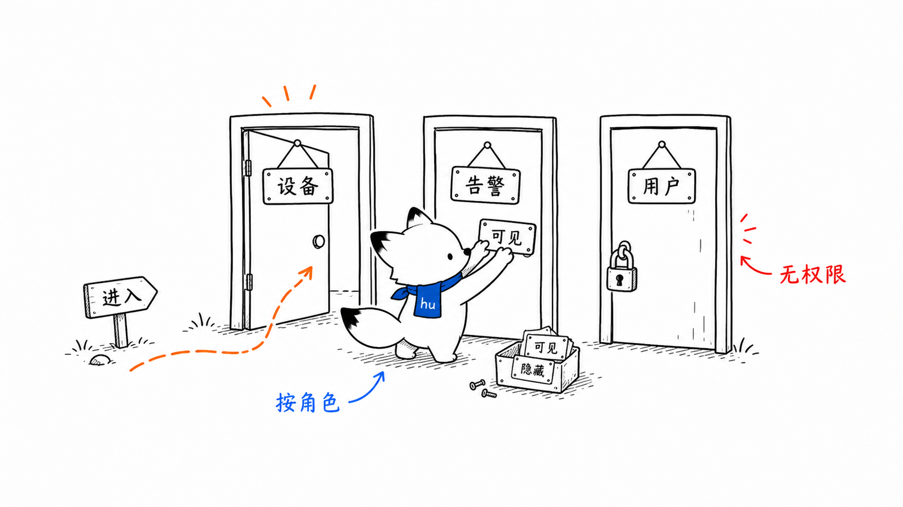
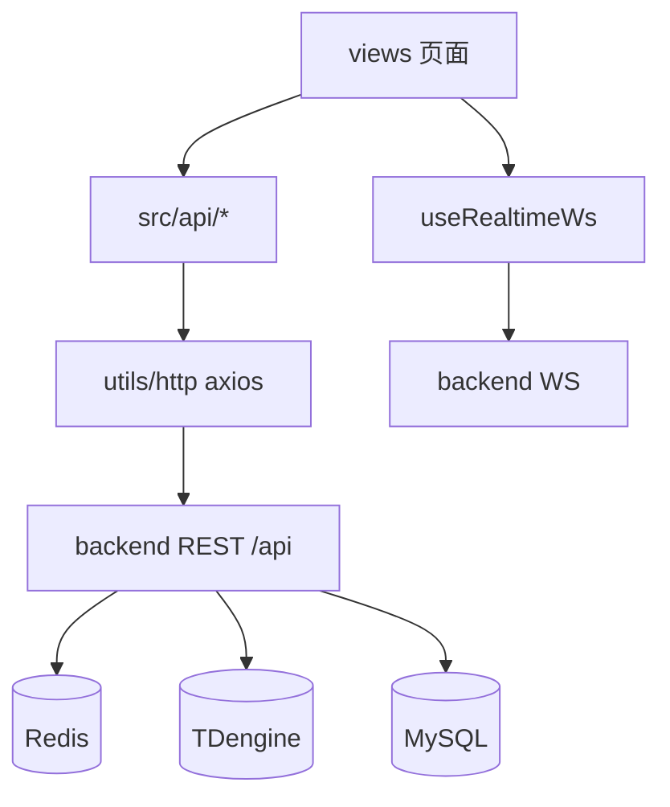
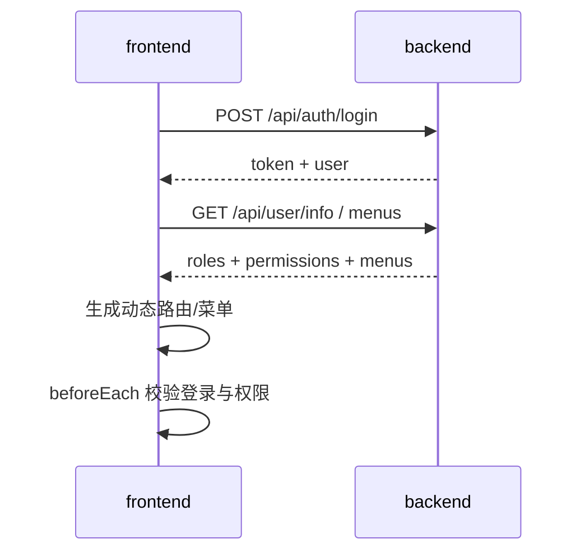
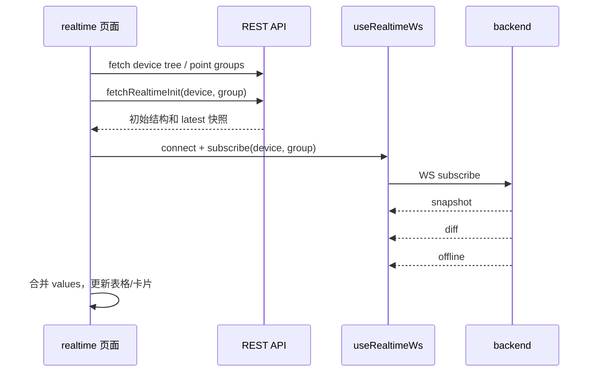
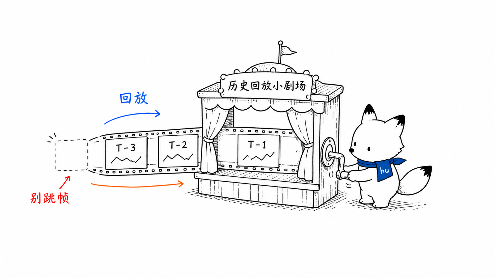

# frontend 页面权限与实时历史设计
<!-- xiaohu-illustration:frontend-pages-01-menu -->


> 本文是《Web 前端-frontend》的深度展开，聚焦 Vue Web 控制台的页面结构、路由菜单权限、页面到 API 映射、实时监控 WebSocket、历史查询 Perspective、错误态和契约治理。

---

## 1. frontend 的定位

frontend 是面向业务用户的 Web 控制台，基于 [Art Design Pro](https://www.artd.pro/docs/zh/) 的 Vue3 管理后台模板二次开发。它不直接连接 Redis、TDengine、MySQL，也不管理边缘机进程。所有业务数据来自 backend。



---

## 2. 页面结构

| 路由 | 页面定位 | 主要数据源 |
|------|----------|------------|
| `/device-monitor/dashboard` | 设备监控总览 | dashboard API |
| `/device-monitor/monitor` | 监控入口/聚合视图 | monitor API |
| `/device-monitor/driver` | 通讯驱动/协议字典 | catalog driver API |
| `/device-monitor/device` | 设备管理、导入导出、设备树 | catalog device API |
| `/device-monitor/point` | 点位管理、模板、导入导出 | catalog point API |
| `/device-monitor/realtime` | 点位实时监控 | realtime-init + ws_push |
| `/device-monitor/history` | 历史查询、图表、矩阵、导出 | history API + Perspective |
| `/device-monitor/log` | 系统日志 | log API |
| `/device-monitor/log-terminal` | 日志终端/TDengine 日志 | log tdengine files/tail |
| `/system/*` | 用户/角色/菜单管理 | system_manage API |

页面设计的主线是“先配置，再实时，再历史，再排障”：设备和点位配置是采集链路事实源；实时页验证 Redis latest；历史页验证 writer→TDengine；日志页验证运行状态。

---

## 3. 页面到 API 映射

| 页面 | 关键 API |
|------|----------|
| 登录 | `POST /api/auth/login`、`GET /api/user/info` |
| 设备管理 | `/api/device-monitor/device/list`、CRUD、import/export、group-tree |
| 点位管理 | `/api/device-monitor/point/list`、CRUD、import/export、device-tree |
| 实时监控 | `/api/device-monitor/monitor/device-tree`、`/monitor/realtime-init`、`/device/{device_code}/point-groups`、WS `/ws/realtime-push` |
| 历史查询 | `/history/devices`、`/history/points`、`/history/query`、`/history/chart`、`/history/raw`、`/history/raw-matrix`、`/history/export` |
| 系统日志 | `/log/list`、`/log/stats`、`/log/policy`、`/log/debug`、`/log/cleanup` |
| TDengine 日志 | `/log/tdengine/files`、`/log/tdengine/tail` |
| 用户角色菜单 | `/api/user`、`/api/role`、`/api/v3/system/menu` |

契约规则：页面字段名应跟随 `docs/03-数据与契约/契约/API契约.md` 与 backend 路由，不应把前端临时类型反向当事实源。

---

## 4. RBAC 路由与菜单



设计要点：

- 菜单可见性由 backend 返回的菜单树驱动。
- 按钮权限由权限码控制，前端仅负责渲染，不是最终安全边界。
- backend 接口仍必须使用 `require_permissions` 校验。
- `sys_role.role_code` 是角色编码事实字段。

建议文档化的权限码维度：

| 域 | 示例语义 |
|----|----------|
| `device_monitor:*` | 设备监控域页面、查询、导入导出、实时/历史 |
| `system:*` | 用户、角色、菜单、权限管理 |
| `log:*` | 系统日志、保留策略、清理 |
| `dashboard:*` | 仪表盘与统计 |

具体权限码以 backend 种子数据和当前路由实现为准。

---

## 5. 实时监控页面数据流



### 5.1 客户端状态机

```text
idle
  -> connecting
  -> connected
  -> subscribed
  -> degraded      # 收到 offline / 后端 degraded / Redis 异常
  -> reconnecting  # 断线指数退避
  -> closed        # 页面卸载或主动关闭
```

### 5.2 关键行为

- 首帧 snapshot 用于重建完整状态。
- diff 只包含变化点，前端必须合并到本地快照。
- 切换设备/分组时先退订旧订阅，再订阅新分组。
- 页面不可见后恢复时主动检查连接，避免浏览器挂起造成假在线。
- token 经 query 传给 WS，代理和日志不要记录完整 URL。

---

## 6. 历史查询与 Perspective
<!-- xiaohu-illustration:frontend-pages-02-replay -->


历史页有三类显示模式：

| 模式 | backend API | 适用场景 |
|------|-------------|----------|
| 降采样图表 | `/history/chart` | 趋势、长时间范围 |
| 原始分页 | `/history/raw` | 明细追溯 |
| 对齐矩阵 | `/history/raw-matrix` | 多点位按统一时间桶横向比较 |

Perspective 用于大表/图表交互：

```text
history query with perspective_session_id/queryVersion
  -> backend 查询 TDengine
  -> PerspectiveSessionManager 存 snapshot
  -> Perspective WebSocket 推送给前端 runtime
```

前端需要用 `queryVersion` 丢弃旧结果，避免慢查询覆盖新查询。

---

## 7. 错误态与空态

| 场景 | 页面建议 |
|------|----------|
| 401 | 清理敏感内存态，跳登录 |
| 403 | 显示无权限，不重复请求 |
| 设备树为空 | 显示配置引导：先创建设备/点位 |
| Redis degraded | 实时页显示降级，不把它当作设备自然无数据 |
| TDengine 不可用 | 历史页提示历史库不可用，保留筛选条件 |
| 查询超限 | 明确提示缩小时间范围/点位数量 |
| 导出任务失败 | 显示失败原因和重试入口 |

敏感数据不持久化到 webstorage；仅主题 key `data-watch-theme` 例外。

---

## 8. 前后端契约治理

变更 API 或页面字段时遵守：

1. 先改 `docs/03-数据与契约/契约/API契约.md` 或 `WebSocket协议.md`。
2. backend 路由/service 与前端 `src/api/*` 同步修改。
3. 更新页面错误态、空态和权限码。
4. 如影响菜单，更新 backend 菜单/权限种子。
5. 禁止用 mock 数据结构反向定义正式契约。

---

## 9. 与桌面 app 的边界

frontend 不做：

- agent bootstrap；
- collector/writer 启停；
- 本机进程 CPU/内存指标；
- stdout/stderr 日志 tail；
- DPAPI 配置。

这些属于桌面端 app + agent。frontend 专注业务配置、实时监控、历史查询与系统管理。

---

## 相关文档

- [Web 前端 frontend](README.md)
- [后端服务分层与实时历史通道](../backend/服务分层与实时历史通道.md)
- [API 契约](../../03-数据与契约/契约/API契约.md)
- [WebSocket 协议](../../03-数据与契约/契约/WebSocket协议.md)
