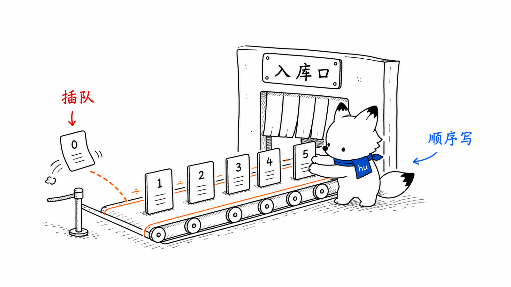
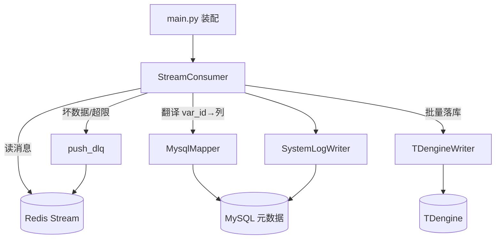
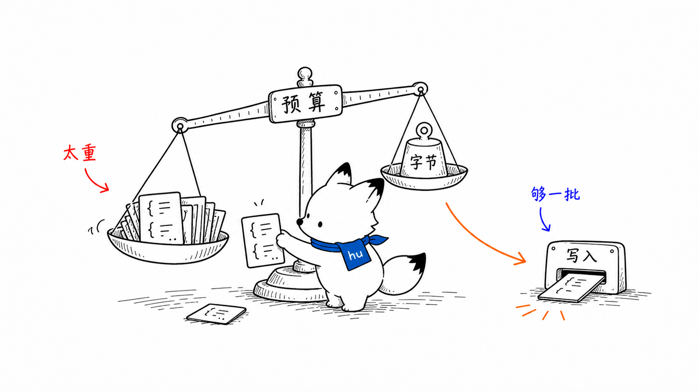
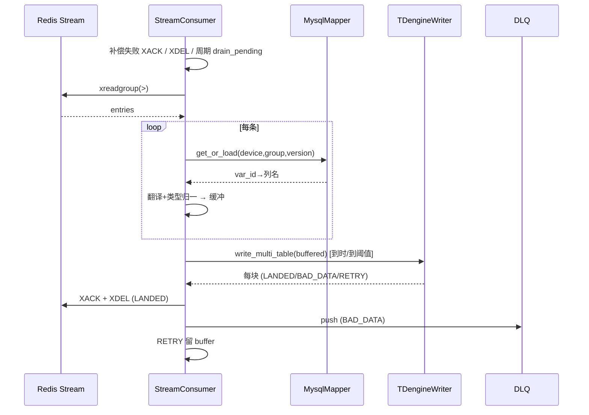

# 入库端 writer 设计文档
<!-- xiaohu-illustration:writer-readme-01-queue -->


> writer 是平台的入库环节：从 Redis Stream 消费 collector 投递的采集数据，按设备子表批量写入 TDengine，并提供"至少一次、不丢数据"的可靠性保证。本文覆盖其架构、消费-入库流水线、可靠性机制、对外契约、配置与扩展方式。
>
> 上游数据由《02-模块设计/采集-collector》产生；Stream/DLQ 的结构契约见《03-数据与契约/数据库/Redis结构与字段》；TDengine 数据模型见《03-数据与契约/数据库/MySQL结构与字段》。

---

## 1. 概述

writer 是一个基于 asyncio 的单进程、多消费分片入库服务。它消费 Collector 或 Central Ingest 写入 Redis 的 `rt:stream:*` 队列，把每条采集帧翻译成 TDengine 的列值并批量落库。默认启动 4 个 worker，Stream key 均匀分片且每个 worker 使用独立 MySQL mapper 连接和 TDengine 连接。核心职责：

- **消费**：以 Redis 消费组（consumer group）方式拉取 Stream 消息；
- **翻译**：经 MySQL 元数据把 `var_id` 映射为 TDengine 列名，并做类型归一；
- **批写**：跨设备子表打包成多表 INSERT，按字节预算分块写入 TDengine；
- **兜底**：失败消息重试、坏数据隔离进 DLQ，全程不丢数据。

writer 与 collector 无代码级耦合，二者只通过 Redis Stream 协作。

入口：`writer/main.py:164`（`main()`）。

---

## 2. 设计目标与范围

| 目标 | 实现要点 |
|------|----------|
| 至少一次、不丢数据 | 消费组 PEL + XAUTOCLAIM 重认领；LANDED 才 ACK；坏数据进 DLQ 才 ACK |
| 高吞吐批量入库 | 跨子表多表 INSERT，按 ~3MB 字节预算分块 |
| 坏数据不阻塞整批 | 二分降级隔离坏行，好行照常落库 |
| 故障可自愈 | TDengine/MySQL 断线自动重连；连续失败退避 |
| 配置可演进 | 永久 point_storage_mapping 解码历史数据；schema 列只增不减 |

**不在本模块范围**：数据采集（collector）、对前端供数与历史查询（backend）。

---

## 3. 核心概念与术语

| 术语 | 含义 |
|------|------|
| **Stream key** | `rt:stream:{device_type}:{group_code}:{shard}`，collector 的输出 = writer 的输入 |
| **消费组 / consumer** | Redis consumer group + consumer 名，多实例可分摊同一组的消息 |
| **PEL** | Pending Entries List，已投递未 ACK 的消息列表，是"至少一次"的基础 |
| **GroupMapping** | `(device_code, group_code)` 的永久映射：超级表、子表、`var_id→列名`；stream config_version 仅作上下文 |
| **超级表 stable / 子表 child_table** | TDengine 模型：每设备类型一张超级表 `sd{type}`，每设备一张子表（= device_code） |
| **flush** | 把缓冲行批量写入 TDengine 的动作，由时间或缓冲阈值触发 |
| **二分降级** | 批写失败且为确定坏数据错误时，二分隔离出坏行的策略 |
| **DLQ** | 死信队列 `rt:dlq:{type}:{group}`，承接超过重试上限或确认坏数据的消息 |

---

## 4. 架构与目录结构

```
writer/
├── main.py             # 入口：配置、连接装配、stream_keys 发现、启动 consumer
├── consumer.py         # StreamConsumer 消费-入库主循环、可靠性机制
├── tdengine_writer.py  # TDengineWriter 多表批写 + 二分降级 + schema 自管
├── mysql_mapper.py     # MysqlMapper var_id→列名 映射缓存（按 config_version）
├── dlq.py              # push_dlq 死信队列
├── system_log.py       # SystemLogWriter 系统日志（独立 MySQL 连接）
├── performance.py      # WriterPerformanceMetrics 性能指标
└── tests/              # 消费降级、指标、TDengine 写入等单测
```

组件协作关系：



---

## 5. 关键组件

### 5.1 main（装配与 stream 发现）

`writer/main.py`。启动序列：加载 `config/settings.toml` → 用 `DATAWATCH_<DB>_<FIELD>` 环境变量覆盖连接字段 → 校验配置 → 连接 Redis/MySQL → 从 MySQL 发现 Stream 范围 → 按 `consumer_workers` 划分 Stream key → 为每个分片建立独立 MySQL mapper 与 TDengine 连接 → 启动消费循环。

- **stream_keys 动态发现**（`_discover_stream_scopes` `main.py:128`）：查 MySQL 中所有启用且有 TDengine 列的 `(device_type, group_code)` 组合，再对每个组合 × `stream_shard_count` 个分片，拼出全部 `rt:stream:{dt}:{gc}:{shard}` 键。这与 collector 写出的分片键格式严格对齐。
- **凭据注入**（`_apply_env_overrides` `main.py:106`）：mysql/redis/tdengine 的 host/port/user/database/password 均可由环境变量覆盖；settings.toml 仅作开发期回退与运行参数。
- 默认 `consumer_workers=4`，实际 worker 数不超过 Stream key 数；多 worker 的 consumer name 自动追加 `-1`、`-2` 等后缀。

### 5.2 StreamConsumer（消费-入库主循环）

`writer/consumer.py:61`。主循环 `run_loop` (`consumer.py:105`) 每轮依次：

1. **补偿失败的 XACK**（`_retry_pending_acks`）——必须早于 drain，避免已落库但 ACK 失败的条目被重新认领重写；
2. **补偿失败的 XDEL**（`_retry_pending_deletes`）——只清理已终态且已 ACK 的条目，不触发 TDengine 重写；
3. **周期重认领**（`drain_pending`，默认 60s）——回收本消费者或崩溃消费者遗留的闲置消息；
4. **读新消息**（`xreadgroup`）——缓冲未满时读；满则跳过读、立即 flush（背压）；
5. **flush**——达时间或缓冲阈值时批量落库；
6. **连续失败退避**——flush 失败递增退避（上限 10s）并降噪日志。

每条消息经 `_handle_entry`：先做 DLQ 检查，再解析字段；永久 mapping 缓存命中时走事件循环内快路径，只有首次加载进入 executor/MySQL；随后完成列名翻译、类型和质量码校验并进入缓冲。

### 5.3 TDengineWriter（多表批写 + 二分降级）

`writer/tdengine_writer.py:87`。WebSocket（taosws）连接，数据库 `device_data`（KEEP 14d / DURATION 1d）。

- **schema 自管**：值超级表 `(ts TIMESTAMP, <列> DOUBLE) TAGS (device_code)`；列缓存 `_col_cache`，按需 `ALTER STABLE ADD COLUMN`。质量码 `0..255` 写入平行窄表 `(ts, var_id BIGINT COMPOSITE KEY, quality TINYINT UNSIGNED)`；Writer 启动时校验复合键和无符号列，不兼容旧 schema 会阻断启动并提示迁移。
- **多表批写**（`write_multi_table` `tdengine_writer.py:383`）：把跨多个子表的行打包进单条多表 `INSERT`，按 `MAX_SQL_BYTES`（~3MB，TDengine 硬上限约 4MiB）用 next-fit 分块；超大子表再按行切分。
- **二分降级**（`_write_chunk` `tdengine_writer.py:425`）：一块写失败时——
  - 连接错 / 未连接 / 未知错 → 整块 `RETRY`（绝不二分、绝不进 DLQ）；
  - 确定数据/SQL 错（白名单错误码 `0x0216`/`0x060b`/`0x0219`）→ 二分递归隔离，单行仍失败标 `BAD_DATA`，其余照常 `LANDED`；
  - 深度上限 24 层兜底为 `RETRY`。
- **断线重连**（`_try_reconnect`）：连接错触发，单点重连、`_reconnecting` 防递归。

> **错误分类哲学**：只认具体错误码判坏数据，**故意不匹配** `invalid`/`out of range`/`syntax` 等英文词——这些也出现在配置越界、协议/版本等瞬时错误里，误判会把可重试数据错送进 DLQ。未知错一律 RETRY。

### 5.4 MysqlMapper（永久映射缓存）

`writer/mysql_mapper.py`。每个消费 worker 拥有独立 MySQL 连接和 MysqlMapper：

- `get_cached(device_code, group_code)` 命中时直接在事件循环内返回，不进入 executor，也不访问 MySQL。
- 首次缺失才经 executor 调用 `get_or_load`，从永久 `point_storage_mapping` 读取 stable、child table、列名和 var_type。
- `stream_config_version` 仅保留作接口兼容和日志上下文，不再用当前可编辑配置拒绝历史数据；旧 config version 由永久 mapping 正确解码。
- MySQL 断线时 `ping(reconnect=True)` 后重试加载；确实没有永久映射时返回 None，由消费可靠性流程处理。

### 5.5 DLQ / 系统日志 / 性能指标

- **DLQ**（`writer/dlq.py:18`）：`rt:dlq:{device_type}:{group_code}` Redis List，`LPUSH` + `LTRIM` 上限 1000；payload 含 entry_id、stream_key、retry_count、last_error、failed_at、原始 data。
- **SystemLogWriter**：独立 MySQL 连接，落库存储类系统日志（重连、降级、DLQ 事件等，均 ≥60s 限流防刷库）。
- **WriterPerformanceMetrics**：缓冲行数、写批耗时/行数/成功率、flush 统计，周期打印。

---

## 6. 主要流程
<!-- xiaohu-illustration:writer-readme-02-scale -->


### 6.1 消费-入库主循环



### 6.2 flush 行级状态分流

`_flush` (`consumer.py:505`) 拿到 `write_multi_table` 的逐块结果后按状态分流：

- **LANDED** → 加入待确认集合，同一 Stream 最多 500 个 entry id 合并 XACK，ACK 成功后同批 XDEL；
- **BAD_DATA** → 逐行 `push_dlq`，**推送成功才 XACK + XDEL**，失败留 buffer；
- **RETRY** → 不 ACK、不进 DLQ，留 buffer 下轮重试。

> **不丢数据的硬约束**：只有"已落库（LANDED）"或"已成功进 DLQ 的坏行"才 XACK，并只在 ACK 成功后 XDEL；任何 RETRY、ACK 失败或 DLQ 推送失败的行都不会删除。XDEL 失败进入独立清理重试，不重复写 TDengine。

### 6.3 待处理消息重认领（崩溃恢复）

启动时与周期性地，对每个 stream key 用 `XAUTOCLAIM`（Redis ≥6.2，回退 `XPENDING`+`XCLAIM`）回收闲置超过 `pending_min_idle_ms` 的消息并重新处理。投递次数超 `pending_max_retry` 的消息进 DLQ。这保证了某实例崩溃后，其未 ACK 的消息会被本实例或其他实例接管。

---

## 7. 对外接口与契约

| 方向 | 契约 |
|------|------|
| 输入 | 消费 `rt:stream:{device_type}:{group_code}:{shard}`（collector 产生） |
| 输出 | 写入 TDengine `device_data` 库：超级表 `sd{type}`、子表 = device_code |
| 死信 | `rt:dlq:{device_type}:{group_code}` List（上限 1000） |
| 元数据 | 启动发现范围读取当前配置；数据解码读取永久 `point_storage_mapping` |
| 停机 | `runtime/writer.shutdown_flag` 文件（agent → writer） |

完整 Stream 字段与 TDengine 表结构见《03-数据与契约》。

---

## 8. 配置说明

`config/settings.toml`，四个必需段（`main.py:50` `_REQUIRED_CONFIG_KEYS`）：

- `[redis]`：host/port/db/password、`stream_shard_count`、`group_name`、`consumer_name`；
- `[mysql]`：host/port/user/password/database；
- `[tdengine]`：host/port/user/password/database；
- `[writer]`：`flush_interval_ms`（默认 200）、`batch_count`（默认 1000）、`max_buffer_rows`（默认 10000）、`consumer_workers`（默认 4）、`pending_min_idle_ms`、`pending_max_retry`。

连接字段可被 `DATAWATCH_<DB>_<FIELD>` 环境变量覆盖（生产凭据由 agent 注入）。`stable_names` 与 stream 范围在启动时从 MySQL 自动发现，无需手配。

---

## 9. 设计决策与权衡

| 决策 | 理由 / 权衡 |
|------|-------------|
| Redis 消费组 + PEL | 天然支持"至少一次"与多实例分摊；代价是需处理重复与崩溃恢复 |
| LANDED 才 ACK | 宁可重写一条，也不丢一条；与二分降级配合保证不丢 |
| 跨子表多表 INSERT | 数百子表不再串行落库，单语句覆盖数千子表，吞吐大幅提升 |
| ~3MB 字节预算分块 | 贴近 TDengine 单语句 4MiB 硬上限留余量，避免 0x0219 |
| 二分降级 + 错误码白名单 | 坏行隔离但不误伤可重试错误；未知错一律重试，绝不误送 DLQ |
| 永久 mapping + 缓存快路径 | 历史 config_version 仍可解码；缓存命中不进入 executor/MySQL，降低高频消费开销 |
| 列统一 DOUBLE | 简化 schema 演进；代价是布尔/枚举语义在时序库中以数值表达 |
| 缓冲满即背压 | 跳过读、优先 flush，避免内存无界增长 |

---

## 10. 已知问题与技术债

> 仅记录，供技术债清理阶段评估，本文不处理。

- **单进程边界**：当前为一个 writer 进程内最多 `consumer_workers` 个异步分片。每个分片有独立 MySQL/TDengine 连接，但进程级故障会同时影响全部分片；消费组协议允许后续扩展为多进程/多实例。
- **永久 mapping 缓存常驻**：mapping 契约要求物理坐标永久不变，因此命中后不按 config_version 失效；新增设备/组需通过重启 Writer 或后续显式失效机制加载。
- **DLQ 只入不出**：无自动重放工具；List 上限 1000，溢出时 LTRIM 丢弃最旧死信。
- **数据列统一 DOUBLE**：非数值语义（布尔/枚举）以数值落库；STRING 在 collector 侧已被排除出 stream。

## 11. 扩展方式

- **新增设备类型 / 点位分组**：无需改 writer 代码——在 MySQL 配好 `device_type`、`device_point_group`、`device_variable.td_column_name` 后，writer 启动时会自动发现对应 stream 范围并按需建超级表/列。
- **调优入库吞吐**：先用压测调整 `consumer_workers`，再评估 `flush_interval_ms` / `batch_count` / `max_buffer_rows`；`stream_shard_count` 必须与 Collector/Ingest 一致。
- **新增可重试/坏数据错误码**：在 `tdengine_writer.py` 的 `_DATA_ERROR_KEYWORDS`（`tdengine_writer.py:60`）按 TDengine 错误码谨慎增补，务必区分瞬时错误与真坏数据。
- 补充单测参考 `writer/tests/test_consumer_degrade.py`、`test_tdengine_writer.py`。

---

## 相关文档

- 《02-模块设计/writer-可靠入库与TDengine写入》（PEL、ACK、DLQ、TDengine 批写细节）
- 《02-模块设计/采集-collector》（上游生产方）
- 《02-模块设计/后端-backend》（历史查询的另一读侧）
- 《03-数据与契约/数据库/Redis结构与字段》
- 《03-数据与契约/数据库/MySQL结构与字段》（TDengine 数据模型）
