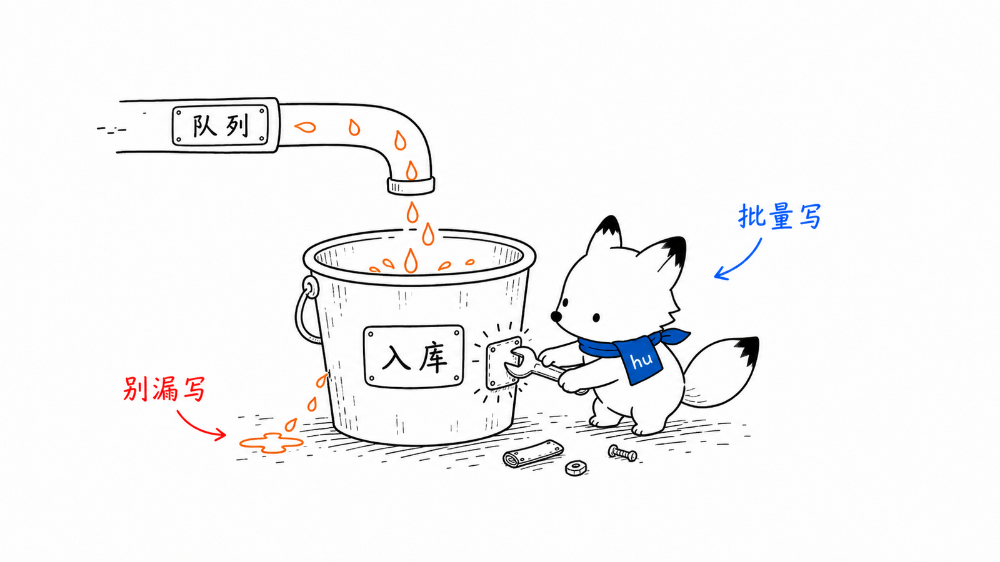
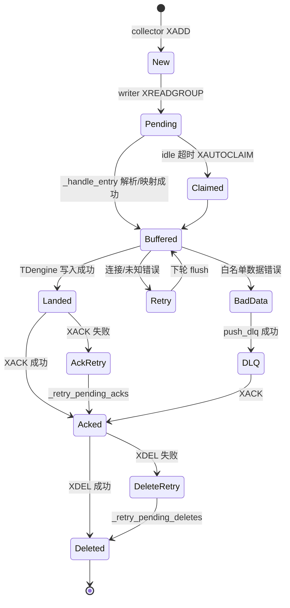
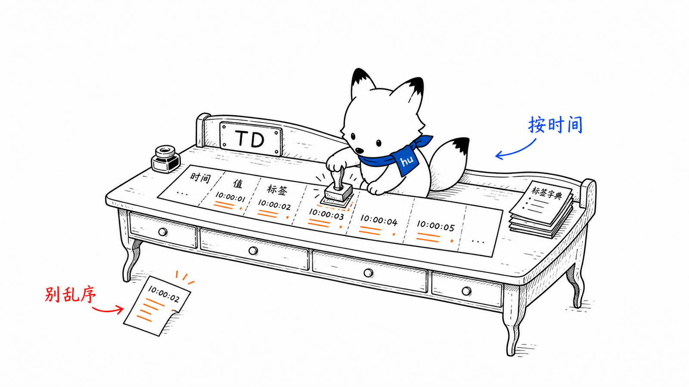
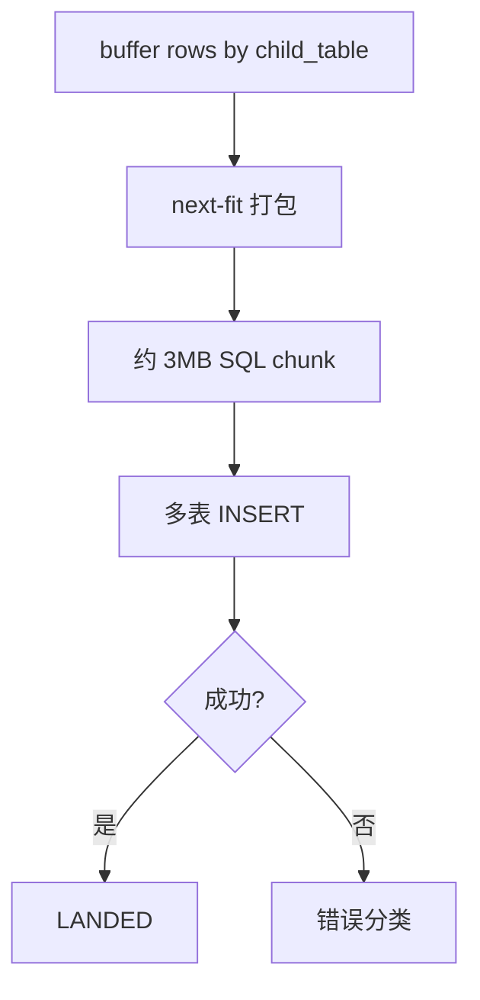

# writer 可靠入库与 TDengine 写入
<!-- xiaohu-illustration:writer-tdengine-01-bucket -->


> 本文是《入库-writer》的深度展开，聚焦 Redis Stream 消费、PEL 恢复、ACK 语义、DLQ、MySQL 映射缓存、TDengine 多表批写和 schema 演进。

---

## 1. 启动调用链

```text
writer/main.py
  -> main()
  -> load settings.toml
  -> _apply_env_overrides()          # DATAWATCH_* 覆盖连接字段
  -> _validate_config()
  -> Redis ping
  -> MySQL connect
  -> TDengineWriter.connect()
  -> _discover_stream_scopes()       # 从 MySQL 发现 device_type/group_code
  -> StreamConsumer.run_loop(stream_keys)
```

writer 不依赖固定设备列表。它从 MySQL 查询启用且有 `td_column_name` 的点位，推导所有 `(device_type, group_code)`，再乘以 `stream_shard_count` 生成要消费的 Stream key：

```text
rt:stream:{device_type}:{group_code}:{shard}
```

这保证新增设备类型或点位分组时，只要 MySQL 配置正确，writer 重启后即可发现新入库范围。

---

## 2. 消息生命周期



核心不变式：

- **LANDED 才 ACK**：TDengine 确认写入后才确认 Redis 消息。
- **DLQ 成功才 ACK**：坏数据只有成功写入死信队列后才 ACK。
- **RETRY 不 ACK**：连接类/未知错误保留在 buffer 或 PEL，等待恢复。
- **ACK 失败要补偿**：写库成功但 ACK 失败的消息进入 `_ack_retry`，下轮优先补 ACK。
- **删除失败不重写**：XDEL 失败的已 ACK 条目进入 `_delete_retry`，只重试删除，不重新写 TDengine。

---

## 3. StreamConsumer 主循环

```text
StreamConsumer.run_loop(stream_keys)
  -> _retry_pending_acks()
  -> _retry_pending_deletes()
  -> drain_pending()                 # 周期性，也在启动时执行
  -> xreadgroup('>')                 # 读新消息
  -> _handle_entry(entry)
       -> 投递次数检查
       -> JSON/字段解析
       -> MysqlMapper.get_or_load()
       -> var_id -> td_column_name
       -> 归一成 buffer row
  -> _flush()                        # 到时间/到阈值/缓冲满
       -> TDengineWriter.write_multi_table()
       -> LANDED / BAD_DATA / RETRY 分流
```

主循环先补偿 ACK 和已确认条目的删除，再重认领 pending，最后读新消息。这个顺序很重要：如果先 XAUTOCLAIM，再补 ACK，已经落库但 ACK 失败的消息会被当作未处理重新写入；删除重试与 PEL 解耦，不触发再次入库。

---

## 4. PEL 与崩溃恢复

Redis consumer group 的 PEL 保存“已经投递给消费者但尚未 ACK”的消息。writer 利用它实现至少一次语义。

| 场景 | Redis 中的状态 | writer 恢复动作 |
|------|----------------|-----------------|
| writer 读到消息后崩溃 | 消息留在 PEL | 新实例启动 `drain_pending()`，用 XAUTOCLAIM / XCLAIM 重认领 |
| TDengine 写成功但 ACK 失败 | 消息仍在 PEL，writer 记录 `_ack_retry` | 下轮先重试 XACK，避免被重复认领 |
| XACK 成功但 XDEL 失败 | 消息已离开 PEL，但 entry 仍占 Stream 内存 | 记录 `_delete_retry`，只重试 XDEL |
| TDengine 连接失败 | 消息未 ACK，buffer 保留 | 退避后重试，恢复后落库并 ACK |
| 消息多次失败超过阈值 | PEL delivery count 增长 | push DLQ 成功后 ACK，避免毒丸永久堵塞 |

Redis 6.2+ 使用 `XAUTOCLAIM`；旧版本回退到 `XPENDING + XCLAIM`。

---

## 5. MySQL 映射缓存

writer 不直接相信 Stream 里的列名。Stream 只携带 `var_id -> value`，物理列映射来自 MySQL。

```text
Redis stream entry
  device_code = QC100
  group_code = g001
  config_version = 12
  values = {"900001":"23.4"}

MysqlMapper.get_or_load(QC100, g001, 12)
  -> 查询 device / device_type / device_point_group / device_variable
  -> stable = sd{device_type}
  -> child_table = device_code
  -> var_id_to_column = {900001: td_column_name}
```

### 5.1 config_version 的意义

`device_point_group.config_version` 是映射缓存失效依据。点位新增、删除、列位调整时版本变化，writer 重新加载映射。

### 5.2 版本不一致降级

如果 Stream 中版本与 MySQL 当前版本不一致，但 writer 仍有旧缓存，可用旧缓存写入。这依赖 TDengine schema **只增不减**：旧列不会被删除，旧数据仍可落入原列，避免配置切换瞬间大量消息卡死。

---

## 6. TDengine schema 与写入模型
<!-- xiaohu-illustration:writer-tdengine-02-table -->


```text
database: device_data
stable:   sd{device_type}
child:    {device_code}
columns:  device_variable.td_column_name DOUBLE
```

writer 自管 TDengine schema：

1. `_ensure_database()`：确保 `device_data` 存在；
2. `_ensure_stable()`：确保 `sd{device_type}` 超级表存在；
3. `_ensure_columns()`：缺列时 `ALTER STABLE ADD COLUMN`；
4. `write_multi_table()`：把多个设备子表行合成多表 INSERT；
5. `_write_chunk()`：按块写入，失败时按错误类型分流。

所有时序列统一 `DOUBLE`。布尔以 0/1 表达，枚举/状态类点位也以数值入库；展示语义由 MySQL 点位元数据补充。

---

## 7. 多表批写与字节预算

TDengine 单条 SQL 有大小上限，writer 不按“行数”粗暴切批，而是按 SQL 字节预算分块。



设计理由：

- 数百设备逐表 INSERT 会产生大量网络往返。
- 多表 INSERT 可以在单条 SQL 中覆盖多个子表。
- 3MB 预算给 TDengine 约 4MiB 上限留余量。
- 超大单子表继续按行切分，避免某个设备独占整批。

---

## 8. 错误分类与二分降级

`TDengineWriter._write_chunk()` 写失败后不立即丢弃，也不盲目二分。

| 错误类型 | 处理 | 原因 |
|----------|------|------|
| 连接断开 / 未连接 / 未知错误 | 整块 RETRY | 可能是瞬时错误，不能误送 DLQ |
| 白名单数据/SQL 错误码 | 二分降级 | 坏行可能混在好行中，隔离后好行仍落库 |
| 单行仍失败且确认坏数据 | BAD_DATA | push DLQ 成功后 ACK |
| 二分深度超过上限 | RETRY | 防止递归失控和误判 |

错误分类只认具体错误码，不用 `invalid`、`syntax` 等英文关键词模糊匹配。因为这些词可能出现在配置、版本、连接等可恢复错误里，误判会造成数据错误进入 DLQ。

---

## 9. DLQ 结构与排查

DLQ key：

```text
rt:dlq:{device_type}:{group_code}
```

载荷包含：

```json
{
  "entry_id": "1700000000000-0",
  "stream_key": "rt:stream:qc:g001:0",
  "retry_count": 5,
  "last_error": "TDengine bad data ...",
  "failed_at": "2026-06-25T10:00:00+08:00",
  "data": {
    "device_code": "QC100",
    "group_code": "g001",
    "values": "{\"900001\":\"bad\"}"
  }
}
```

排查优先级：

1. 看 `last_error` 是 TDengine schema/数据错误还是投递次数超限；
2. 用 `stream_key` + `entry_id` 定位原 Stream；
3. 用 `device_code/group_code/var_id` 回查 MySQL 点位定义；
4. 修正点位配置或数据源后，按运维工具/脚本做人工重放；当前 writer 只负责入 DLQ，不自动重放。

---

## 10. 与 collector / backend 的边界

| 边界 | writer 的职责 | 非 writer 职责 |
|------|---------------|----------------|
| Redis Stream | 消费、ACK、重认领、DLQ | 生产 Stream 是 collector 职责 |
| TDengine | 建库/建表/补列/批写 | 历史查询是 backend 职责 |
| MySQL 映射 | 读取点位列映射 | 修改点位配置是 backend/管理端职责 |
| 实时态 | 不读 latest/window | 实时推送是 backend 职责 |
| 运维进程 | 响应 shutdown_flag | 启停由 agent 管控 |

---

## 相关文档

- [入库 writer](README.md)
- [collector 调用链与协议设计](../collector/调用链与协议设计.md)
- [数据库设计](../../03-数据与契约/数据库/MySQL结构与字段.md)
- [Redis 流与点位分组](../../03-数据与契约/数据库/Redis结构与字段.md)
