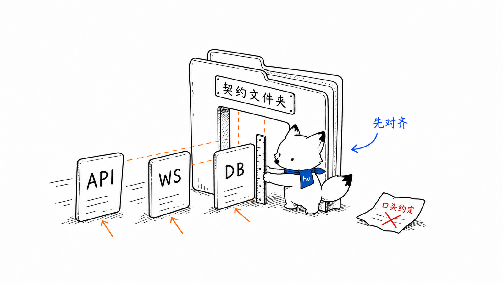
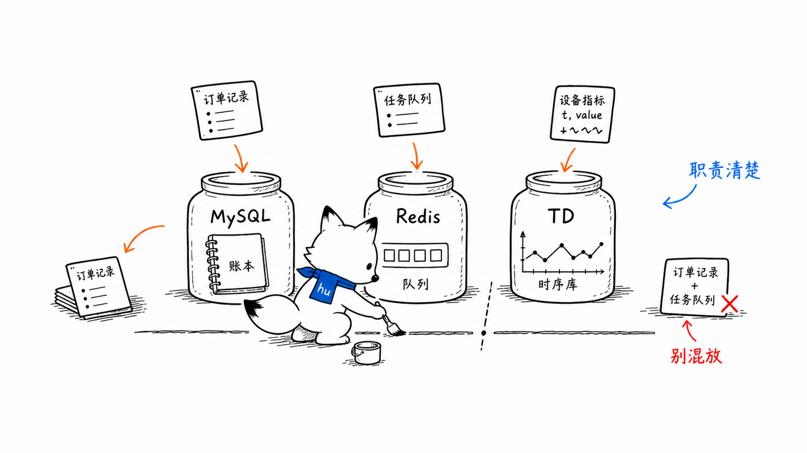
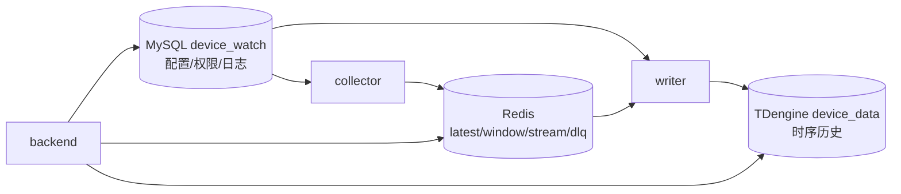

# 数据与契约
<!-- xiaohu-illustration:data-contracts-01-contract -->


> 本目录按“契约”和“数据库”两类组织：契约描述模块之间如何调用，数据库描述三类存储组件的结构、字段与边界。

---

## 目录结构

```text
docs/03-数据与契约/
├─ 契约/
│  ├─ API契约.md
│  ├─ WebSocket协议.md
│  └─ CLI输出契约.md
└─ 数据库/
   ├─ MySQL结构与字段.md
   ├─ Redis结构与字段.md
   └─ TDengine结构与字段.md
```

---

## 1. 契约

| 文档 | 内容 |
|------|------|
| [API 契约](契约/API契约.md) | backend REST、agent REST、响应包络、鉴权、分页、错误语义、接口变更门禁 |
| [WebSocket 协议](契约/WebSocket协议.md) | 实时监控 ws_push、历史 Perspective 快照、消息格式、状态机、nginx WS 代理 |
| [CLI 输出契约](契约/CLI输出契约.md) | JSON/JSONL、错误、退出码、分页、dry-run、文件与兼容性 |

---

## 2. 数据库 / 存储结构

| 文档 | 内容 |
|------|------|
| [MySQL 结构与字段](数据库/MySQL结构与字段.md) | `device_watch`：设备点位、告警、RBAC、日志、字段语义和跨库映射 |
| [Redis 结构与字段](数据库/Redis结构与字段.md) | latest/window/stream/dlq key、字段、分片、消费组、DLQ、运维检查点 |
| [TDengine 结构与字段](数据库/TDengine结构与字段.md) | `device_data`：超级表、子表、列名、schema 演进、写入与查询语义 |

---

## 3. 三类存储的边界
<!-- xiaohu-illustration:data-contracts-02-boundary -->




| 存储 | 事实源类型 | 不承载 |
|------|------------|--------|
| MySQL | 设备/点位配置、权限、菜单、告警规则、系统日志 | 高频时序值、实时最新值 |
| Redis | 实时最新值、短窗口、入库队列、死信 | 长期历史、权限、配置事实 |
| TDengine | 高频时序历史 | 配置、权限、实时 latest、quality |

---

## 4. 维护规则

- 结构性 API / WebSocket 变更先改契约文档，再改实现。
- 数据库字段以当前实际 schema 为准；字段不一致时改代码，不改 schema。
- Redis key / TDengine schema / MySQL 字段的跨库映射必须在三篇数据库文档中保持一致。
- 旧文档在 `_archive` 中仅作素材，不作为现行事实源。
