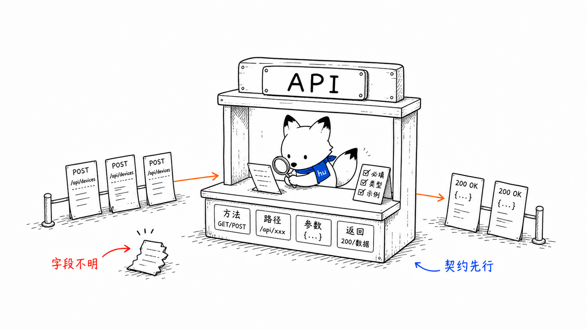
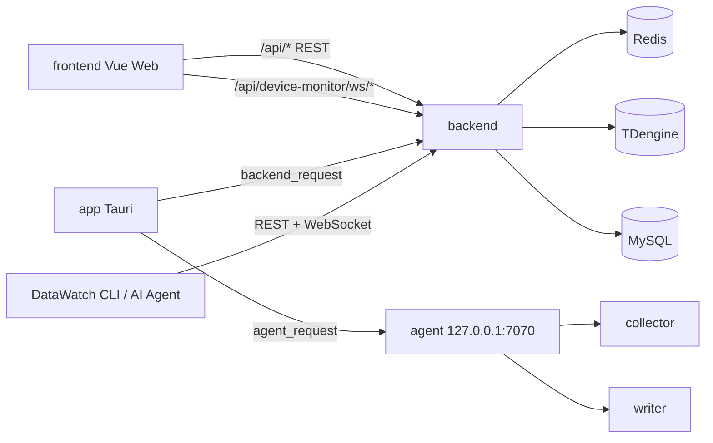
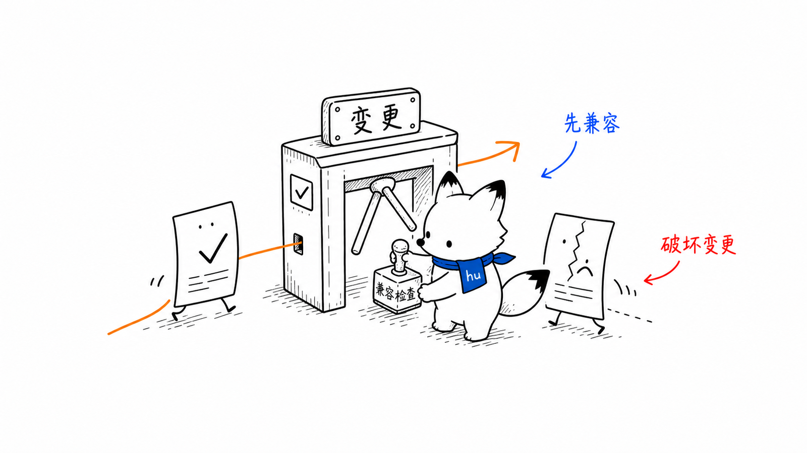

# API 契约
<!-- xiaohu-illustration:api-contract-01-counter -->


> 本文汇总平台对外的 HTTP 接口契约：backend 的业务 REST（供 Web 前端与桌面端）与 agent 的本机管控 REST（供桌面端）。本文定义通用包络、鉴权、分页、错误语义、接口分组与变更门禁。

---

## 1. 契约边界



- frontend 只调用 backend，不直接访问 agent、Redis、TDengine、MySQL。
- app 同时调用 backend 与 agent。
- CLI 只调用 backend；生产可经 nginx，开发可直连 backend，不直接访问数据库或 agent。
- agent 只监听本机，服务桌面端与边缘进程管控。
- backend 是业务 API 事实源，前端类型和 mock 不能反向定义接口契约。

---

## 2. backend 通用约定

### 2.1 基址

```text
/api
```

部署方式：

- 开发：frontend 通过 Vite proxy 或 `VITE_API_URL` 指向 backend；
- 镜像：frontend nginx 将 `/api/` 反代到 backend:8000；
- app：从 agent `runtime-config` 读取 backend base_url 后经 Rust `backend_request` 调用。
- CLI：Profile 保存完整 HTTP(S) base URL；生产推荐 nginx，开发允许 `127.0.0.1:8000` 直连。

### 2.2 响应包络

普通 JSON API 返回：

```json
{
  "code": 0,
  "msg": "success",
  "data": {}
}
```

约定：

- 客户端业务数据取 `data`。
- 列表接口 `data` 中包含 `list` 与 `total`，或按接口语义返回数组。
- 文件导出/下载接口可以不走 JSON 包络，按 Blob/文件流处理。

### 2.3 鉴权

```http
Authorization: Bearer <token>
```

注意：backend 登录返回的 token 字符串已经带 `Bearer ` 前缀，调用端只做规范化，不重复拼接。

### 2.4 状态码与错误语义

| HTTP | 语义 | 客户端处理 |
|------|------|------------|
| 200 | 请求成功，业务结果看 `code` | 正常渲染 |
| 400 | 参数错误/业务校验失败 | 展示错误信息，保留用户输入 |
| 401 | 未登录、token 失效或签名错误 | 清理敏感内存态，跳登录 |
| 403 | 已登录但权限不足 | 显示无权限，不重复请求 |
| 404 | 路由或资源不存在 | 显示空态/不存在 |
| 409 | 状态冲突 | 提示刷新或重新操作 |
| 500 | 服务端异常 | 展示错误，保留排障 trace/log |
| 503 | 依赖不可用/降级 | 显示 degraded，不伪装成空数据 |

### 2.5 分页

请求参数：

```text
pageNo=1&pageSize=20
```

兼容旧字段时可接受 `current/size`，但新文档和新页面统一使用 `pageNo/pageSize`。

响应示例：

```json
{
  "code": 0,
  "msg": "success",
  "data": {
    "list": [],
    "total": 0,
    "pageNo": 1,
    "pageSize": 20
  }
}
```

---

## 3. backend 接口分组

### 3.1 鉴权与账户

| 方法 | 路径 | 用途 | 主要调用方 |
|------|------|------|------------|
| POST | `/api/auth/login` | 登录，返回 token / refreshToken / userId / mustChangePassword | frontend/app/CLI |
| POST | `/api/auth/refresh` | 消费 Refresh Token 并轮换 access/refresh token | CLI/其他支持刷新客户端 |
| POST | `/api/auth/logout` | 登出 | frontend |
| GET | `/api/user/info` | 当前用户信息、角色、权限、按钮标记 | frontend/app/CLI |
| POST | `/api/user/password/change` | 修改密码并轮换 token version | frontend/app |

登录响应示例：

```json
{
  "code": 0,
  "msg": "success",
  "data": {
    "token": "Bearer eyJ...",
    "refreshToken": "Bearer eyJ...",
    "userId": 1,
    "mustChangePassword": false,
    "tokenVersion": 0
  }
}
```

用户信息响应示例：

```json
{
  "code": 0,
  "msg": "success",
  "data": {
    "userId": 1,
    "userName": "Super",
    "roles": ["R_SUPER"],
    "buttons": ["edit"],
    "permissions": ["device_monitor:realtime:view"],
    "mustChangePassword": false,
    "tokenVersion": 0
  }
}
```

`buttons` 来自 `auth_mark`，用于前端按钮可见性；`permissions` 来自 `permission_code`，用于 Backend 鉴权与 CLI 本地预检查。两者不保证等价。

刷新请求：

```json
{"refreshToken":"Bearer eyJ..."}
```

刷新成功返回新的 `token`、`refreshToken`、`userId`、`mustChangePassword` 与 `tokenVersion`。服务端验证令牌类型、用户状态和当前角色；CLI 在认证请求 401 后最多自动刷新一次并重放原请求。

### 3.2 系统管理（用户/角色/菜单）

| 方法 | 路径 | 用途 |
|------|------|------|
| GET/POST | `/api/user` | 用户列表/新增；创建请求不携带 password，由服务端生成一次性临时密码 |
| GET/PUT/DELETE | `/api/user/{id}` | 用户详情/更新/删除 |
| PATCH | `/api/user/{id}/status` | 启停用户 |
| PATCH | `/api/user/{id}/password/reset` | 重置密码；请求体必须为 `{}`，返回一次性临时密码 |
| GET/POST | `/api/role` | 角色列表/新增 |
| GET/PUT/DELETE | `/api/role/{id}` | 角色详情/更新/删除 |
| PATCH | `/api/role/{id}/status` | 启停角色 |
| GET/POST | `/api/v3/system/menu` | 菜单树/新增菜单 |
| PUT/DELETE | `/api/v3/system/menu/{id}` | 更新/删除菜单 |
| POST | `/api/v3/system/menu/{id}/permissions` | 维护菜单权限 |

字段注意：角色编码字段为 `role_code`。

**数据范围（`dataScopes`）当前语义——请勿据此以为权限已被收窄（B22）：**

- `GET /api/role/{id}/grant` 会返回 `dataScopes`，`PUT /api/role/{id}/grant` 也接受该字段并持久化到 `sys_data_permission`，但**服务端目前不对任何读取路径（REST / WebSocket / 导出）执行数据范围过滤**。
- 内置角色由首装种子写成 `{"scopeType": "all", "scopeValue": "*"}`，即"不受限"。
- 因此 `PUT /api/role/{id}/grant` **只接受 `scopeType="all"`**；提交任何收窄形式（如按设备/分组）会返回**业务码 501** 并说明尚未实现，而不是静默忽略——避免管理员以为角色已被限制、实际没有。
- **默认策略（显式声明）**：没有范围记录、或范围记录为 `all` 的角色**不受范围限制**。数据范围是"选择性收窄"能力，未配置即不收窄；这一点是明确约定，不是隐式默认。
- 若产品确需按 用户×设备×分组 限制读取，需先确认需求，再统一在服务端落地（REST / WebSocket / 导出一致），并同步 UI 与本文档；**未实现前 UI 与文档不得声称已生效**。

密码生命周期约定：

- 创建用户与重置密码都返回 `data={id,userId,temporaryPassword,mustChangePassword:true,tokenVersion}`；`temporaryPassword` 只在本次响应中显示，客户端不得保存、回传或用固定默认值替代。
- `PATCH /api/user/{id}/password/reset` 请求体固定为 `{}`；旧客户端若发送 `password` 不会被采用。
- `POST /api/user/password/change` 请求体为 `{oldPassword,newPassword}`。成功后 `tokenVersion` 增加，当前 access/refresh token 立即失效；客户端必须清空本地会话并用新密码重新登录。
- `mustChangePassword=true` 时，登录/刷新及用户信息都会携带该状态；客户端应只进入强制改密页，不把菜单拉取失败当成登录失败。

### 3.3 设备监控域 `/api/device-monitor`

#### 仪表盘

| 路径 | 用途 |
|------|------|
| `/dashboard/overview` | 概览统计 |
| `/dashboard/device-type-distribution` | 设备类型分布 |
| `/dashboard/recent-events` | 最近事件 |
| `/dashboard/trend` | 趋势 |
| `/dashboard/device-connection-health` | 连接健康 |
| `/dashboard/alarm-distribution` | 告警分布 |

`/dashboard/trend` 对慢查询设有限时。超时返回 HTTP 504；TDengine 查询或告警统计不可用时返回 HTTP 503，调用方应显示失败并提供重试，不能把错误当作零值趋势。相同查询参数的成功结果在服务进程内短时缓存 30 秒。

#### 设备 / 点位 / 驱动

| 路径 | 用途 |
|------|------|
| `/driver/list`、`/driver/options` | 驱动与协议选项 |
| `/device/list`、`/device/{id}`、`/device`、`/device/batch` | 设备查询/详情/CRUD/批量操作 |
| `/device/import`、`/device/export`、`/device/group-tree` | 设备导入导出/树 |
| `/device/summary` | 按设备基础筛选条件返回 `total`、`onlineCount`、`offlineCount`、`unstableCount`、`disabledCount` |
| `/point/list`、`/point/{id}`、`/point`、`/point/batch` | 点位查询/详情/CRUD/批量操作 |
| `/point/import`、`/point/import/template`、`/point/export`、`/point/device-tree` | 点位导入导出/树 |
| `/point/latest` | 批量读取指定点位的 Redis 最新值与采集时间 |

`GET /device/list` 可传 `includeSummary=false`：此时无 `connectStatus` 筛选时先分页，再只查询当前页的采集活动时间；默认保留原有统计行为。`GET /device/summary` 使用与设备列表相同的 `keyword`、`deviceType`、`deviceCode`、`deviceName`、`deviceStatus` 基础筛选，不接收连接状态筛选，因此状态分布统计与连接状态列表筛选分开。两者均需 `device_monitor:device:view` 权限。

`GET /point/list` 在 MySQL 侧执行筛选、总数统计与分页，返回点位配置；未加载实时值时 `currentValue` 为 `"--"`。`GET /point/latest` 需 `device_monitor:point:view` 权限，使用重复的 `pointIds` 查询参数传入 1～100 个点位 ID；返回以点位 ID 字符串为键的对象，存在有效最新值时字段为 `currentValue` 和可选 `updateTime`。无值的点位不出现在该对象中。ID 无效或超过 100 个返回 HTTP 400，点位不存在返回 HTTP 404，Redis 不可用或读取超时分别返回 HTTP 503/504。

#### 实时监控

| 路径 | 用途 |
|------|------|
| `/monitor/device-tree` | 监控设备树 |
| `/monitor/point-resolve` | 按 IO 地址/点位名称解析业务点位，可带设备现场名称提示 |
| `/monitor/realtime-init` | 实时初始快照 |
| `/realtime-window` | 短窗口历史 |
| `/device/{device_code}/point-groups` | 某设备点位分组 |

#### 历史数据

| 路径 | 用途 |
|------|------|
| `/history/devices`、`/history/device-types`、`/history/points` | 历史筛选元数据 |
| `/history/query` | 多点对齐原始表 |
| `/history/chart` | 降采样图表 |
| `/history/raw` | 分页原始 |
| `/history/raw-matrix` | 时间桶矩阵 |
| `/history/export`、`/history/export/{id}/status`、`/history/export/{id}/download` | 异步导出 |

历史查询请求示例：

```json
{
  "deviceCodes": ["QC100"],
  "varSeqs": [1, 2, 3],
  "startTime": "2026-06-25 10:00:00",
  "endTime": "2026-06-25 11:00:00",
  "interval": "auto",
  "aggregation": "avg",
  "perspectiveSessionId": "optional-session",
  "perspectiveQueryVersion": 3
}
```

#### 系统日志

| 路径 | 用途 |
|------|------|
| `/log/list`、`/log/stats` | 查询/统计 |
| `/log/policy`（GET/PUT） | 保留策略 |
| `/log/debug` | DEBUG 落库开关 |
| `/log/cleanup` | 手动清理 |
| `/log/client` | 前端日志上报（限流，免鉴权） |
| `/log/tdengine/files`、`/log/tdengine/tail` | TDengine 服务日志查看 |

#### 模块监控（桌面端消费）

| 路径 | 用途 |
|------|------|
| `/module-monitor/collector` | collector 数据链路指标 |
| `/module-monitor/writer` | writer 队列、pending、DLQ、入库指标 |
| `/module-monitor/rates` | 采集/入库速率趋势 |

### 3.4 CLI 支持接口

| 方法 | 路径 | 鉴权 | 用途 |
|------|------|------|------|
| GET | `/api/cli/compatibility` | 无 | 返回 Backend/API 版本及支持的 CLI 版本范围 |
| GET | `/api/cli/releases/latest?channel=stable&platform=windows-x64` | 无 | 返回 Ed25519 签名的最新版本清单 |
| GET | `/api/cli/releases/{version}/download?channel=stable&platform=windows-x64` | 无 | 下载清单指定的 Windows ZIP |

发布清单至少包含 `schemaVersion`、`version`、`channel`、`platform`、`archive.fileName`、`archive.downloadUrl`、`archive.sha256`、`archive.size` 与 `signature`。CLI 必须先验证受信任 Ed25519 签名，再验证文件大小和 SHA-256；不能只信任 HTTPS 或文件名。

CLI 自身 stdout/stderr 包络不是 Backend `{code,msg,data}` 包络，见 [CLI 输出契约](CLI输出契约.md)。

---

## 4. agent 接口（127.0.0.1:7070）

agent 是本机边缘控制面，供 app 调用。

| 层 | 方法/路径 | 用途 |
|----|-----------|------|
| bootstrap | GET `/bootstrap/status` | 查询是否处于首装状态 |
| bootstrap | GET `/bootstrap/runtime-config` | 获取 backend base_url 等运行配置 |
| bootstrap | PUT `/bootstrap/config` | 写入 DB/backend 配置，密码 DPAPI 加密 |
| bootstrap | POST `/bootstrap/test-connection` | 测试 MySQL/Redis/TDengine 连通性 |
| bootstrap | POST `/bootstrap/finish` | 完成首装 |
| auth | POST `/auth/login` | 登录获取 agent token |
| viewer | GET `/viewer/status` | agent 总状态 |
| viewer | GET `/viewer/health` | 健康检查 |
| viewer | GET `/viewer/processes/{name}/status` | 进程状态 |
| viewer | GET `/viewer/processes/{name}/metrics` | 进程指标 |
| viewer | GET `/viewer/logs/{name}/tail` | 日志 tail |
| admin | POST `/admin/processes/{name}/start` | 启动进程 |
| admin | POST `/admin/processes/{name}/stop` | 停止进程 |
| admin | POST `/admin/processes/{name}/restart` | 重启进程 |
| admin | GET/PUT `/admin/config` | 读取/修改配置 |
| admin | POST `/admin/health/check` | 主动健康检查 |

`{name}` 当前为 `collector` 或 `writer`。

admin 接口是写操作，不应被前端隐藏按钮替代权限校验。

---

## 5. WebSocket

backend WebSocket 不在本文件展开，见 [WebSocket 协议](WebSocket协议.md)。核心端点：

- `/api/device-monitor/ws/realtime-push`：实时监控 snapshot/diff/offline；
- Perspective WebSocket：历史查询快照。

---

## 6. 接口变更门禁
<!-- xiaohu-illustration:api-contract-02-pass -->


任何影响前后端契约的变更，按以下顺序执行：

1. 先更新本文或 [WebSocket 协议](WebSocket协议.md)。
2. 标明兼容性：新增字段、字段改名、结构变化、错误语义变化。
3. backend 路由/service 更新。
4. frontend/app client 与页面状态更新。
5. 权限相关变更同步菜单/权限种子。
6. 示例请求/响应同步更新。
7. 验证真实服务，不以 mock 通过作为完成标准。

禁止：

- 前端 mock 或 TypeScript 类型先行成为事实源；
- 文档中保留已废弃路径但不标注 legacy；
- token 重复拼接 `Bearer `；
- 生产示例中出现真实密码。

---

## 相关文档

- [后端 backend](../../02-模块设计/backend/README.md)
- [backend 服务分层与实时历史通道](../../02-模块设计/backend/服务分层与实时历史通道.md)
- [边缘代理 agent](../../02-模块设计/agent/README.md)
- [agent 边缘进程编排与凭据](../../02-模块设计/agent/边缘进程编排与凭据.md)
- [WebSocket 协议](WebSocket协议.md)
- [CLI 输出契约](CLI输出契约.md)
- [CLI 模块](../../02-模块设计/cli/README.md)
