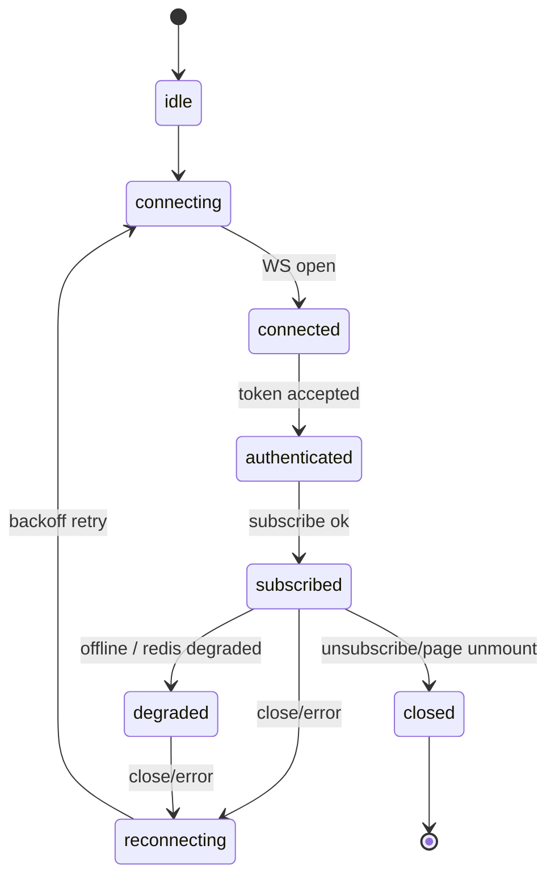
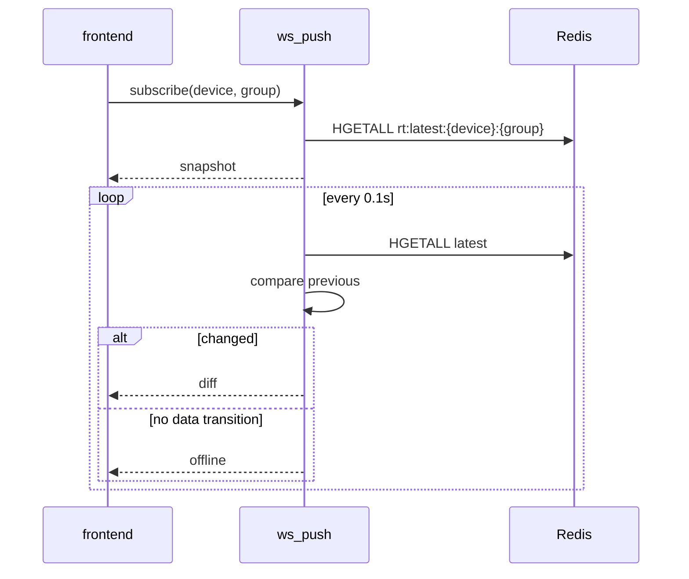
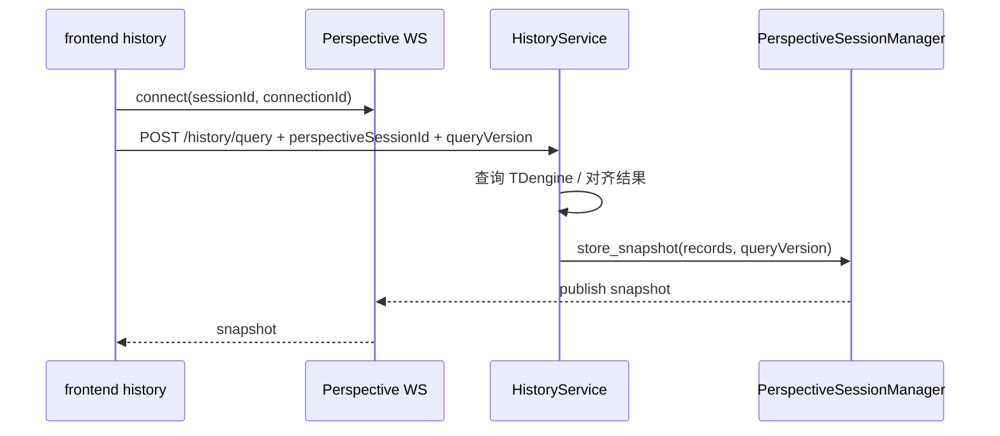

# WebSocket 协议

> 平台有两条 WebSocket 通道，均由 backend 提供：实时监控（设备点位 snapshot/diff/offline 推送）与历史数据快照（Perspective 会话）。本文定义连接、鉴权、消息格式、状态机与异常语义。

---

## 1. 通道总览

| 通道 | 端点 | 数据源 | 用途 | 主要客户端 |
|------|------|--------|------|------------|
| 实时监控 ws_push | `/api/device-monitor/ws/realtime-push` | Redis latest | 设备点位当前值与增量变化 | frontend 实时页 |
| 历史快照 Perspective | 配置项 `perspective_ws_route` 对应端点 | TDengine 查询结果 | 历史大表/图表 snapshot 推送 | frontend 历史页 |

两条通道不要混用：实时通道面向“当前值持续变化”，Perspective 通道面向“一次历史查询结果的会话化快照”。

---

## 2. 实时监控通道 ws_push

### 2.1 连接

```text
ws(s)://<host>/api/device-monitor/ws/realtime-push?token=<JWT>
```

- token 来自 backend 登录。
- token 当前经 query 传递；nginx、浏览器、调试日志不要记录完整 URL。
- nginx 需要转发 Upgrade/Connection 头，镜像部署中由 `deploy/nginx.conf` 处理。

### 2.2 客户端状态机



前端行为：

- 初次进入页面连接 WS；
- 连接后发送 subscribe；
- 断线后指数退避重连；
- 页面恢复可见时检查连接；
- 离开页面主动 unsubscribe 并关闭连接。

### 2.3 客户端 → 服务端

订阅：

```json
{
  "action": "subscribe",
  "device_code": "QC100",
  "group_code": "g001"
}
```

退订：

```json
{
  "action": "unsubscribe",
  "device_code": "QC100",
  "group_code": "g001"
}
```

心跳：

```json
{ "action": "ping" }
```

切换设备或分组时，客户端应先退订旧分组，再订阅新分组。

### 2.4 服务端 → 客户端

#### snapshot

订阅后的首帧全量快照：

```json
{
  "type": "snapshot",
  "device_code": "QC100",
  "group_code": "g001",
  "values": {
    "900001": {"v":"23.4","t":1718000000000,"q":0},
    "900002": {"v":"1","t":1718000000000,"q":0}
  },
  "tdengineConnected": true
}
```

#### diff

后续变化点增量：

```json
{
  "type": "diff",
  "device_code": "QC100",
  "group_code": "g001",
  "values": {
    "900001": {"v":"23.8","t":1718000000100,"q":0}
  }
}
```

客户端必须把 diff 合并到本地 snapshot，而不是替换整个 values。

#### offline

设备从有数据变为无数据时推一次：

```json
{
  "type": "offline",
  "device_code": "QC100",
  "group_code": "g001"
}
```

离线期间不重复广播，避免刷屏。

#### error

订阅失败、参数错误、鉴权失败等：

```json
{
  "type": "error",
  "code": "INVALID_SUBSCRIPTION",
  "message": "device_code and group_code are required"
}
```

#### pong

心跳响应：

```json
{ "type": "pong" }
```

如服务端实现返回纯文本 pong，客户端需要兼容；新文档推荐 JSON 形式。

### 2.5 推送机制



---

## 3. Perspective 历史快照通道

### 3.1 连接与会话

Perspective 会话按 owner + sessionId 管理，典型参数：

| 参数 | 含义 |
|------|------|
| `perspectiveSessionId` | 前端生成/持有的会话 ID |
| `connectionId` | 本次 WebSocket 连接 ID |
| `queryVersion` | 查询版本，防止旧结果覆盖新结果 |

Perspective runtime 是可选依赖；未安装时普通历史 REST 查询仍应可用，只是大表运行时能力降级。

### 3.2 REST 查询触发 snapshot



### 3.3 snapshot 消息

```json
{
  "type": "snapshot",
  "sessionId": "hist-001",
  "queryVersion": 3,
  "recordCount": 2,
  "records": [
    {
      "timestamp": "2026-06-25 10:00:00.100",
      "deviceId": 1,
      "deviceCode": "QC100",
      "varSeq": 1,
      "pointName": "speed",
      "ioAddress": "%R100",
      "value": 23.4
    }
  ],
  "timestamp": "2026-06-25 10:00:01"
}
```

客户端必须丢弃低于当前 `queryVersion` 的旧 snapshot。

### 3.4 会话事件

建议支持/兼容以下事件：

| 类型 | 语义 |
|------|------|
| `session_restored` | 断线后在 TTL 内恢复旧会话 |
| `session_conflict` | 同一 session 出现冲突连接 |
| `snapshot` | 历史查询结果快照 |
| `error` | 会话、配额、查询或运行时错误 |
| `pong` | 心跳 |

实际可用事件以当前 backend 实现为准；新增事件必须先更新本文。

---

## 4. 配额与保护

Perspective 通道有资源保护：

- 单 owner 会话数上限；
- 全局会话数上限；
- 空闲 TTL；
- 断连恢复 TTL；
- 查询点数上限；
- 查询时间范围上限；
- 记录数上限。

超过限制时应返回明确 error，而不是让连接静默断开。

---

## 5. 两通道对比

| 维度 | 实时监控 ws_push | 历史 Perspective |
|------|------------------|------------------|
| 数据源 | Redis latest | TDengine 历史查询结果 |
| 触发 | subscribe 后持续轮询 | REST 查询后发布 snapshot |
| 粒度 | device_code + group_code | sessionId + queryVersion |
| 消息 | snapshot / diff / offline / error / pong | session_restored / session_conflict / snapshot / error / pong |
| 目标 | 低延迟当前值 | 大表/历史分析交互 |
| 客户端策略 | 合并 diff，断线重连 | 丢弃旧 queryVersion，恢复会话 |

---

## 6. 镜像部署中的 WebSocket 代理

frontend 镜像由 nginx 托管，必须正确代理 WS：

```nginx
location /api/device-monitor/ws/ {
  proxy_pass http://backend:8000/api/device-monitor/ws/;
  proxy_http_version 1.1;
  proxy_set_header Upgrade $http_upgrade;
  proxy_set_header Connection "upgrade";
  proxy_read_timeout 3600s;
}
```

如果实时页在直连 backend 正常、经 frontend 镜像异常，优先检查 nginx Upgrade 头、路径前缀和 token query 是否被保留。

---

## 相关文档

- [backend 服务分层与实时历史通道](../02-模块设计/backend/服务分层与实时历史通道.md)
- [frontend 页面权限与实时历史设计](../02-模块设计/frontend/页面权限与实时历史设计.md)
- [Redis 流与点位分组](Redis流与点位分组.md)
- [运维部署](../05-运维部署/README.md)
