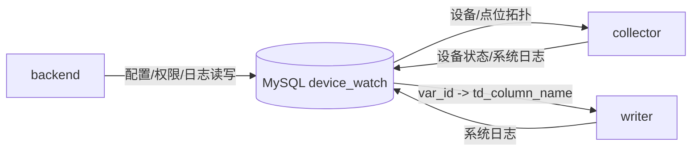
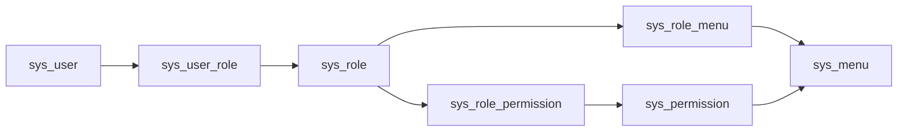

# MySQL 结构与字段

> MySQL `device_watch` 是平台的配置与关系数据事实源，承载设备/点位配置、告警、RBAC、系统日志和运维辅助数据。collector / writer / backend 都会读取它，但语义不同：collector 读采集拓扑，writer 读入库映射，backend 读写业务配置、权限和日志。

---

## 1. 数据库边界

| 数据库 | 类型 | 承载 | 主要写入方 | 主要读取方 |
|--------|------|------|------------|------------|
| `device_watch` | MySQL | 设备/点位配置、告警、RBAC、系统/操作日志 | backend、collector/writer 状态/日志 | backend、collector、writer |

MySQL 不保存高频点位历史值；历史值进入 TDengine，实时值在 Redis。

---

## 2. 设备与点位域

设备与点位域是采集配置的权威来源。

| 表 | 用途 | 关键字段 |
|----|------|---------|
| `device_type` | 设备类型 | `type_code`（唯一，→ TDengine 超级表 `sd{type_code}`）、`type_name` |
| `device_group` | 设备分组 | `group_code`、`group_name` |
| `comm_protocol` | 通讯协议字典 | `protocol`（s7/ge_srtp/opcua/opcda_center 等）、`server`、`port` |
| `device` | 设备 | `device_code`（唯一，不可改）、`type_id`、`group_id`、`protocol_id`、`endpoint`、`rack`/`slot`、`scan_cycle`、`enable`、`status`、`variable_config_version` |
| `device_point_group` | 设备点位分组 | `device_id` + `group_code`（唯一）、`config_version`、`max_point_count`、`next_column_index`、`used_column_count`、`status` |
| `device_variable` | 点位/变量 | `device_id`、`point_group_id`、`td_column_name`、`var_seq`、`var_type`、`io_type`、`var_address`/`var_offset`/`var_bit`、`scan_rate`、`is_storage`、`is_alarm`、`enable`、`deleted`、`unit_id` |
| `variable_template` / `template_variable` | 点位模板 | `template_code`、`device_type_id`、`version_no` |
| `unit_dict` | 单位字典 | `unit_code`、`unit_symbol` |

### 2.1 字段语义

| 字段 | 表 | 语义 |
|------|----|------|
| `device_code` | `device` | 设备唯一编码，参与 Redis key 与 TDengine 子表名，不允许随意变更 |
| `type_code` | `device_type` | 设备类型编码，映射 TDengine 超级表 `sd{type_code}` |
| `group_code` | `device_point_group` | 点位分组编码，参与 Redis key 与 writer 映射维度 |
| `config_version` | `device_point_group` | 点位分组配置版本，writer 映射缓存失效依据 |
| `td_column_name` | `device_variable` | TDengine 物理列名，唯一事实源 |
| `var_seq` | `device_variable` | 业务展示/排序序号，不是 TDengine 物理列名 |
| `var_address` / `var_offset` / `var_bit` | `device_variable` | 协议地址、偏移、bit 位 |
| `scan_rate` | `device_variable` | 点位扫描周期 ms |
| `is_storage` | `device_variable` | 是否进入 Redis Stream 并由 writer 入 TDengine |
| `enable` / `deleted` | 多表 | 启用与软删除标志 |

### 2.2 关键规则

1. **采集拓扑权威在 MySQL**：collector 启动与热更新时从这些表加载设备与点位，覆盖本地 TOML 中的拓扑。
2. **入库映射权威在 MySQL**：writer 用 `device_variable.td_column_name` 把 Redis 中的 `var_id` 映射到 TDengine 列。
3. **`device_code` 不可改**：它参与 Redis key、TDengine 子表名和前端展示；改名会断裂历史链路。
4. **列位只增不回收**：软删除点位不回收 TDengine 列，保证 schema 只增不减。
5. **`config_version` 驱动缓存失效**：点位分组变化时推进版本，writer 重新加载映射。
6. **软删除 + 启用双标志**：查询通常需要同时过滤 `deleted=0` 与 `enable=1`。

---

## 3. 告警域

| 表 | 用途 | 说明 |
|----|------|------|
| `alarm_level` | 告警级别字典 | 级别、严重度、颜色等展示语义 |
| `alarm_rule` | 告警规则 | 绑定设备/点位、比较符、阈值、死区、持续时间 |
| `alarm_record` | 告警历史 | 不可变事件事实，保留触发时快照 |
| `alarm_active` | 活动告警 | 当前未恢复告警快照 |

告警规则依赖实时态和点位元数据；告警历史属于关系事实，不进入 TDengine 宽表。

---

## 4. 权限域（RBAC）

| 表 | 用途 | 关键字段 |
|----|------|---------|
| `sys_user` | 用户 | `user_name`（唯一）、`password_hash`、`status`、`deleted` |
| `sys_role` | 角色 | `role_code`（唯一，**是 role_code，不是 role_key**） |
| `sys_user_role` | 用户-角色 | `user_id` + `role_id` |
| `sys_permission` | 权限 | `permission_code`（唯一）、`permission_type`、`menu_id` |
| `sys_role_permission` | 角色-权限 | backend 鉴权按权限码交集判定 |
| `sys_menu` | 菜单 | `parent_id`、`path`、`component`、`title_key`、`auth_mark` |
| `sys_role_menu` | 角色-菜单 | 动态菜单/路由来源 |
| `sys_data_permission` | 数据范围骨架 | 后续扩展数据权限 |

RBAC 规则：

- 登录后 backend 根据用户角色聚合权限码和菜单。
- frontend 依据菜单生成可见路由，但后端接口仍必须做权限校验。
- 按钮权限来自权限码，不应只靠前端隐藏。

---

## 5. 日志与运维域

| 表 | 用途 | 关键字段 |
|----|------|---------|
| `system_log` | 运行系统日志 | `level`、`log_type`、`source`、`device_code`、`content`、`detail_json`、`trace_id`、`exception_stack`、`elapsed_ms` |
| `operation_log` | 操作审计日志 | `operator_id`、`module_name`、`action_name`、`result_status`、`request_id` |
| `plc_connection_log` | PLC 连接事件 | `device_id`、`event_type`、`status` |
| `log_retention_policy` | 日志保留与 DEBUG 策略 | `retention_days`、`max_total_mb`、`cleanup_time`、`debug_db_enabled` |
| `cross_db_task` | 跨库一致性任务骨架 | `biz_type`、`action_type`、`status`、`retry_count` |

`system_log` 与 stdout/stderr tail 是两条不同链路：前者用于结构化历史检索，后者用于现场实时排障。

---

## 6. 与 Redis / TDengine 的一致性关系

| 字段/概念 | MySQL | Redis | TDengine |
|----------|-------|-------|----------|
| 设备编号 | `device.device_code` | key 中 `{device_code}` | 子表名 / tag |
| 设备类型 | `device_type.type_code` | stream key `{device_type}` | 超级表 `sd{device_type}` |
| 点位分组 | `device_point_group.group_code` | key 中 `{group_code}` | writer 映射加载维度 |
| 配置版本 | `device_point_group.config_version` | stream field `config_version` | 不存储，影响 writer 映射缓存 |
| 点位 ID | `device_variable.id` | stream/latest/window 的 `var_id` | 不直接存储 |
| 物理列名 | `device_variable.td_column_name` | 不在 stream 中直接信任 | 列名 |
| 点位类型 | `device_variable.var_type` | 值以字符串/数值表达 | 统一 DOUBLE，展示时回查 MySQL |

---

## 7. 不迁入的旧口径

| 旧口径 | 当前口径 |
|--------|----------|
| PostgreSQL 备用库 | 当前实现以 MySQL 为关系库事实源 |
| `var_seq` 生成 TDengine 列 | TDengine 列名以 `td_column_name` 为准 |
| `sys_role.role_key` | 当前字段是 `role_code` |

## 8. 全表结构与字段说明

> 本节从当前 live MySQL `information_schema` 自动整理，避免旧 SQL 注释乱码或旧文档过期字段污染现行文档。字段以当前实际数据库为准；若字段与代码不一致，按本项目规则改代码、不改 schema。

当前 MySQL `device_watch` 基线共 26 张表。

### 8.1 设备与点位域

#### `device_type`

用途：设备类型表

| 字段 | 类型 | 可空 | 默认值 | 键 | 说明 |
|------|------|------|--------|----|------|
| `id` | `bigint auto_increment` | NO |  | PRI | 设备类型ID |
| `type_code` | `varchar(50)` | NO |  | UNI | 设备编码 |
| `type_name` | `varchar(100)` | NO |  |  | 设备名称 |
| `description` | `varchar(255)` | YES |  |  | 描述 |
| `create_user` | `varchar(20)` | YES |  |  | 创建者 |
| `create_time` | `datetime` | NO |  |  | 创建时间 |

索引：

- `PRIMARY (`id`)`
- `UNIQUE uq_device_type_type_code (`type_code`)`

#### `device_group`

用途：设备分组

| 字段 | 类型 | 可空 | 默认值 | 键 | 说明 |
|------|------|------|--------|----|------|
| `id` | `bigint auto_increment` | NO |  | PRI | 设备分组ID |
| `group_code` | `varchar(50)` | NO |  | UNI | 分组编号 |
| `group_name` | `varchar(100)` | NO |  |  | 分组名称 |
| `description` | `varchar(255)` | YES |  |  | 描述 |
| `create_user` | `varchar(255)` | YES |  |  | 创建者 |
| `create_time` | `datetime` | NO |  |  | 创建时间 |

索引：

- `PRIMARY (`id`)`
- `UNIQUE uq_device_group_group_code (`group_code`)`

#### `comm_protocol`

用途：通讯协议表

| 字段 | 类型 | 可空 | 默认值 | 键 | 说明 |
|------|------|------|--------|----|------|
| `id` | `bigint auto_increment` | NO |  | PRI | 通讯协议ID |
| `protocol` | `varchar(20)` | NO |  | UNI | 通讯协议名称，如S7、GE SRTP |
| `server` | `varchar(20)` | YES |  |  | 通讯协议公司 |
| `port` | `int` | YES |  |  | 默认端口 |
| `description` | `varchar(255)` | YES |  |  | 描述 |
| `create_user` | `varchar(20)` | YES |  |  | 创建者 |
| `create_time` | `datetime` | NO |  |  | 创建时间 |

索引：

- `PRIMARY (`id`)`
- `UNIQUE uq_comm_protocol_protocol (`protocol`)`

#### `device`

用途：设备

| 字段 | 类型 | 可空 | 默认值 | 键 | 说明 |
|------|------|------|--------|----|------|
| `id` | `bigint auto_increment` | NO |  | PRI | 设备ID |
| `device_code` | `varchar(20)` | NO |  | UNI | 设备编号 |
| `device_name` | `varchar(20)` | YES |  |  | 设备名称 |
| `type_id` | `bigint` | NO |  | MUL | device type id references device_type.id |
| `template_id` | `bigint` | YES |  | MUL |  |
| `group_id` | `bigint` | NO |  | MUL | device group id references device_group.id |
| `enable` | `tinyint` | NO |  |  | 是否启用（0=未启用，1=启用） |
| `status` | `tinyint` | NO |  |  | 在线状态（0=离线，1=在线） |
| `protocol_id` | `bigint` | NO |  | MUL | protocol id references comm_protocol.id |
| `endpoint` | `varchar(20)` | NO |  |  | 端点，IP/URL等 |
| `endpoint_bkp` | `varchar(20)` | YES |  |  | 备用端点 |
| `rack` | `int` | NO |  |  | PLC机架 |
| `slot` | `int` | NO |  |  | PLC插槽 |
| `scan_cycle` | `int` | NO | 1000 |  | 默认扫描周期，点位未配置时使用 |
| `template_last_sync_version` | `int` | YES |  |  |  |
| `template_sync_time` | `datetime` | YES |  |  |  |
| `create_user` | `varchar(20)` | YES |  |  | 创建者 |
| `create_time` | `datetime` | YES |  |  | 创建时间 |
| `update_user` | `varchar(20)` | YES |  |  | 更新者 |
| `update_time` | `datetime` | YES |  |  | 更新时间 |
| `variable_config_version` | `int unsigned` | NO | 1 |  | 设备点位配置版本号 |

索引：

- `group_id (`group_id`)`
- `idx_device_template_id (`template_id`)`
- `PRIMARY (`id`)`
- `protocol_id (`protocol_id`)`
- `type_id (`type_id`)`
- `UNIQUE uq_device_device_code (`device_code`)`

外键：

- `device_ibfk_1`: `type_id` -> `device_type.id`
- `device_ibfk_2`: `group_id` -> `device_group.id`
- `device_ibfk_3`: `protocol_id` -> `comm_protocol.id`
- `fk_device_template`: `template_id` -> `variable_template.id`

#### `device_point_group`

用途：设备点位分组

| 字段 | 类型 | 可空 | 默认值 | 键 | 说明 |
|------|------|------|--------|----|------|
| `id` | `bigint unsigned auto_increment` | NO |  | PRI |  |
| `device_id` | `bigint unsigned` | NO |  | MUL | 设备 ID，关联 device.id |
| `group_no` | `int unsigned` | NO |  |  | 分组序号，从 1 开始 |
| `group_code` | `varchar(16)` | NO |  |  | 分组编码，如 g001 |
| `group_name` | `varchar(64)` | YES |  |  | 分组名称，可为空 |
| `max_point_count` | `int unsigned` | NO | 3072 |  | 该分组最大点位列数 |
| `active_point_count` | `int unsigned` | NO | 0 |  | 当前启用点位数 |
| `disabled_point_count` | `int unsigned` | NO | 0 |  | 当前停用点位数 |
| `deleted_point_count` | `int unsigned` | NO | 0 |  | 软删除点位数 |
| `used_column_count` | `int unsigned` | NO | 0 |  | 已分配列位总数（含软删除，列位不回收） |
| `next_column_index` | `int unsigned` | NO | 1 |  | 下一个可用列位序号 |
| `status` | `varchar(16)` | NO | active |  | active / full / disabled |
| `config_version` | `int unsigned` | NO | 1 |  | 配置版本号，点位变更时递增 |
| `create_user` | `varchar(64)` | YES |  |  |  |
| `create_time` | `datetime DEFAULT_GENERATED` | YES | CURRENT_TIMESTAMP |  |  |
| `update_user` | `varchar(64)` | YES |  |  |  |
| `update_time` | `datetime DEFAULT_GENERATED on update CURRENT_TIMESTAMP` | YES | CURRENT_TIMESTAMP |  |  |

索引：

- `idx_device_id (`device_id`)`
- `PRIMARY (`id`)`
- `UNIQUE uq_device_group (`device_id`, `group_code`)`

#### `device_variable`

用途：设备变量表

| 字段 | 类型 | 可空 | 默认值 | 键 | 说明 |
|------|------|------|--------|----|------|
| `id` | `bigint auto_increment` | NO |  | PRI | 变量ID |
| `device_id` | `bigint` | NO |  | MUL | device id references device.id |
| `point_group_id` | `bigint unsigned` | YES |  | MUL | 所属分组 ID |
| `group_index` | `int unsigned` | YES |  |  | 组内列位序号 |
| `td_column_name` | `varchar(8)` | YES |  |  | TDengine 列名 |
| `enable` | `tinyint(1)` | NO | 1 |  | 点位是否启用 |
| `deleted` | `tinyint(1)` | NO | 0 |  | 是否软删除 |
| `var_seq` | `int` | NO |  |  |  |
| `var_name` | `varchar(50)` | NO |  |  | 变量名称 |
| `io_type` | `varchar(10)` | YES |  |  | memory area type such as I M Q DB R |
| `var_type` | `varchar(20)` | NO |  |  | data type such as BOOL INT DINT REAL DOUBLE |
| `var_address` | `varchar(50)` | NO |  |  | 变量原始地址（type+offset+bit） |
| `var_offset` | `int` | YES |  |  | 地址偏移 |
| `var_bit` | `int` | YES |  |  | 位偏移 |
| `unit_id` | `bigint` | YES |  | MUL |  |
| `description` | `varchar(255)` | YES |  |  | 描述 |
| `scan_rate` | `int` | YES |  | MUL | 采集周期 |
| `is_alarm` | `tinyint` | NO |  | MUL | 是否报警 |
| `is_storage` | `tinyint` | NO |  |  | 是否存储 |
| `create_user` | `varchar(20)` | YES |  |  | 创建者 |
| `create_time` | `datetime` | YES |  |  | 创建时间 |
| `update_user` | `varchar(20)` | YES |  |  | 更新者 |
| `update_time` | `datetime` | YES |  |  | 更新时间 |

索引：

- `idx_device_variable_device_id (`device_id`)`
- `idx_device_variable_is_alarm (`is_alarm`)`
- `idx_device_variable_scan_rate (`scan_rate`)`
- `idx_device_variable_unit_id (`unit_id`)`
- `idx_group_deleted (`point_group_id`, `deleted`, `enable`)`
- `idx_point_group_id (`point_group_id`)`
- `PRIMARY (`id`)`
- `UNIQUE uq_device_variable_device_var_address (`device_id`, `var_address`)`
- `UNIQUE uq_device_variable_device_var_seq (`device_id`, `var_seq`)`

外键：

- `fk_device_variable_device`: `device_id` -> `device.id`
- `fk_device_variable_unit`: `unit_id` -> `unit_dict.id`

#### `unit_dict`

用途：

| 字段 | 类型 | 可空 | 默认值 | 键 | 说明 |
|------|------|------|--------|----|------|
| `id` | `bigint auto_increment` | NO |  | PRI |  |
| `unit_code` | `varchar(32)` | NO |  | UNI |  |
| `unit_symbol` | `varchar(20)` | NO |  | UNI |  |
| `unit_name` | `varchar(50)` | NO |  |  |  |
| `unit_category` | `varchar(32)` | NO |  |  |  |
| `description` | `varchar(255)` | NO |  |  |  |
| `create_user` | `varchar(20)` | YES |  |  |  |
| `create_time` | `datetime DEFAULT_GENERATED` | YES | CURRENT_TIMESTAMP |  |  |
| `update_user` | `varchar(20)` | YES |  |  |  |
| `update_time` | `datetime DEFAULT_GENERATED on update CURRENT_TIMESTAMP` | YES | CURRENT_TIMESTAMP |  |  |

索引：

- `PRIMARY (`id`)`
- `UNIQUE uq_unit_dict_unit_code (`unit_code`)`
- `UNIQUE uq_unit_dict_unit_symbol (`unit_symbol`)`

#### `variable_template`

用途：

| 字段 | 类型 | 可空 | 默认值 | 键 | 说明 |
|------|------|------|--------|----|------|
| `id` | `bigint auto_increment` | NO |  | PRI |  |
| `template_code` | `varchar(50)` | NO |  | UNI |  |
| `template_name` | `varchar(100)` | NO |  |  |  |
| `device_type_id` | `bigint` | NO |  | MUL |  |
| `version_no` | `int` | NO | 1 |  |  |
| `enabled` | `tinyint(1)` | NO | 1 | MUL |  |
| `description` | `varchar(255)` | NO |  |  |  |
| `create_user` | `varchar(20)` | YES |  |  |  |
| `create_time` | `datetime DEFAULT_GENERATED` | YES | CURRENT_TIMESTAMP |  |  |
| `update_user` | `varchar(20)` | YES |  |  |  |
| `update_time` | `datetime DEFAULT_GENERATED on update CURRENT_TIMESTAMP` | YES | CURRENT_TIMESTAMP |  |  |

索引：

- `idx_variable_template_device_type_id (`device_type_id`)`
- `idx_variable_template_enabled (`enabled`)`
- `PRIMARY (`id`)`
- `UNIQUE uq_variable_template_template_code (`template_code`)`

外键：

- `fk_variable_template_device_type`: `device_type_id` -> `device_type.id`

#### `template_variable`

用途：

| 字段 | 类型 | 可空 | 默认值 | 键 | 说明 |
|------|------|------|--------|----|------|
| `id` | `bigint auto_increment` | NO |  | PRI |  |
| `template_id` | `bigint` | NO |  | MUL |  |
| `var_seq` | `int` | NO |  |  |  |
| `var_name` | `varchar(50)` | NO |  |  |  |
| `io_type` | `varchar(10)` | NO |  |  |  |
| `var_type` | `varchar(20)` | NO |  |  |  |
| `var_address` | `varchar(20)` | NO |  |  |  |
| `var_offset` | `int` | YES |  |  |  |
| `var_bit` | `int` | YES |  |  |  |
| `unit_id` | `bigint` | YES |  | MUL |  |
| `description` | `varchar(255)` | YES |  |  |  |
| `scan_rate` | `int` | YES |  | MUL |  |
| `is_alarm` | `tinyint` | NO |  | MUL |  |
| `is_storage` | `tinyint` | NO |  |  |  |
| `create_user` | `varchar(20)` | YES |  |  |  |
| `create_time` | `datetime` | YES |  |  |  |
| `update_user` | `varchar(20)` | YES |  |  |  |
| `update_time` | `datetime` | YES |  |  |  |

索引：

- `idx_template_variable_is_alarm (`is_alarm`)`
- `idx_template_variable_scan_rate (`scan_rate`)`
- `idx_template_variable_template_id (`template_id`)`
- `idx_template_variable_unit_id (`unit_id`)`
- `PRIMARY (`id`)`
- `UNIQUE uq_template_variable_template_var_address (`template_id`, `var_address`)`
- `UNIQUE uq_template_variable_template_var_seq (`template_id`, `var_seq`)`

外键：

- `fk_template_variable_template`: `template_id` -> `variable_template.id`
- `fk_template_variable_unit`: `unit_id` -> `unit_dict.id`

#### `cross_db_task`

用途：

| 字段 | 类型 | 可空 | 默认值 | 键 | 说明 |
|------|------|------|--------|----|------|
| `id` | `bigint auto_increment` | NO |  | PRI |  |
| `task_no` | `varchar(64)` | NO |  | UNI |  |
| `biz_type` | `varchar(32)` | NO |  | MUL |  |
| `biz_id` | `bigint` | NO |  |  |  |
| `action_type` | `varchar(64)` | NO |  |  |  |
| `payload_json` | `json` | NO |  |  |  |
| `status` | `varchar(20)` | NO | pending | MUL |  |
| `retry_count` | `int` | NO | 0 |  |  |
| `next_retry_time` | `datetime` | YES |  |  |  |
| `last_error` | `varchar(1000)` | YES |  |  |  |
| `create_time` | `datetime DEFAULT_GENERATED` | NO | CURRENT_TIMESTAMP |  |  |
| `update_time` | `datetime DEFAULT_GENERATED on update CURRENT_TIMESTAMP` | NO | CURRENT_TIMESTAMP |  |  |

索引：

- `idx_cross_db_task_biz (`biz_type`, `biz_id`)`
- `idx_cross_db_task_status_retry (`status`, `next_retry_time`)`
- `PRIMARY (`id`)`
- `UNIQUE uq_cross_db_task_task_no (`task_no`)`

### 8.2 告警域

#### `alarm_level`

用途：alarm level dictionary

| 字段 | 类型 | 可空 | 默认值 | 键 | 说明 |
|------|------|------|--------|----|------|
| `id` | `bigint auto_increment` | NO |  | PRI |  |
| `level_code` | `varchar(10)` | NO |  | UNI |  |
| `level_name` | `varchar(10)` | NO |  |  |  |
| `severity` | `tinyint` | NO |  | MUL |  |
| `color` | `varchar(16)` | NO |  |  |  |
| `sort` | `int` | NO | 1 |  |  |
| `enabled` | `tinyint(1)` | NO | 1 | MUL |  |
| `icon` | `varchar(64)` | NO |  |  |  |
| `description` | `varchar(50)` | NO |  |  |  |
| `create_by` | `varchar(10)` | NO | system |  |  |
| `create_time` | `datetime DEFAULT_GENERATED` | NO | CURRENT_TIMESTAMP |  |  |
| `update_by` | `varchar(10)` | NO | system |  |  |
| `update_time` | `datetime DEFAULT_GENERATED on update CURRENT_TIMESTAMP` | NO | CURRENT_TIMESTAMP |  |  |

索引：

- `idx_alarm_level_enabled_sort (`enabled`, `sort`)`
- `idx_alarm_level_severity (`severity`)`
- `PRIMARY (`id`)`
- `UNIQUE uq_alarm_level_level_code (`level_code`)`

#### `alarm_rule`

用途：alarm rule definition

| 字段 | 类型 | 可空 | 默认值 | 键 | 说明 |
|------|------|------|--------|----|------|
| `id` | `bigint auto_increment` | NO |  | PRI |  |
| `rule_code` | `varchar(64)` | NO |  | UNI |  |
| `rule_name` | `varchar(128)` | NO |  |  |  |
| `device_id` | `bigint` | YES |  | MUL |  |
| `point_id` | `bigint` | YES |  | MUL |  |
| `alarm_type` | `varchar(32)` | NO |  | MUL |  |
| `level_id` | `bigint` | NO |  | MUL |  |
| `compare_op` | `varchar(16)` | YES |  |  |  |
| `threshold_value` | `varchar(128)` | YES |  |  |  |
| `recover_value` | `varchar(128)` | YES |  |  |  |
| `enabled` | `tinyint(1)` | NO | 1 |  |  |
| `description` | `varchar(255)` | NO |  |  |  |
| `deadband_value` | `decimal(20,6)` | YES |  |  |  |
| `hold_seconds` | `int` | NO | 0 |  |  |
| `message_template` | `varchar(255)` | YES |  |  |  |
| `threshold_value_num` | `decimal(20,6)` | YES |  |  |  |
| `recover_value_num` | `decimal(20,6)` | YES |  |  |  |
| `extra_json` | `json` | YES |  |  |  |
| `create_time` | `datetime DEFAULT_GENERATED` | NO | CURRENT_TIMESTAMP |  |  |
| `update_time` | `datetime DEFAULT_GENERATED on update CURRENT_TIMESTAMP` | NO | CURRENT_TIMESTAMP |  |  |

索引：

- `fk_alarm_rule_point (`point_id`)`
- `idx_alarm_rule_alarm_type_enabled (`alarm_type`, `enabled`)`
- `idx_alarm_rule_device_point_enabled (`device_id`, `point_id`, `enabled`)`
- `idx_alarm_rule_level_enabled (`level_id`, `enabled`)`
- `PRIMARY (`id`)`
- `UNIQUE uq_alarm_rule_rule_code (`rule_code`)`

外键：

- `fk_alarm_rule_device`: `device_id` -> `device.id`
- `fk_alarm_rule_level`: `level_id` -> `alarm_level.id`
- `fk_alarm_rule_point`: `point_id` -> `device_variable.id`

#### `alarm_record`

用途：alarm history event fact

| 字段 | 类型 | 可空 | 默认值 | 键 | 说明 |
|------|------|------|--------|----|------|
| `id` | `bigint auto_increment` | NO |  | PRI |  |
| `alarm_no` | `varchar(64)` | NO |  | UNI |  |
| `rule_id` | `bigint` | YES |  | MUL |  |
| `device_id` | `bigint` | YES |  | MUL |  |
| `device_code` | `varchar(64)` | NO |  |  |  |
| `device_name` | `varchar(128)` | NO |  |  |  |
| `device_type_code` | `varchar(32)` | NO |  | MUL |  |
| `point_id` | `bigint` | YES |  | MUL |  |
| `point_code` | `varchar(64)` | NO |  |  |  |
| `point_name` | `varchar(128)` | NO |  |  |  |
| `alarm_type` | `varchar(32)` | NO |  | MUL |  |
| `level_code` | `varchar(32)` | NO |  | MUL |  |
| `severity` | `tinyint` | NO |  |  |  |
| `status` | `varchar(32)` | NO |  | MUL |  |
| `alarm_value` | `varchar(128)` | NO |  |  |  |
| `threshold_value` | `varchar(128)` | NO |  |  |  |
| `content` | `varchar(500)` | NO |  |  |  |
| `rule_name_snapshot` | `varchar(128)` | NO |  |  |  |
| `level_name_snapshot` | `varchar(32)` | NO |  |  |  |
| `alarm_value_num` | `decimal(20,6)` | YES |  |  |  |
| `threshold_value_num` | `decimal(20,6)` | YES |  |  |  |
| `occur_count` | `int` | NO | 1 |  |  |
| `start_time` | `datetime` | NO |  | MUL |  |
| `end_time` | `datetime` | YES |  |  |  |
| `ack_time` | `datetime` | YES |  |  |  |
| `ack_by` | `varchar(64)` | NO |  |  |  |
| `ack_user_id` | `bigint` | YES |  | MUL |  |
| `recover_time` | `datetime` | YES |  |  |  |
| `trace_id` | `varchar(64)` | NO |  |  |  |
| `extra_json` | `json` | YES |  |  |  |
| `create_time` | `datetime DEFAULT_GENERATED` | NO | CURRENT_TIMESTAMP |  |  |

索引：

- `fk_alarm_record_ack_user (`ack_user_id`)`
- `fk_alarm_record_point (`point_id`)`
- `idx_alarm_record_alarm_type_start_time (`alarm_type`, `start_time`)`
- `idx_alarm_record_device_start_time (`device_id`, `start_time`)`
- `idx_alarm_record_device_type_start_time (`device_type_code`, `start_time`)`
- `idx_alarm_record_level_start_time (`level_code`, `start_time`)`
- `idx_alarm_record_rule_start_time (`rule_id`, `start_time`)`
- `idx_alarm_record_start_time (`start_time`)`
- `idx_alarm_record_status_start_time (`status`, `start_time`)`
- `PRIMARY (`id`)`
- `UNIQUE uq_alarm_record_alarm_no (`alarm_no`)`

外键：

- `fk_alarm_record_ack_user`: `ack_user_id` -> `sys_user.id`
- `fk_alarm_record_device`: `device_id` -> `device.id`
- `fk_alarm_record_point`: `point_id` -> `device_variable.id`
- `fk_alarm_record_rule`: `rule_id` -> `alarm_rule.id`

#### `alarm_active`

用途：active alarm snapshot

| 字段 | 类型 | 可空 | 默认值 | 键 | 说明 |
|------|------|------|--------|----|------|
| `id` | `bigint auto_increment` | NO |  | PRI |  |
| `record_id` | `bigint` | NO |  | UNI |  |
| `rule_id` | `bigint` | YES |  | MUL |  |
| `device_id` | `bigint` | YES |  | MUL |  |
| `device_code` | `varchar(64)` | NO |  |  |  |
| `device_name` | `varchar(128)` | NO |  |  |  |
| `device_type_code` | `varchar(32)` | NO |  |  |  |
| `point_id` | `bigint` | YES |  | MUL |  |
| `point_name` | `varchar(128)` | NO |  |  |  |
| `alarm_type` | `varchar(32)` | NO |  |  |  |
| `level_code` | `varchar(32)` | NO |  | MUL |  |
| `severity` | `tinyint` | NO |  |  |  |
| `status` | `varchar(32)` | NO |  | MUL |  |
| `content` | `varchar(500)` | NO |  |  |  |
| `alarm_value` | `varchar(128)` | NO |  |  |  |
| `start_time` | `datetime` | NO |  |  |  |
| `latest_time` | `datetime` | NO |  | MUL |  |
| `ack_time` | `datetime` | YES |  |  |  |
| `ack_by` | `varchar(64)` | NO |  |  |  |
| `extra_json` | `json` | YES |  |  |  |
| `create_time` | `datetime DEFAULT_GENERATED` | NO | CURRENT_TIMESTAMP |  |  |
| `update_time` | `datetime DEFAULT_GENERATED on update CURRENT_TIMESTAMP` | NO | CURRENT_TIMESTAMP |  |  |

索引：

- `fk_alarm_active_point (`point_id`)`
- `fk_alarm_active_rule (`rule_id`)`
- `idx_alarm_active_device_id (`device_id`)`
- `idx_alarm_active_latest_time (`latest_time`)`
- `idx_alarm_active_level_code (`level_code`)`
- `idx_alarm_active_status (`status`)`
- `PRIMARY (`id`)`
- `UNIQUE uq_alarm_active_record_id (`record_id`)`

外键：

- `fk_alarm_active_device`: `device_id` -> `device.id`
- `fk_alarm_active_point`: `point_id` -> `device_variable.id`
- `fk_alarm_active_record`: `record_id` -> `alarm_record.id`
- `fk_alarm_active_rule`: `rule_id` -> `alarm_rule.id`

### 8.3 RBAC 权限域

#### `sys_user`

用途：system users

| 字段 | 类型 | 可空 | 默认值 | 键 | 说明 |
|------|------|------|--------|----|------|
| `id` | `bigint auto_increment` | NO |  | PRI |  |
| `user_name` | `varchar(64)` | NO |  | UNI |  |
| `password_hash` | `varchar(255)` | NO |  |  |  |
| `nick_name` | `varchar(64)` | NO |  |  |  |
| `email` | `varchar(128)` | NO |  |  |  |
| `phone` | `varchar(32)` | NO |  |  |  |
| `gender` | `varchar(16)` | NO | unknown |  |  |
| `avatar` | `varchar(255)` | NO |  |  |  |
| `status` | `varchar(16)` | NO | 1 |  |  |
| `last_login_time` | `datetime` | YES |  |  |  |
| `last_login_ip` | `varchar(64)` | NO |  |  |  |
| `create_by` | `varchar(64)` | NO | system |  |  |
| `create_time` | `datetime DEFAULT_GENERATED` | NO | CURRENT_TIMESTAMP |  |  |
| `update_by` | `varchar(64)` | NO | system |  |  |
| `update_time` | `datetime DEFAULT_GENERATED on update CURRENT_TIMESTAMP` | NO | CURRENT_TIMESTAMP |  |  |
| `deleted` | `tinyint(1)` | NO | 0 |  |  |

索引：

- `PRIMARY (`id`)`
- `UNIQUE uq_sys_user_user_name (`user_name`)`

#### `sys_role`

用途：system roles

| 字段 | 类型 | 可空 | 默认值 | 键 | 说明 |
|------|------|------|--------|----|------|
| `id` | `bigint auto_increment` | NO |  | PRI |  |
| `role_code` | `varchar(64)` | NO |  | UNI |  |
| `role_name` | `varchar(64)` | NO |  |  |  |
| `description` | `varchar(255)` | NO |  |  |  |
| `enabled` | `tinyint(1)` | NO | 1 |  |  |
| `sort` | `int` | NO | 1 |  |  |
| `create_time` | `datetime DEFAULT_GENERATED` | NO | CURRENT_TIMESTAMP |  |  |
| `update_time` | `datetime DEFAULT_GENERATED on update CURRENT_TIMESTAMP` | NO | CURRENT_TIMESTAMP |  |  |

索引：

- `PRIMARY (`id`)`
- `UNIQUE uq_sys_role_role_code (`role_code`)`

#### `sys_user_role`

用途：user role mapping

| 字段 | 类型 | 可空 | 默认值 | 键 | 说明 |
|------|------|------|--------|----|------|
| `id` | `bigint auto_increment` | NO |  | PRI |  |
| `user_id` | `bigint` | NO |  | MUL |  |
| `role_id` | `bigint` | NO |  | MUL |  |

索引：

- `idx_sys_user_role_role_id (`role_id`)`
- `idx_sys_user_role_user_id (`user_id`)`
- `PRIMARY (`id`)`
- `UNIQUE uq_sys_user_role_user_role (`user_id`, `role_id`)`

外键：

- `fk_sys_user_role_role`: `role_id` -> `sys_role.id`
- `fk_sys_user_role_user`: `user_id` -> `sys_user.id`

#### `sys_menu`

用途：system menus

| 字段 | 类型 | 可空 | 默认值 | 键 | 说明 |
|------|------|------|--------|----|------|
| `id` | `bigint auto_increment` | NO |  | PRI |  |
| `parent_id` | `bigint` | YES |  | MUL |  |
| `name` | `varchar(128)` | NO |  | UNI |  |
| `path` | `varchar(255)` | NO |  |  |  |
| `component` | `varchar(255)` | NO |  |  |  |
| `title_key` | `varchar(255)` | NO |  |  |  |
| `icon` | `varchar(128)` | NO |  |  |  |
| `menu_type` | `varchar(32)` | NO | menu |  |  |
| `link` | `varchar(255)` | NO |  |  |  |
| `is_iframe` | `tinyint(1)` | NO | 0 |  |  |
| `keep_alive` | `tinyint(1)` | NO | 0 |  |  |
| `is_hide` | `tinyint(1)` | NO | 0 |  |  |
| `is_hide_tab` | `tinyint(1)` | NO | 0 |  |  |
| `fixed_tab` | `tinyint(1)` | NO | 0 |  |  |
| `active_path` | `varchar(255)` | NO |  |  |  |
| `is_full_page` | `tinyint(1)` | NO | 0 |  |  |
| `sort` | `int` | NO | 1 | MUL |  |
| `enabled` | `tinyint(1)` | NO | 1 |  |  |

索引：

- `idx_sys_menu_parent_id (`parent_id`)`
- `idx_sys_menu_sort (`sort`)`
- `PRIMARY (`id`)`
- `UNIQUE uq_sys_menu_name (`name`)`

外键：

- `fk_sys_menu_parent`: `parent_id` -> `sys_menu.id`

#### `sys_permission`

用途：system permissions

| 字段 | 类型 | 可空 | 默认值 | 键 | 说明 |
|------|------|------|--------|----|------|
| `id` | `bigint auto_increment` | NO |  | PRI |  |
| `permission_code` | `varchar(128)` | NO |  | UNI |  |
| `permission_name` | `varchar(128)` | NO |  |  |  |
| `permission_type` | `varchar(32)` | NO | action | MUL |  |
| `menu_id` | `bigint` | YES |  | MUL |  |
| `auth_mark` | `varchar(128)` | NO |  |  |  |
| `description` | `text` | NO |  |  |  |
| `sort` | `int` | NO | 1 |  |  |
| `enabled` | `tinyint(1)` | NO | 1 |  |  |

索引：

- `idx_sys_permission_menu_id (`menu_id`)`
- `idx_sys_permission_type (`permission_type`)`
- `PRIMARY (`id`)`
- `UNIQUE uq_sys_permission_permission_code (`permission_code`)`

外键：

- `fk_sys_permission_menu`: `menu_id` -> `sys_menu.id`

#### `sys_role_menu`

用途：role menu mapping

| 字段 | 类型 | 可空 | 默认值 | 键 | 说明 |
|------|------|------|--------|----|------|
| `id` | `bigint auto_increment` | NO |  | PRI |  |
| `role_id` | `bigint` | NO |  | MUL |  |
| `menu_id` | `bigint` | NO |  | MUL |  |

索引：

- `idx_sys_role_menu_menu_id (`menu_id`)`
- `idx_sys_role_menu_role_id (`role_id`)`
- `PRIMARY (`id`)`
- `UNIQUE uq_sys_role_menu_role_menu (`role_id`, `menu_id`)`

外键：

- `fk_sys_role_menu_menu`: `menu_id` -> `sys_menu.id`
- `fk_sys_role_menu_role`: `role_id` -> `sys_role.id`

#### `sys_role_permission`

用途：role permission mapping

| 字段 | 类型 | 可空 | 默认值 | 键 | 说明 |
|------|------|------|--------|----|------|
| `id` | `bigint auto_increment` | NO |  | PRI |  |
| `role_id` | `bigint` | NO |  | MUL |  |
| `permission_id` | `bigint` | NO |  | MUL |  |

索引：

- `idx_sys_role_permission_permission_id (`permission_id`)`
- `idx_sys_role_permission_role_id (`role_id`)`
- `PRIMARY (`id`)`
- `UNIQUE uq_sys_role_permission_role_permission (`role_id`, `permission_id`)`

外键：

- `fk_sys_role_permission_permission`: `permission_id` -> `sys_permission.id`
- `fk_sys_role_permission_role`: `role_id` -> `sys_role.id`

#### `sys_data_permission`

用途：role data scope skeleton

| 字段 | 类型 | 可空 | 默认值 | 键 | 说明 |
|------|------|------|--------|----|------|
| `id` | `bigint auto_increment` | NO |  | PRI |  |
| `role_id` | `bigint` | NO |  | MUL |  |
| `scope_type` | `varchar(32)` | NO | all | MUL |  |
| `scope_value` | `varchar(128)` | NO | * |  |  |
| `enabled` | `tinyint(1)` | NO | 1 |  |  |

索引：

- `idx_sys_data_permission_role_id (`role_id`)`
- `idx_sys_data_permission_scope (`scope_type`, `scope_value`)`
- `PRIMARY (`id`)`

外键：

- `fk_sys_data_permission_role`: `role_id` -> `sys_role.id`

### 8.4 日志与运维域

#### `operation_log`

用途：operation audit log

| 字段 | 类型 | 可空 | 默认值 | 键 | 说明 |
|------|------|------|--------|----|------|
| `id` | `bigint auto_increment` | NO |  | PRI |  |
| `log_time` | `datetime` | NO |  | MUL |  |
| `operator_id` | `bigint` | YES |  | MUL |  |
| `operator_name` | `varchar(64)` | NO |  |  |  |
| `module_name` | `varchar(64)` | NO |  | MUL |  |
| `action_name` | `varchar(64)` | NO |  |  |  |
| `level` | `varchar(16)` | NO |  | MUL |  |
| `content` | `varchar(500)` | NO |  |  |  |
| `detail_json` | `json` | YES |  |  |  |
| `request_id` | `varchar(64)` | NO |  | MUL |  |
| `ip` | `varchar(64)` | NO |  |  |  |
| `user_agent` | `varchar(255)` | NO |  |  |  |
| `biz_type` | `varchar(64)` | NO |  |  |  |
| `biz_id` | `varchar(64)` | NO |  |  |  |
| `duration_ms` | `int` | YES |  |  |  |
| `result_status` | `varchar(32)` | NO |  | MUL |  |
| `create_time` | `datetime DEFAULT_GENERATED` | NO | CURRENT_TIMESTAMP |  |  |

索引：

- `idx_operation_log_level_log_time (`level`, `log_time`)`
- `idx_operation_log_log_time (`log_time`)`
- `idx_operation_log_module_log_time (`module_name`, `log_time`)`
- `idx_operation_log_operator_log_time (`operator_id`, `log_time`)`
- `idx_operation_log_request_id (`request_id`)`
- `idx_operation_log_result_log_time (`result_status`, `log_time`)`
- `PRIMARY (`id`)`

外键：

- `fk_operation_log_operator`: `operator_id` -> `sys_user.id`

#### `system_log`

用途：system runtime log

| 字段 | 类型 | 可空 | 默认值 | 键 | 说明 |
|------|------|------|--------|----|------|
| `id` | `bigint auto_increment` | NO |  | PRI |  |
| `log_time` | `datetime` | NO |  | MUL |  |
| `level` | `varchar(16)` | NO |  | MUL |  |
| `log_type` | `varchar(16)` | NO |  | MUL |  |
| `source` | `varchar(64)` | NO |  | MUL |  |
| `device_id` | `bigint` | YES |  | MUL |  |
| `device_code` | `varchar(64)` | NO |  | MUL |  |
| `point_id` | `bigint` | YES |  | MUL |  |
| `host_name` | `varchar(64)` | NO |  |  |  |
| `service_name` | `varchar(64)` | NO |  | MUL |  |
| `content` | `varchar(500)` | NO |  |  |  |
| `detail_json` | `json` | YES |  |  |  |
| `trace_id` | `varchar(64)` | NO |  | MUL |  |
| `exception_stack` | `text` | YES |  |  |  |
| `elapsed_ms` | `int` | YES |  |  |  |
| `create_time` | `datetime DEFAULT_GENERATED` | NO | CURRENT_TIMESTAMP |  |  |

索引：

- `fk_system_log_point (`point_id`)`
- `idx_system_log_device_code_log_time (`device_code`, `log_time`)`
- `idx_system_log_device_log_time (`device_id`, `log_time`)`
- `idx_system_log_level_log_time (`level`, `log_time`)`
- `idx_system_log_log_time (`log_time`)`
- `idx_system_log_log_type_log_time (`log_type`, `log_time`)`
- `idx_system_log_service_log_time (`service_name`, `log_time`)`
- `idx_system_log_source_log_time (`source`, `log_time`)`
- `idx_system_log_trace_id (`trace_id`)`
- `PRIMARY (`id`)`

外键：

- `fk_system_log_device`: `device_id` -> `device.id`
- `fk_system_log_point`: `point_id` -> `device_variable.id`

#### `log_retention_policy`

用途：system log retention and debug policy

| 字段 | 类型 | 可空 | 默认值 | 键 | 说明 |
|------|------|------|--------|----|------|
| `id` | `bigint` | NO |  | PRI |  |
| `enabled` | `tinyint(1)` | NO | 1 |  |  |
| `retention_days` | `int` | NO | 7 |  |  |
| `max_total_mb` | `int` | NO | 1024 |  |  |
| `cleanup_time` | `varchar(8)` | NO | 03:00 |  |  |
| `capacity_check_interval_minutes` | `int` | NO | 30 |  |  |
| `batch_size` | `int` | NO | 5000 |  |  |
| `debug_db_enabled` | `tinyint(1)` | NO | 0 |  |  |
| `debug_enabled_until` | `datetime` | YES |  |  |  |
| `debug_reason` | `varchar(255)` | NO |  |  |  |
| `debug_enabled_by_id` | `bigint` | YES |  | MUL |  |
| `debug_enabled_by_name` | `varchar(64)` | NO |  |  |  |
| `last_cleanup_time` | `datetime` | YES |  |  |  |
| `last_cleanup_result_json` | `json` | YES |  |  |  |
| `update_by_id` | `bigint` | YES |  | MUL |  |
| `update_by_name` | `varchar(64)` | NO | system |  |  |
| `create_time` | `datetime DEFAULT_GENERATED` | NO | CURRENT_TIMESTAMP |  |  |
| `update_time` | `datetime DEFAULT_GENERATED on update CURRENT_TIMESTAMP` | NO | CURRENT_TIMESTAMP |  |  |

索引：

- `fk_log_policy_debug_by (`debug_enabled_by_id`)`
- `fk_log_policy_update_by (`update_by_id`)`
- `PRIMARY (`id`)`

外键：

- `fk_log_policy_debug_by`: `debug_enabled_by_id` -> `sys_user.id`
- `fk_log_policy_update_by`: `update_by_id` -> `sys_user.id`

#### `plc_connection_log`

用途：

| 字段 | 类型 | 可空 | 默认值 | 键 | 说明 |
|------|------|------|--------|----|------|
| `id` | `bigint auto_increment` | NO |  | PRI |  |
| `device_id` | `bigint` | YES |  | MUL |  |
| `event_type` | `varchar(20)` | YES |  |  |  |
| `status` | `tinyint` | YES |  |  |  |
| `messsage` | `varchar(255)` | YES |  |  |  |
| `create_time` | `datetime DEFAULT_GENERATED` | YES | CURRENT_TIMESTAMP | MUL |  |

索引：

- `idx_plc_connection_log_create_time (`create_time`)`
- `idx_plc_connection_log_device_id (`device_id`)`
- `PRIMARY (`id`)`

外键：

- `fk_plc_connection_log_device`: `device_id` -> `device.id`

------|-------------|------|
| `id` | `bigint NOT NULL AUTO_INCREMENT` |  |
| `type_code` | `varchar(50) NOT NULL` |  |
| `type_name` | `varchar(100) NOT NULL` |  |
| `description` | `varchar(255) NULL DEFAULT NULL` | 描述 |
| `create_user` | `varchar(20) NULL DEFAULT NULL` | 创建者 |
| `create_time` | `datetime NOT NULL` |  |

约束与索引：

- `PRIMARY KEY (`id`) USING BTREE`
- `UNIQUE INDEX `uq_device_type_type_code`(`type_code` ASC) USING BTREE`

#### `device_group`

| 字段 | 类型 / 约束 | 说明 |
|------|-------------|------|
| `id` | `bigint NOT NULL AUTO_INCREMENT` |  |
| `group_code` | `varchar(50) NOT NULL` |  |
| `group_name` | `varchar(100) NOT NULL` |  |
| `description` | `varchar(255) NULL DEFAULT NULL` | 描述 |
| `create_user` | `varchar(255) NULL DEFAULT NULL` | 创建者 |
| `create_time` | `datetime NOT NULL` |  |

约束与索引：

- `PRIMARY KEY (`id`) USING BTREE`
- `UNIQUE INDEX `uq_device_group_group_code`(`group_code` ASC) USING BTREE`

#### `comm_protocol`

| 字段 | 类型 / 约束 | 说明 |
|------|-------------|------|
| `id` | `bigint NOT NULL AUTO_INCREMENT` |  |
| `protocol` | `varchar(20) NOT NULL` |  |
| `server` | `varchar(20) NULL DEFAULT NULL` |  |
| `port` | `int NULL DEFAULT NULL` |  |
| `description` | `varchar(255) NULL DEFAULT NULL` | 描述 |
| `create_user` | `varchar(20) NULL DEFAULT NULL` | 创建者 |
| `create_time` | `datetime NOT NULL` |  |

约束与索引：

- `PRIMARY KEY (`id`) USING BTREE`
- `UNIQUE INDEX `uq_comm_protocol_protocol`(`protocol` ASC) USING BTREE`

#### `device`

用途：设备

| 字段 | 类型 / 约束 | 说明 |
|------|-------------|------|
| `id` | `bigint NOT NULL AUTO_INCREMENT` |  |
| `device_code` | `varchar(20) NOT NULL` |  |
| `device_name` | `varchar(20) NULL DEFAULT NULL` |  |
| `type_id` | `bigint NOT NULL` |  |
| `template_id` | `bigint NULL DEFAULT NULL` |  |
| `group_id` | `bigint NOT NULL` |  |
| `enable` | `tinyint NOT NULL` |  |
| `status` | `tinyint NOT NULL` |  |
| `protocol_id` | `bigint NOT NULL` |  |
| `endpoint` | `varchar(20) NOT NULL` |  |
| `endpoint_bkp` | `varchar(20) NULL DEFAULT NULL` |  |
| `rack` | `int NOT NULL` |  |
| `slot` | `int NOT NULL` |  |
| `scan_cycle` | `int NOT NULL DEFAULT 1000` |  |
| `template_last_sync_version` | `int NULL DEFAULT NULL` |  |
| `template_sync_time` | `datetime NULL DEFAULT NULL` |  |
| `create_user` | `varchar(20) NULL DEFAULT NULL` | 创建者 |
| `create_time` | `datetime NULL DEFAULT NULL` |  |
| `update_user` | `varchar(20) NULL DEFAULT NULL` | 更新者 |
| `update_time` | `datetime NULL DEFAULT NULL` |  |
| `variable_config_version` | `int UNSIGNED NOT NULL DEFAULT 1` |  |

约束与索引：

- `PRIMARY KEY (`id`) USING BTREE`
- `UNIQUE INDEX `uq_device_device_code`(`device_code` ASC) USING BTREE`
- `INDEX `type_id`(`type_id` ASC) USING BTREE`
- `INDEX `group_id`(`group_id` ASC) USING BTREE`
- `INDEX `protocol_id`(`protocol_id` ASC) USING BTREE`
- `INDEX `idx_device_template_id`(`template_id` ASC) USING BTREE`
- `CONSTRAINT `device_ibfk_1` FOREIGN KEY (`type_id`) REFERENCES `device_type` (`id`) ON DELETE RESTRICT ON UPDATE RESTRICT`
- `CONSTRAINT `device_ibfk_2` FOREIGN KEY (`group_id`) REFERENCES `device_group` (`id`) ON DELETE RESTRICT ON UPDATE RESTRICT`
- `CONSTRAINT `device_ibfk_3` FOREIGN KEY (`protocol_id`) REFERENCES `comm_protocol` (`id`) ON DELETE RESTRICT ON UPDATE RESTRICT`
- `CONSTRAINT `fk_device_template` FOREIGN KEY (`template_id`) REFERENCES `variable_template` (`id`) ON DELETE SET NULL ON UPDATE RESTRICT`

#### `device_point_group`

| 字段 | 类型 / 约束 | 说明 |
|------|-------------|------|
| `id` | `bigint UNSIGNED NOT NULL AUTO_INCREMENT` |  |
| `device_id` | `bigint UNSIGNED NOT NULL` |  |
| `group_no` | `int UNSIGNED NOT NULL` |  |
| `group_code` | `varchar(16) NOT NULL` |  |
| `group_name` | `varchar(64) NULL DEFAULT NULL` |  |
| `max_point_count` | `int UNSIGNED NOT NULL DEFAULT 3072` |  |
| `active_point_count` | `int UNSIGNED NOT NULL DEFAULT 0` |  |
| `disabled_point_count` | `int UNSIGNED NOT NULL DEFAULT 0` |  |
| `deleted_point_count` | `int UNSIGNED NOT NULL DEFAULT 0` |  |
| `used_column_count` | `int UNSIGNED NOT NULL DEFAULT 0` |  |
| `next_column_index` | `int UNSIGNED NOT NULL DEFAULT 1` |  |
| `status` | `varchar(16) NOT NULL DEFAULT 'active'` |  |
| `config_version` | `int UNSIGNED NOT NULL DEFAULT 1` |  |
| `create_user` | `varchar(64) NULL DEFAULT NULL` |  |
| `create_time` | `datetime NULL DEFAULT CURRENT_TIMESTAMP` |  |
| `update_user` | `varchar(64) NULL DEFAULT NULL` |  |
| `update_time` | `datetime NULL DEFAULT CURRENT_TIMESTAMP ON UPDATE CURRENT_TIMESTAMP` |  |

约束与索引：

- `PRIMARY KEY (`id`) USING BTREE`
- `UNIQUE INDEX `uq_device_group`(`device_id` ASC, `group_code` ASC) USING BTREE`
- `INDEX `idx_device_id`(`device_id` ASC) USING BTREE`

#### `device_variable`

| 字段 | 类型 / 约束 | 说明 |
|------|-------------|------|
| `id` | `bigint NOT NULL AUTO_INCREMENT` |  |
| `device_id` | `bigint NOT NULL` |  |
| `point_group_id` | `bigint UNSIGNED NULL DEFAULT NULL` |  |
| `group_index` | `int UNSIGNED NULL DEFAULT NULL` |  |
| `td_column_name` | `varchar(8) NULL DEFAULT NULL` |  |
| `enable` | `tinyint(1) NOT NULL DEFAULT 1` |  |
| `deleted` | `tinyint(1) NOT NULL DEFAULT 0` |  |
| `var_seq` | `int` | NO |  | UNI | 点位业务序号；同设备内唯一 |
| `var_name` | `varchar(50) NOT NULL` |  |
| `io_type` | `varchar(10) NULL DEFAULT NULL` |  |
| `var_type` | `varchar(20) NOT NULL` |  |
| `var_address` | `varchar(50) NOT NULL` |  |
| `var_offset` | `int NULL DEFAULT NULL` |  |
| `var_bit` | `int NULL DEFAULT NULL` | 位偏移 |
| `unit_id` | `bigint NULL DEFAULT NULL` |  |
| `description` | `varchar(255) NULL DEFAULT NULL` | 描述 |
| `scan_rate` | `int NULL DEFAULT NULL` |  |
| `is_alarm` | `tinyint NOT NULL` |  |
| `is_storage` | `tinyint NOT NULL` |  |
| `create_user` | `varchar(20) NULL DEFAULT NULL` | 创建者 |
| `create_time` | `datetime NULL DEFAULT NULL` |  |
| `update_user` | `varchar(20) NULL DEFAULT NULL` | 更新者 |
| `update_time` | `datetime NULL DEFAULT NULL` |  |

约束与索引：

- `PRIMARY KEY (`id`) USING BTREE`
- `UNIQUE INDEX `uq_device_variable_device_var_address`(`device_id` ASC, `var_address` ASC) USING BTREE`
- `UNIQUE INDEX `uq_device_variable_device_var_seq`(`device_id` ASC, `var_seq` ASC) USING BTREE`
- `INDEX `idx_device_variable_device_id`(`device_id` ASC) USING BTREE`
- `INDEX `idx_device_variable_scan_rate`(`scan_rate` ASC) USING BTREE`
- `INDEX `idx_device_variable_is_alarm`(`is_alarm` ASC) USING BTREE`
- `INDEX `idx_device_variable_unit_id`(`unit_id` ASC) USING BTREE`
- `INDEX `idx_point_group_id`(`point_group_id` ASC) USING BTREE`
- `INDEX `idx_group_deleted`(`point_group_id` ASC, `deleted` ASC, `enable` ASC) USING BTREE`
- `CONSTRAINT `fk_device_variable_device` FOREIGN KEY (`device_id`) REFERENCES `device` (`id`) ON DELETE RESTRICT ON UPDATE RESTRICT`
- `CONSTRAINT `fk_device_variable_unit` FOREIGN KEY (`unit_id`) REFERENCES `unit_dict` (`id`) ON DELETE SET NULL ON UPDATE RESTRICT`

#### `unit_dict`

| 字段 | 类型 / 约束 | 说明 |
|------|-------------|------|
| `id` | `bigint NOT NULL AUTO_INCREMENT` |  |
| `unit_code` | `varchar(32) NOT NULL` |  |
| `unit_symbol` | `varchar(20) NOT NULL DEFAULT ''` |  |
| `unit_name` | `varchar(50) NOT NULL` |  |
| `unit_category` | `varchar(32) NOT NULL DEFAULT ''` |  |
| `description` | `varchar(255) NOT NULL DEFAULT ''` |  |
| `create_user` | `varchar(20) NULL DEFAULT NULL` |  |
| `create_time` | `datetime NULL DEFAULT CURRENT_TIMESTAMP` |  |
| `update_user` | `varchar(20) NULL DEFAULT NULL` |  |
| `update_time` | `datetime NULL DEFAULT CURRENT_TIMESTAMP ON UPDATE CURRENT_TIMESTAMP` |  |

约束与索引：

- `PRIMARY KEY (`id`) USING BTREE`
- `UNIQUE INDEX `uq_unit_dict_unit_code`(`unit_code` ASC) USING BTREE`
- `UNIQUE INDEX `uq_unit_dict_unit_symbol`(`unit_symbol` ASC) USING BTREE`

#### `variable_template`

| 字段 | 类型 / 约束 | 说明 |
|------|-------------|------|
| `id` | `bigint NOT NULL AUTO_INCREMENT` |  |
| `template_code` | `varchar(50) NOT NULL` |  |
| `template_name` | `varchar(100) NOT NULL` |  |
| `device_type_id` | `bigint NOT NULL` |  |
| `version_no` | `int NOT NULL DEFAULT 1` |  |
| `enabled` | `tinyint(1) NOT NULL DEFAULT 1` |  |
| `description` | `varchar(255) NOT NULL DEFAULT ''` |  |
| `create_user` | `varchar(20) NULL DEFAULT NULL` |  |
| `create_time` | `datetime NULL DEFAULT CURRENT_TIMESTAMP` |  |
| `update_user` | `varchar(20) NULL DEFAULT NULL` |  |
| `update_time` | `datetime NULL DEFAULT CURRENT_TIMESTAMP ON UPDATE CURRENT_TIMESTAMP` |  |

约束与索引：

- `PRIMARY KEY (`id`) USING BTREE`
- `UNIQUE INDEX `uq_variable_template_template_code`(`template_code` ASC) USING BTREE`
- `INDEX `idx_variable_template_device_type_id`(`device_type_id` ASC) USING BTREE`
- `INDEX `idx_variable_template_enabled`(`enabled` ASC) USING BTREE`
- `CONSTRAINT `fk_variable_template_device_type` FOREIGN KEY (`device_type_id`) REFERENCES `device_type` (`id`) ON DELETE RESTRICT ON UPDATE RESTRICT`

#### `template_variable`

| 字段 | 类型 / 约束 | 说明 |
|------|-------------|------|
| `id` | `bigint NOT NULL AUTO_INCREMENT` |  |
| `template_id` | `bigint NOT NULL` |  |
| `var_seq` | `int NOT NULL` |  |
| `var_name` | `varchar(50) NOT NULL` |  |
| `io_type` | `varchar(10) NOT NULL` |  |
| `var_type` | `varchar(20) NOT NULL` |  |
| `var_address` | `varchar(20) NOT NULL` |  |
| `var_offset` | `int NULL DEFAULT NULL` |  |
| `var_bit` | `int NULL DEFAULT NULL` |  |
| `unit_id` | `bigint NULL DEFAULT NULL` |  |
| `description` | `varchar(255) NULL DEFAULT NULL` |  |
| `scan_rate` | `int NULL DEFAULT NULL` |  |
| `is_alarm` | `tinyint NOT NULL` |  |
| `is_storage` | `tinyint NOT NULL` |  |
| `create_user` | `varchar(20) NULL DEFAULT NULL` |  |
| `create_time` | `datetime NULL DEFAULT NULL` |  |
| `update_user` | `varchar(20) NULL DEFAULT NULL` |  |
| `update_time` | `datetime NULL DEFAULT NULL` |  |

约束与索引：

- `PRIMARY KEY (`id`) USING BTREE`
- `UNIQUE INDEX `uq_template_variable_template_var_address`(`template_id` ASC, `var_address` ASC) USING BTREE`
- `UNIQUE INDEX `uq_template_variable_template_var_seq`(`template_id` ASC, `var_seq` ASC) USING BTREE`
- `INDEX `idx_template_variable_template_id`(`template_id` ASC) USING BTREE`
- `INDEX `idx_template_variable_scan_rate`(`scan_rate` ASC) USING BTREE`
- `INDEX `idx_template_variable_is_alarm`(`is_alarm` ASC) USING BTREE`
- `INDEX `idx_template_variable_unit_id`(`unit_id` ASC) USING BTREE`
- `CONSTRAINT `fk_template_variable_template` FOREIGN KEY (`template_id`) REFERENCES `variable_template` (`id`) ON DELETE CASCADE ON UPDATE RESTRICT`
- `CONSTRAINT `fk_template_variable_unit` FOREIGN KEY (`unit_id`) REFERENCES `unit_dict` (`id`) ON DELETE SET NULL ON UPDATE RESTRICT`

#### `cross_db_task`

| 字段 | 类型 / 约束 | 说明 |
|------|-------------|------|
| `id` | `bigint NOT NULL AUTO_INCREMENT` |  |
| `task_no` | `varchar(64) NOT NULL` |  |
| `biz_type` | `varchar(32) NOT NULL` |  |
| `biz_id` | `bigint NOT NULL` |  |
| `action_type` | `varchar(64) NOT NULL` |  |
| `payload_json` | `json NOT NULL` |  |
| `status` | `varchar(20) NOT NULL DEFAULT 'pending'` |  |
| `retry_count` | `int NOT NULL DEFAULT 0` |  |
| `next_retry_time` | `datetime NULL DEFAULT NULL` |  |
| `last_error` | `varchar(1000) NULL DEFAULT NULL` |  |
| `create_time` | `datetime NOT NULL DEFAULT CURRENT_TIMESTAMP` |  |
| `update_time` | `datetime NOT NULL DEFAULT CURRENT_TIMESTAMP ON UPDATE CURRENT_TIMESTAMP` |  |

约束与索引：

- `PRIMARY KEY (`id`) USING BTREE`
- `UNIQUE INDEX `uq_cross_db_task_task_no`(`task_no` ASC) USING BTREE`
- `INDEX `idx_cross_db_task_biz`(`biz_type` ASC, `biz_id` ASC) USING BTREE`
- `INDEX `idx_cross_db_task_status_retry`(`status` ASC, `next_retry_time` ASC) USING BTREE`

### 8.2 告警域

#### `alarm_level`

| 字段 | 类型 / 约束 | 说明 |
|------|-------------|------|
| `id` | `bigint NOT NULL AUTO_INCREMENT` |  |
| `level_code` | `varchar(10) NOT NULL` |  |
| `level_name` | `varchar(10) NOT NULL` |  |
| `severity` | `tinyint NOT NULL` |  |
| `color` | `varchar(16) NOT NULL DEFAULT ''` |  |
| `sort` | `int NOT NULL DEFAULT 1` |  |
| `enabled` | `tinyint(1) NOT NULL DEFAULT 1` |  |
| `icon` | `varchar(64) NOT NULL DEFAULT ''` |  |
| `description` | `varchar(50) NOT NULL DEFAULT ''` |  |
| `create_by` | `varchar(10) NOT NULL DEFAULT 'system'` |  |
| `create_time` | `datetime NOT NULL DEFAULT CURRENT_TIMESTAMP` |  |
| `update_by` | `varchar(10) NOT NULL DEFAULT 'system'` |  |
| `update_time` | `datetime NOT NULL DEFAULT CURRENT_TIMESTAMP ON UPDATE CURRENT_TIMESTAMP` |  |

约束与索引：

- `PRIMARY KEY (`id`) USING BTREE`
- `UNIQUE INDEX `uq_alarm_level_level_code`(`level_code` ASC) USING BTREE`
- `INDEX `idx_alarm_level_severity`(`severity` ASC) USING BTREE`
- `INDEX `idx_alarm_level_enabled_sort`(`enabled` ASC, `sort` ASC) USING BTREE`

#### `alarm_rule`

| 字段 | 类型 / 约束 | 说明 |
|------|-------------|------|
| `id` | `bigint NOT NULL AUTO_INCREMENT` |  |
| `rule_code` | `varchar(64) NOT NULL` |  |
| `rule_name` | `varchar(128) NOT NULL` |  |
| `device_id` | `bigint NULL DEFAULT NULL` |  |
| `point_id` | `bigint NULL DEFAULT NULL` |  |
| `alarm_type` | `varchar(32) NOT NULL` |  |
| `level_id` | `bigint NOT NULL` |  |
| `compare_op` | `varchar(16) NULL DEFAULT NULL` |  |
| `threshold_value` | `varchar(128) NULL DEFAULT NULL` |  |
| `recover_value` | `varchar(128) NULL DEFAULT NULL` |  |
| `enabled` | `tinyint(1) NOT NULL DEFAULT 1` |  |
| `description` | `varchar(255) NOT NULL DEFAULT ''` |  |
| `deadband_value` | `decimal(20, 6) NULL DEFAULT NULL` |  |
| `hold_seconds` | `int NOT NULL DEFAULT 0` |  |
| `message_template` | `varchar(255) NULL DEFAULT NULL` |  |
| `threshold_value_num` | `decimal(20, 6) NULL DEFAULT NULL` |  |
| `recover_value_num` | `decimal(20, 6) NULL DEFAULT NULL` |  |
| `extra_json` | `json NULL` |  |
| `create_time` | `datetime NOT NULL DEFAULT CURRENT_TIMESTAMP` |  |
| `update_time` | `datetime NOT NULL DEFAULT CURRENT_TIMESTAMP ON UPDATE CURRENT_TIMESTAMP` |  |

约束与索引：

- `PRIMARY KEY (`id`) USING BTREE`
- `UNIQUE INDEX `uq_alarm_rule_rule_code`(`rule_code` ASC) USING BTREE`
- `INDEX `idx_alarm_rule_device_point_enabled`(`device_id` ASC, `point_id` ASC, `enabled` ASC) USING BTREE`
- `INDEX `idx_alarm_rule_alarm_type_enabled`(`alarm_type` ASC, `enabled` ASC) USING BTREE`
- `INDEX `idx_alarm_rule_level_enabled`(`level_id` ASC, `enabled` ASC) USING BTREE`
- `INDEX `fk_alarm_rule_point`(`point_id` ASC) USING BTREE`
- `CONSTRAINT `fk_alarm_rule_device` FOREIGN KEY (`device_id`) REFERENCES `device` (`id`) ON DELETE SET NULL ON UPDATE RESTRICT`
- `CONSTRAINT `fk_alarm_rule_level` FOREIGN KEY (`level_id`) REFERENCES `alarm_level` (`id`) ON DELETE RESTRICT ON UPDATE RESTRICT`
- `CONSTRAINT `fk_alarm_rule_point` FOREIGN KEY (`point_id`) REFERENCES `device_variable` (`id`) ON DELETE SET NULL ON UPDATE RESTRICT`

#### `alarm_record`

| 字段 | 类型 / 约束 | 说明 |
|------|-------------|------|
| `id` | `bigint NOT NULL AUTO_INCREMENT` |  |
| `alarm_no` | `varchar(64) NOT NULL` |  |
| `rule_id` | `bigint NULL DEFAULT NULL` |  |
| `device_id` | `bigint NULL DEFAULT NULL` |  |
| `device_code` | `varchar(64) NOT NULL DEFAULT ''` |  |
| `device_name` | `varchar(128) NOT NULL DEFAULT ''` |  |
| `device_type_code` | `varchar(32) NOT NULL DEFAULT ''` |  |
| `point_id` | `bigint NULL DEFAULT NULL` |  |
| `point_code` | `varchar(64) NOT NULL DEFAULT ''` |  |
| `point_name` | `varchar(128) NOT NULL DEFAULT ''` |  |
| `alarm_type` | `varchar(32) NOT NULL` |  |
| `level_code` | `varchar(32) NOT NULL` |  |
| `severity` | `tinyint NOT NULL` |  |
| `status` | `varchar(32) NOT NULL` |  |
| `alarm_value` | `varchar(128) NOT NULL DEFAULT ''` |  |
| `threshold_value` | `varchar(128) NOT NULL DEFAULT ''` |  |
| `content` | `varchar(500) NOT NULL` |  |
| `rule_name_snapshot` | `varchar(128) NOT NULL DEFAULT ''` |  |
| `level_name_snapshot` | `varchar(32) NOT NULL DEFAULT ''` |  |
| `alarm_value_num` | `decimal(20, 6) NULL DEFAULT NULL` |  |
| `threshold_value_num` | `decimal(20, 6) NULL DEFAULT NULL` |  |
| `occur_count` | `int NOT NULL DEFAULT 1` |  |
| `start_time` | `datetime NOT NULL` |  |
| `end_time` | `datetime NULL DEFAULT NULL` |  |
| `ack_time` | `datetime NULL DEFAULT NULL` |  |
| `ack_by` | `varchar(64) NOT NULL DEFAULT ''` |  |
| `ack_user_id` | `bigint NULL DEFAULT NULL` |  |
| `recover_time` | `datetime NULL DEFAULT NULL` |  |
| `trace_id` | `varchar(64) NOT NULL DEFAULT ''` |  |
| `extra_json` | `json NULL` |  |
| `create_time` | `datetime NOT NULL DEFAULT CURRENT_TIMESTAMP` |  |

约束与索引：

- `PRIMARY KEY (`id`) USING BTREE`
- `UNIQUE INDEX `uq_alarm_record_alarm_no`(`alarm_no` ASC) USING BTREE`
- `INDEX `idx_alarm_record_start_time`(`start_time` ASC) USING BTREE`
- `INDEX `idx_alarm_record_device_start_time`(`device_id` ASC, `start_time` ASC) USING BTREE`
- `INDEX `idx_alarm_record_level_start_time`(`level_code` ASC, `start_time` ASC) USING BTREE`
- `INDEX `idx_alarm_record_alarm_type_start_time`(`alarm_type` ASC, `start_time` ASC) USING BTREE`
- `INDEX `idx_alarm_record_status_start_time`(`status` ASC, `start_time` ASC) USING BTREE`
- `INDEX `idx_alarm_record_device_type_start_time`(`device_type_code` ASC, `start_time` ASC) USING BTREE`
- `INDEX `idx_alarm_record_rule_start_time`(`rule_id` ASC, `start_time` ASC) USING BTREE`
- `INDEX `fk_alarm_record_point`(`point_id` ASC) USING BTREE`
- `INDEX `fk_alarm_record_ack_user`(`ack_user_id` ASC) USING BTREE`
- `CONSTRAINT `fk_alarm_record_ack_user` FOREIGN KEY (`ack_user_id`) REFERENCES `sys_user` (`id`) ON DELETE SET NULL ON UPDATE RESTRICT`
- `CONSTRAINT `fk_alarm_record_device` FOREIGN KEY (`device_id`) REFERENCES `device` (`id`) ON DELETE SET NULL ON UPDATE RESTRICT`
- `CONSTRAINT `fk_alarm_record_point` FOREIGN KEY (`point_id`) REFERENCES `device_variable` (`id`) ON DELETE SET NULL ON UPDATE RESTRICT`
- `CONSTRAINT `fk_alarm_record_rule` FOREIGN KEY (`rule_id`) REFERENCES `alarm_rule` (`id`) ON DELETE SET NULL ON UPDATE RESTRICT`

#### `alarm_active`

| 字段 | 类型 / 约束 | 说明 |
|------|-------------|------|
| `id` | `bigint NOT NULL AUTO_INCREMENT` |  |
| `record_id` | `bigint NOT NULL` |  |
| `rule_id` | `bigint NULL DEFAULT NULL` |  |
| `device_id` | `bigint NULL DEFAULT NULL` |  |
| `device_code` | `varchar(64) NOT NULL DEFAULT ''` |  |
| `device_name` | `varchar(128) NOT NULL DEFAULT ''` |  |
| `device_type_code` | `varchar(32) NOT NULL DEFAULT ''` |  |
| `point_id` | `bigint NULL DEFAULT NULL` |  |
| `point_name` | `varchar(128) NOT NULL DEFAULT ''` |  |
| `alarm_type` | `varchar(32) NOT NULL` |  |
| `level_code` | `varchar(32) NOT NULL` |  |
| `severity` | `tinyint NOT NULL` |  |
| `status` | `varchar(32) NOT NULL` |  |
| `content` | `varchar(500) NOT NULL DEFAULT ''` |  |
| `alarm_value` | `varchar(128) NOT NULL DEFAULT ''` |  |
| `start_time` | `datetime NOT NULL` |  |
| `latest_time` | `datetime NOT NULL` |  |
| `ack_time` | `datetime NULL DEFAULT NULL` |  |
| `ack_by` | `varchar(64) NOT NULL DEFAULT ''` |  |
| `extra_json` | `json NULL` |  |
| `create_time` | `datetime NOT NULL DEFAULT CURRENT_TIMESTAMP` |  |
| `update_time` | `datetime NOT NULL DEFAULT CURRENT_TIMESTAMP ON UPDATE CURRENT_TIMESTAMP` |  |

约束与索引：

- `PRIMARY KEY (`id`) USING BTREE`
- `UNIQUE INDEX `uq_alarm_active_record_id`(`record_id` ASC) USING BTREE`
- `INDEX `idx_alarm_active_device_id`(`device_id` ASC) USING BTREE`
- `INDEX `idx_alarm_active_level_code`(`level_code` ASC) USING BTREE`
- `INDEX `idx_alarm_active_status`(`status` ASC) USING BTREE`
- `INDEX `idx_alarm_active_latest_time`(`latest_time` ASC) USING BTREE`
- `INDEX `fk_alarm_active_rule`(`rule_id` ASC) USING BTREE`
- `INDEX `fk_alarm_active_point`(`point_id` ASC) USING BTREE`
- `CONSTRAINT `fk_alarm_active_device` FOREIGN KEY (`device_id`) REFERENCES `device` (`id`) ON DELETE SET NULL ON UPDATE RESTRICT`
- `CONSTRAINT `fk_alarm_active_point` FOREIGN KEY (`point_id`) REFERENCES `device_variable` (`id`) ON DELETE SET NULL ON UPDATE RESTRICT`
- `CONSTRAINT `fk_alarm_active_record` FOREIGN KEY (`record_id`) REFERENCES `alarm_record` (`id`) ON DELETE CASCADE ON UPDATE RESTRICT`
- `CONSTRAINT `fk_alarm_active_rule` FOREIGN KEY (`rule_id`) REFERENCES `alarm_rule` (`id`) ON DELETE SET NULL ON UPDATE RESTRICT`

### 8.3 RBAC 权限域

#### `sys_user`

| 字段 | 类型 / 约束 | 说明 |
|------|-------------|------|
| `id` | `bigint NOT NULL AUTO_INCREMENT` |  |
| `user_name` | `varchar(64) NOT NULL` |  |
| `password_hash` | `varchar(255) NOT NULL` |  |
| `nick_name` | `varchar(64) NOT NULL DEFAULT ''` |  |
| `email` | `varchar(128) NOT NULL DEFAULT ''` |  |
| `phone` | `varchar(32) NOT NULL DEFAULT ''` |  |
| `gender` | `varchar(16) NOT NULL DEFAULT 'unknown'` |  |
| `avatar` | `varchar(255) NOT NULL DEFAULT ''` |  |
| `status` | `varchar(16) NOT NULL DEFAULT '1'` |  |
| `last_login_time` | `datetime NULL DEFAULT NULL` |  |
| `last_login_ip` | `varchar(64) NOT NULL DEFAULT ''` |  |
| `create_by` | `varchar(64) NOT NULL DEFAULT 'system'` |  |
| `create_time` | `datetime NOT NULL DEFAULT CURRENT_TIMESTAMP` |  |
| `update_by` | `varchar(64) NOT NULL DEFAULT 'system'` |  |
| `update_time` | `datetime NOT NULL DEFAULT CURRENT_TIMESTAMP ON UPDATE CURRENT_TIMESTAMP` |  |
| `deleted` | `tinyint(1) NOT NULL DEFAULT 0` |  |

约束与索引：

- `PRIMARY KEY (`id`) USING BTREE`
- `UNIQUE INDEX `uq_sys_user_user_name`(`user_name` ASC) USING BTREE`

#### `sys_role`

| 字段 | 类型 / 约束 | 说明 |
|------|-------------|------|
| `id` | `bigint NOT NULL AUTO_INCREMENT` |  |
| `role_code` | `varchar(64) NOT NULL` |  |
| `role_name` | `varchar(64) NOT NULL` |  |
| `description` | `varchar(255) NOT NULL DEFAULT ''` |  |
| `enabled` | `tinyint(1) NOT NULL DEFAULT 1` |  |
| `sort` | `int NOT NULL DEFAULT 1` |  |
| `create_time` | `datetime NOT NULL DEFAULT CURRENT_TIMESTAMP` |  |
| `update_time` | `datetime NOT NULL DEFAULT CURRENT_TIMESTAMP ON UPDATE CURRENT_TIMESTAMP` |  |

约束与索引：

- `PRIMARY KEY (`id`) USING BTREE`
- `UNIQUE INDEX `uq_sys_role_role_code`(`role_code` ASC) USING BTREE`

#### `sys_user_role`

| 字段 | 类型 / 约束 | 说明 |
|------|-------------|------|
| `id` | `bigint NOT NULL AUTO_INCREMENT` |  |
| `user_id` | `bigint NOT NULL` |  |
| `role_id` | `bigint NOT NULL` |  |

约束与索引：

- `PRIMARY KEY (`id`) USING BTREE`
- `UNIQUE INDEX `uq_sys_user_role_user_role`(`user_id` ASC, `role_id` ASC) USING BTREE`
- `INDEX `idx_sys_user_role_user_id`(`user_id` ASC) USING BTREE`
- `INDEX `idx_sys_user_role_role_id`(`role_id` ASC) USING BTREE`
- `CONSTRAINT `fk_sys_user_role_role` FOREIGN KEY (`role_id`) REFERENCES `sys_role` (`id`) ON DELETE CASCADE ON UPDATE RESTRICT`
- `CONSTRAINT `fk_sys_user_role_user` FOREIGN KEY (`user_id`) REFERENCES `sys_user` (`id`) ON DELETE CASCADE ON UPDATE RESTRICT`

#### `sys_menu`

| 字段 | 类型 / 约束 | 说明 |
|------|-------------|------|
| `id` | `bigint NOT NULL AUTO_INCREMENT` |  |
| `parent_id` | `bigint NULL DEFAULT NULL` |  |
| `name` | `varchar(128) NOT NULL` |  |
| `path` | `varchar(255) NOT NULL DEFAULT ''` |  |
| `component` | `varchar(255) NOT NULL DEFAULT ''` |  |
| `title_key` | `varchar(255) NOT NULL` |  |
| `icon` | `varchar(128) NOT NULL DEFAULT ''` |  |
| `menu_type` | `varchar(32) NOT NULL DEFAULT 'menu'` |  |
| `link` | `varchar(255) NOT NULL DEFAULT ''` |  |
| `is_iframe` | `tinyint(1) NOT NULL DEFAULT 0` |  |
| `keep_alive` | `tinyint(1) NOT NULL DEFAULT 0` |  |
| `is_hide` | `tinyint(1) NOT NULL DEFAULT 0` |  |
| `is_hide_tab` | `tinyint(1) NOT NULL DEFAULT 0` |  |
| `fixed_tab` | `tinyint(1) NOT NULL DEFAULT 0` |  |
| `active_path` | `varchar(255) NOT NULL DEFAULT ''` |  |
| `is_full_page` | `tinyint(1) NOT NULL DEFAULT 0` |  |
| `sort` | `int NOT NULL DEFAULT 1` |  |
| `enabled` | `tinyint(1) NOT NULL DEFAULT 1` |  |

约束与索引：

- `PRIMARY KEY (`id`) USING BTREE`
- `UNIQUE INDEX `uq_sys_menu_name`(`name` ASC) USING BTREE`
- `INDEX `idx_sys_menu_parent_id`(`parent_id` ASC) USING BTREE`
- `INDEX `idx_sys_menu_sort`(`sort` ASC) USING BTREE`
- `CONSTRAINT `fk_sys_menu_parent` FOREIGN KEY (`parent_id`) REFERENCES `sys_menu` (`id`) ON DELETE CASCADE ON UPDATE RESTRICT`

#### `sys_permission`

| 字段 | 类型 / 约束 | 说明 |
|------|-------------|------|
| `id` | `bigint NOT NULL AUTO_INCREMENT` |  |
| `permission_code` | `varchar(128) NOT NULL` |  |
| `permission_name` | `varchar(128) NOT NULL` |  |
| `permission_type` | `varchar(32) NOT NULL DEFAULT 'action'` |  |
| `menu_id` | `bigint NULL DEFAULT NULL` |  |
| `auth_mark` | `varchar(128) NOT NULL DEFAULT ''` |  |
| `description` | `text NOT NULL` |  |
| `sort` | `int NOT NULL DEFAULT 1` |  |
| `enabled` | `tinyint(1) NOT NULL DEFAULT 1` |  |

约束与索引：

- `PRIMARY KEY (`id`) USING BTREE`
- `UNIQUE INDEX `uq_sys_permission_permission_code`(`permission_code` ASC) USING BTREE`
- `INDEX `idx_sys_permission_menu_id`(`menu_id` ASC) USING BTREE`
- `INDEX `idx_sys_permission_type`(`permission_type` ASC) USING BTREE`
- `CONSTRAINT `fk_sys_permission_menu` FOREIGN KEY (`menu_id`) REFERENCES `sys_menu` (`id`) ON DELETE SET NULL ON UPDATE RESTRICT`

#### `sys_role_menu`

| 字段 | 类型 / 约束 | 说明 |
|------|-------------|------|
| `id` | `bigint NOT NULL AUTO_INCREMENT` |  |
| `role_id` | `bigint NOT NULL` |  |
| `menu_id` | `bigint NOT NULL` |  |

约束与索引：

- `PRIMARY KEY (`id`) USING BTREE`
- `UNIQUE INDEX `uq_sys_role_menu_role_menu`(`role_id` ASC, `menu_id` ASC) USING BTREE`
- `INDEX `idx_sys_role_menu_role_id`(`role_id` ASC) USING BTREE`
- `INDEX `idx_sys_role_menu_menu_id`(`menu_id` ASC) USING BTREE`
- `CONSTRAINT `fk_sys_role_menu_menu` FOREIGN KEY (`menu_id`) REFERENCES `sys_menu` (`id`) ON DELETE CASCADE ON UPDATE RESTRICT`
- `CONSTRAINT `fk_sys_role_menu_role` FOREIGN KEY (`role_id`) REFERENCES `sys_role` (`id`) ON DELETE CASCADE ON UPDATE RESTRICT`

#### `sys_role_permission`

| 字段 | 类型 / 约束 | 说明 |
|------|-------------|------|
| `id` | `bigint NOT NULL AUTO_INCREMENT` |  |
| `role_id` | `bigint NOT NULL` |  |
| `permission_id` | `bigint NOT NULL` |  |

约束与索引：

- `PRIMARY KEY (`id`) USING BTREE`
- `UNIQUE INDEX `uq_sys_role_permission_role_permission`(`role_id` ASC, `permission_id` ASC) USING BTREE`
- `INDEX `idx_sys_role_permission_role_id`(`role_id` ASC) USING BTREE`
- `INDEX `idx_sys_role_permission_permission_id`(`permission_id` ASC) USING BTREE`
- `CONSTRAINT `fk_sys_role_permission_permission` FOREIGN KEY (`permission_id`) REFERENCES `sys_permission` (`id`) ON DELETE CASCADE ON UPDATE RESTRICT`
- `CONSTRAINT `fk_sys_role_permission_role` FOREIGN KEY (`role_id`) REFERENCES `sys_role` (`id`) ON DELETE CASCADE ON UPDATE RESTRICT`

#### `sys_data_permission`

| 字段 | 类型 / 约束 | 说明 |
|------|-------------|------|
| `id` | `bigint NOT NULL AUTO_INCREMENT` |  |
| `role_id` | `bigint NOT NULL` |  |
| `scope_type` | `varchar(32) NOT NULL DEFAULT 'all'` |  |
| `scope_value` | `varchar(128) NOT NULL DEFAULT '*'` |  |
| `enabled` | `tinyint(1) NOT NULL DEFAULT 1` |  |

约束与索引：

- `PRIMARY KEY (`id`) USING BTREE`
- `INDEX `idx_sys_data_permission_role_id`(`role_id` ASC) USING BTREE`
- `INDEX `idx_sys_data_permission_scope`(`scope_type` ASC, `scope_value` ASC) USING BTREE`
- `CONSTRAINT `fk_sys_data_permission_role` FOREIGN KEY (`role_id`) REFERENCES `sys_role` (`id`) ON DELETE CASCADE ON UPDATE RESTRICT`

### 8.4 日志与运维域

#### `operation_log`

| 字段 | 类型 / 约束 | 说明 |
|------|-------------|------|
| `id` | `bigint NOT NULL AUTO_INCREMENT` |  |
| `log_time` | `datetime NOT NULL` |  |
| `operator_id` | `bigint NULL DEFAULT NULL` |  |
| `operator_name` | `varchar(64) NOT NULL DEFAULT ''` |  |
| `module_name` | `varchar(64) NOT NULL` |  |
| `action_name` | `varchar(64) NOT NULL` |  |
| `level` | `varchar(16) NOT NULL` |  |
| `content` | `varchar(500) NOT NULL` |  |
| `detail_json` | `json NULL` |  |
| `request_id` | `varchar(64) NOT NULL DEFAULT ''` |  |
| `ip` | `varchar(64) NOT NULL DEFAULT ''` |  |
| `user_agent` | `varchar(255) NOT NULL DEFAULT ''` |  |
| `biz_type` | `varchar(64) NOT NULL DEFAULT ''` |  |
| `biz_id` | `varchar(64) NOT NULL DEFAULT ''` |  |
| `duration_ms` | `int NULL DEFAULT NULL` |  |
| `result_status` | `varchar(32) NOT NULL DEFAULT ''` |  |
| `create_time` | `datetime NOT NULL DEFAULT CURRENT_TIMESTAMP` |  |

约束与索引：

- `PRIMARY KEY (`id`) USING BTREE`
- `INDEX `idx_operation_log_log_time`(`log_time` ASC) USING BTREE`
- `INDEX `idx_operation_log_level_log_time`(`level` ASC, `log_time` ASC) USING BTREE`
- `INDEX `idx_operation_log_operator_log_time`(`operator_id` ASC, `log_time` ASC) USING BTREE`
- `INDEX `idx_operation_log_module_log_time`(`module_name` ASC, `log_time` ASC) USING BTREE`
- `INDEX `idx_operation_log_request_id`(`request_id` ASC) USING BTREE`
- `INDEX `idx_operation_log_result_log_time`(`result_status` ASC, `log_time` ASC) USING BTREE`
- `CONSTRAINT `fk_operation_log_operator` FOREIGN KEY (`operator_id`) REFERENCES `sys_user` (`id`) ON DELETE SET NULL ON UPDATE RESTRICT`

#### `system_log`

| 字段 | 类型 / 约束 | 说明 |
|------|-------------|------|
| `id` | `bigint NOT NULL AUTO_INCREMENT` |  |
| `log_time` | `datetime NOT NULL` |  |
| `level` | `varchar(16) NOT NULL` |  |
| `log_type` | `varchar(16) NOT NULL` |  |
| `source` | `varchar(64) NOT NULL` |  |
| `device_id` | `bigint NULL DEFAULT NULL` |  |
| `device_code` | `varchar(64) NOT NULL DEFAULT ''` |  |
| `point_id` | `bigint NULL DEFAULT NULL` |  |
| `host_name` | `varchar(64) NOT NULL DEFAULT ''` |  |
| `service_name` | `varchar(64) NOT NULL DEFAULT ''` |  |
| `content` | `varchar(500) NOT NULL` |  |
| `detail_json` | `json NULL` |  |
| `trace_id` | `varchar(64) NOT NULL DEFAULT ''` |  |
| `exception_stack` | `text NULL` |  |
| `elapsed_ms` | `int NULL DEFAULT NULL` |  |
| `create_time` | `datetime NOT NULL DEFAULT CURRENT_TIMESTAMP` |  |

约束与索引：

- `PRIMARY KEY (`id`) USING BTREE`
- `INDEX `idx_system_log_log_time`(`log_time` ASC) USING BTREE`
- `INDEX `idx_system_log_level_log_time`(`level` ASC, `log_time` ASC) USING BTREE`
- `INDEX `idx_system_log_log_type_log_time`(`log_type` ASC, `log_time` ASC) USING BTREE`
- `INDEX `idx_system_log_device_log_time`(`device_id` ASC, `log_time` ASC) USING BTREE`
- `INDEX `idx_system_log_trace_id`(`trace_id` ASC) USING BTREE`
- `INDEX `fk_system_log_point`(`point_id` ASC) USING BTREE`
- `INDEX `idx_system_log_source_log_time`(`source` ASC, `log_time` ASC) USING BTREE`
- `INDEX `idx_system_log_service_log_time`(`service_name` ASC, `log_time` ASC) USING BTREE`
- `INDEX `idx_system_log_device_code_log_time`(`device_code` ASC, `log_time` ASC) USING BTREE`
- `CONSTRAINT `fk_system_log_device` FOREIGN KEY (`device_id`) REFERENCES `device` (`id`) ON DELETE SET NULL ON UPDATE RESTRICT`
- `CONSTRAINT `fk_system_log_point` FOREIGN KEY (`point_id`) REFERENCES `device_variable` (`id`) ON DELETE SET NULL ON UPDATE RESTRICT`

#### `log_retention_policy`

| 字段 | 类型 / 约束 | 说明 |
|------|-------------|------|
| `id` | `bigint NOT NULL` |  |
| `enabled` | `tinyint(1) NOT NULL DEFAULT 1` |  |
| `retention_days` | `int NOT NULL DEFAULT 7` |  |
| `max_total_mb` | `int NOT NULL DEFAULT 1024` |  |
| `cleanup_time` | `varchar(8) NOT NULL DEFAULT '03:00'` |  |
| `capacity_check_interval_minutes` | `int NOT NULL DEFAULT 30` |  |
| `batch_size` | `int NOT NULL DEFAULT 5000` |  |
| `debug_db_enabled` | `tinyint(1) NOT NULL DEFAULT 0` |  |
| `debug_enabled_until` | `datetime NULL DEFAULT NULL` |  |
| `debug_reason` | `varchar(255) NOT NULL DEFAULT ''` |  |
| `debug_enabled_by_id` | `bigint NULL DEFAULT NULL` |  |
| `debug_enabled_by_name` | `varchar(64) NOT NULL DEFAULT ''` |  |
| `last_cleanup_time` | `datetime NULL DEFAULT NULL` |  |
| `last_cleanup_result_json` | `json NULL` |  |
| `update_by_id` | `bigint NULL DEFAULT NULL` |  |
| `update_by_name` | `varchar(64) NOT NULL DEFAULT 'system'` |  |
| `create_time` | `datetime NOT NULL DEFAULT CURRENT_TIMESTAMP` |  |
| `update_time` | `datetime NOT NULL DEFAULT CURRENT_TIMESTAMP ON UPDATE CURRENT_TIMESTAMP` |  |

约束与索引：

- `PRIMARY KEY (`id`) USING BTREE`
- `INDEX `fk_log_policy_debug_by`(`debug_enabled_by_id` ASC) USING BTREE`
- `INDEX `fk_log_policy_update_by`(`update_by_id` ASC) USING BTREE`
- `CONSTRAINT `fk_log_policy_debug_by` FOREIGN KEY (`debug_enabled_by_id`) REFERENCES `sys_user` (`id`) ON DELETE SET NULL ON UPDATE RESTRICT`
- `CONSTRAINT `fk_log_policy_update_by` FOREIGN KEY (`update_by_id`) REFERENCES `sys_user` (`id`) ON DELETE SET NULL ON UPDATE RESTRICT`

#### `plc_connection_log`

| 字段 | 类型 / 约束 | 说明 |
|------|-------------|------|
| `id` | `bigint NOT NULL AUTO_INCREMENT` |  |
| `device_id` | `bigint NULL DEFAULT NULL` |  |
| `event_type` | `varchar(20) NULL DEFAULT NULL` |  |
| `status` | `tinyint NULL DEFAULT NULL` |  |
| `messsage` | `varchar(255) NULL DEFAULT NULL` |  |
| `create_time` | `datetime NULL DEFAULT CURRENT_TIMESTAMP` |  |

约束与索引：

- `PRIMARY KEY (`id`) USING BTREE`
- `INDEX `idx_plc_connection_log_device_id`(`device_id` ASC) USING BTREE`
- `INDEX `idx_plc_connection_log_create_time`(`create_time` ASC) USING BTREE`
- `CONSTRAINT `fk_plc_connection_log_device` FOREIGN KEY (`device_id`) REFERENCES `device` (`id`) ON DELETE RESTRICT ON UPDATE RESTRICT`

---

## 相关文档

- [Redis 结构与字段](Redis结构与字段.md)
- [TDengine 结构与字段](TDengine结构与字段.md)
- [API 契约](../契约/API契约.md)
- [writer 可靠入库与 TDengine 写入](../../02-模块设计/writer/可靠入库与TDengine写入.md)
- [后端-backend](../../02-模块设计/backend/README.md)
