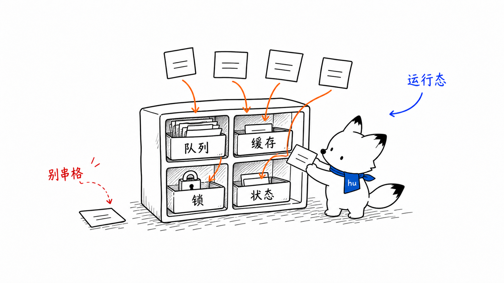
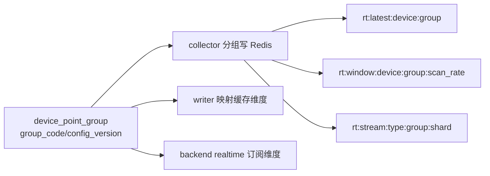
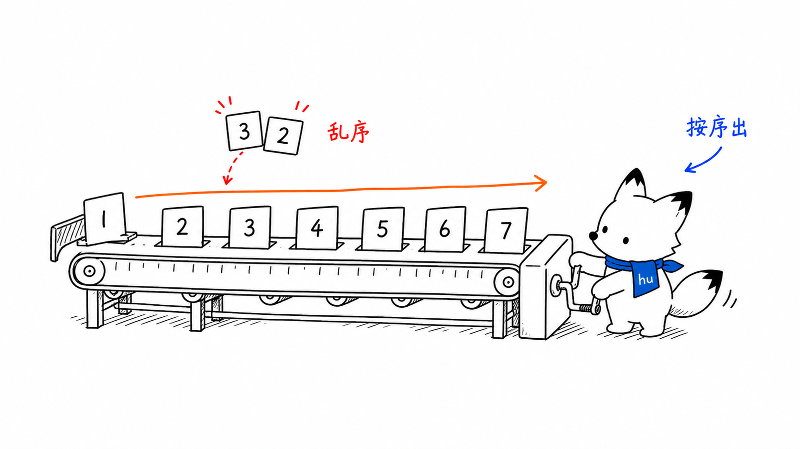
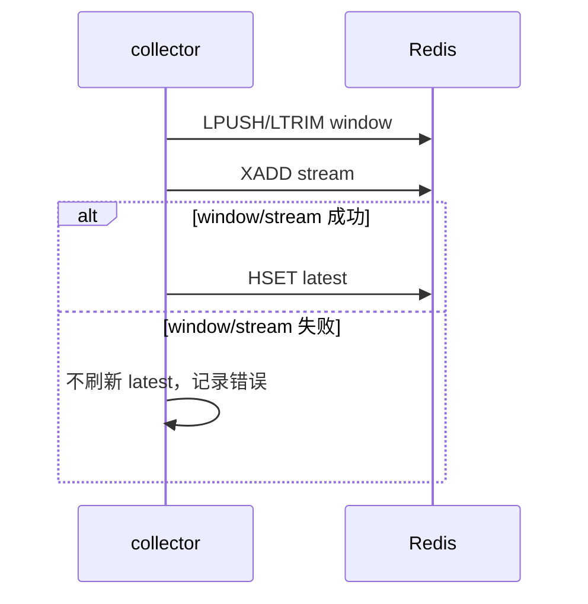

# Redis 流与点位分组
<!-- xiaohu-illustration:redis-schema-01-streams -->


> Redis 是采集端与入库端之间的缓冲层，同时承载后端读取的实时态。本文定义 Redis 中的键结构、字段契约、分片与点位分组规则，是 collector（生产）、writer（消费入库）、backend（读实时）三方共同遵守的契约。

---

## 1. 概述

collector 每个采集周期把结果写入 Redis 的四种结构：

| 结构 | 键 | 类型 | 用途 | 读取方 |
|------|-----|------|------|--------|
| latest | `rt:latest:{device_code}:{group_code}` | Hash | 各点位最新值 | backend 实时 WS / realtime-init |
| window | `rt:window:{device_code}:{group_code}:{scan_rate_ms}` | List | 最近 10 帧短历史 | backend realtime-window |
| stream | `rt:stream:{device_type}:{group_code}:{shard}` | Stream | 入库消费队列 | writer |
| dlq | `rt:dlq:{device_type}:{group_code}` | List | 死信 | 运维排查 |

Redis 是实时态和入库缓冲层，不是长期历史库。长期历史以 TDengine 为准。

---

## 2. 点位分组 group_code

点位按 `device_point_group.group_code`（如 `g001`）分组。分组是 Redis key、writer 映射和前端订阅的共同粒度。



分组的意义：

- 降低实时页订阅和 Redis 读写放大；
- 让 writer 以 `(device_code, group_code, config_version)` 选择映射；
- 支撑不同扫描周期、不同业务页面按需读取；
- 为 TDengine 列位管理提供边界。

---

## 3. latest：当前实时态

### 3.1 key 与字段

```text
rt:latest:{device_code}:{group_code}
```

Hash 字段：

```text
field = var_id
value = {"v":"<值>","t":<时间戳ms>,"q":<质量>}
```

示例：

```json
HGETALL rt:latest:QC100:g001
{
  "900001": {"v":"23.4","t":1718000000000,"q":0},
  "900002": {"v":"1","t":1718000000000,"q":0}
}
```

### 3.2 语义

- 每周期覆盖写，无 TTL。
- 后端实时 WebSocket 首帧 `snapshot` 与后续 `diff` 均来自 latest。
- latest 是“当前批次已完成 Redis 写入”的信号，因此必须最后写。
- 设备删除、停用或运维清理时由管理逻辑显式处理，不能依赖 TTL 自然过期。

---

## 4. window：短窗口

```text
rt:window:{device_code}:{group_code}:{scan_rate_ms}
```

List 内容是完整帧 JSON，collector 执行：

```text
LPUSH frame
LTRIM 0 9
```

帧示例：

```json
{
  "device_code": "QC100",
  "group_code": "g001",
  "ts": 1718000000000,
  "scan_rate": 100,
  "values": {
    "900001": "23.4",
    "900002": "1"
  }
}
```

用途：

- 实时页短历史回看；
- 调试 collector 是否连续产出完整帧；
- 和 latest 对照排查“当前值有但窗口缺失”的一致性问题。

---

## 5. stream：入库队列

### 5.1 key 与分片

```text
rt:stream:{device_type}:{group_code}:{shard}
shard = crc32(device_code) % stream_shard_count
```

必须使用 crc32，而不是 Python 内置 `hash()`，因为内置 hash 会受进程随机种子影响，导致 collector/writer 分片不一致。

`stream_shard_count` 必须在 collector 与 writer 保持一致。

### 5.2 条目字段（contract v2）

| 字段 | 含义 |
|------|------|
| `contract_version` | 契约版本，v2 起必须为 `2` |
| `device_code` | 设备编号 |
| `device_type` | 设备类型，映射 TDengine 超级表 `sd{device_type}` |
| `group_code` | 点位分组 |
| `scan_rate` | 扫描周期 ms |
| `ts` | 采集时间戳 ms |
| `config_version` | 点位分组配置版本 |
| `values` | JSON 数组 `[var_id, ...]`，与 qualities 一一对应 |
| `qualities` | JSON 数组 `[quality_code, ...]`，与 values 一一对应 |

**v2 示例**（含质量码）：

```json
XADD rt:stream:qc:g001:0 *
{
  "contract_version": "2",
  "device_code": "QC100",
  "device_type": "qc",
  "group_code": "g001",
  "scan_rate": "100",
  "ts": "1718000000000",
  "config_version": "12",
  "values": "[23.4, 1]",
  "qualities": "[0, 0]"
}
```

**兼容性**：writer 读取时若 `contract_version < 2` 或缺 `qualities` 字段，兼容填充质量码 `0`（GOOD）。

### 5.3 写入过滤

collector 只把需要历史入库的点位写入 stream：

- `is_storage=1`；
- 非 `STRING` 类型；
- 能被 writer 归一成数值。

latest/window 可以承载实时展示所需值；stream 只承载 TDengine 入库候选。

---

## 6. 写序不变式
<!-- xiaohu-illustration:redis-schema-02-belt -->


collector 每周期必须按以下顺序：

```text
1. 写 window
2. 写 stream
3. 写 latest
```

实际实现中 window + stream 可合并为 pipeline，但 latest 必须最后。



原因：backend 读 latest 推实时。如果 latest 先写成功而 stream 失败，前端会看到新值，但 writer 永远收不到这批历史入库消息。

---

## 7. writer 消费组语义

writer 以 Redis consumer group 消费 stream：

```text
XGROUP CREATE rt:stream:qc:g001:0 writer_cg $ MKSTREAM
XREADGROUP GROUP writer_cg writer-1 STREAMS rt:stream:qc:g001:0 >
```

可靠性约定：

| 状态 | Redis 表现 | writer 动作 |
|------|------------|-------------|
| 新消息 | Stream 中未投递 | `XREADGROUP >` 读取 |
| 已投递未确认 | PEL 中 | 成功写 TDengine 后 `XACK` |
| 消费者崩溃 | PEL idle 增长 | `XAUTOCLAIM` / `XCLAIM` 重认领 |
| 投递过多仍失败 | delivery count 超阈值 | push DLQ 成功后 `XACK` |

---

## 8. dlq：死信队列

```text
rt:dlq:{device_type}:{group_code}
```

List 上限 1000，writer 执行 `LPUSH + LTRIM 0 999`。

载荷示例：

```json
{
  "entry_id": "1718000000000-0",
  "stream_key": "rt:stream:qc:g001:0",
  "retry_count": 5,
  "last_error": "TDengine bad data",
  "failed_at": "2026-06-25T10:00:00+08:00",
  "data": {
    "device_code": "QC100",
    "device_type": "qc",
    "group_code": "g001",
    "values": "{\"900001\":\"bad\"}"
  }
}
```

DLQ 是人工排查入口，不是自动重放机制。进入 DLQ 的常见原因：

- 投递次数超过 `pending_max_retry`；
- TDengine 确认坏数据错误，二分后定位到单行；
- 数据类型无法安全落入 DOUBLE。

---

## 9. 运维检查点

| 检查目标 | 命令/指标 |
|----------|-----------|
| Stream 是否增长 | `XLEN rt:stream:{type}:{group}:{shard}` |
| 消费组状态 | `XINFO GROUPS rt:stream:{type}:{group}:{shard}` |
| pending 是否积压 | `XPENDING rt:stream:{type}:{group}:{shard} writer_cg` |
| DLQ 是否增长 | `LLEN rt:dlq:{type}:{group}` |
| latest 是否有值 | `HGETALL rt:latest:{device}:{group}` |
| window 是否连续 | `LRANGE rt:window:{device}:{group}:{scan_rate} 0 9` |

注意：生产环境不要随意 `DEL` Stream 或 PEL 相关 key。需要清理时先确认 writer 停止、数据可丢或已有备份。

---

## 10. 配置一致性要求

| 参数/字段 | 一致性要求 |
|-----------|------------|
| `stream_shard_count` | collector 与 writer 必须相同 |
| `group_code` | MySQL、Redis key、前端订阅必须一致 |
| `config_version` | collector 写入 stream，writer 用于映射缓存失效 |
| `device_type` | Redis stream key 与 TDengine stable `sd{device_type}` 对齐 |
| `device_code` | Redis key、TDengine 子表、MySQL 设备编号对齐 |

---

## 相关文档

- [采集-collector](../02-模块设计/collector/README.md)
- [collector 调用链与协议设计](../02-模块设计/collector/调用链与协议设计.md)
- [入库-writer](../02-模块设计/writer/README.md)
- [writer 可靠入库与 TDengine 写入](../02-模块设计/writer/可靠入库与TDengine写入.md)
- [WebSocket 协议](WebSocket协议.md)
