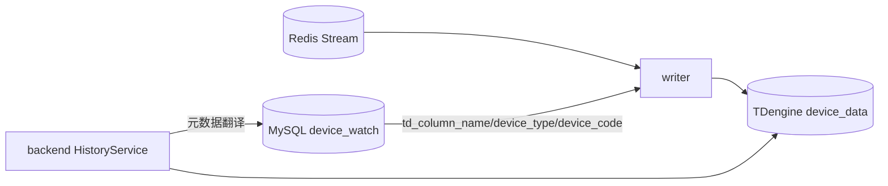

# TDengine 结构与字段

> TDengine `device_data` 是平台的高频时序历史库，由 writer 写入、backend 查询。它不保存设备配置、权限、菜单、告警规则等关系数据，也不承载实时最新值。

---

## 1. 数据库边界

| 数据库 | 类型 | 承载 | 主要写入方 | 主要读取方 |
|--------|------|------|------------|------------|
| `device_data` | TDengine | 点位时序历史 | writer | backend |



实时值不从 TDengine 读，实时页面以 Redis latest/window 为准。

---

## 2. 当前 writer schema

| 对象 | 规则 |
|------|------|
| 数据库 | `device_data` |
| 保留期 | `KEEP 14d` |
| 数据文件粒度 | `DURATION 1d` |
| 超级表 | 每设备类型一张：`sd{device_type}` |
| 子表 | 每设备一张：子表名 = `device_code`（规范化） |
| tags | `device_code` |
| 列 | 每点位一列：列名 = `device_variable.td_column_name` |
| 类型 | 所有点位列统一 `DOUBLE` |

示意：

```sql
CREATE STABLE IF NOT EXISTS sdqc (
  ts TIMESTAMP,
  v0001 DOUBLE,
  v0002 DOUBLE
) TAGS (device_code VARCHAR(64));

CREATE TABLE IF NOT EXISTS qc100 USING sdqc TAGS ('QC100');

INSERT INTO qc100 (ts, v0001, v0002)
VALUES ('2026-06-25 10:00:00.100', 1.0, 23.4);
```

---

## 3. 字段与命名规则

| 字段/对象 | 来源 | TDengine 中的表现 |
|----------|------|------------------|
| `device_type.type_code` | MySQL | 超级表名 `sd{device_type}` |
| `device.device_code` | MySQL | 子表名 + tag `device_code` |
| `device_variable.td_column_name` | MySQL | 数据列名 |
| `ts` | collector 采集时间，经 Redis Stream 传入 writer | TDengine 时间戳列 |
| 点位值 | Redis Stream `values` 中的 `var_id -> value` | 对应 `td_column_name DOUBLE` |

### 3.1 设备类型 → 超级表

```text
device_type.type_code = qc
TDengine stable = sdqc
```

### 3.2 设备编号 → 子表

```text
device.device_code = QC100
TDengine child table = qc100 或规范化后的 device_code
```

### 3.3 点位列

```text
device_variable.id = 900001
Redis values["900001"] = "23.4"
MySQL td_column_name = v0001
TDengine column = v0001 DOUBLE
```

writer 不直接信任 Redis 中的物理列名，Redis 只携带 `var_id`，列映射必须从 MySQL 加载。

---

## 4. schema 演进规则

- writer 可自动 `CREATE DATABASE IF NOT EXISTS device_data KEEP 14d DURATION 1d`。
- writer 可自动 `CREATE STABLE`。
- writer 可自动 `ALTER STABLE ADD COLUMN`。
- 列只增不删，点位软删除后历史列保留。
- 所有新增列为 `DOUBLE`。
- `quality` 不进入 TDengine 宽表；质量、告警与采集异常属于实时态/日志/告警域。
- `var_seq` 是业务序号，不是 TDengine 物理列名。

### 4.1 为什么列只增不减

列只增不减带来三个收益：

1. 历史查询不会因为点位删除而找不到旧列；
2. writer 在 config_version 短暂不一致时可安全使用旧映射；
3. 避免 TDengine schema 频繁删除/重排造成维护风险。

代价是历史废弃点位列会保留，容量与列数量需通过点位治理控制。

---

## 5. 写入语义

writer 写入流程：

```text
Redis Stream entry
  -> MysqlMapper(var_id -> td_column_name)
  -> TDengineWriter.ensure_database/stable/columns
  -> 多子表批量 INSERT
  -> LANDED / BAD_DATA / RETRY
```

写入原则：

- 跨子表多表 INSERT，提高吞吐；
- 按约 3MB SQL 字节预算分块，规避 TDengine 单语句大小上限；
- 连接类或未知错误返回 RETRY，不 ACK Redis；
- 确认坏数据错误才二分隔离，坏行进 DLQ，好行照常落库；
- LANDED 才 ACK Redis Stream。

---

## 6. 查询语义

backend `HistoryService` 查询时：

1. 从 MySQL 取设备与点位元数据；
2. 用 `device_code` 定位 TDengine 子表；
3. 用 `td_column_name` 定位列；
4. 按时间范围查询原始/降采样/矩阵；
5. 必要时 fallback legacy schema，仅用于兼容旧历史，不作为新写入口径。

常见查询形态：

| 查询 | 用途 |
|------|------|
| 原始明细 | 点位历史追溯 |
| 降采样图表 | 长时间范围趋势 |
| raw matrix | 多点位按时间桶对齐 |
| export | 历史数据导出 |

---

## 7. 不迁入的旧口径

| 旧口径 | 当前口径 |
|--------|----------|
| TDengine 每点位子表作为新模型 | 当前 writer schema 是设备子表宽表，legacy 只用于查询回退 |
| `var_seq` 作为 TDengine 列名 | 当前以 `device_variable.td_column_name` 为列名 |
| TDengine 保存 `quality` | 当前时序宽表只保存 DOUBLE 值 |
| Redis latest/window 作为历史库 | Redis 只做实时态和缓冲，历史以 TDengine 为准 |

---

## 相关文档

- [MySQL 结构与字段](MySQL结构与字段.md)
- [Redis 结构与字段](Redis结构与字段.md)
- [writer 可靠入库与 TDengine 写入](../../02-模块设计/writer/可靠入库与TDengine写入.md)
- [后端服务分层与实时历史通道](../../02-模块设计/backend/服务分层与实时历史通道.md)
