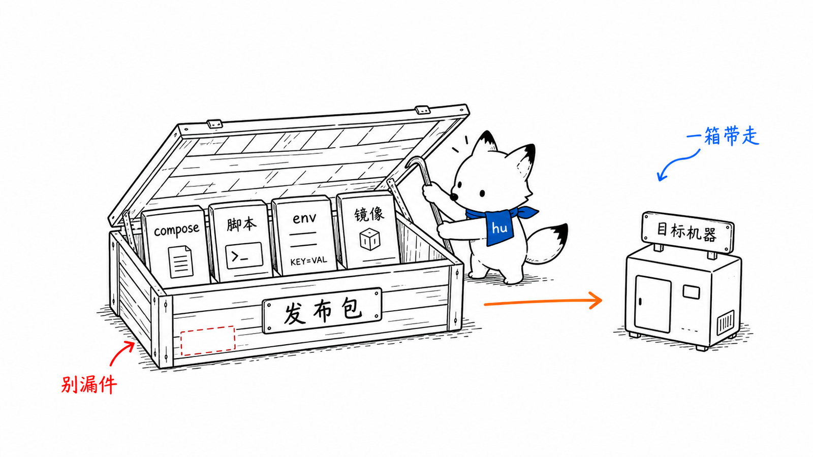
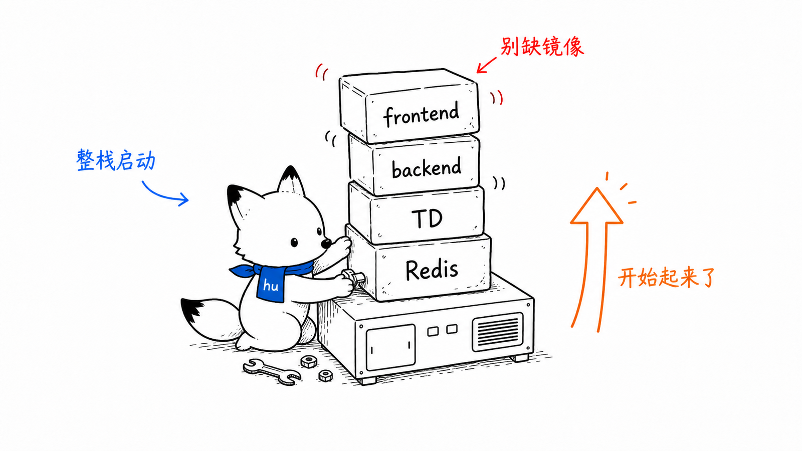

# 运维部署
<!-- xiaohu-illustration:ops-deploy-01-crate -->


> 本文覆盖平台的运行环境、开发启动、中心镜像部署、发版打包、离线镜像、升级回滚与验收。DataWatch CLI 的独立 Windows ZIP、安装、自更新和回滚见 [CLI安装与更新](CLI安装与更新.md)。三个固定角色安装包的最新构建与隔离契约见 [三角色安装包构建与隔离](三角色安装包构建与隔离.md)，交付验收见 [三角色安装包验收清单](三角色安装包验收清单.md)，Ingest 上线门禁见 [Ingest容量压测](Ingest容量压测.md)，问题排查见 [问题排查](问题排查.md)。命令以仓库脚本和当前部署文件为准。
>
> Windows 交付固定为三种角色包：中心式、分布式边缘、分布式中心。三个 EXE 只包含对应角色的 Windows 组件；Backend/Frontend 与 MySQL/Redis/TDengine 走独立 Docker 部署，不进入 Windows 安装包。边缘角色使用 Edge Agent + Storage + Collector + SQLite outbox + Uploader，不包含 Writer 或中心数据库。

---

## 1. 部署形态总览

### 2026-10-15 配套升级说明

本批包含桌面数据加载优化、请求取消、会话续期、设备目录分页，以及 Backend/Agent 的配套查询接口。升级时必须使用同批次的 Windows 角色安装包与 Backend 镜像；仅替换 App 会使新增目录查询接口返回 404。Frontend Web 镜像独立构建，也随本批更新。

- 三个 Windows 包位于 `installer/Output/`，以同目录 `release-manifest.json` 和 `SHA256SUMS.txt` 校验；文件名仍为 `0.1.0`，不能单凭文件名判断是否为新版。
- 默认离线应用镜像包为 `deploy/data-watch-images.zip`。旧包保留带日期归档；ZIP 内的清单记录镜像 ID、来源和 tar 哈希，不包含业务数据库或真实 `backend.env`。
- 本次允许基于包含未提交修复的工作区构建。此类产物必须明确标注 `working-tree` 并记录构建输入内容哈希；基础提交号不能替代工作区来源校验。
- 先更新中心 Backend/Frontend，再用对应角色安装包更新 Windows App/Agent；保留 ProgramData 配置、身份密钥和边缘 SQLite 数据。安装包生成不等于已经在本机或目标机安装。

已有数据库的中心仅更新应用容器，在仓库根目录执行：

```powershell
$ImageDir = Join-Path $env:TEMP ("datawatch-images-" + [guid]::NewGuid().ToString('N'))
Expand-Archive -LiteralPath .\deploy\data-watch-images.zip -DestinationPath $ImageDir
# 先检查归档内 release-manifest.json / SHA256SUMS.txt，与实际 tar 文件哈希比对。
Get-ChildItem -LiteralPath $ImageDir -Recurse -Filter *.tar | ForEach-Object {
    docker load -i $_.FullName
    if ($LASTEXITCODE -ne 0) { throw "镜像加载失败：$($_.Name)" }
}
docker compose --env-file .\deploy\backend.env -f .\deploy\docker-compose.yml up -d --no-deps --no-build --force-recreate backend frontend
Invoke-RestMethod http://127.0.0.1:8000/healthz
Invoke-WebRequest http://127.0.0.1:8080/ -UseBasicParsing | Select-Object StatusCode
```

`/healthz` 和首页成功仅证明服务可达，还需验证登录、设备分页、实时订阅和历史查询。应用升级不需要删除或重建数据库卷，禁止使用 `docker compose down -v`。回滚时载入上批应用镜像归档并重复上述应用容器重建命令；本批新 App 依赖新增接口，Backend 回滚时应同时回滚对应 Windows 包。

```text
中心侧（Docker / 现场已有服务）：
  MySQL        业务配置库 device_watch（可外置，不一定由 compose 托管）
  Redis        实时缓冲层 latest/window/stream/dlq
  TDengine     时序历史库 device_data
  backend      Python 3.14t + uvicorn 镜像
  frontend     Nginx 静态资源 + /api、WS 与 /ingest 统一入口镜像

Windows 角色安装包：
  中心式                    App + Agent(:7070) + Collector + Writer
  分布式边缘                Edge App + Edge Agent(:7071) + Storage(:7073) + Edge Collector + Uploader
  分布式中心                Center App + Agent(:7072) + Ingest + Writer
OPC DA proxy             仅随包含 Collector 的角色安装

独立工具包：
  DataWatch CLI            Windows x64 one-folder ZIP，不进入三角色安装包，目标机无需 Python
```

采集模块涉及 OPC DA、DCOM、PLC 网络和现场驱动环境，**不放进 Docker**；中心业务服务与 Web 前端支持镜像部署。

---

## 2. 运行环境

| 组件 | 运行时 / 依赖 |
|------|---------------|
| backend | free-threaded Python 3.14t，uvicorn，`backend/.env` 或 `deploy/backend.env` |
| frontend | Node 22 构建，nginx 1.27-alpine 运行 |
| CLI | Python 3.11+ 源码开发；PyInstaller Windows x64 one-folder 包用于目标机，目标机无需 Python |
| collector / storage / uploader / ingest / writer | free-threaded Python 3.14t，PyInstaller 打包 exe，按 Windows 角色运行 |
| agent | Python/FastAPI 打包 exe，NSSM Windows 服务 |
| app | Tauri + React + Rust + WebView2 |
| OPC DA proxy | .NET Framework 4.8 / x86，Windows COM/DCOM |
| 数据面 | MySQL、Redis、TDengine 3.4.0.9 |
| 打包环境 | 各模块 `.venv-pack`，Inno Setup 6，Node/pnpm，Rust，Docker |

---

## 3. 本地开发启动

### 3.1 backend + frontend

项目根目录：

```powershell
.\start-dev.ps1
.\start-dev.ps1 -Force
```

该脚本只启动：

| 服务 | 地址 |
|------|------|
| backend | `http://127.0.0.1:8000` |
| frontend dev server | `http://127.0.0.1:5173` |

它不会启动 agent、collector、writer、app。

Vite 开发服务只代理 `/api/* -> 127.0.0.1:8000`，当前不代理 `/ingest`。Docker Frontend/nginx 的 8080 端口才是分布式边缘使用的统一入口，同时承载 Web、`/api`、WebSocket 和 `/ingest`。因此开发页面可以使用 5173，但边缘 `center_url` 应继续指向 8080，并保持 `data-watch-frontend` 容器运行；关闭该容器会使所有边缘心跳和 Uploader 上传一并离线。

### 3.2 collector / writer

本地源码调试可用各自 `.venv-pack` 运行。生产/边缘部署应由 agent 启动，不要手工起同名进程，避免重复消费 Redis 或重复写 TDengine。

collector 支持配置预检：

```powershell
cd D:\python\device_alarm\data_watch\collector
.\.venv-pack\Scripts\python.exe main.py --dry-run
```

writer 会从 MySQL 动态发现 `(device_type, group_code)`，不再维护固定 `device_types/group_codes/stable_names`。

### 3.3 app / agent

开发 app 的顺序：

```text
backend(:8000) -> agent(:7070) -> app pnpm tauri dev
```

app 登录需要 agent token 与 backend token 都可获取。backend CORS 开发白名单需包含 Tauri dev 源 `http://localhost:1420` / `http://127.0.0.1:1420`。

---

## 4. 导出中心部署包

本章在开发机或打包机执行，只负责构建、导出和组装发布目录；目标机部署步骤见第 5 章。

### 4.1 当前镜像与部署文件

| 文件 | 作用 |
|------|------|
| `deploy/python314t.Dockerfile` | 构建 `data-watch-python314t:3.14t-3.14.4` 基础镜像，编译 Python 3.14.4 `--disable-gil`。同时打 `latest` 别名，供仍写死该标签的 backend Dockerfile 使用 |
| `backend/Dockerfile` | 构建 `data-watch-backend:latest`，复制 TDengine `libtaos.so`，运行 uvicorn |
| `frontend/Dockerfile` | Node 22 构建 Vite，nginx 托管静态文件 |
| `deploy/docker-compose.yml` | 定义 redis、tdengine、backend、frontend 服务 |
| `deploy/nginx.conf` | frontend 容器内 nginx，反代 `/api/`、WebSocket 与宿主机 Ingest `/ingest` |
| `deploy/backend.env.example` | backend 容器环境变量模板 |
| `deploy/taos.cfg` | TDengine 服务配置 |
| `deploy/redis.conf` | Redis 服务配置：内存保险丝（maxmemory）+ 持久化策略，由 compose 挂载，容器重建可复现 |
| `deploy/stack-up.ps1` | 一键从 tar 载入镜像并拉起中心全栈（mysql + redis + tdengine + backend + frontend） |

`deploy/docker-compose.yml` 当前服务：

| 服务 | 镜像 | 端口 | 说明 |
|------|------|------|------|
| mysql | `mysql:8.4` | `127.0.0.1:3306:3306` | profile `infra`，可选由 compose 托管；数据在 `mysql_data` 命名卷，业务表仍需恢复 |
| redis | `redis:7.4` | `127.0.0.1:6379:6379` | profile `infra`，可选由 compose 托管；要求 `REDIS_PASSWORD`，仅主机回环可达 |
| tdengine | `tdengine/tsdb-amd64:3.4.0.9` | `127.0.0.1:6041:6041` | profile `infra`，仅发布 taosAdapter 且仅主机回环可达（见 §10）；固定 `hostname`/`TAOS_FQDN=tdengine`（否则容器内解析不了自身 FQDN 会启动即崩），挂载 `taos.cfg` 与日志卷 |
| backend | `data-watch-backend:latest` | `8000:8000` | 读取 `deploy/backend.env` |
| frontend | `data-watch-frontend:latest` | `8080:80` | nginx 静态资源 + API/WS 代理 |

三种数据库都可由 Compose 的 `infra` profile 托管，也可使用现场已有的外部服务。Compose 新建 MySQL 容器只准备数据库实例和空 `device_watch`，不会自动恢复设备/点位业务表。

### 4.2 构建中心镜像

第一次或 Python 基础镜像变化时：

```powershell
cd D:\python\device_alarm\data_watch
docker build -t data-watch-python314t:3.14t-3.14.4 -t data-watch-python314t:latest -f .\deploy\python314t.Dockerfile .
```

构建 backend/frontend：

```powershell
docker compose -f .\deploy\docker-compose.yml build backend frontend
```

构建 ingest（上下文必须是仓库根目录，因为镜像要复制 `data_watch_shared`。默认 `BASE_IMAGE` 是 `data-watch-python314t:3.14t-3.14.4`，先打出这个标签）：

```powershell
docker build --build-arg BASE_IMAGE=data-watch-python314t:3.14t-3.14.4 -f .\ingest\Dockerfile -t data-watch-ingest:latest .
```

backend 镜像要点：

- 基于 `data-watch-python314t:latest`；
- 从 TDengine 镜像复制 `libtaos.so`；
- Docker 构建中排除 `perspective-python` 与 `taos-ws-py`；
- 以 `python3.14t -m uvicorn main:app --host 0.0.0.0 --port 8000` 启动。

ingest 镜像要点：

- 基于 `data-watch-python314t:3.14t-3.14.4`（free-threaded 3.14t，不是 `python:3.14-slim`；`PYTHON_GIL=0`）；
- 构建期导入 `ingest.main` 并断言 `sys._is_gil_enabled()` 为假；
- 以 `python3.14t -m ingest.main` 启动，内部 `uvicorn.run("ingest.app.main:app", workers=...)`，`workers>1` 时先做 schema 预热。

frontend 镜像要点：

- Node 22 alpine 构建；
- pnpm 安装依赖并 `pnpm build`；
- nginx 运行静态资源；
- 使用 `deploy/nginx.conf` 反代 API 和 WebSocket。

### 4.3 导出应用镜像

中心 Docker 镜像与 Windows 三角色安装包独立发布。离线场景把预构建的运行镜像导出到发布目录 `docker-images\`；文件名不写 Docker tag 里的 `:latest`，统一使用固定 tar 文件名。`data-watch-python314t:latest` 只在打包机构建 Backend 时使用，不导出到目标机，也不进入 Windows 安装包。

发布时先检出**本次指定的分支/提交**，从同一份源码分别构建 Backend 和 Frontend，再一起导出两个 tar，记录提交号及镜像 ID。`latest` 只是本机镜像标签，不证明它来自本次发布；目标机不能混用不同批次的前后端（本批前端会调用新增的 `/device/summary`、`/point/latest`）。不要默认 `main` 或现场已有的 `latest` 就是本次验证版本。

```powershell
$ReleaseRoot = "D:\data_watch_release"
New-Item -ItemType Directory -Force "$ReleaseRoot\docker-images" | Out-Null


docker save data-watch-backend:latest    -o "$ReleaseRoot\docker-images\data-watch-backend.tar"
docker save data-watch-frontend:latest   -o "$ReleaseRoot\docker-images\data-watch-frontend.tar"
```

### 4.4 导出基础设施镜像

当目标机准备由 Compose 托管 MySQL、Redis、TDengine 时，随发布包导出三种基础设施镜像。输出目录仍是 `docker-images\`，文件名固定为 `mysql.tar`、`redis.tar`、`tdengine.tar`。

```powershell
New-Item -ItemType Directory -Force "$ReleaseRoot\docker-images" | Out-Null
docker pull mysql:8.4
docker pull redis:7.4
docker pull tdengine/tsdb-amd64:3.4.0.9
docker save mysql:8.4                   -o "$ReleaseRoot\docker-images\mysql.tar"
docker save redis:7.4                   -o "$ReleaseRoot\docker-images\redis.tar"
docker save tdengine/tsdb-amd64:3.4.0.9  -o "$ReleaseRoot\docker-images\tdengine.tar"
```

> `deploy\data-watch-images.zip` 是前后端应用镜像归档，不含 MySQL/Redis/TDengine。归档内的 `release-manifest.json` 必须记录本次源码提交、镜像 ID 与 tar 哈希；文件名和 `latest` 不能证明版本。旧归档不得代替按本次提交重新导出的镜像。

### 4.5 复制部署配置到发布目录

镜像只是程序，目标机还要 `deploy\` 里的配置文件和脚本才能启动。这一步在仓库根目录 `D:\python\device_alarm\data_watch` 执行：

```powershell
New-Item -ItemType Directory -Force "$ReleaseRoot\deploy" | Out-Null
Copy-Item ".\deploy\docker-compose.yml"     "$ReleaseRoot\deploy\" -Force
Copy-Item ".\deploy\taos.cfg"               "$ReleaseRoot\deploy\" -Force
Copy-Item ".\deploy\nginx.conf"             "$ReleaseRoot\deploy\" -Force
Copy-Item ".\deploy\backend.env.example"    "$ReleaseRoot\deploy\" -Force
Copy-Item ".\deploy\python314t.Dockerfile"  "$ReleaseRoot\deploy\" -Force
Copy-Item ".\deploy\redis.conf"             "$ReleaseRoot\deploy\" -Force
Copy-Item ".\deploy\stack-up.ps1"           "$ReleaseRoot\deploy\" -Force
```

> `backend.env` 不拷贝：它是目标机真实配置文件，应由目标机从 `backend.env.example` 复制后填写。

发布目录结构：

```text
D:\data_watch_release\
├─ DataWatch-<Role>-Setup-<版本>.exe
├─ SHA256SUMS.txt
├─ release-manifest.json
├─ docker-images\
│  ├─ data-watch-backend.tar
│  ├─ data-watch-frontend.tar
│  ├─ mysql.tar
│  ├─ redis.tar
│  └─ tdengine.tar
│  # 此目录另含 release-manifest.json 和 SHA256SUMS.txt，记录镜像版本与 tar 哈希
└─ deploy\
   ├─ docker-compose.yml
   ├─ taos.cfg
   ├─ nginx.conf
   ├─ backend.env.example
   ├─ python314t.Dockerfile
   ├─ redis.conf
   └─ stack-up.ps1
```

镜像只包含程序环境，不包含 MySQL/Redis/TDengine 业务数据；完整 MySQL 备份如 `E:\device_watch.sql` 单独保管与恢复，不放入仓库或镜像。整个 `docker-images\` 目录独立于三个 Windows 安装包。

---

## 5. 目标机中心部署
<!-- xiaohu-illustration:ops-deploy-02-stack -->


本章在目标机执行。先确认 `E:\device_watch.sql` 等业务库备份与本次发布版本匹配，再选择 Compose 全栈或已有外部数据库。首次空卷部署应先单独启动 MySQL 并导入备份，之后才启动 Backend；已有数据卷的更新不重复初始化或导入。初始化责任与检查见第 6 节。

### 5.1 部署方式选择

| 场景 | 使用方式 | 说明 |
|------|----------|------|
| 目标机已有 MySQL/Redis/TDengine | 只启动 backend/frontend | 环境文件填各外部服务地址；手工加载本次 backend/frontend 镜像后执行 `docker compose up -d` |
| Compose 托管 MySQL/Redis/TDengine | 启动中心全栈 | 执行 `stack-up.ps1`，加载五个 tar 并拉起 mysql、redis、tdengine、backend、frontend |

全栈模式的 MySQL 使用 `mysql_data` 命名卷，只在首次创建空卷时读取 `MYSQL_ROOT_PASSWORD` 和 `MYSQL_DATABASE`。`stack-up.ps1` 不导入业务 SQL；首次建好实例后仍需把 `E:\device_watch.sql` 导入 `device_watch`。

### 5.2 配置 backend.env

部署前复制模板：

```powershell
cd D:\data_watch_release\deploy
Copy-Item .\backend.env.example .\backend.env
notepad .\backend.env
```

关键字段使用占位示例：

```env
PYTHONUTF8=1
BACKEND_HOST=0.0.0.0
BACKEND_PORT=8000
BACKEND_LOG_LEVEL=INFO
BACKEND_CORS_ORIGINS=http://localhost:8080,http://127.0.0.1:8080,http://localhost:1420,http://127.0.0.1:1420
BACKEND_ENV=production

MYSQL_HOST=mysql
MYSQL_PORT=3306
MYSQL_USER=root
MYSQL_PASSWORD=<strong-mysql-password>
MYSQL_DATABASE=device_watch
MYSQL_ROOT_PASSWORD=<same-strong-mysql-password>

TDENGINE_HOST=tdengine
TDENGINE_PORT=6041
TDENGINE_USER=<tdengine-user>
TDENGINE_PASSWORD=<tdengine-password>
TDENGINE_DATABASE=device_data
TDENGINE_LOG_DIR=/tdengine-logs

REDIS_HOST=redis
REDIS_PORT=6379
REDIS_DB=0
REDIS_PASSWORD=<strong-random-redis-password>

AUTH_SECRET_KEY=<generate-a-strong-random-secret>
AUTH_AUTO_BOOTSTRAP=true
AUTH_BOOTSTRAP_SUPER_PASSWORD=<unique-strong-bootstrap-password>
PERSPECTIVE_ENABLED=true

# Agent 服务凭据（Backend 调用 Agent 装卸驱动时使用）
# 值来自 Agent 安装器生成的 token 文件，不要自行编造；见下方说明
DATAWATCH_AGENT_SERVICE_TOKEN=<copy-from-role-data-root-agent_service_token.txt>
DATAWATCH_AGENT_BASE_URL=http://host.docker.internal:7070
```

说明：

- 全栈模式下 `MYSQL_HOST=mysql`、`REDIS_HOST=redis`、`TDENGINE_HOST=tdengine`；`MYSQL_USER=root` 时 `MYSQL_ROOT_PASSWORD` 必须与 Backend 的 `MYSQL_PASSWORD` 一致，且非空。`stack-up.ps1` 通过 `--env-file backend.env` 将初始化密码传给 Compose。
- 外部数据库模式下分别填 Backend 容器可达的 MySQL/Redis/TDengine 地址；不启动 `infra` profile，也不需要 `mysql.tar` 等基础设施镜像。Compose 的 `mysql` 服务不会自动接入外部 MySQL。
- 若 Redis/TDengine 在 Docker 宿主机运行，Docker Desktop 下可使用 `host.docker.internal`；若在另一台服务器，使用 Backend 容器实际可达的 DNS/IP，不要沿用 `redis`/`tdengine` 服务名。MySQL 同理；`host.docker.internal` 不是远端数据库地址。
- Compose `infra` 模式下 Redis 只发布到宿主机 `127.0.0.1:6379`，Backend 应通过 Docker 内网的 `redis:6379` 访问；Redis 与 Backend 必须使用同一个 `REDIS_PASSWORD`。
- `AUTH_SECRET_KEY` 生产必须强随机，不能使用模板值；`AUTH_BOOTSTRAP_SUPER_PASSWORD` 不得提交到仓库或写成示例弱密码。
- **`AUTH_TRUSTED_PROXIES`（来源 IP 可信边界）**：逗号分隔的 IP/CIDR。**默认留空**——此时 Backend **完全忽略** `X-Forwarded-For` / `X-Real-IP`，来源 IP 取连接对端，因此**无法被伪造**。仅当 Backend 确实位于你自己的网关之后时才填写网关地址（例如 `127.0.0.1,::1` 或 nginx 容器所在网段）；填写后来源从转发链**从右往左**取第一个**不可信**地址，而不是最左项（nginx 的 `$proxy_add_x_forwarded_for` 会把对端追加在最右，客户端自带的伪造项留在最左）。来源 IP 参与登录/日志限流与审计，配置错误会让限流被绕过或误伤合法用户。
- 生产/非开发环境首次启动且数据库中不存在 `Super` 时，`AUTH_AUTO_BOOTSTRAP=true` 必须同时提供 `AUTH_BOOTSTRAP_SUPER_PASSWORD`：至少 16 个字符，含大小写字母、数字和符号，且不得含空白。首次登录会要求改密，改密后从运行环境移除该变量；已有 disabled/deleted 的 `Super` 不会被复活。
- `TDENGINE_LOG_DIR=/tdengine-logs` 只有 compose 托管 TDengine 并挂载日志卷时可用；外部 TDengine 会优雅降级。
- **`DATAWATCH_AGENT_SERVICE_TOKEN`**: Backend 调用 Agent 装卸驱动时的服务凭据，必须与 Agent 侧配置的 `DATAWATCH_AGENT_SERVICE_TOKEN` **完全一致**。
  - **优先做法：直接取安装器已生成的值。** 角色安装包在安装时生成该令牌并写入角色数据根：中心式为 `C:\ProgramData\DataWatch\agent_service_token.txt`，分布式中心为 `C:\ProgramData\DataWatch Distributed Center\agent_service_token.txt`。安装后令牌由安装器以 CSPRNG 生成（256 位），且文件 ACL 只授予**管理员 + SYSTEM**。
  - **安全读取**：以管理员身份读取该文件并只粘贴到目标 `backend.env`。**不要把真实令牌写入 Markdown、工单、聊天记录、日志或任何提交**；也不要把文件复制到普通用户可读的位置。
  - **仅在没有安装器产物时**（例如纯 Docker / 手工部署，Agent 由通用脚本安装）才自行生成：`python -c "import secrets; print(secrets.token_hex(32))"`，并同时写入 Agent 侧与 Backend 侧。注意该通用脚本不注入 `DATAWATCH_ROLE`，缺失时 Agent 按中心式运行，只限开发辅助，不能用于正式角色部署。
  - **轮换与回滚（必须两端一起改）**：①生成新值；②同时更新 Agent 侧（`agent_service_token.txt` + Agent 服务环境）与 Backend 侧 `backend.env`；③重启 Agent 服务与 Backend；④验证 Backend 的驱动装卸接口可用、Agent 日志出现鉴权成功。**任一侧先改都会导致 Backend 调 Agent 失败**——这正是"旧凭据失效可验证"的判据。失败时把旧值写回两侧并重启即可回滚（无需重新安装）。
- **`DATAWATCH_AGENT_BASE_URL`（新增）**: Agent 地址。Docker 部署 Backend 时，Agent 在宿主机使用 `http://host.docker.internal:7070`；多节点部署时改为 Agent 实际 IP。

### 5.3 启动中心服务

现场已有外部 MySQL/Redis/TDengine 时，只启动 backend/frontend（环境文件须填写外部数据库的可达地址）：

```powershell
cd D:\data_watch_release\docker-images
docker load -i .\data-watch-backend.tar
docker load -i .\data-watch-frontend.tar

cd D:\data_watch_release\deploy
docker compose --env-file .\backend.env -f .\docker-compose.yml up -d --pull never --no-build
```

Compose 托管三库的**首次空卷部署**，先填写非空 MySQL/Redis 密码，只启动 MySQL 并恢复业务库，避免 Backend 在空业务库上先行启动：

```powershell
Set-Location "D:\data_watch_release\deploy"
docker load -i "..\docker-images\mysql.tar"
docker compose --env-file .\backend.env -f .\docker-compose.yml --profile infra up -d --pull never --no-build mysql
```

确认 `mysql_data` 是新建空卷后，把经验证且与本次版本匹配的 `E:\device_watch.sql` 复制到 MySQL 容器，使用容器内客户端交互输入密码导入。SQL 文件不进入 Git 或镜像：

```powershell
docker cp "E:\device_watch.sql" data-watch-mysql:/tmp/device_watch.sql
docker exec -it data-watch-mysql mysql -u root -p
```

在 `mysql>` 提示符下执行（若备份自带 `CREATE DATABASE`/`USE`，先核对其目标库确为 `device_watch`）：

```sql
USE device_watch;
SET autocommit=0;
SOURCE /tmp/device_watch.sql;
COMMIT;
SET autocommit=1;
SHOW TABLES;
SELECT COUNT(*) FROM device;
SELECT COUNT(*) FROM device_variable;
```

导入后复核设备、点位和 `td_column_name` 映射，然后运行全栈脚本。已有 `mysql_data` 卷的应用更新**跳过以上导入步骤**，直接运行该脚本；MySQL 初始化密码变量不会改变已有卷的 root 密码。

```powershell
powershell.exe -ExecutionPolicy Bypass -File .\stack-up.ps1
```

> 目标机离线且没有 PowerShell 7 时，用 Windows 自带的 `powershell.exe` 即可，不需要安装 `pwsh`。如果现场已经安装 PowerShell 7，也可以使用 `pwsh -File .\stack-up.ps1`。

`stack-up.ps1` 会逐个检查并加载这 5 个运行镜像 tar（路径统一在 `docker-images\` 下，固定文件名，缺任一即报错）：

- `..\docker-images\mysql.tar`
- `..\docker-images\redis.tar`
- `..\docker-images\tdengine.tar`
- `..\docker-images\data-watch-backend.tar`
- `..\docker-images\data-watch-frontend.tar`

脚本最后执行 `docker compose --env-file .\backend.env -f .\docker-compose.yml --profile infra up -d --pull never --no-build`，因此会同时拉起 mysql、redis、tdengine、backend、frontend。后续应用更新保留所有命名卷，不执行 `down -v`。

> 目标机使用预构建的 Backend/Frontend 运行镜像，不在现场重建。`stack-up.ps1` 在启动前强制检查并加载五个 tar；镜像缺失或标签不符时应重新生成 Docker 发布包，而不是把构建基础镜像塞进 Windows 安装器。

TDengine 的 `device_data` 可由 Writer 在首帧按 MySQL 映射创建；无 Collector 的演示流程见第 6 节。首次全栈启动后先验证数据可读，再启动真实采集/Writer。

### 5.4 Redis 数据与 stream 容量

正常应用更新保留 Redis/MySQL/TDengine 全部命名卷。以下清空 Redis 的命令**仅适用于已确认不需要旧数据的隔离测试环境**；重新部署 Redis 且有意清空旧数据时，需同时处理命名卷，否则旧 `dump.rdb` 可能被重新加载，一旦超过 `redis.conf` 的 `maxmemory`，noeviction 会全面拒写：

```powershell
docker rm -f data-watch-redis
docker volume ls
docker volume rm data_watch_redis_data   # 项目名 data_watch，卷名带此前缀
```

独立离线资源目录中的 `docker-images\redis.tar` 应为 Compose 固定的 `redis:7.4`；`redis.conf` 的 `maxmemory 3gb` 是 12G 虚机下的内存保险丝，撞顶会拒写而非把 TDengine 一起拖垮。

**关于 `stream_maxlen`（stream 容量上限）**

正常消费时，Writer 对已落 TDengine 或已成功进入 DLQ 的终态条目执行 `XACK + XDEL`；`stream_maxlen` 是 Writer 停止、持续滞后或删除暂时失败时的应急上限，仓库默认 `50000/shard`：

- **最坏内存预算**：Writer 无法推进时，`50000 × ~9KB ≈ 450MB/shard`；`shard_count=4` 时单个 `(device_type, group)` 组合约 1.8GB。此预算假设只有一个同量级 stream 组合，组合数增多需按 `maxmemory 3gb` 重算（如 2 组同量级 ≈ 3.6GB，会超保险丝）。
- **缓冲窗口变短（重要）**：旧值 500000 名义“3 分钟容量”，但在本机内存放不下、必然 OOM；降到 50000 后，writer 掉线/滞后时每 shard 仅缓冲约几十秒~1 分钟，超出的旧数据会被 MAXLEN 裁掉丢失。本质是用“短缓冲 + 不崩”换“长缓冲 + 崩”。
- **已部署机器生效路径**：中心式由 Collector 的 `stream_maxlen` 生效；分布式中心由 `INGEST_STREAM_MAXLEN` 生效。修改目标机实际配置后必须重启对应 Collector 或 Ingest，只改仓库不会让已安装实例生效。
- **升级前存量**：新版 Writer 只会自动 XDEL 它实际完成终态确认的条目。升级前已经 ACK 的旧 entry 仍可能保留；测试环境需要先停止 Collector/Uploader/Ingest 等写入源，让 Writer 追平后停止 Writer，确认所有消费组 `pending=0` 且 `lag=0`，再对目标 Stream 执行 `XTRIM <key> MAXLEN 0`。正式环境执行前必须备份并逐 Stream 核对，禁止直接 `FLUSHDB`。

### 5.4.1 Redis 暴露与认证

Compose 默认将 Redis 端口绑定到 `127.0.0.1:6379`，不会向现场所有网卡发布；使用 `--profile infra` 时 Backend 通过 Compose 私有网络访问服务名 `redis`。启动前必须在 `deploy/backend.env` 设置高强度 `REDIS_PASSWORD`，Redis 容器会拒绝空密码启动。

若必须让非 Compose 进程或其他主机访问 Redis：

1. 优先把客户端加入受控 Docker/专用内网，不要把端口改成 `0.0.0.0:6379`；
2. 为采集、Writer、Backend 分别建立 Redis ACL 用户，按实际命令授予最小权限（latest 的 Hash、window 的 List、Stream 的 XADD/XREADGROUP/XACK/XAUTOCLAIM、DLQ 的 List），禁止使用无约束的 `default on +@all`；
3. Redis 服务端与所有客户端统一设置强随机密码，凭据只放在受保护的环境变量/Secret，不写入日志、镜像或文档；
4. 跨主机传输必须启用 Redis TLS（或经批准的 TLS 隧道），并验收证书主机名、过期时间和客户端校验；内网不是跳过加密和 ACL 的理由。

现场验收至少执行：确认 `docker port data-watch-redis` 只显示 `127.0.0.1:6379`；使用正确密码执行 `PING`；无密码、错误密码和来自非授权网络的连接均失败；再用真实采集/Writer 流程确认 ACL 不会误拒绝所需命令。

### 5.5 查看和访问

查看服务：

```powershell
docker compose -f .\docker-compose.yml ps
docker logs -f data-watch-backend
docker logs -f data-watch-frontend
```

`/healthz` 只表示 Backend HTTP 路由可响应并回显配置的数据库名称，**不会实际查询 MySQL、Redis 或 TDengine**。数据库可读、Writer 入库和工作台趋势应按第 12 节分别验收。

访问地址：

```text
Web 前端: http://127.0.0.1:8080
后端 API: http://127.0.0.1:8080/api/...   # 经 nginx
后端直连: http://127.0.0.1:8000
```

### 5.6 nginx 代理规则

frontend 容器内 nginx 负责：

- `/api/` → `http://backend:8000/api/`；
- `/api/device-monitor/ws/` → backend WebSocket，并保留 Upgrade/Connection；
- `/ingest` → 宿主机 `Ingest :8010`；
- `/healthz` → backend healthz；
- 其他路径回退 `index.html`，支持前端路由刷新。

该 nginx 是当前分布式统一入口，不只是静态前端。生产环境必须独立监控容器状态、8080、`/api` 和一次签名 `/ingest` 请求；不要因本地使用 Vite 开发页面而停止它。

---

## 6. 数据库初始化责任

| 库 | 谁初始化 | 内容 | 部署要求 |
|----|----------|------|----------|
| MySQL `device_watch` 业务表 | 现场交付/数据库管理员 | 设备、点位、协议、映射等完整业务基线及相应增量迁移 | **Backend 启动前**恢复与本次发布匹配的已验证库备份或正式建库交付件 |
| MySQL 鉴权表 | backend（启用 `AUTH_AUTO_BOOTSTRAP` 时） | 仅鉴权模型的建表/迁移，以及用户、角色、菜单、权限种子 | 已有可连接的 `device_watch` 业务库与首装密码 |
| TDengine `device_data` | writer | `CREATE DATABASE IF NOT EXISTS`，首次实际写入时按 MySQL 映射建 `sd*`/`sq*` 超级表、子表及列 | 可从空库开始，但未采集前不保证表已出现 |
| Redis | 无 schema | latest/window/stream/dlq 运行时产生 | 只需服务可用 |

仓库目前只有 `scripts/sql/db1_*`、`db2_*`、`db4_*`、`db5_*`、`db6_*` 等**增量**文件，没有可单独创建全部业务表的完整基线 SQL。不能把空 `device_watch` 库加上 `AUTH_AUTO_BOOTSTRAP=true` 当作完成首装，也不能在未核对现有表结构时把这些增量脚本全部重跑；其中 `db5` 需要支持 `DELIMITER` 的 MySQL 客户端和人工核对。新机应随发布包另行交付经验证的 `device_watch` 备份/基线及其版本记录，先按该交付件恢复，再检查 `device`、`device_type`、`device_variable`、`device_point_group`、`comm_protocol`、`point_storage_mapping` 等当前代码实际查询的表与字段，确认设备和点位映射数量，然后启动 Backend。迁移旧机时还要保留用户/权限、设备配置及必要的日志/告警表。无真实设备配置的空业务库无法让 Collector 或演示脚本产生桥吊 100 数据。

`deploy/stack-up.ps1` 仅加载五个镜像并拉起容器，不执行上述 MySQL 恢复。旧的 `scripts/init_tdengine_v2.py` 生成 `st_*_g001`/`t_*_g001`，与当前 Writer 使用的 `sd*`/`sq*` 结构不同，**不要用它准备本次发布的 TDengine 库**。有真实 Collector 时，让 Writer 在首帧按 MySQL 映射建表；随后核对值表、质量表和一条真实历史查询。仅有 `/healthz` 成功不能证明数据库可读。

### 无 Collector 的桥吊 100 演示结构

[桥吊 100 模拟脚本](../测试/README.md)不创建 MySQL 配置或 TDengine 表。若目标机需要离线复现本机演示，应先恢复**与快照相同的** MySQL 设备/点位映射，并单独交付 [`tdengine-schema-20260929.json`](../tdengine-schema-20260929.json)。这个 JSON 只记录 2026-09-29 本机 `device_data` 的 3 张超级表和桥吊 100、101 的 4 张子表 DDL，**没有历史数据，也不是任意新现场的通用 schema**。目标机 TDengine 必须为兼容的 3.4.0.9，并确认 `device_data` 数据库尚不存在；已有库一律不要覆盖或删除，应走备份/迁移流程。

若上述前提满足，将 JSON 复制到目标机 `D:\data_watch_release\deploy\tdengine-schema-20260929.json`，用 Windows PowerShell 生成仅含建库、建超级表、建子表的 SQL，再用 TDengine 自带客户端交互输入密码执行：

```powershell
Set-Location "D:\data_watch_release\deploy"
$snapshot = Get-Content -LiteralPath ".\tdengine-schema-20260929.json" -Raw -Encoding UTF8 | ConvertFrom-Json
if ($snapshot.database -notmatch '^CREATE DATABASE `device_data`') { throw 'schema database 不匹配' }
$statements = @($snapshot.database, 'USE `device_data`')
$statements += @($snapshot.stables.PSObject.Properties | ForEach-Object { $_.Value })
$statements += @($snapshot.tables.PSObject.Properties | ForEach-Object { $_.Value })
$sql = @($statements | ForEach-Object { $_.TrimEnd(';') + ';' })
[IO.File]::WriteAllLines((Join-Path (Get-Location) 'tdengine-schema-replay.sql'), $sql, [Text.UTF8Encoding]::new($false))

# 先交互查询 SHOW DATABASES; 确认 device_data 不存在，然后退出客户端。
docker exec -it data-watch-tdengine taos -u root -p
docker cp ".\tdengine-schema-replay.sql" data-watch-tdengine:/tmp/tdengine-schema-replay.sql
docker exec -it data-watch-tdengine taos -u root -p -f /tmp/tdengine-schema-replay.sql
```

若 `SHOW DATABASES` 已有 `device_data`，**到此停止，不执行后两条命令**。执行后在新的 `taos` 会话先运行 `USE device_data;`，再核对 `SHOW STABLES;`、`SHOW TABLES;`、`DESCRIBE qc100;` 和 `DESCRIBE qc100_q;`，然后按[测试说明](../测试/README.md)运行限时模拟并核对 `qc101` 未变化。TDengine 结构恢复不能代替 MySQL 业务库恢复，也不能从这份 JSON 还原旧历史样本。

---

## 7. Windows 角色包部署

### 7.1 安装包内容

三个安装包的组件边界见 [三角色安装包构建与隔离](三角色安装包构建与隔离.md)。中心式包包含 App、Agent、Collector、Writer 和 OPC DA proxy；分布式边缘包包含 Edge App、Edge Agent、Storage、Edge Collector、SQLite outbox、Uploader 和 OPC DA proxy；分布式中心包包含 Center App、Agent、Ingest 和 Writer。Backend、Frontend、MySQL、Redis、TDengine 及所有 Docker tar 均不进入这三个 EXE。

### 7.2 双根目录（中心式示例）

```text
C:\Program Files\DataWatch Centralized\ # DATAWATCH_INSTALL_ROOT，只读安装根
  app\
  agent\
  collector\
  writer\
  sidecars\opcda_proxy_service\bin\
  tools\nssm.exe
  templates\

C:\ProgramData\DataWatch\            # DATAWATCH_DATA_ROOT，可写数据根
  config.toml
  collector\config\settings.toml
  writer\config\settings.toml
  runtime\
    logs\
    pids\
    opcda_proxy\
```

安装器/NSSM 注入：

```text
DATAWATCH_ROLE
DATAWATCH_AGENT_PORT
DATAWATCH_AGENT_SERVICE_TOKEN
DATAWATCH_INSTALL_ROOT
DATAWATCH_DATA_ROOT
```

各角色的 agent 和本角色子进程实际路径由双根动态派生，不在 config.toml 固定绝对路径；边缘与分布式中心使用各自独立的安装目录、ProgramData、服务名和 Agent 端口。

### 7.3 中心式 bootstrap

首次打开 app：

```text
1. app 连接 agent /bootstrap/status。
2. bootstrap_done=false -> 进入引导页。
3. 填写 MySQL、Redis、TDengine、backend 地址等连接信息。
4. agent 用 DPAPI 保存密码到 config.toml。
5. /bootstrap/test-connection 验证连通。
6. /bootstrap/finish 标记完成。
7. 登录并进入运维页面。
```

密码不要手工写入 config.toml；DPAPI 密文不可跨机器复制。

**Backend 首次认证 bootstrap（生产/非开发）**：

1. 首次启动前在 `deploy/backend.env` 设置 `BACKEND_ENV=production`、`AUTH_AUTO_BOOTSTRAP=true` 和符合策略的 `AUTH_BOOTSTRAP_SUPER_PASSWORD`；不要把密码写进 Compose 文件、脚本或文档。
2. Backend 连接 MySQL 后只在缺少 `Super` 时创建 Super，不会自动创建 Admin/User；disabled/deleted 的同名账号不会被复活。
3. 首次登录返回 `mustChangePassword=true`，Web/App 只能进入强制改密页；创建用户或重置密码产生的一次性临时密码只显示一次并通过安全渠道交付。
4. 使用 `POST /api/user/password/change` 完成改密。由于 token version 会轮换，客户端随后清理旧 access/refresh token 并重新登录。
5. 验证 Super 可正常登录后，立即从运行环境移除 `AUTH_BOOTSTRAP_SUPER_PASSWORD`；保留受控的部署审计记录，不在日志中记录密码。

**Agent 服务凭据配置**：安装器生成 `DATAWATCH_AGENT_SERVICE_TOKEN`，写入角色数据目录下的 `agent_service_token.txt`，并通过 NSSM 环境变量注入 Agent。Backend 需要调用中心本机 Agent 时，必须把同一值配置到独立 Docker 部署的 `backend.env`：中心式读取 `C:\ProgramData\DataWatch\agent_service_token.txt`，分布式中心读取 `C:\ProgramData\DataWatch Distributed Center\agent_service_token.txt`；`DATAWATCH_AGENT_BASE_URL` 分别使用宿主机端口 7070 或 7072。

### 7.4 中心式 collector / writer 启停

```text
app -> agent admin API -> ProcessManager -> collector/writer exe
```

agent 启动子进程时：

- 解密 DB 密码；
- 注入 `DATAWATCH_<DB>_<FIELD>`；
- 设置工作目录；
- 对 collector 拼接 `--config`、`--runtime-dir`、`--port-mapping`；writer 同样显式收到 `--runtime-dir`，确保停止标志目录与 Agent 一致；各模块仍保留 `config.toml` 的静态 `args`；
- stdout/stderr 写入 runtime logs；
- PID 文件包含 pid + create_time。

停止时先写 `runtime/<name>.shutdown_flag`，超时后才强杀。

Agent 在 `runtime/state/process_state.json` 原子保存用户希望运行的模块。完成引导后，Agent 重启或模块崩溃会按原意恢复运行；人工停止会清除对应意图，停止 Storage 同时清除 Collector/Uploader 的意图。恢复复用手动启动的凭据、驱动事务、proxy 和 Storage 就绪检查，失败重试间隔逐步增加至 60 秒；稳定运行 60 秒后恢复初始间隔。Agent 自身关停和驱动临时停机保留意图，恢复前清理遗留停止标志。状态文件不可作为跨机器迁移凭据，密码迁移仍遵循 DPAPI 限制。

App 经 Agent 的普通请求体上限为 4 MiB；驱动安装/预览兼容最大 50 MiB ZIP 的 base64 JSON（另留 4 KiB 元数据余量），响应上限为 50 MiB，并对无长度标头的分块响应计数。超限明确提示缩小数据范围或驱动包。

### 7.5 Collector 角色的 OPC DA proxy 验收

有 OPC DA center 设备时，agent 启动 collector 前必须：

1. 从 MySQL 检测 `opcda_center` endpoint；
2. 启动或认领对应 proxy；
3. 生成 `runtime\opcda_proxy\port_mapping.json`；
4. 检查端口可连、进程归属正确、proxy 存活；
5. 再启动 collector。

现场验收不能只看 proxy 进程和端口，要确认服务账户具备 DCOM/OPCEnum/OPC Server 权限，并真实读到点位。

### 7.6 分布式边缘启动与数据路径

```text
Edge Agent(:7071)
  -> Storage(:7073) ready
  -> Edge Collector
  -> Uploader
```

Collector 和 Uploader 不直接执行 SQLite 写事务。Collector 将采集帧提交给 Storage；Uploader 经 Storage 领取 outbox 批次并提交 ACK/重试/永久失败状态。Storage 停止时，Agent 应先停止依赖模块；启动 Collector 或 Uploader 时应先恢复 Storage 并等待 `/healthz` 成功。

本机检查：

```powershell
Invoke-RestMethod http://127.0.0.1:7073/healthz   # 免凭据，仅作存活探针
# /v1/status 需带 IPC 令牌（无/错令牌 401，角色越权 403）；/v1/status 属 agent 与 uploader 角色
$token = (Get-Content 'C:\ProgramData\DataWatch Edge\edge\storage-ipc-tokens.json' | ConvertFrom-Json).tokens.agent
Invoke-RestMethod http://127.0.0.1:7073/v1/status -Headers @{ 'X-DataWatch-Storage-Token' = $token }
Get-NetTCPConnection -LocalPort 7071,7073 -State Listen
```

Edge Storage IPC 的信任边界：`POST /v1/command` 与 `GET /v1/status` **默认拒绝**任何调用方 —— 无令牌或令牌错误返回 `401`，带有效令牌但动作超出该角色白名单返回 `403`；只有 `GET /healthz` 免凭据。令牌按角色（`collector` / `uploader` / `agent`）存放在 `<DATAWATCH_DATA_ROOT>\edge\storage-ipc-tokens.json`，由 Storage 首次启动时以随机值生成，并尽力用 ACL 收紧到「属主 + SYSTEM + Administrators」；可用 `DATAWATCH_EDGE_STORAGE_TOKEN_FILE` 改路径，或用 `DATAWATCH_EDGE_STORAGE_TOKEN` 直接注入令牌。Collector、Uploader、Agent 的边进程各自从同一文件读取自己角色的令牌，不需要人工配置。Storage 若绑定到非回环地址，必须显式传 `--allow-non-loopback`（或设 `DATAWATCH_EDGE_STORAGE_ALLOW_NON_LOOPBACK=1`），否则启动即被拒绝并返回退出码 2。判定只承认**可证明为回环**的地址：`127.0.0.0/8` 全段、`::1` 及其等价写法，以及 `localhost`（含 DNS 根形式 `localhost.` 与任意大小写，且必须在本机 `AF_INET` 下解析为回环地址才算通过）；**空串、纯空白、`0.0.0.0`、`::`、非回环地址与不可解析的 host 一律按非回环处理并拒绝**（`socket.bind(("", port))` 的语义是 `INADDR_ANY`，即监听全部网卡），因此 `--host ""` 或 `DATAWATCH_EDGE_STORAGE_HOST=`（空值）同样会被 exit 2 拒绝，需要显式授权才放行。反向也成立：**看着像回环、但本机解析不了的写法不会被放行** —— `127.1`、`127.0.0.1.`（IP 字面量带尾点）、`[::1]` 都按非回环拒绝并 exit 2，因为放行只会把清晰的拒绝换成绑定期崩溃。绑定失败一律**快速失败**（退出码 2，不残留进程、不创建数据库文件）并按原因分类：**地址族不支持**（如 `--host ::1` —— 该 IPC 端点仅 IPv4，`ThreadingHTTPServer` 固定 `AF_INET`，日志为 `... this IPC endpoint is IPv4-only ... IPv6 (e.g. ::1) is not supported ...`）、**地址不属于本机**（如 `--host 192.168.1.99`，日志为 `... that address does not belong to this host`）、**端口已被占用或无绑定权限**（日志为 `... the port is already in use ...`）。

---

## 8. 发版打包

### 8.1 Windows 三角色安装包

```powershell
cd D:\python\device_alarm\data_watch
pwsh -File installer\build.ps1
pwsh -File installer\build.ps1 -Role edge
pwsh -File installer\build.ps1 -Role distributed-center -Iscc "D:\path\to\ISCC.exe"
```

`installer\build.ps1` 默认依次生成三个角色包；-Role 可只构建一个角色。详细组件矩阵、隔离值和 Docker 分轨发布策略见 [三角色安装包构建与隔离](三角色安装包构建与隔离.md)。

角色构建按目标裁剪组件，主要产物如下：

| 阶段 | 动作 | 产物 |
|------|------|------|
| 1 | app：`pnpm tauri build` | Tauri app exe/resources |
| 2 | agent：PyInstaller | `agent\dist\data-watch-agent\` |
| 3 | Python 模块：按角色构建 Collector/Storage/Uploader/Ingest/Writer | 各模块 `dist\` 目录 |
| 4 | OPC DA proxy：仅包含 Collector 的角色执行 .NET 4.8 x86 build | `OpcDaProxyService.exe` |
| 5 | Inno ISCC | `installer\output\DataWatch-<Role>-Setup-<版本>.exe` |

### 8.2 Docker 镜像

`installer\build.ps1` 只构建 Windows 三角色安装包，不调用 Docker，也不读取 `deploy\images`。Backend/Frontend 镜像按第 4 节单独构建与发布，目标机部署按第 5 节执行。

---

## 9. 更新与回滚

### 9.1 更新 backend/frontend 镜像

```powershell
cd D:\data_watch_release\deploy
docker load -i ..\docker-images\data-watch-backend.tar
docker load -i ..\docker-images\data-watch-frontend.tar
docker compose --env-file .\backend.env -f .\docker-compose.yml up -d --pull never --no-build backend frontend
```

开发机按第 4 节从同一提交构建、记录镜像 ID 并导出；目标机按上述步骤加载交付镜像。发布目录不含源码，目标机不执行 `--build`。更新前保留上一批 tar 与发布记录，保留全部数据库卷。

修改 `backend.env` 后无需 rebuild，但要重建容器使环境变量生效：

```powershell
docker compose --env-file .\backend.env -f .\docker-compose.yml up -d --pull never --no-build --force-recreate backend
```

### 9.2 更新 Windows 一体包

1. 开发机重新打包 `installer\build.ps1`；
2. 拷贝对应角色的 `DataWatch-<Role>-Setup-<版本>.exe`、`SHA256SUMS.txt` 和 `release-manifest.json` 到目标机，核对文件哈希及记录的源码提交；文件名里的 `0.1.0` 不能单独证明发布批次；
3. 管理员运行安装器覆盖安装；
4. ProgramData 现场配置保留；
5. 按角色检查 `DataWatchCentralizedAgent`、`DataWatchEdgeAgent` 或 `DataWatchDistributedCenterAgent`，并访问对应端口的 `/bootstrap/status`。

### 9.3 回滚

| 对象 | 回滚方式 |
|------|----------|
| backend/frontend | 保留上一版镜像 tar，`docker load` 后 `docker compose up -d` 指向旧 tag 或重新打 latest |
| backend.env | 恢复备份 env，`up -d --force-recreate backend` |
| Windows 一体包 | 重新运行上一版安装器；ProgramData 配置默认保留 |
| 数据库 | MySQL/TDengine 需依赖部署前备份；镜像回滚不回滚数据 |

不要使用 `docker compose down -v`，`-v` 会删除 compose 管理的数据卷，可能丢 Redis/TDengine 数据。

---

## 10. 端口表

| 端口 | 组件 | 说明 |
|------|------|------|
| 7070 | 中心式 Agent | 本机 `127.0.0.1`，中心式 App 调用 |
| 7071 | 分布式边缘 Agent | 本机 `127.0.0.1`，Edge App 调用 |
| 7072 | 分布式中心 Agent | 本机 `127.0.0.1`，Center App 调用 |
| 7073 | Edge Storage | 分布式边缘本机 `127.0.0.1`，Collector/Uploader/Agent 调用 |
| 8010 | Ingest | 分布式中心宿主机监听，nginx `/ingest/*` 代理目标 |
| 8000 | backend | backend 直连端口 |
| 8080 | frontend nginx | 分布式统一入口，承载 Web、`/api`、WS 与 `/ingest` |
| 5173 | frontend dev | Vite 开发服务 |
| 1420 | app dev | Tauri dev WebView origin |
| 6379 | Redis | 实时缓存/Stream；Compose 默认仅 `127.0.0.1` 发布 |
| 6041 | TDengine taosAdapter | backend/writer/agent 唯一使用的 HTTP/WebSocket 端口；Compose 只发布到 `127.0.0.1` |
| 6030 / 6043 / 6060 | TDengine native / taosKeeper / Explorer | Compose 不再发布，仅容器内可用 |

TDengine 的客户端在两种形态下都在中心机：中心式的 Writer/Agent，分布式中心的 Writer/Agent，以及 backend 容器
（经 `host.docker.internal`，与 Redis 相同）。分布式边缘只经 nginx `8080` → Ingest 上传，不直连 TDengine。
因此 6041 只绑主机回环；中心机上的 Writer/Agent 配置须用 `127.0.0.1`，不要填中心机的局域网 IP。
部署后核对：本机 `Test-NetConnection 127.0.0.1 -Port 6041` 成功，其他主机 `Test-NetConnection <中心IP> -Port 6041` 失败。
TDengine 默认 `root/taosdata` 必须改掉：`ALTER USER root PASS '<新密码>';`，并同步 `deploy/backend.env` 与各 Writer/Agent 配置。

---

## 11. 数据迁移与备份

镜像包不包含业务数据。迁移时分别处理：

| 数据 | 迁移方式 |
|------|----------|
| MySQL `device_watch` | mysqldump / 恢复，包含用户、菜单、设备点位配置 |
| TDengine `device_data` | TDengine 官方导出/数据目录/volume 迁移 |
| Redis | 实时缓存通常不迁移；如果 Stream 中还有未落库数据，先停采集并等 writer 消费完成 |
| ProgramData | 角色配置、日志和边缘 `edge.db`/outbox；DPAPI 密文不可跨机解密，迁移后需重新配置密码 |

新装机器须随发布包取得与当前源码匹配的 MySQL 完整业务基线或已验证备份；仓库里的增量 SQL 不能代替该基线。TDengine 的结构 JSON 只能重建本机样例表，历史行仍须由正式备份恢复。迁移后分别核对 MySQL 表与设备点位映射、TDengine 真实表查询、Redis 写入路径，再允许 Collector/Writer 上线。

---

## 12. 验收清单

分布式阶段 1 至阶段 4 的研发范围已经完成，但下列现场检查和《三角色安装包验收清单》仍需在目标环境签署。自动化测试通过不能替代安装、断网、升级、真实设备和容量证据。

### 中心镜像部署

- 核对发布指定分支/提交、Backend 与 Frontend 镜像 ID 和配套 tar；两个镜像均来自本次验证源码，而非现场遗留的 `latest`；
- MySQL `device_watch` 业务基线/备份已先行恢复，设备、点位、列映射与本次发布相符；
- `docker compose ps` 中 backend/frontend running；若使用 `infra`，Redis/TDengine 也应运行；
- 访问 `http://127.0.0.1:8080` 正常；
- `/api/auth/login` 可达；
- 首装生产环境已验收 `AUTH_BOOTSTRAP_SUPER_PASSWORD` 强度、首次 `mustChangePassword=true`、改密后旧 token 失效且重新登录成功；改密后已移除该环境变量；
- WebSocket 经 8080 可连接；
- Redis 仅回环或 Docker 私网可达，密码/ACL/TLS 验收记录完整；
- `/healthz` 只验 HTTP 存活；另用真实登录、设备列表及摘要、点位列表及当前值查询确认 MySQL/Redis 可读；
- TDengine 空库有实际采集时由 Writer 建 `sd*`/`sq*` 结构并写入；无采集的演示库按第 6 节复制与 MySQL 映射匹配的 schema，分别检查值表、质量表与工作台趋势结果；
- 工作台各模块失败时有独立提示/重试；趋势 503/504 不显示成零值；对照 `x-request-id` 和后端日志定位慢请求；
- TDengine 日志页在 compose 托管 TDengine 时可用，外部 TDengine 时优雅提示不可用。

### 分布式边缘部署

- 桌面安装 Edge App，`DataWatchEdgeAgent` 服务监听本机端口 7071；
- 首次引导生成 node_uuid/Ed25519 密钥并完成 center_url、enrollment code 注册；
- Edge App 的本机设备、采集状态、Storage 状态、离线积压通过 localhost Edge Agent API 可查看，中心断网时仍可用；
- App 可管控 Edge Collector、Storage 和 Uploader，安装目录中不包含 Writer、Backend、MySQL、Redis 或 TDengine；
- Collector 采集结果经 Storage 先落 SQLite outbox，Uploader 恢复联网后严格按序追赶；
- Storage `writer_queue_depth` 不持续增长，`errors_total` 无异常增加，`commit_p99_ms` 满足本机采集节拍；
- OPC DA 场景下 proxy 自动启动且真实点位刷新；
- 中心节点页可看到心跳、配置修订、积压、磁盘水位和累计丢弃数。

---

## 相关文档

- [Ingest容量压测](Ingest容量压测.md)
- [系统架构总览](../01-总体设计/系统架构总览.md)
- [架构决策记录](../01-总体设计/架构决策记录.md)
- [agent 边缘进程编排与凭据](../02-模块设计/agent/边缘进程编排与凭据.md)
- [app 控制台页面与双数据源](../02-模块设计/app/控制台页面与双数据源.md)
- [API 契约](../03-数据与契约/契约/API契约.md)
- [WebSocket 协议](../03-数据与契约/契约/WebSocket协议.md)
- [CLI 安装与更新](CLI安装与更新.md)
- [CLI 模块说明](../02-模块设计/cli/README.md)
- [CLI 输出契约](../03-数据与契约/契约/CLI输出契约.md)
