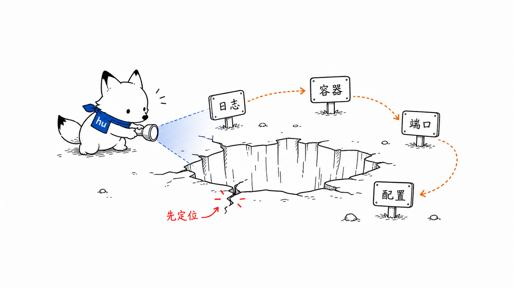
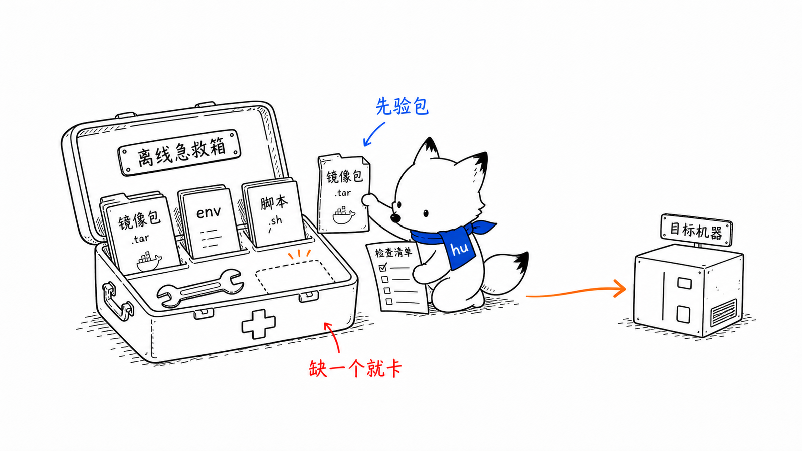

# 问题排查
<!-- xiaohu-illustration:ops-troubleshooting-01-flashlight -->


> 本文从《运维部署》拆出，专门记录部署、启动、登录、WebSocket、agent、collector、writer、OPC DA 等常见故障的定位路径。主部署流程见 [运维部署总览](README.md)。

---

## 1. Web 前端能打开但 API 失败

检查容器日志：

```powershell
docker logs -f data-watch-frontend
docker logs -f data-watch-backend
```

重点检查：

- `deploy/nginx.conf` 是否正确反代 `/api/`；
- backend 容器是否启动；
- `deploy/backend.env` 是否指向正确 MySQL / Redis / TDengine；
- `AUTH_SECRET_KEY` 是否已替换为强随机值；
- backend 是否成功初始化 MySQL schema 与基础用户/权限。

---

## 2. 实时 WebSocket 失败

如果直连 backend 正常，但经 `http://127.0.0.1:8080` 的 frontend 镜像异常，优先检查 nginx WebSocket 配置：

```nginx
location /api/device-monitor/ws/ {
  proxy_pass http://backend:8000/api/device-monitor/ws/;
  proxy_http_version 1.1;
  proxy_set_header Upgrade $http_upgrade;
  proxy_set_header Connection "upgrade";
  proxy_read_timeout 3600s;
}
```

同时确认：

- 路径为 `/api/device-monitor/ws/realtime-push`；
- 客户端未在 URL 携带 token，且首帧先发送 `{"type":"auth","token":"..."}` 再订阅；代理/日志不得记录鉴权头或完整认证消息；
- backend 日志无鉴权失败；
- Redis latest 有对应 `rt:latest:{device_code}:{group_code}`；
- 前端订阅使用 `device_code + group_code`，不是旧的 `deviceIds/channel`。

---

## 3. backend 容器连不上数据库

常见原因：

- Windows Docker Desktop 访问宿主机服务需要 `host.docker.internal`；
- 使用 Compose `infra` 三库时 Backend 的 `MYSQL_HOST=mysql`、`REDIS_HOST=redis`、`TDENGINE_HOST=tdengine`；使用外部数据库时填写容器实际可达的地址；
- Compose 首次创建 MySQL 空卷时需 `MYSQL_ROOT_PASSWORD`，并先导入完整 `device_watch` 业务备份；容器 running 或 `/healthz` 成功不代表业务表已恢复；
- `backend.env` 修改后未重建容器。

修改 `backend.env` 后执行：

```powershell
docker compose --env-file .\backend.env -f .\docker-compose.yml up -d --no-build --force-recreate backend
```

---

## 4. app 显示 Agent 不可达

检查 Windows 服务：

```powershell
Get-Service DataWatchCentralizedAgent,DataWatchEdgeAgent,DataWatchDistributedCenterAgent
Invoke-RestMethod http://127.0.0.1:7070/bootstrap/status
```

示例命令检查中心式 7070；分布式边缘和分布式中心分别替换为 7071、7072。如果对应端口不通：

- 看对应角色服务是否 Running；
- 看 `C:\ProgramData\DataWatch\runtime\logs\` 下 agent stdout/stderr；
- 确认 NSSM 注入了 `DATAWATCH_INSTALL_ROOT` / `DATAWATCH_DATA_ROOT`；
- 确认端口 7070 未被其他进程占用。

---

## 5. 登录失败

### 5.1 503 database unavailable

通常是 MySQL 地址、账号、密码错误，或 agent/backend 连不到库。

检查：

- agent `config.toml` 中 MySQL host/port/user/database 是否正确；
- 密码是否通过 app/bootstrap 写入 DPAPI，而不是手工填明文；
- backend 容器是否也指向同一个 MySQL；
- 目标机网络是否能访问 MySQL。

### 5.2 401 用户名或密码错误

常见原因：

- 目标 MySQL 尚未由 backend 初始化；
- `sys_user` 中没有默认用户；
- 使用了错误账号密码。

默认超管账号口径以当前数据库初始化为准。

### 5.3 bootstrap 填错 MySQL 后锁死

如果已经 `/bootstrap/finish`，但 MySQL 填错导致无法登录，可重置 bootstrap 状态后重新引导：

```powershell
Stop-Service DataWatchCentralizedAgent
notepad C:\ProgramData\DataWatch\config.toml
# 把 bootstrap_done 改回 false
Start-Service DataWatchCentralizedAgent
```

密码仍必须通过 app 界面写入，让 agent 重新 DPAPI 加密。

---

## 6. collector 启动失败或无实时数据
<!-- xiaohu-illustration:ops-troubleshooting-02-firstaid -->


检查顺序：

1. agent 是否成功启动 collector；
2. collector 日志是否显示 MySQL / Redis 连接成功；
3. MySQL 中是否有启用的 device / device_variable；
4. 点位是否有 group_code 与 scan_rate；
5. 设备协议是否被 DeviceManager 支持；
6. Redis 是否出现 latest/window/stream key；
7. generation stale 或 executor saturated 指标是否增长。

常用 Redis 检查：

```text
HGETALL rt:latest:{device_code}:{group_code}
LRANGE rt:window:{device_code}:{group_code}:{scan_rate_ms} 0 9
XLEN rt:stream:{device_type}:{group_code}:{shard}
```

---

## 7. writer pending 增长

检查：

- writer 是否 running；
- writer 与 collector 是否连接同一个 Redis；
- `stream_shard_count` 是否一致；
- TDengine 是否可用；
- Redis `XINFO GROUPS` 中 pending 是否增长；
- DLQ 是否增长；
- writer 日志是否有 TDengine 连接错误或坏数据错误。

常用 Redis 检查：

```text
XINFO GROUPS rt:stream:{device_type}:{group_code}:{shard}
XPENDING rt:stream:{device_type}:{group_code}:{shard} writer_cg
LLEN rt:dlq:{device_type}:{group_code}
```

如果 pending 增长但 DLQ 不增长，多半是 TDengine 连接/写入能力问题；如果 DLQ 增长，则优先排查点位值、数据类型和 TDengine schema。

分布式中心建议连续采样至少 30 分钟：

```powershell
$env:REDIS_PASSWORD = "<redis密码>"
.\scripts\capture_performance_baseline.ps1 -DurationSeconds 1800
```

输出同时包含 Agent/Collector/Ingest/Writer 进程、Docker 容器、Redis 分节 `INFO`、各 Stream 的 `XLEN/XPENDING` 以及 Redis/TDengine 尾部日志。判断时区分 `used_memory` 与 RSS：前者下降而 RSS 暂不下降通常是分配器保留或碎片；`XLEN` 持续增长而 `pending=0` 则优先检查 Writer 的 XDEL 日志和版本。

TDengine 内存需要单独判断：先看 `docker-stats.jsonl` 在停止采集、Writer 追平后的 10～30 分钟是否继续单调增长，再结合 `tdengine-container-tail.log` 的 OOM、重启、 vnode 或写入错误。稳定在固定平台且无 OOM/重启通常是引擎缓存或操作系统页缓存；持续增长并伴随写入失败才进入保留策略、缓存参数、压缩比和数据量核算。不要仅凭任务管理器某个瞬时值直接修改 TDengine 缓存。

---

## 8. OPC DA proxy ready 但无真实点位

不要只看：

```text
proxy 进程存在
端口正在监听
collector 状态 running
```

必须确认：

- Agent 服务账户具备 DCOM / OPCEnum / OPC Server 权限；
- proxy 日志无 ProgID、DCOM、Identity 错误；
- `serverProgId`、channel、endpoint 正确；
- 点位 `var_address` 是真实 OPC Item ID；
- `runtime\opcda_proxy\port_mapping.json` 中 endpoint 与 MySQL endpoint 归一一致；
- 实时页或 Redis latest 中点位值真实刷新。

需要逐点质量码时，把 proxy 日志级别调到 DEBUG，看每个 item 的 quality。

---

## 9. Docker 数据卷风险

日常更新 backend/frontend 不要执行：

```powershell
docker compose down -v
```

`-v` 会删除 compose 管理的数据卷。如果曾用 `--profile infra` 托管 Redis / TDengine，会导致数据丢失。

推荐更新：

```powershell
docker compose -f .\docker-compose.yml up -d --build backend frontend
```

---

## 10. 数据迁移相关问题

镜像 tar 只包含程序环境，不包含业务数据。

| 数据 | 排查重点 |
|------|----------|
| MySQL | 是否导入 `device_watch`，是否包含 `sys_user`、菜单、权限、设备点位 |
| TDengine | 是否迁移 `device_data`，保留期和数据目录是否正确 |
| Redis | 通常不迁移；若 Stream 仍有未落库消息，需先停采集并等 writer 消费完成 |
| ProgramData | DPAPI 密文不可跨机解密，迁移后需重新配置密码 |

---

## 11. tdengine 容器反复重启（FQDN 解析失败）

现象：tdengine 容器一直 `Restarting`，`docker logs data-watch-tdengine` 却几乎没输出；而在 Docker Desktop 里直接从镜像运行同一个 tdengine 又能正常启动。

`docker logs` 看不到东西，是因为 **taosd 把日志写进 `/var/log/taos` 文件（即 `tdengine_log` 卷），不写 stdout**。先把真实日志抠出来：

```powershell
docker run --rm --entrypoint sh -v data_watch_tdengine_log:/var/log/taos tdengine/tsdb-amd64:3.4.0.9 -lc "tail -n 60 /var/log/taos/taosdlog.*"
```

若日志结尾是：

```text
failed to get ip from fqdn:<容器随机ID> ... can not be initialized
failed to apply cfg ... since Unable to resolve FQDN
failed to start since apply config error
```

根因：**compose 自定义网络下，taosd 解析不了"随机容器主机名"作为自身 FQDN**。Docker Desktop 直接跑用默认 bridge 网络能自解析，所以没暴露此问题。

修复：`docker-compose.yml` 的 tdengine 服务已固定 `hostname: tdengine` + `TAOS_FQDN=tdengine`。确认目标机用的是带这两项的最新 compose，然后重建：

```powershell
cd D:\data_watch_release\deploy
docker compose -f .\docker-compose.yml --profile infra up -d --force-recreate tdengine
docker compose -f .\docker-compose.yml --profile infra ps   # State 应为 Up，而非 Restarting
```

若仍报 fqdn / dnode 不匹配（残留半初始化的空卷），清掉数据卷重来（此时尚无真实数据，安全）：

```powershell
docker compose -f .\docker-compose.yml --profile infra rm -sf tdengine
docker volume rm data_watch_tdengine_data
docker compose -f .\docker-compose.yml --profile infra up -d tdengine
```

---

## 12. 中心历史查询失败并提示 TDengine 许可证过期

现象：

- 中心式 App、分布式中心 App 查询历史数据失败，但边缘 App 的本地历史查询正常；
- TDengine 服务日志或后端日志包含 `[0x0800]: License expired`；
- 普通端口或 `SERVER_STATUS()` 健康检查可能仍然成功。

根因：目标机运行了 `tdengine/tsdb-ee:latest` 企业版镜像，许可证到期后实际表查询被拒绝。这与 MySQL 设备配置无关。当前 `deploy/docker-compose.yml` 已固定社区版 `tdengine/tsdb-amd64:3.4.0.9`。

处理前先停止 Collector、Ingest 和 Writer 的写入，并备份 `device_data` 或 `data_watch_tdengine_data` 数据卷。不要执行 `docker compose down -v`，也不要在备份验证前删除旧数据卷。

在线机器执行：

```powershell
cd D:\data_watch_release\deploy
docker inspect data-watch-tdengine --format "{{.Config.Image}}"
docker compose -f .\docker-compose.yml --profile infra pull tdengine
docker compose -f .\docker-compose.yml --profile infra up -d --force-recreate tdengine
docker inspect data-watch-tdengine --format "{{.Config.Image}}"
```

离线机器先导入社区版镜像，再执行重建：

```powershell
docker load -i .\tdengine-tsdb-amd64-3.4.0.9.tar
docker compose -f .\docker-compose.yml --profile infra up -d --force-recreate tdengine
```

重建只替换容器并继续挂载原 `tdengine_data` 卷。确认镜像显示为 `tdengine/tsdb-amd64:3.4.0.9`、Writer 恢复写入且历史查询成功后，再恢复采集。若旧卷与社区版不兼容，使用处理前备份恢复到新的 3.4.0.9 数据卷，不要直接删除唯一副本。

---

## 13. Uploader 离线且 outbox 持续积压

现象：

- Edge Collector 和 Storage 正常，`waiting/retry` 持续增加；
- Uploader 进程可能仍显示 running，但中心节点页显示 Uploader 离线；
- Backend `:8000/healthz` 与 Ingest `:8010/healthz` 正常；
- 边缘 `center_url` 配置为 `http://<center>:8080`。

优先检查统一入口：

```powershell
docker ps -a --filter name=data-watch-frontend
Get-NetTCPConnection -LocalPort 8080 -State Listen
Invoke-RestMethod http://127.0.0.1:8080/healthz
Invoke-RestMethod http://127.0.0.1:8010/healthz
```

当前 `data-watch-frontend` 容器中的 nginx 不只是页面服务，还负责 `/api` 和 `/ingest`。若容器被手工停止，8080 会整体消失，Edge Agent 心跳与 Uploader 上传同时失败。恢复：

```powershell
docker start data-watch-frontend
# 或在发布目录执行
docker compose -f .\docker-compose.yml up -d frontend
```

本地 `npm run dev`/Vite 使用 5173，当前只代理 `/api`，不能替代 nginx 的 `/ingest -> 8010`。开发页面可以打开 5173，但边缘 `center_url` 仍应使用 8080。恢复入口后观察 Uploader 日志、`sent` 递增和 backlog 回落；不要通过清空 `edge.db`、修改 `local_seq` 或生成新 session 处理普通入口故障。

注意：Ingest 自身健康地址是直连 `http://127.0.0.1:8010/healthz`。通过 nginx 请求 `/ingest/healthz` 返回 404 不等于 Ingest 不健康，`/ingest` 是需要签名请求体的业务入口。

---

## 14. Edge Storage 不可达或队列持续增长

现象：

- 存储监控显示连接已断开或正在重连；
- Collector 有设备响应，但 outbox 不增长；
- Uploader 无法领取批次或提交上传状态；
- `writer_queue_depth` 持续接近 `writer_queue_capacity`，或 `errors_total` 增长。

检查：

```powershell
Get-NetTCPConnection -LocalPort 7073 -State Listen
Invoke-RestMethod http://127.0.0.1:7073/healthz
Invoke-RestMethod http://127.0.0.1:7073/v1/status
Get-Service DataWatchEdgeAgent
```

Storage 是边缘 SQLite 唯一写者。先确认 `data-watch-storage.exe` 进程和 Storage 日志，再由 Edge App/Agent 重启 Storage；Agent 会按依赖恢复 Collector/Uploader。不要同时手工启动第二个 Storage，也不要让模拟脚本直接写生产 `edge.db`。若 P99 或队列持续升高，再检查磁盘空间、杀毒软件实时扫描和 `C:\ProgramData\DataWatch Edge\edge\edge.db` 所在卷的 I/O 延迟。

---

## 15. TDengine WAL 损坏或工作台查询超时

若 TDengine 3.4.0.9 日志出现 `log vnode2 WAL` 损坏、表查询失败或启动后不能读取业务库，先保留旧数据卷和日志，停止采集与 Writer 写入，并记录当前 `SHOW CREATE DATABASE/STABLE/TABLE`、`DESCRIBE` 以及 Redis 待入库状态。**重建相同表结构不会恢复历史行**；必须分开验证结构、历史数据和实时链路。2026-09-29 本机隔离副本导出 schema、新卷重建与随后桥吊 100 演示写入的具体范围见[运行状态记录](../06-验证记录/2026-09/2026-09-29-运行状态与性能改动.md)，原始 schema 见 [`tdengine-schema-20260929.json`](../tdengine-schema-20260929.json)。该记录仅适用于那次本机恢复，不是已有数据卷的通用重建指令。

若工作台趋势返回 503/504，优先用响应头 `x-request-id` 与 `server-timing` 对照 backend 请求日志，查看 MySQL、Redis、TDengine 查询和排队分段耗时；再检查 TDengine 容器日志与健康状态。趋势错误应作为错误呈现，不应解释成采集量为零。设备、点位列表先加载而统计或当前值失败时，可分别重试摘要与实时值接口。

---

## 相关文档

- [运维部署总览](README.md)
- [分布式系统技术架构](../01-总体设计/分布式系统技术架构.md)
- [边缘运行时实现说明](../02-模块设计/edge/边缘运行时实现说明.md)
- [系统架构总览](../01-总体设计/系统架构总览.md)
- [agent 边缘进程编排与凭据](../02-模块设计/agent/边缘进程编排与凭据.md)
- [writer 可靠入库与 TDengine 写入](../02-模块设计/writer/可靠入库与TDengine写入.md)
- [Redis 流与点位分组](../03-数据与契约/数据库/Redis结构与字段.md)
- [WebSocket 协议](../03-数据与契约/契约/WebSocket协议.md)
