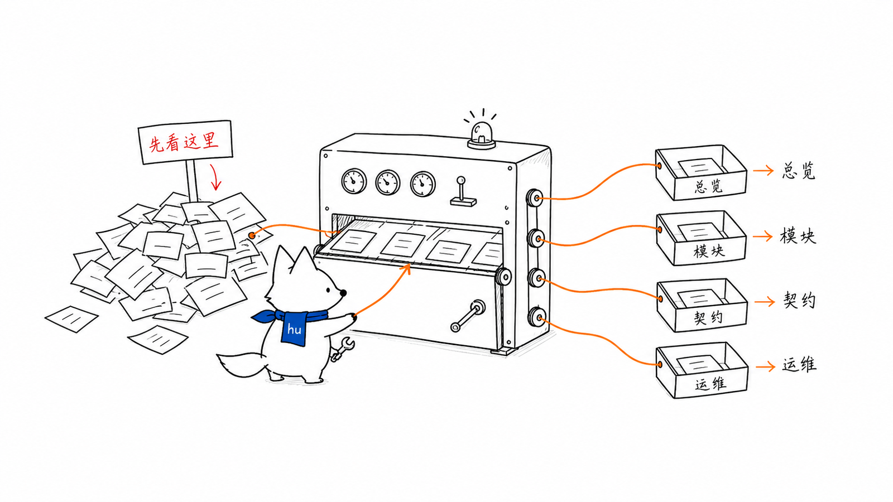
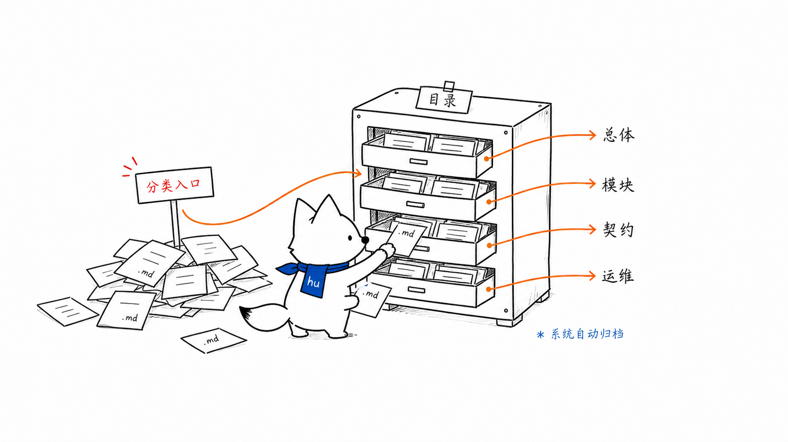
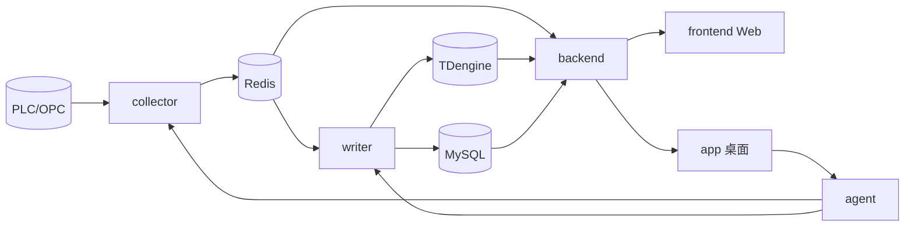

# DataWatch 文档体系
<!-- xiaohu-illustration:docs-index-01-map -->

> DataWatch 是面向自动化码头的工业设备数据采集与监控平台。本目录是项目的权威文档体系，按「总体 → 模块 → 契约 → 运维」组织，便于从整体到细节逐层理解。

---

## 阅读路径

- **第一次了解项目**：先读《01-总体设计/系统架构总览》建立全局认知，再读《01-总体设计/架构决策记录》理解关键取舍。
- **改某个模块**：读该模块目录下的 `README.md` + 同目录深度专题 + 相关《03-数据与契约》篇。
- **改跨模块接口/数据**：以《03-数据与契约》为准。
- **部署/发版/排障**：见《05-运维部署》，排障优先读《05-运维部署/问题排查》。

---

## 目录
<!-- xiaohu-illustration:docs-index-02-shelves -->

### 01 总体设计
- [系统架构总览](01-总体设计/系统架构总览.md) — 全局架构、数据流、模块协作、部署拓扑、设计决策摘要
- [架构决策记录](01-总体设计/架构决策记录.md) — 核心架构决策（背景、决策、放弃方案、后果）

### 02 模块设计（一个模块一个目录）
- [collector 采集端](02-模块设计/collector/README.md) — 周期采集、驱动、调度、Redis 写出
  - [调用链与协议设计](02-模块设计/collector/调用链与协议设计.md)
  - [外置驱动包制作指南](02-模块设计/collector/外置驱动包制作指南.md) — ZIP 清单、打包、安装与升级
- [writer 入库端](02-模块设计/writer/README.md) — Stream 消费、TDengine 批写、二分降级、DLQ
  - [可靠入库与 TDengine 写入](02-模块设计/writer/可靠入库与TDengine写入.md)
- [backend 中心后端](02-模块设计/backend/README.md) — TurboAPI、鉴权权限、实时/历史两通道、三数据源
  - [服务分层与实时历史通道](02-模块设计/backend/服务分层与实时历史通道.md)
- [agent 边缘代理](02-模块设计/agent/README.md) — 进程管控、DPAPI 凭据、双根路径、bootstrap
  - [边缘进程编排与凭据](02-模块设计/agent/边缘进程编排与凭据.md)
- [app 桌面端](02-模块设计/app/README.md) — Tauri+React 运维监控台
  - [控制台页面与双数据源](02-模块设计/app/控制台页面与双数据源.md)
- [frontend Web 前端](02-模块设计/frontend/README.md) — Art Design Pro / Vue3 业务控制台
  - [页面权限与实时历史设计](02-模块设计/frontend/页面权限与实时历史设计.md)

### 03 数据与契约
- [数据与契约总览](03-数据与契约/README.md) — 契约与三类数据库/存储结构的入口
- 契约
  - [API 契约](03-数据与契约/契约/API契约.md) — backend REST + agent REST
  - [WebSocket 协议](03-数据与契约/契约/WebSocket协议.md) — 实时监控 + 历史快照
- 数据库 / 存储结构
  - [MySQL 结构与字段](03-数据与契约/数据库/MySQL结构与字段.md) — `device_watch` 配置/告警/RBAC/日志
  - [Redis 结构与字段](03-数据与契约/数据库/Redis结构与字段.md) — latest/window/stream/dlq key 与字段
  - [TDengine 结构与字段](03-数据与契约/数据库/TDengine结构与字段.md) — `device_data` 时序库、超级表/子表/列规则

### 05 运维部署
- [运维部署总览](05-运维部署/README.md) — 运行环境、开发启动、中心镜像部署、边缘安装包、发版与验收
- [问题排查](05-运维部署/问题排查.md) — Web/API/WS/agent/collector/writer/OPC DA 常见故障定位

---

## 模块全景

---

## 约定

- 文档以**当前代码为准**；与代码不一致时改文档（数据库字段不一致改代码、不改 schema）。
- 重大架构变更应先更新《01-总体设计/架构决策记录》，再落地实现与文档。
- 历史文档保留在 [`_archive/`](_archive/)（旧版设计/联调/过程文档，仅供追溯，不作为现行依据）。
