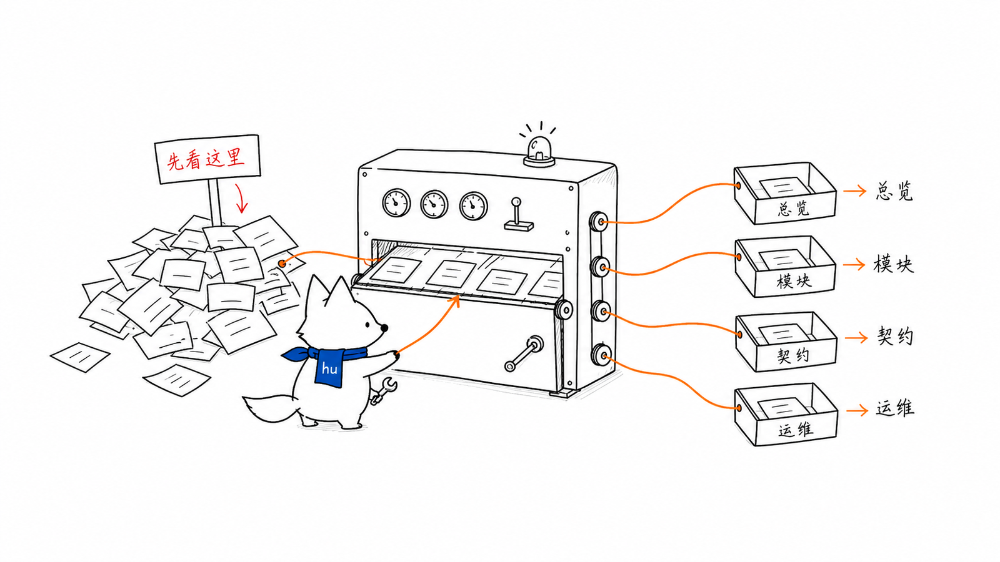
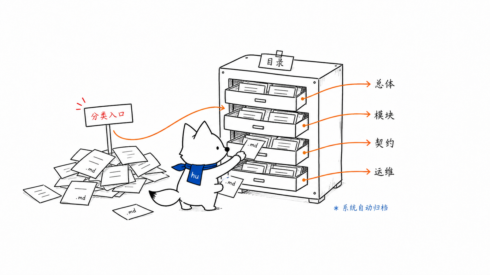
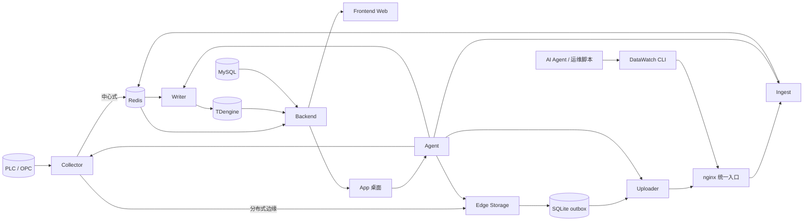

# DataWatch 文档体系
<!-- xiaohu-illustration:docs-index-01-map -->

> DataWatch 是面向自动化码头的工业设备数据采集与监控平台。本目录是项目的权威文档体系，按「总体 → 模块 → 契约 → 运维」组织，便于从整体到细节逐层理解。
## 当前实现与文档基线（2026-11-10）

本次更新对齐到 `eba47567`（2026-11-10，Web 实时 Bool 状态泳道 #38）。上一版基线是 `2f616946`（2026-10-07 21:59，关闭登录容量与驱动签名待办），该基线覆盖的 10 月审计整改见[整改提交与核验记录](06-验证记录/2026-10/2026-10-06-整改提交与核验记录.md)和[综合审查与 Agent 整改执行清单](Data_Watch_综合审查与Agent整改执行清单_6845e80.md)。跨度内按模块分组的提交与 PR 见[2026-11-10 文档对齐记录](06-验证记录/2026-11/2026-11-10-文档对齐记录.md)，精确提交以 `git log --first-parent 2f616946..eba47567` 为准。

跨度摘要：

- **Writer**：TDengine 连接器释放 GIL、SQL 构造复用、分层与执行器计时；按 Stream `config_version` 刷新永久映射，缺映射/非法列名持续时写 `system_log` 告警（见[writer](02-模块设计/writer/README.md)）。
- **直接改库后的映射校准**：`data-watch points resync --device X [--check]` 与 `GET/POST /api/device-monitor/point/resync`（见[API 契约](03-数据与契约/契约/API契约.md)、[问题排查](04-运维部署/问题排查.md)）。
- **直连只读**：`data-watch plc get` 经 `direct_read/` 短连接读一个 S7 点，不经 Backend、不写平台存储（见[命令与权限参考](02-模块设计/cli/命令与权限参考.md)）。
- **可靠性与安全**：Edge dead 记录在导出或重放前不删除，operator 本机导出/重放；密码哈希走有界 `run_password_op`；Ingest 镜像改为 free-threaded 3.14t；六批代码审查修复（#14、#22–#27）。
- **驱动**：五个官方驱动全部独立 Ed25519 签名；Collector 复用宿主已加载的同版本依赖（见[外置驱动包制作指南](02-模块设计/collector/外置驱动包制作指南.md)）。
- **App / Web**：App 分组侧栏 + 顶栏、面包屑、Ctrl+K 搜索、Bool 状态泳道、日志查询、设置页、圆角窗口与 Pleat W 品牌标志；安装器要求 WebView2 ≥ 111。Web 实时监控 Bool 点位改为状态泳道。
- **CI**：`.github/workflows/ci.yml` 覆盖 frontend、desktop、CLI（Linux/Windows）、backend、edge、ingest、agent、collector、writer、scripts、OPC DA sidecar 与 Tauri（见[运维部署总览](04-运维部署/README.md)）。

仍然有效的约定：

- 临时密码、强制改密、`tokenVersion` 失效语义、请求体上限和历史/导出边界以[API 契约](03-数据与契约/契约/API契约.md)及[运维部署总览](04-运维部署/README.md)为准。
- 实时与 Perspective WebSocket 的鉴权、会话和订阅上限以[WebSocket 协议](03-数据与契约/契约/WebSocket协议.md)为准。
- Collector 有界执行器、Ingest 接纳/裁剪、Writer 多 worker、重试与 DLQ 语义分别记录在对应模块文档；配置默认值以仓库示例配置为最终依据。
- `dist/`、`build/`、`artifacts/`、`outputs/` 和运行日志不是现行文档；需保留的旧版设计文档进入 `docs/_archive/`，仍需复核的阶段报告进入 `06-验证记录/`，原始输出继续留在 `outputs/` 与 `evidence/`。
- 9 月的性能、联调、验收报告、10 月的整改核验记录与 11 月的文档对齐记录集中在[验证记录](06-验证记录/README.md)；原始运行产物仍按测试批次留在 `outputs/` 与 `evidence/`。

---

## 阅读路径

- **第一次了解项目**：先读《01-总体设计/系统架构总览》建立全局认知；涉及分布式部署时继续读《分布式系统技术架构》和《分布式部署架构方案》；最后读《架构决策记录》理解关键取舍。
- **改某个模块**：读该模块目录下的 `README.md` + 同目录深度专题 + 相关《03-数据与契约》篇。
- **改跨模块接口/数据**：以《03-数据与契约》为准。
- **部署/发版/排障**：见《04-运维部署》，排障优先读《04-运维部署/问题排查》。
- **复核某次实验或验收**：见[验证记录](06-验证记录/README.md)；桥吊 100 演示脚本见[测试说明](测试/README.md)。
- **使用 CLI 或接入 AI**：先读《01-总体设计/AI调用与CLI实施方案》，再进入《02-模块设计/cli》查看命令、权限和 AI 调用规范。

---

## 目录
<!-- xiaohu-illustration:docs-index-02-shelves -->

### 01 总体设计
- [系统架构总览](01-总体设计/系统架构总览.md) — 全局架构、数据流、模块协作、部署拓扑、设计决策摘要
- [分布式系统技术架构](01-总体设计/分布式系统技术架构.md) — 三角色边界、控制面/数据面/查询面、关键技术架构与工程创新点
- [分布式部署架构方案](01-总体设计/分布式部署架构方案.md) — 分布式契约基线、失败语义、容量口径与阶段实施记录
- [架构决策记录](01-总体设计/架构决策记录.md) — 核心架构决策（背景、决策、放弃方案、后果）
- [AI 调用与 CLI 总体方案](01-总体设计/AI调用与CLI实施方案.md) — CLI 完成状态、架构边界、业务约束与 MCP 决策

### 02 模块设计（一个模块一个目录）
- [collector 采集端](02-模块设计/collector/README.md) — 周期采集、驱动、调度、Redis 写出
  - [调用链与协议设计](02-模块设计/collector/调用链与协议设计.md)
  - [外置驱动包制作指南](02-模块设计/collector/外置驱动包制作指南.md) — ZIP 清单、打包、安装与升级
- [writer 入库端](02-模块设计/writer/README.md) — Stream 消费、TDengine 批写、二分降级、DLQ
  - [可靠入库与 TDengine 写入](02-模块设计/writer/可靠入库与TDengine写入.md)
- [edge 边缘运行时](02-模块设计/edge/边缘运行时实现说明.md) — Storage 单写者、SQLite outbox、Uploader、配置快照与本地兜底
- [ingest 中心汇聚端](02-模块设计/ingest/Central%20Ingest实现说明.md) — 节点认证、会话围栏、Redis 原子接纳与逐项 ACK
- [backend 中心后端](02-模块设计/backend/README.md) — TurboAPI、鉴权权限、实时/历史两通道、三数据源
  - [服务分层与实时历史通道](02-模块设计/backend/服务分层与实时历史通道.md)
- [agent 边缘代理](02-模块设计/agent/README.md) — 进程管控、DPAPI 凭据、双根路径、bootstrap
  - [边缘进程编排与凭据](02-模块设计/agent/边缘进程编排与凭据.md)
- [app 桌面端](02-模块设计/app/README.md) — Tauri+React 运维监控台
  - [控制台页面与双数据源](02-模块设计/app/控制台页面与双数据源.md)
- [frontend Web 前端](02-模块设计/frontend/README.md) — Art Design Pro / Vue3 业务控制台
- [页面权限与实时历史设计](02-模块设计/frontend/页面权限与实时历史设计.md)
- [CLI 命令行客户端](02-模块设计/cli/README.md) — 人工运维、自动化脚本和 AI Agent 的正式客户端
  - [总体设计与架构](02-模块设计/cli/总体设计与架构.md)
  - [命令与权限参考](02-模块设计/cli/命令与权限参考.md)
  - [AI 调用指南](02-模块设计/cli/AI调用指南.md)

### 03 数据与契约
- [数据与契约总览](03-数据与契约/README.md) — 契约与三类数据库/存储结构的入口
- 契约
  - [API 契约](03-数据与契约/契约/API契约.md) — backend REST + agent REST
- [WebSocket 协议](03-数据与契约/契约/WebSocket协议.md) — 实时监控 + 历史快照
  - [CLI 输出契约](03-数据与契约/契约/CLI输出契约.md) — JSON/JSONL、错误、退出码、分页与兼容性
- 数据库 / 存储结构
  - [MySQL 结构与字段](03-数据与契约/数据库/MySQL结构与字段.md) — `device_watch` 配置/告警/RBAC/日志
  - [Redis 结构与字段](03-数据与契约/数据库/Redis结构与字段.md) — latest/window/stream/dlq key 与字段
  - [TDengine 结构与字段](03-数据与契约/数据库/TDengine结构与字段.md) — `device_data` 时序库、超级表/子表/列规则

### 04 运维部署
- [运维部署总览](04-运维部署/README.md) — 运行环境、开发启动、中心镜像部署、三角色安装包、发版与验收
- [三角色安装包构建与隔离](04-运维部署/三角色安装包构建与隔离.md) — 角色裁剪、包体边界与并存隔离
- [三角色安装包验收清单](04-运维部署/三角色安装包验收清单.md) — 安装、角色、断网恢复和端到端验收
- [Ingest 容量压测](04-运维部署/Ingest容量压测.md) — 稳态吞吐、P99 和上线门禁
- [问题排查](04-运维部署/问题排查.md) — Web/API/WS/Agent/Collector/Storage/Uploader/Ingest/Writer 常见故障定位
- [CLI 安装与更新](04-运维部署/CLI安装与更新.md) — Windows 离线安装、签名发布、自更新与回滚

### 05 参考调研

- [参考调研索引](05-参考调研/README.md) — 工业平台对比与界面设计分析，不作为当前实现契约

### 06 验证记录与演示

- [验证记录索引](06-验证记录/README.md) — 性能、联调、故障与验收的阶段性报告及证据入口
- [2026-09-29 运行状态与性能改动](06-验证记录/2026-09/2026-09-29-运行状态与性能改动.md) — 上次文档提交后的改动与验证边界
- [2026-10-06 整改提交与核验记录](06-验证记录/2026-10/2026-10-06-整改提交与核验记录.md) — 10 月审计整改的提交对应、独立复核与验收边界
- [2026-11-10 文档对齐记录](06-验证记录/2026-11/2026-11-10-文档对齐记录.md) — `2f616946..eba47567` 的提交与 PR 按模块分组，及本次同步的文档
- [桥吊 100 演示脚本](测试/README.md) — 100 ms 模拟采集数据的运行说明

---

## 模块全景

---

## 约定

- 文档以**当前代码为准**；与代码不一致时改文档（数据库字段不一致改代码、不改 schema）。
- 重大架构变更应先更新《01-总体设计/架构决策记录》，再落地实现与文档。
- 历史文档保留在 [`_archive/`](_archive/)（旧版设计/联调/过程文档，仅供追溯，不作为现行依据）。
- 认证、数据契约、配置默认值或部署边界发生变化时，必须在同一变更中更新对应权威文档，并检查本地 Markdown 链接。
