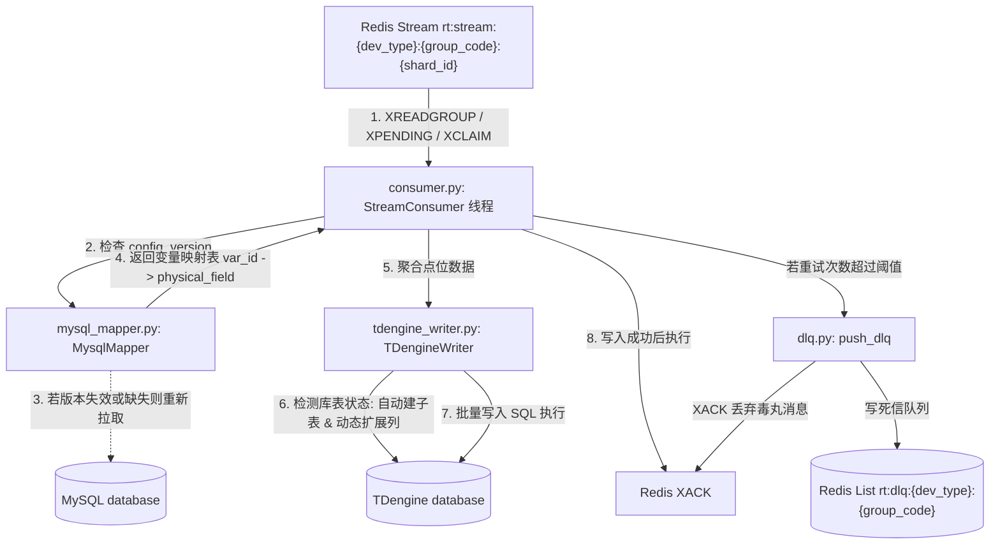

# 入库模块代码设计逻辑

> 本文档记录入库模块（`writer`）各组件的代码级设计逻辑，介绍其整体架构、数据流向、以及可靠性与动态扩展等核心技术实现。

------

# 一、 总体数据流与架构

入库模块作为一个独立的服务进程运行。它采用**拉取模式（Pull Mode）**，通过 Redis 消费组（Consumer Group）从 Redis Stream 订阅并消费采集模块推入的原始点位数据，利用 MySQL 的配置信息解析点位字段，最终将数据批量持久化至 TDengine。

其数据处理与流转架构如下：



------

# 二、 核心配置项解析 (`config/settings.toml`)

入库模块的所有运行参数和外部数据库连接均通过 `config/settings.toml` 统一配置。核心配置项说明如下：

- **`[redis]`**
  - `stream_shard_count`：Redis Stream 的分片数（默认 4 分片）。
  - `group_name`：消费组名称（默认 `writer_cg`）。
  - `consumer_name`：消费者标识，区分同一消费组内的不同消费者。
- **`[tdengine]`**
  - 连接 TDengine 数据库所需的连接参数（REST/WebSocket 等使用的地址和认证凭据，默认库名 `device_data`）。
- **`[mysql]`**
  - 连接元数据配置库（默认库名 `device_watch`），用于拉取点位映射关系和 `config_version`。
- **`[writer]`**
  - `flush_interval_ms`：定时强制刷写数据到 TDengine 的时间间隔（默认 500ms），在批量大小未达到阈值时提供时间边界保障。
  - `batch_count`：每次从 Redis Stream 批量读取的最大消息数（默认 200 条）。
  - `max_buffer_rows`：内存中累计缓存的最多数据行数，达到该上限立即刷写（默认 2000 行）。
  - `pending_min_idle_ms`：未确认消息（Pending）被判定为可 Claim（认领）所需的最小空闲时间（默认 30000ms = 30s）。
  - `pending_max_retry`：单条 Pending 消息的最大重试次数（默认 5 次），超过此限制被视作毒丸消息进入死信队列。
  - `device_types` / `group_codes` / `stable_names`：消费的设备类型、区域组编码、以及对应的 TDengine 超级表名称，三个列表一一对应。

------

# 三、 分层设计逻辑与核心类

## 3.1 `main.py` — 主入口与线程调度

主入口负责服务初始化，并采用**“多线程多 Stream 并行消费”**模型调度消费：

- **核心职责**：
  1. **配置加载**：使用 `dynaconf` 加载并解析配置文件 `settings.toml`。
  2. **组件初始化**：连接 Redis，初始化 `MysqlMapper` 实例，以及初始化全局的 `TDengineWriter` 实例。
  3. **并发线程启动**：
     - 根据 `settings.toml` 中配置的 `device_types` 与 `group_codes` 组合，为每一个特定的 `(device_type, group_code)` 配对，启动对应数量分片的消费线程。
     - 例如，配置有 3 个设备类型、1 个 group_code，Stream 分片数为 4，则会启动 `3 * 1 * 4 = 12` 个独立的 `StreamConsumer` 线程，实现高并发的水平扩展。
  4. **优雅退出**：捕获 `KeyboardInterrupt`，并将优雅退出标志（`stop_event`）广播给所有工作线程，确保内存中的数据刷新回 TDengine 且安全关闭连接。

## 3.2 `consumer.py` — Redis Stream 消费与可靠性处理

`StreamConsumer` 类继承自 `threading.Thread`，是消息拉取和流程控制的核心。

- **核心生命周期与消费策略**：
  1. **初始化消费组**：在启动时尝试通过 `XGROUP CREATE` 创建消费组。如果消费组已存在，则忽略错误并继续。
  2. **未确认消息重 claim（`claim_pending`）**：
     - 每次正常消费前，先调用 `r.xpending_range` 获取消费组中处理超时的未确认消息（Pending List）。
     - 若消息的 `idle` 时间超过 `pending_min_idle_ms`，则使用 `XCLAIM` 将其领回，分配给当前消费者重新消费。
     - 若消息重试次数超过 `pending_max_retry`，将其送入死信队列并 `XACK` 确认，防止坏数据导致死锁。
  3. **正常消息消费（`read_new`）**：
     - 使用 `XREADGROUP` 以阻塞方式（例如 2000ms）从特定分片的 Stream 读取新消息，获取的消息经过解析后加入内存批处理队列。
  4. **内存缓冲与定时刷写**：
     - 拉取到的点位首先通过 `mysql_mapper` 映射出 TDengine 对应的物理列名。
     - 将数据缓存进本地内存结构中，当**缓存条数达到 `max_buffer_rows`** 或 **距离上一次刷写时间超过 `flush_interval_ms`** 时，调用 `TDengineWriter.write_points` 执行落库，并对该批次的所有 Stream Entry IDs 统一执行 `XACK` 确认。

## 3.3 `mysql_mapper.py` — 元数据动态映射

`MysqlMapper` 类负责管理从 `MySQL` 获取的变量映射缓存，主要作用是将 Redis 消息中的 `(var_id)` 转换成 TDengine 表中的物理字段名。

- **核心机制**：
  1. **基于 `config_version` 的缓存管理**：
     - 内存中维护 `self.version_mappings`。
     - 每次消费端收到一批数据包时，均带有 `config_version` 标记（在采集模块中由 MySQL 中设备变量版本控制）。
     - 如果缓存中没有该版本的映射，或者缓存中的版本已过期，则主动查询 MySQL 重建映射。
  2. **映射建立 SQL**：
     - 通过查询 `device_variable` 表和关联的物理变量映射表，构建字典映射关系。
     - 支持忽略 `is_store = 0` 的非存储变量，只提取需要持久化的字段名映射。
     - 重建后，缓存结果，此后的解析均通过本地缓存完成，实现高吞吐。

## 3.4 `tdengine_writer.py` — TDengine 动态写入

`TDengineWriter` 是处理 TDengine 时序数据库写入的实体，提供了强大的**动态 Schema 维护**功能。

- **核心机制**：
  1. **动态建表**：
     - 写入时首先根据设备代码（`device_code`）划分写入批。
     - 检查 `self.created_tables` 内存缓存，若发现该子表（如 `dev_qc_001`）未创建过，则生成 DDL：
       `CREATE TABLE IF NOT EXISTS {table_name} USING {stable_name} TAGS ({device_code_tag}, ...)`
       从而实现了设备上线后**零人工干预自动建表**。
  2. **动态超级表列扩展（超级表的 Schema 自动扩展）**：
     - 本地缓存超级表的物理字段名集合 `self.stables_schema`。
     - 当收到包含某些新字段的写入请求时，会将请求字段与缓存中的列信息做比对。
     - 若发现包含新字段，则生成 DDL 执行超级表扩展列语句：
       `ALTER STABLE {stable_name} ADD COLUMN {col} DOUBLE`
       同时更新本地超级表 Schema 缓存。
     - 这一设计使得在 PLC 物理点位配置变更、或者上层动态修改点位存储配置时，入库端可以完全自适应，避免了由于 Schema 不匹配造成的数据库写入异常。
  3. **批量数据插入**：
     - 将数据以 `INSERT INTO {device_subtable} (ts, col1, col2, ...) VALUES (ts_val, val1, val2, ...)` 拼接成单条或多条大 SQL，利用 TDengine 的极高性能批量一次性写入。

## 3.5 `dlq.py` — 死信队列辅助

当某些特定消息（如数据格式损毁、非法变量 ID 导致转换抛异常等）因为自身原因导致消费处理持续报错，重试次数超限后，它们会被判定为“毒丸消息”。

- **处理逻辑**：
  - 调用 `push_dlq` 函数。
  - 将此 Entry ID 的消息的原始元数据（ID、所属 Stream Key、已重试次数、最后错误堆栈、数据包负载）封装成 JSON payload。
  - 通过 Redis `lpush` 命令，推入 Redis List 键中：`rt:dlq:{device_type}:{group_code}`。
  - 利用 Redis 的管道（Pipeline）执行 `lpush` + `ltrim`，限制该死信队列最大只保存 1000 条最近的异常消息。
  - 随后消费端对该消息执行 `XACK` 确认，防止该毒丸数据阻塞消费组。

------

# 五、 核心技术特性深度解析

## 5.1 异常重试与死信队列机制

在分布式消费架构下，由于网络抖动、数据库瞬间不可用或异常格式消息可能产生处理失败。

```
[开始消费 Pending 消息]
        │
        ▼
   [XCLAIM 成功?] ──(否)──► [继续正常拉取新消息]
        │
       (是)
        │
        ▼
  [重试次数 > max_retry?] ──(进死信队列)──► [DLQ: push_dlq] ──► [XACK 确认] ──► [从 Pending 移除]
        │
       (否)
        │
        ▼
   [加入常规消费队列]
```

通过这一策略，入库服务实现了**去阻碍的流控保障**，在任何数据库异常引发积压时均能重试恢复，而在局部报文受损时能自动剥离死信。

## 5.2 动态 Schema 扩展设计

TDengine 的多表结构对于物联网场景非常高效，但当点位在 PLC 配置更改或设备重构时，点位对应字段的增删将是一个痛点。`TDengineWriter` 的动态列扩展完美解决了该痛点：

1. **缓存超级表结构**：启动时调用描述语句 `DESCRIBE {stable_name}` 并缓存结果。
2. **写前差异比对**：在向子表 `dev_sub` 插入点位数据 `{"ts": 1700000000, "temp": 23.5, "humidity": 60.1}` 前，检查超级表 `stable_name` 是否包含 `temp` 和 `humidity` 列。
3. **动态 DDL 修改**：如果发现 `humidity` 在结构中不存在，立即暂停数据 SQL 构建，向数据库发送 `ALTER STABLE {stable_name} ADD COLUMN humidity DOUBLE`。
4. **回填缓存与写入**：更新本地超级表 Schema 缓存，然后继续拼接插入 SQL 并写入。整个过程通过 DDL 和 DML 的结合无缝自动完成。

## 5.3 `config_version` 热更新映射机制

由于采集模块在发现 MySQL 的设备或点位拓扑结构变更后，会发布新的版本号并附带在 Stream 数据的 `config_version` 中，入库模块利用此版本号实现无感知的热更新：
- 每一批 Stream 数据包含字段结构如：`{"config_version": 20260522001, "data": {...}}`。
- `MysqlMapper` 仅当遇到未缓存的 `config_version` 时才会对 MySQL 发起查询。
- 这不仅消除了实时映射带来的 MySQL 读取压力，同时达成了数据库拓扑信息变更在两端（采集侧和入库侧）的最终一致性与同步更新。
