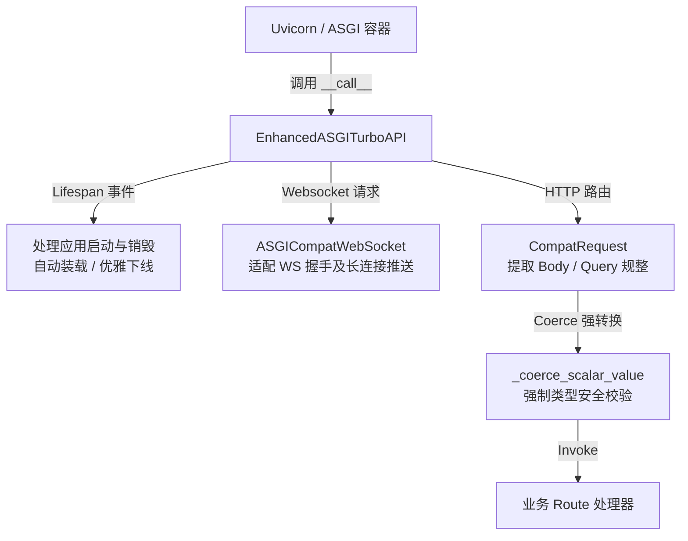

# 后端核心架构说明 (初稿)

本文档阐述系统后端的核心架构设计，深入剖析自定义 ASGI 适配层 `EnhancedASGITurboAPI` 的设计价值、MySQL/Redis/TDengine 三大库的数据闭环架构，以及后台日志管理调度器 `LogScheduler` 的保障机制。

---

## 一、 EnhancedASGITurboAPI 的存在价值与设计动机

系统后端基于轻量级高性能 Web 框架 `TurboAPI` 开发。但在工业物联网级高吞吐、高频 WebSocket 订阅的业务场景下，原生框架存在几处与标准 ASGI/Uvicorn 兼容性不足的瓶颈。为此，系统在 `backend/app/main.py` 中自主实现了 `EnhancedASGITurboAPI`：



### 1. 解决的核心问题与动机
1.  **标准的 ASGI 生命周期 (Lifespan) 对接**：
    原生的 TurboAPI 在对接标准 ASGI 生态（如 Uvicorn）的生命周期事件（`lifespan.startup` 和 `lifespan.shutdown`）时不够完善。`EnhancedASGITurboAPI` 显式重写了 ASGI 的 `__call__` 入口，能够精准拦截这两种事件，从而让系统在启动阶段顺利执行数据库迁移、建立连接池及开启 `log_scheduler` 守护进程；并在停止阶段优雅下线（如关闭 Redis 和时序库的连接池，避免僵尸进程和锁表）。
2.  **WebSocket 长连接协议解耦与原生代理**：
    系统提供了实时监测看板和数据透视推送，高度依赖稳定的 WebSocket 服务。适配器中封装了 `ASGICompatWebSocket`，将 ASGI 底层的 `websocket.receive` 和 `websocket.send` 消息通道转换为框架易用的 `send_text`、`receive_text`、`accept` 及 `close` 方法，极大降低了长连接握手和通信在 ASGI 容器中丢失的概率。
3.  **多类型参数强制规整与容错 (Coercion)**：
    工业控制接口中的数据字段类型错综复杂，时序接口中极易出现字符型与整型混用（如 `deviceId=100` 或 `"100"`，数组表示为 `varSeqs[]` 或 `varSeqs`）。
    `EnhancedASGITurboAPI` 在路由调度阶段引入了强类型转换器 `_coerce_scalar_value`：
    *   自动提取并解析以 `[]` 结尾的数组参数。
    *   根据路由签名对参数进行自动 Coerce 强制类型转换（特别支持 `Union[str, int]` 类型的匹配解析以及对布尔字符串 `"1"`, `"true"`, `"on"` 的容错解析）。这能有效防范由于框架级参数校验失败引发的 `422` 报错，提升了系统面对工业网关粗糙参数输入时的鲁棒性。

---

## 二、 三大数据库数据闭环架构与详细数据流向

本系统针对工业场景高吞吐写入与复杂历史聚合的双重需求，架构中将 MySQL、Redis 以及 TDengine 三者有机结合，构建了各司其职的数据闭环：

```mermaid
flowchart TD
    subgraph 采集层 (Collector)
        PLC[工业设备/PLC] -->|周期性扫描| Coll[采集器]
    end

    subgraph 缓存层 (Redis)
        Coll -->|HSET 写入| Lat[实时最新哈希 rt:latest]
        Coll -->|LPUSH & LTRIM| Win[10分钟短窗口 rt:window]
        Coll -->|XADD Sharded| Stream[时序落库流 rt:stream]
    end

    subgraph 存储层 (MySQL & TDengine)
        Writer[异步落库写入器] -->|xreadgroup 批量读| Stream
        Writer -->|元数据检索 & 映射翻译| MySQL[(MySQL 元数据/策略库)]
        Writer -->|批量 INSERT USING| TD[(TDengine 历史时序库)]
    end

    subgraph 服务层 (Backend API)
        Client[Web 前端 / API] -->|实时看板查询| Lat
        Client -->|秒级极速曲线| Win
        Client -->|大跨度降采样 / 原始明细| TD
    end
```

### 1. 数据库的分工与职责
*   **MySQL (关系型配置与审计数据库)**：
    *   **定位**：系统元数据及业务配置的“持久化真理之源”。
    *   **职责**：存储设备台账信息、点位元数据（含 `var_seq`）、时序宽表映射（`td_column_name`）、报警规则配置、操作审计日志与全局清理策略。
*   **Redis (高并发高吞吐状态及缓冲数据库)**：
    *   **定位**：边缘数据接入层与核心存储之间的缓冲桥梁、极速分发中心。
    *   **职责**：
        1.  `rt:latest` (HSET 哈希)：零 TTL，保存设备各点位最新上报值，用于满足实时监控页面超高并发的快速直读。
        2.  `rt:window` (LPUSH 队列)：`LTRIM` 限制保留 10 帧，供极速波形曲线直读，隔离对时序库的并发查询。
        3.  `rt:stream` (XADD 流)：基于稳定 CRC32 的设备分片（Sharding）消息流，为时序数据落库做异步解耦与削峰填谷。
*   **TDengine (高性能时序数据库)**：
    *   **定位**：毫秒级海量物理数据的高效持久化仓库与降采样中心。
    *   **职责**：按“一设备一子表，一类型一超级表”结构，存储全部的毫秒级历史曲线，利用时序数据库原生窗口计算（`INTERVAL`）提供超高效率的历史聚合检索。

### 2. 核心数据链路流向
1.  **数据采集输入**：
    采集器（Collector）以指定扫描率读取 PLC，组装数据帧，并行写入 Redis 最新哈希（`HSET`）、短窗口列表（`LPUSH`），并将仅含需存储点位的负载以 CRC32 物理设备分片算法哈希到指定的待落库 Redis Stream。
2.  **异步落库执行**：
    落库写入器（Writer）运行独立的消费进程，通过 `xreadgroup` 从 Redis Stream 批量读取。读取后查询 `MysqlMapper` 获取当前的 `config_version` 变量映射关系，将 `var_id` 转换为 `device_variable.td_column_name` 中登记的物理列名，按 `device_data -> sd{device_type} -> device_code 子表` 执行批量 `INSERT USING`，落库成功后向 Redis 发送 `XACK` 剔除 PEL 记录。
3.  **应用层数据消费**：
    后端服务收到实时请求时直接由 Redis 读出；当收到大跨度趋势图表或明细报表查询时，解析请求的 `var_seq`，到 MySQL 翻译出物理列名 `td_column_name` 后，到 TDengine 拉取并执行降采样或分页游标明细，对齐规整后下发给前端。

---

## 三、 log_scheduler 定时清理机制与日志保留策略

为了防止系统审计日志（`operation_log`、`system_log`）占用过多磁盘空间导致数据库崩溃，系统在后端核心框架内置了自主运行的后台清理调度器 `LogScheduler`：

### 1. 核心运行机制
在应用启动生命周期中激活的 `LogScheduler`，在后台独立运行三个协程：
*   `_cleanup_scheduler`：根据保留天数，定时触发物理过期清理任务。
*   `_capacity_checker`：按固定周期（默认每30分钟）检查磁盘占用，超限时启动紧急强制清理。
*   `_debug_expiration_checker`：定时检查临时开启的 DEBUG 日志落库开关，过期则自动关闭，防止日志量突增。

### 2. 定时清理与“24小时强保护防呆机制”
*   每天在指定时刻（如 `03:00`）唤醒清理任务。根据全局策略表中的 `retention_days`（如 7 天）计算截止时间 `cutoff_time`。
*   **24小时强保护防呆**：
    为防止人为配置错误（如将保留天数设为 0 或 1）导致系统刚发生的严重故障日志被误删，系统实施了强硬的安全兜底过滤：
    `effective_cutoff = min(cutoff_time, now - 24 hours)`。
    **这确保了最近 24 小时内的所有故障系统日志是绝对安全的，永远不会被定时清理任务触碰。**
*   **分批无锁删除设计**：
    为避免一次性删除百万级大日志表造成的数据库锁表、大事务阻塞及主从同步高延迟，系统使用游标分批拉取过期记录 ID：每次限制处理 `batch_size`（如 5000 条），在独立的小事务中执行 `DELETE` 并提交，直至清空。

### 3. 容量超限“预估行数分批清理算法”
*   当系统两张日志表大小超过配额（`max_total_mb`，默认 1024MB）时，触发紧急清理，目标为将容量降低到配额的 90%（即留出 10% 缓存空间）。
*   **难点**：MySQL InnoDB 引擎在删除数据行后，并不会立刻在文件系统上收缩表空间，这导致 `DATA_LENGTH` 并不能实时反映删除进度，无法使用“边删边读取 DATA_LENGTH”的循环。
*   **解决方案**：系统使用基于超出比例的**行数估算清理算法**：
    1.  计算超出比例：`excess_ratio = (current_size_mb - target_size_mb) / current_size_mb`。
    2.  统计 24 小时安全保护期以外的可删日志总行数 `total_deletable`。
    3.  估算需删行数：`estimated_delete_count = total_deletable * excess_ratio * 1.2`（乘以 1.2 的系数进行安全溢量以保障效果）。
    4.  批量执行 `_batch_delete` 累计清除对应条数后即刻退出。具体的空间回收工作留给数据库物理存储引擎（InnoDB purge thread）在后台异步完成，防止频繁删除造成的 CPU 高压和长时间锁表。

---

## 四、 相关源码参考

*   **自定义 ASGI 适配层**：[main.py](file:///D:/python/device_alarm/data_watch/backend/app/main.py)
*   **日志调度与清理服务**：[log.py](file:///D:/python/device_alarm/data_watch/backend/app/services/log.py)
