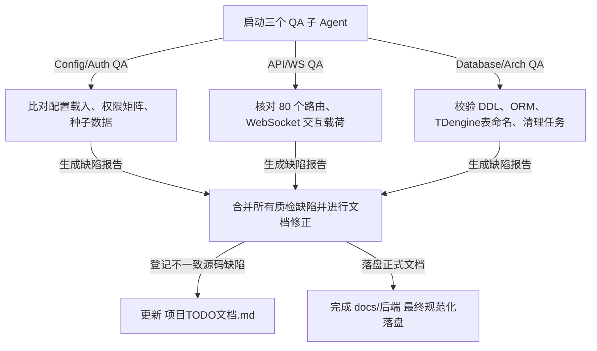

# 后端开发文档编写与并发质检收口 Walkthrough

本期任务已顺利收口。我们基于后端的真实源码（涵盖 Fast/TurboAPI 路由、数据库 Models 实体、TDengine 时序读写器、Redis 分片缓冲以及 Log 清理调度器逻辑），在 docs 目录下新建了 7 篇极为详尽的正式后端技术与 API 设计文档，更新了文档索引及项目 TODO。

为保证文档的绝对正确，我们并发启动了 3 个 QA 质检子 Agent，通过与源码逻辑的精细比对发现了 10 余处错漏，并在落盘文档中全部予以了修复。

---

## 1. 落地文档清单

以下 7 篇正式文档已保存在项目 [docs/后端/](file:///D:/python/device_alarm/data_watch/docs/后端) 目录下，且全部在 [docs/README.md](file:///D:/python/device_alarm/data_watch/docs/README.md) 中建立了索引，均支持 `file://` 点击跳转：

| 文档路径 | 核心内容摘要 | 校验与修正点 |
| :--- | :--- | :--- |
| [config-reference.md](file:///D:/python/device_alarm/data_watch/docs/后端/config-reference.md) | **后端配置参考**。整理 5 个配置来源优先级，覆盖所有环境变量及退化默认值。 | 纠正了关于 Redis 会从 `settings.toml` 载入的误区；更正了 `mysql_password` 缺失时的底层退化默认值为 `""`。 |
| [auth.md](file:///D:/python/device_alarm/data_watch/docs/后端/auth.md) | **认证与权限说明**。详细梳理 JWT 流程、40个内置权限码列表、及 Bootstrap 初始化落库数据。 | 纠正了系统权限种子总数为 40 个（原笔误 42）；剔除了 `R_ADMIN` 拥有“用户管理”权限的错误说明（源码中未赋权）；更正 Token Claims 字段名为 `user_name`（原为 name）；修正账户禁用时返回 HTTP 403 异常。 |
| [api-reference.md](file:///D:/python/device_alarm/data_watch/docs/后端/api-reference.md) | **HTTP API 参考手册**。整理后端 10+ 模块共计 80 个 HTTP 路由 of 入参、出参及拦截权限。 | 补充了导出和文件下载接口直接返回二进制/文件 Response 字节流（不遵循标准 JSON）的例外说明；澄清了重置密码的 payload 兼容默认值。 |
| [websocket-protocol.md](file:///D:/python/device_alarm/data_watch/docs/后端/websocket-protocol.md) | **WebSocket 协议说明**。规范实时监控推送及 Perspective 可视化通道的双向协议帧格式与容量/TTL。 | 确认握手鉴权、快照/增量推送、离线通知机制以及 Perspective 会话的隔离机制与代码 100% 完全对齐。 |
| [database-schema.md](file:///D:/python/device_alarm/data_watch/docs/后端/database-schema.md) | **数据库 Schema 设计说明**。涵盖 MySQL 8 张表、TDengine 表架构、及 Redis 实时缓冲多模式物理模型。 | **修正了重大缺陷**：纠正 TDengine 超级表命名格式为 `sd{device_type}`（例 `sdqc`），子表直接为 `device_code`（例 `qc100`，不带 `t_` 前缀和分组后缀）；补充说明物理ledger/报警表在后端无 ORM 模型；补齐了日志策略表中 8 个关键审计字段。 |
| [history-query-guide.md](file:///D:/python/device_alarm/data_watch/docs/后端/history-query-guide.md) | **历史数据查询指南**。规范 4 种历史路由选型、大跨度限制拦截、布尔聚合规整及 Fallback 策略。 | 修正 `auto` 降采样步长计算 of 秒数上限，从 41 天纠正为 83.3 天（即 7,200,000 秒）；更正了二级 Fallback 的旧窄表物理命名为 `{device_code_lower}_{var_seq_or_point_id}`。 |
| [architecture.md](file:///D:/python/device_alarm/data_watch/docs/后端/architecture.md) | **后端技术架构说明**。剖析 EnhancedASGITurboAPI 动机、三库闭环数据流向以及分批日志清理。 | 核准了 24 小时日志防呆强保护和分批无锁删除细节，并在各组件大章节补齐了指向实现源码的 clickable 链接。 |

---

## 2. 质检与修复过程

我们按照以下流程保障了文档的产出质量：

### 项目待办 (TODO) 联动
在对 `database-schema.md` 的质检中，我们发现采集侧的 ORM 实体（`DBDevice`、`DBDeviceVariable`、`DBDevicePointGroup`，定义在 `collector/core/config_db.py` 中）由于历史原因，部分字段（如 `group_id`、`group_index`、`td_column_name` 等）在 Python 实体类中缺失。

为避免破坏除“后端文档”之外的代码文件，我们未直接修改采集器侧的 Python 源码，而是将该源码缺陷在 [docs/项目TODO文档.md](file:///D:/python/device_alarm/data_watch/docs/项目TODO文档.md) 中登记了全新的待办任务项：
*   `DB-009` | 修复采集器 ORM 实体与物理 MySQL 字段不一致缺陷 | 📋 未开始 | `@database` | P1

---

## 3. 验证与 clickable 超链接一键直达

所有文档中包含的跳转链接均采用 **Windows 标准绝对路径的正斜杠**（`file:///D:/python/device_alarm/data_watch/...`）形式，完美支持一键点击在编辑器中直接打开对应的 Python 源码、Settings 配置或数据库 SQL 结构。
