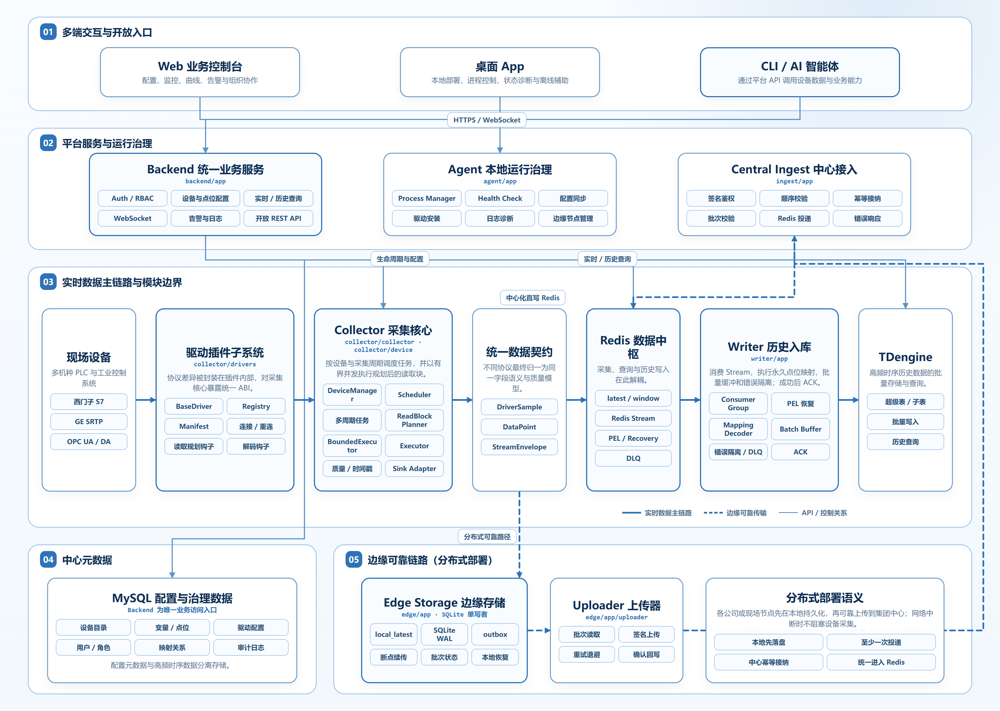
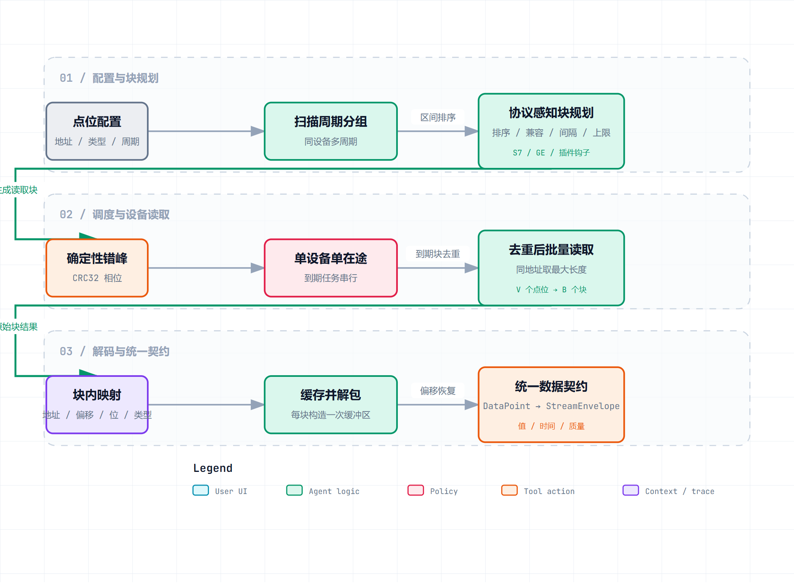

# DataWatch：以洋山四期自动化码头为例的契约保持型工业物联网数据采集与监控平台

**DataWatch: A Contract-Preserving Industrial IoT Data Platform for Yangshan Phase IV Automated Terminal**

作者及单位：待补充

中图分类号：TP393；TP274　文献标志码：A

基金项目：***（待补充，投稿前填写；如无基金支持请删除本行）

## 摘要

目的　以洋山四期自动化码头为工程案例，针对设备种类多、PLC 与通信协议异构、数据分散以及监控诊断依赖人工经验的问题，构建可复用的工业物联网数据采集与监控平台。方法　设计并实现 DataWatch，以分层数据契约统一点位值、时间与质量语义；按扫描周期和协议地址规划多点位读取块；通过受控驱动插件扩展 S7、GE SRTP、OPC 等协议；以中心化直写和边缘可靠上传支持单机及分布式部署，并由 Web、桌面 App 和 CLI 提供人员与机器访问入口。结果　平台形成了从设备接入、实时与历史存储到配置、监控、运维和受治理 AI 调用的一体化链路。结论　DataWatch 将洋山四期的异构设备数据需求抽象为可配置、可扩展的平台能力，可为智能运维和故障预测等后续应用提供统一数据基础。

**关键词：** 洋山四期自动化码头；工业物联网；异构设备采集；多点位块合并；插件化架构；边缘—中心协同；AI 智能体

## Abstract

Yangshan Phase IV automated terminal provides the engineering context for DataWatch, an industrial Internet of Things platform developed to address heterogeneous programmable logic controllers, communication protocols, dispersed data stores, and experience-driven equipment diagnosis. DataWatch uses layered contracts to normalize values, timestamps, and quality semantics; scan-period grouping and protocol-aware read-block coalescing to organize tag acquisition; governed driver packages to extend S7, GE SRTP, OPC, and other protocols; and centralized or edge-to-center paths to support single-site and distributed deployment. A Web console, a role-filtered desktop application, and a governed command-line interface provide configuration, monitoring, local operations, and machine-callable access without creating separate data paths. The platform translates the equipment-data requirements encountered at Yangshan Phase IV into configurable and extensible capabilities that can be adapted to other automated terminals and industrial sites, while providing a unified data foundation for future intelligent maintenance and fault-prediction applications.

**Keywords:** Yangshan Phase IV automated terminal; industrial Internet of Things; heterogeneous acquisition; read-block coalescing; plug-in architecture; edge-to-center deployment; AI agents

## 1 引言

洋山四期自动化码头是 DataWatch 的需求来源和现场开发环境。随着码头自动化建设持续推进、年度集装箱作业量屡创新高，生产组织对桥吊、轨道吊及其配套系统的稳定性、可靠性和故障响应提出了更高要求。根据项目申报材料与现场开发认识，现有设备监控、故障诊断和运维决策仍较多依赖人员经验；要从被动处置迈向智能运维，首先必须持续、完整地采集设备运行数据，并将其治理为可查询、可追溯、可复用的数据资产。

洋山四期现场同时存在不同机种、不同代际设备及多种控制系统。西门子 S7、艾默生 GE、OPC 等接入方式在地址表达、数据类型、时间与质量语义、读取限制和原有存储方式上并不一致，造成数据分散、配置重复和上层应用接口不统一。DataWatch 正是在这一现场需求中开发和迭代，但其设计目标并非只服务某一种码头设备，而是把洋山四期的共性问题抽象为工业物联网平台能力：以统一契约接纳异构设备，以配置和插件扩展协议，以同一数据链路服务存储、监控、运维和后续分析。

工业物联网研究表明，设备连接只是系统建设的起点，异构互操作、实时性、可靠性、安全、资源约束和生命周期管理会共同影响平台可用性[1–3]。OPC UA 通过平台无关的信息、消息和通信模型提高互操作能力[4]，但真实现场仍会长期并存供应商专用 PLC 协议、OPC 系列协议、HTTP 接口和遗留系统。若每增加一个机种或协议就同时改动调度、缓存、存储和页面，项目将形成难以复制的定制链。因此，需要在驱动边界之后建立稳定的数据契约，并以协议感知的多点位合并块降低设备读取交互。

当系统从洋山四期单站点向集团或其他公司推广时，部署边界也随之变化。单机部署适合采集、缓存、入库和展示位于同一受控网络的场景；分布式部署则需要在各公司或边缘站点保存数据，在网络恢复后安全上传到中心。边缘计算研究强调将计算与存储下沉至数据源附近，以降低时延和网络依赖[5,6]。但简单复制中心服务不能自动解决断网缓冲、重复提交、顺序恢复和中心语义分叉，部署扩展必须建立在可验证的数据契约与端到端可靠性规则之上。

平台还必须覆盖数据被使用和系统被操作的全过程。工程人员需要批量配置驱动、设备与点位，值班人员需要在 Web 监控大屏和实时页面识别异常，在历史曲线、原始记录及日志页面追溯原因；现场人员还需要借助桌面 App 完成启动、停止、重启、配置切换、边缘队列和节点状态检查。与此同时，工业数据的调用主体正在从人扩展到脚本、大模型和智能体[7–9]。DataWatch 因而把 Web 业务控制台、角色化桌面 App 和受治理 CLI 都视为平台组成，使人员与 AI 复用同一认证、权限、审计和数据边界，而不是让模型直连数据库或设备。

本文围绕一个核心问题展开：如何以洋山四期的复杂设备数据需求为起点，在协议、部署形态、操作终端和调用主体变化时，仍保持中心数据语义与可靠性规则稳定？为此，我们设计并实现 DataWatch。本文的主要贡献如下。

1. 提出异构设备的分层统一数据契约与协议感知块读取。协议原始值逐级收敛为 `DriverSample`、`DataPoint` 和版本化 `StreamEnvelope`；同设备点位按扫描周期和协议地址空间规划为合并块，一次读取后依偏移恢复，避免把逐点请求和协议分支扩散到核心管线。
2. 实现面向工业协议的受控插件机制。统一驱动 ABI、清单、能力声明、平台约束、包哈希、只读策略和冷启动生命周期共同限定扩展边界，使新增协议无需修改主调度、队列、存储和上层应用。
3. 构建契约保持的双形态部署。中心化部署由 Collector 直接进入 Redis；分布式部署经 SQLite outbox、Uploader 与 Central Ingest 进入中心，两条路径在同一 Stream 契约处汇合并复用 Writer，支持洋山四期等单站点部署和集团多公司节点统一汇聚。
4. 构建面向人员与 AI 的完整操作面。Web 覆盖配置、监控大屏、实时、历史与日志，桌面 App 通过角色裁剪和 Agent/Backend 双数据源覆盖本机控制与中心业务；CLI 则把同一 Backend 能力组织为可发现、可判错、受 RBAC（基于角色的访问控制）和审计约束的机器工具。
5. 以洋山四期申报与开发过程为工程脉络，给出从需求分析、协议接入、存储、后端、前端到测试优化的阶段性实现，并以边界化工程观察说明当前证据范围及向其他自动化码头推广时的适配条件。

本文其余部分组织如下：第 2 节回顾相关工作；第 3 节给出问题定义与设计目标；第 4 节介绍系统总体架构与产品操作面；第 5 节阐述关键机制；第 6 节说明洋山四期项目建设过程和当前实现；第 7 节简述系统测试与工程观察；第 8 节讨论推广边界；第 9 节总结全文。

## 2 相关工作

### 2.1 工业互操作与统一信息表示

IoT 与工业自动化研究长期关注设备连接、数据聚合和面向服务的系统集成[1–3]。OPC UA 提供从抽象服务到传输映射的统一架构，是工业互操作的重要基础[4]。然而，标准协议解决的是一部分通信与信息建模问题；多年代设备共存时，系统仍需接纳供应商专用地址空间、不同数据类型、时间戳来源和质量表示。DataWatch 不试图以新的现场协议替代既有标准，而是在协议驱动之后定义更窄、面向采集管线的数据契约。该设计把“支持哪些协议”和“中心如何存储、消费数据”解耦，使协议演进不扩散到队列和存储模块。

### 2.2 边缘—中心协同与可靠流处理

边缘计算通过在数据源附近提供计算和存储，缓解云中心的网络、时延与可用性约束[5,6]。工业系统进一步要求离线缓冲、恢复顺序、重复提交处理和历史数据对账。常见消息中间件提供至少一次投递或消费确认，但端到端正确性仍取决于生产端身份、顺序约束、消费端提交点以及实时视图更新规则。DataWatch 将这些规则组合为跨边缘与中心的显式不变量：边缘先落盘，批次身份不随重试改变，上传会话内序号单调，中心只接受下一序号，流写入与高水位推进原子执行，Writer 仅在落库或进入死信队列后确认，实时值在窗口与流写入成功后最后更新。

### 2.3 工业 AI 与工具化系统接口

工业 AI 的价值依赖稳定、可解释且受治理的数据入口[7]。通用智能体研究显示，大模型可以学习何时调用 API，并在推理与外部行动之间交替[8,9]。这些工作说明结构化工具是连接模型与业务系统的有效媒介，但没有替工业系统回答权限、审计和危险动作确认问题。DataWatch 的机器入口首先是业务 CLI：命令目录和输入约束可被发现，结果采用 JSON 或 JSONL，失败通过稳定退出码分类；CLI 仍经 Backend 完成最终鉴权。因而未来增加模型上下文协议（Model Context Protocol，MCP）或其他智能体适配层时，只需映射既有受控命令，而无须开放新的数据旁路。

## 3 问题定义与设计目标

洋山四期现场存在多种机种、PLC 和工业通信协议。不同设备返回的数据类型、地址表达、时间戳来源和质量状态并不一致，设备配置、实时值与历史数据也可能分散在不同程序或存储介质中。如果直接针对每一种设备分别开发采集、存储和展示逻辑，系统会迅速形成大量协议分支，新增设备时需要同时修改调度、队列、入库和上层应用，难以长期维护和推广。因此，DataWatch 首先要解决的问题，是如何把异构设备产生的数据转换为稳定、统一且可持续扩展的平台数据。

平台将每次采集结果统一描述为一条点位记录。记录中包含设备标识、点位标识、采集值、时间戳和质量状态；协议驱动负责解释厂商特有的数据类型、地址和通信状态，Collector 负责调度、读取、质量处理与时间信息整理。经过这一边界后，Redis、Writer、Web、桌面 App 以及后续分析程序面对的是相同的数据含义，不再需要了解底层来自 S7、GE SRTP、OPC UA 还是 OPC DA。

为支持高频采集和批量传输，平台进一步按照设备、变量分组和采集周期组织数据，并附带设备类型、配置版本、批次时间、点位值和质量信息。中心化部署可以把这类统一数据直接写入 Redis；分布式部署则先写入边缘 SQLite WAL 与 outbox，再由 Uploader 发送至 Central Ingest，最终进入同一 Redis 数据中枢。本文所称“契约保持”，就是无论数据经由哪一种协议、采用哪一种部署路径，进入中心实时查询和历史入库环节时，其点位标识、字段含义、质量语义、配置版本和确认规则均保持一致。

围绕上述问题，系统形成以下五项设计目标。

- **异构数据统一。** 在驱动和采集执行边界完成类型、地址、时间戳与质量状态的归一化，使上层队列、存储和页面使用统一格式读取与保存设备数据。
- **协议扩展隔离。** 以驱动注册、清单和统一接口封装协议差异，新增设备或通信协议时主要增加驱动插件，尽量不改动 Collector 调度、Redis 数据结构、Writer 和上层业务接口。
- **部署路径一致。** 同时支持单机中心化部署和边缘—中心分布式部署，两种方式只改变统一数据进入 Redis 之前的传输路径，共用后续实时查询、历史入库和业务访问逻辑。
- **故障可检测、可恢复。** 通过本地持久化、批次状态、重试、高水位、待处理恢复和死信隔离，使断网、进程重启和异常数据不会形成无法追踪的数据缺口、静默重复入库或实时值回退。
- **人机调用统一治理。** Web、桌面 App、CLI 和未来 AI 智能体均通过 Backend 的鉴权、权限与审计边界访问平台；自动化调用不能绕过人员操作所需的权限检查和危险动作确认。

## 4 系统总体架构

**图 1｜DataWatch 模块化总体架构。** 现场设备依次经过驱动插件、Collector 和统一数据契约进入 Redis，Writer 再将流式数据批量写入 TDengine；分布式部署时，统一数据也可经 Edge Storage、Uploader 和 Central Ingest 可靠汇入同一 Redis。Web、桌面 App 与 CLI/AI 通过 Backend 访问业务能力，Agent 负责本机进程与运行治理。实线表示实时数据主链路，虚线表示边缘可靠传输，细线表示 API 或控制关系。

如图 1 所示，架构由五个相互衔接的区域组成。第 01 区是多端交互与开放入口，包括 Web 业务控制台、桌面 App 和 CLI/AI 智能体；第 02 区是平台服务与运行治理，包括统一承载鉴权、配置、实时与历史服务的 Backend，负责本机进程、健康检查、驱动安装和边缘节点管理的 Agent，以及负责签名、顺序、幂等和批次校验的 Central Ingest。第 03 区给出了核心数据主链：不同机种设备首先由插件化驱动屏蔽协议差异，Collector 通过设备管理、多周期调度、读取块规划和有界执行完成采集，再将结果转换为统一数据契约；Redis 承担实时值、窗口、Stream、待处理恢复与死信隔离，Writer 负责消费、永久点位映射、批量缓冲、错误隔离和确认，最终写入 TDengine。Backend 对 MySQL、Collector、Redis 和 TDengine 的配置、控制与查询关系在图中汇总为一条服务总线，避免把业务入口分散到各底层组件。

第 04 区使用 MySQL 保存设备目录、点位与驱动配置、用户角色、映射关系和审计日志，使配置治理数据与高频时序数据分离。第 05 区描述分布式部署的可靠链路：统一数据先进入 Edge Storage，由 SQLite 单写者维护本地实时值、WAL 和 outbox；Uploader 按批次读取、签名上传、失败重试并回写确认；Central Ingest 在中心完成校验后将数据写入 Redis。系统并未因部署方式不同而拆成两套产品。中心化部署适合设备与中心服务位于同一站点的场景，分布式部署则允许各公司部署边缘节点并向集团或公司中心汇聚。两种方式在 Redis 之后复用同一 Writer、TDengine 和 Backend 访问体系，其差异仅发生在统一数据到达 Redis 之前，如表 1 所示。

**表 1｜两种部署路径及其不变部分。**

| 维度 | 中心化/单机路径 | 分布式/集团路径 | 保持不变的核心契约 |
|---|---|---|---|
| 采集入口 | Collector 直接写 Redis | Collector 先写 SQLite outbox | DriverSample、DataPoint |
| 传输 | 进程内/局域网直连 | Uploader 经 HTTPS 向 Central Ingest 上传 | StreamEnvelope v1/v2 |
| 断网策略 | 依赖中心服务可用性 | 本地 WAL（预写日志）、租约与重试 | 点位标识、质量码、配置版本 |
| 幂等 | Redis/Writer 消费语义 | 会话序号、高水位与 Lua 原子提交 | Redis Stream 与 latest 规则 |
| 历史入库 | Writer → TDengine | 同一 Writer → TDengine | 永久点位映射、ACK 语义 |
| 上层访问 | Backend/Web/App/CLI | 同一 Backend/Web/App/CLI | JWT（JSON Web Token）、RBAC、审计与输出契约 |

### 4.1 从采集入口到运维闭环

Collector 是 DataWatch 的数据入口，而不是产品边界。完整操作链路从驱动、设备和点位配置开始，经实时页面或监控大屏确认通信与采集状态，再由历史趋势、原始记录、对齐矩阵和日志定位异常；若问题属于本机组件或边缘链路，桌面 App 进一步完成依赖感知的启动、停止、重启、中心连接校验和离线队列配置，处理后返回实时页面复核。配置—观察—追溯—处置—复核构成同一数据契约上的闭环，减少工程人员在数据库客户端、脚本和独立监控工具之间切换。

Web 与桌面 App 存在有意的能力重叠，但职责不同。Web 面向浏览器内的远程业务管理和数据分析，适合集团或公司范围的统一访问；App 面向需要本机权限、进程生命周期、运行配置和边缘依赖控制的运维岗位。两者对驱动、设备、点位、实时、历史和权限等中心业务复用同一 Backend，不复制数据语义；App 仅把无法由浏览器安全完成的本机操作交给 Agent。

### 4.2 Web 业务控制台及代表页面

Web 端采用 Vue 3 与 TypeScript。设备配置链路包含驱动、设备和点位页面：设备页以树和列表组织现场对象，可进入设备点位上下文；点位页支持筛选以及 Excel 模板、导入与导出，降低大规模点表逐条录入的成本。实时监控页通过 Backend WebSocket 接收快照、差量和离线事件，并在连接中断时退避重连；历史数据页同时提供趋势图、原始分页、时间对齐矩阵与导出，以适应运维浏览和工程分析两种粒度。

Web 的工作台和全屏监控大屏提供面向值班与管理岗位的概览。当前页面展示设备总数、在线/离线与风险状态、在线率、点位总数、系统告警、日志与异常数量、驱动可用性，并组合设备通信状态、设备类型分布、采集/告警趋势、近期告警、告警类型分布和日志等级趋势。需要说明的是，上述告警指标由系统与操作日志中的高等级事件聚合统计而来，平台当前不包含设备点位阈值越限告警引擎，点位级阈值告警不在本文范围内。系统日志与终端视图承担运行追踪。菜单和路由由权限动态生成，但 Backend 仍执行最终鉴权，避免仅依赖前端隐藏菜单形成安全边界。

### 4.3 桌面 App 的角色化运维页面

桌面 App 采用 Tauri、React 与 TypeScript，Rust 外壳通过 `agent_request`、`backend_request` 和下载代理把 WebView 请求转发到本机 Agent 或中心 Backend。登录过程分别建立 Agent 与 Backend 会话；中心菜单权限映射为桌面路由，再与构建角色共同裁剪页面。因而同一安装包可形成 `centralized`、`edge` 和 `distributed-center` 三类工作面，而不需要维护三套数据模型。

中心化角色提供工作台以及 Collector、Writer 页面，分布式中心角色提供工作台以及 Ingest、Writer 页面；这些模块页面展示运行时长、内存、CPU、采集/接收/写入速率、任务或缓冲状态、趋势和实时日志，并允许对本机进程执行启动、停止与重启。驱动、设备、点位、实时、历史、日志、用户、角色和菜单页面复用 Backend 的业务数据。边缘角色增加 Bootstrap、Edge Console、Operations 与 Settings：可验证中心连接和数据库、注册节点、配置离线队列，并按依赖关系控制 Storage、Collector 和 Uploader；停止上传不会丢弃数据，而是继续保存在 outbox。分布式中心页面则展示节点在线状态、积压与设备数量，管理注册码、节点设置、设备分配和同步。两类终端在页面、任务与数据通道上的分工如表 2 所示。

**表 2｜Web 与桌面 App 的代表页面、操作任务和数据通道。**

| 终端与代表页面 | 面向角色 | 关键内容与操作 | 主要数据或控制通道 |
|---|---|---|---|
| Web 工作台/监控大屏 | 值班、管理人员 | 设备总量与在线率、点位数、采集/告警趋势、近期告警、类型分布、日志趋势 | Backend REST；实时统计接口 |
| Web 驱动/设备/点位 | 实施、工程人员 | 树形设备管理、点位上下文、筛选、Excel 模板与批量导入导出 | Backend REST；MySQL 元数据；RBAC |
| Web 实时/历史/日志 | 运维、分析人员 | 快照/差量/离线事件、退避重连、趋势、原始分页、对齐矩阵、导出和日志追踪 | WebSocket；Backend；Redis/TDengine |
| App 工作台与模块页 | 本机及中心运维 | Collector/Ingest/Writer 等组件的启停、重启、CPU/内存/时长、速率、趋势和实时日志 | 本机 Agent；中心 Backend |
| App 边缘与分布式页面 | 分公司、集团运维 | 中心连接校验、节点注册、依赖感知控制、outbox 配置、节点积压、设备分配与同步 | Agent 本机控制；Ingest/Backend；双会话权限 |

## 5 关键机制

### 5.1 从协议样本到版本化流信封

统一格式并不意味着抹去质量和时间语义。DataWatch 在驱动边界使用不可变 `DriverSample(value, quality, source_timestamp, protocol_quality)`：声明原生质量能力的驱动必须返回该结构，普通驱动返回裸值并由执行器包装为 `GOOD`。其中 `protocol_quality` 用于诊断保留，平台质量码用于后续统一处理。执行器将样本归一化为 `DataPoint(device_id, variable_id, value, timestamp, quality)`。这种两级结构既避免核心管线理解各协议质量位，又保留了未来诊断扩展空间。

Collector 随后按设备、类型、分组和扫描周期聚合点位。`StreamEnvelope` v1 包含 `device_code`、`device_type`、`group_code`、`scan_rate`、`ts`、`config_version` 和 `values`；v2 额外显式携带 `contract_version=2` 与键集合完全相同的 `qualities`。实时值按变量保存为 `{"v", "t", "q"}`；分布式中心入口在写入 latest 时额外携带分配序号 `e`（assignment epoch，缺失按 0 处理），用于设备迁移场景下新旧边缘数据的时间序判定。版本化和键集合校验使质量语义能够在不破坏既有消费者的情况下演进。

该模型还把实时视图与历史事实分离。Redis latest 面向低时延读取，Stream 承担可恢复的顺序消费，TDengine 保存历史值；质量数据采用独立窄表，避免点位数增长导致宽表列数越界。MySQL 中的永久点位映射固定逻辑点位到物理表坐标，减少配置变化导致历史落位漂移的风险。

### 5.2 插件化协议接入

DataWatch 的驱动抽象以 `BaseDriver` 为最小 ABI，要求实现异步 `connect`、`disconnect` 与批量 `read`，并默认只读。驱动通过 `native_quality`、`read_only` 和 `capabilities` 声明能力；生产采集进程拒绝 PLC/节点写操作，从接口层缩小意外控制设备的风险。现有内置或已接入路径覆盖 S7、GE SRTP、OPC UA、OPC DA 和 HTTP 推送；新增协议只需完成驱动包、配置映射以及所声明的规划/解码钩子，不改变 Collector 之后的组件。

插件化不仅是运行时工厂。外置驱动包包含 `driver.toml` 清单，声明驱动 API/ABI、操作系统、处理器架构、能力和只读属性；Agent 对 ZIP 路径、包结构、哈希与兼容性进行检查，并通过冷重启使新包生效。当前模型定位为受信任的内部驱动包，而不是允许任意第三方代码热加载的公共市场。这个边界使扩展性与安全主张保持一致：协议可以扩展，但扩展代码仍需经过组织内发布和校验流程。

### 5.3 多周期调度与协议感知的多点位合并块

同一设备的点位可能具有不同扫描周期。DataWatch 首先按 `scan_rate` 构造设备内任务组，再以设备标识的循环冗余校验值（`crc32(device_id)`）对周期取模产生确定性相位，避免大量设备在周期边界同时唤醒。调度器维护设备级在途标记和等待队列，使同一设备同一时刻至多执行一个读取任务；固定大小的执行器及待处理上限进一步把线程、连接与排队内存限制在配置范围内。

**图 2｜多点位合并块的规划、读取与恢复。** 点位先按设备和扫描周期分组，再按协议兼容性与地址区间规划为读取块。S7 DB 区域仅在 DB 号等条件兼容时跨越不超过 64 B 的间隙，单块跨度不超过 8192 B；GE 字寄存器与离散位分别遵守载荷上限和字节/位对齐。到期任务中的重复块按地址去重并取较大长度，读取结果依据 `result_map` 的字节、字或位偏移恢复为统一点位。

如图 2 所示，块规划把每个点位视为地址区间 [s_i, e_i)，先按起始地址排序，再判断协议、区域、DB 号和数据类型是否兼容；字节序为各协议固定约定并记录在 `result_map` 中，不参与规划期逐点兼容判断。只有当间隔不超过协议阈值且合并跨度不超过单次请求上限时，才扩展当前块，否则提交当前块并新建块。S7 的 I/Q/M 区域按连续字节规划，定时器和计数器按区域与类型规划，DB 数据还要求 DB 号一致；类型不兼容时退化为单点或独立块。S7 DB 默认允许桥接不超过 64 B 的空隙，最大块跨度为 8192 B。GE SRTP 的 R/AI/AQ 采用字寄存器区间，默认最大载荷为 250 B，并允许在 8–1024 B 范围配置；I/Q/M/T/S/SA/SB/SC/G 等离散区采用字节对齐的 BOOL 块。对于过小的 GE 请求，规划器可向较低地址扩展到至少 4 个字或 8 B，以规避部分设备因驱动最小请求填充而在高地址边界产生否定应答（negative acknowledgment，NACK）。

规划阶段同时生成 `result_map`，记录变量到块地址、字节/字偏移、位号、数据类型和字节序的映射。若多个扫描周期在同一轮到期，执行器还会按块地址去重，并在重复项中保留较大的读取长度。设备侧因此只返回块级原始结果；解码侧对每个 S7 块只构造一次 `bytearray`，随后按映射逐点解包，避免为每个变量重复复制同一块。声明 `batch_contiguous` 能力的外置驱动则通过注册表提供规划器和解码器钩子，在不修改调度器的情况下复用同一流程。

若原有逐点方案需要 V 次读取，块规划后请求数为 B，且 B ≤ V；实际减少幅度取决于地址连续性、扫描周期、协议上限和数据类型分布，不能由代码结构直接推导。项目已记录合并块数量和 `coalesced_read_saved_block_count` 等指标，但当前存档没有形成独立消融试验，因此本文只主张请求收敛机制成立，不报告未经归档的百分比收益。该边界也解释了现场低内存观测为何只能与有界并发和块读取“相符”，而不能被单独归因于某一优化。

### 5.4 双部署形态的契约汇合

中心化路径适用于单公司或单站点：Collector 构建流字段后直接进入 Redis。分布式路径在各公司或边缘站点增加本地持久化层。Collector 为每条待上传帧生成不可变 `batch_id`，边缘会话生成随机 `upload_session_id`，会话内为每项分配单调递增的 `local_seq`。记录首先写入启用预写日志（write-ahead log，WAL）的 SQLite outbox，再由 Uploader 按严格顺序取出；上传端保持单批在途，重试复用同一身份三元组。

Central Ingest 验证节点身份、Ed25519 数字签名、配置映射、会话和序号。对节点 \(n\) 的会话 \(s\)，中心保存高水位 \(h_{n,s}\)。仅当 \(seq=h_{n,s}+1\) 时接受新项；\(seq\le h_{n,s}\) 被识别为已处理重传，\(seq>h_{n,s}+1\) 则拒绝跳号。接受路径在一个 Redis Lua 脚本内完成高水位推进、`XADD` 和 latest 的逐点时间/序号判定，因此不会出现“已返回成功但未进入流”或旧样本覆盖新实时值的半提交状态。

入口完成后，两种部署均产生相同的 Redis Stream 字段。实时视图与历史提交解耦：latest 只在窗口与流写入成功后最后刷新——中心化路径由 Collector 保证“先流后 latest”的顺序，分布式路径由 Ingest 在同一 Lua 脚本内与 `XADD` 原子更新——因此实时页面不会看到“未进入入库流”的新值，但可能先于历史落库可见；历史可靠性由 Writer 的确认语义单独保证。Writer 使用消费组处理 Stream，维护待处理条目列表（pending entries list，PEL）并区分可重试和终止性错误；只有当批次已写入历史库（LANDED）或已被隔离到死信队列（dead-letter queue，DLQ）时才 ACK。这里的创新不在于单独使用 SQLite、Redis 或 Lua，而在于把它们组织为跨部署路径可复用的提交协议。

### 5.5 面向人员与 AI 的同一治理接口

DataWatch 的 AI 能力定位为“可被模型安全使用的工业工具”，而不是在数据平台旁边新建一套 AI 专用后门。Backend 是中心业务的最终鉴权方；Web、App 的中心业务与 CLI 复用 JWT、RBAC 和审计链路，App 的本机控制另由 Agent 会话授权。CLI 将查询、诊断和受控运维能力组织为稳定命令，并提供命令发现与输入模式输出。单结果使用 JSON，流式或批量结果使用换行分隔 JSON（JSON Lines，JSONL），错误类型映射到稳定退出码（参数错误、认证失败、权限拒绝、网络错误、服务异常、部分成功与超时），资源不存在与冲突等细分情形通过输出中的 `error.type` 字段区分，便于脚本和智能体程序化判错。JSON 作为可互操作的数据交换格式，为跨语言调用提供了低耦合边界[10]。

高风险操作仍需资源级确认；无人值守调用必须显式使用 `--yes`，并可先用 `--dry-run` 解析目标和校验请求。因而 AI 的权限不会高于其服务账号，模型也不能绕过 Backend 直接修改采集器或数据库。未来若集团接入大模型、智能体平台或 MCP 网关，可以把现有 CLI/Backend 命令映射为工具；权限策略、输出契约与审计语义继续复用。该设计把“AI 接入成本”从重写工业数据接口，降为对稳定工具契约进行适配。

### 5.6 机制—证据映射

为避免把架构主张停留在概念层，本文将关键主张映射到仓库中的实现或设计工件，如表 3 所示。该映射表示当前实现的可追溯证据，不等同于独立第三方认证。

**表 3｜核心主张、机制与项目证据。**

| 核心主张 | 关键机制 | 项目证据 |
|---|---|---|
| 异构设备统一读存 | DriverSample → DataPoint → StreamEnvelope v1/v2；质量码与版本校验 | `collector/drivers/base.py`；`collector/data_queue/types.py`；`data_watch_shared/stream_envelope.py` |
| 多点位合并块 | 周期分组、协议感知区间合并、单设备单在途、块去重与 result_map 解包 | `collector/device/device.py`；`collector/collector/scheduler.py`；`collector/collector/executor.py` |
| 协议可插拔扩展 | BaseDriver ABI、driver.toml、能力/平台声明、包哈希与生命周期 | `collector/drivers/`；`collector/drivers/registry.py`；`packages/*/driver.toml` |
| 单机与分布式共存 | centralized/edge/distributed-center 角色；两入口汇合至同一 Redis/Writer | `agent/app/core/role.py`；`edge/app/`；`ingest/app/main.py`、`ingest/app/redis_store.py`；部署清单 |
| Web 业务控制台 | 配置、大屏、实时、历史、日志和动态权限路由 | `frontend/src/views/`；`frontend/src/router/modules/device-monitor.ts`；前端设计文档 |
| App 角色化运维 | Tauri 双数据源、三角色裁剪、进程控制、边缘与分布式节点页面 | `app/src/config/build-role.ts`；`app/src/config/navigation.ts`；`app/src/pages/` |
| 人与 AI 共用受控接口 | 命令发现、JSON/JSONL、退出码、JWT/RBAC、dry-run 与显式确认 | `cli/`；Backend API；《AI调用与CLI实施方案》 |
| 有界资源行为 | 有界队列/执行器、单设备单在途、批量读取、错峰调度 | Collector 调度与执行器实现；容量配置与运维文档 |

## 6 工程建设过程与实现

### 6.1 洋山四期项目目标与实施演进

洋山四期项目申报阶段把“全面采集与有效治理设备运行数据”确定为智能运维的前置基础。项目拟统一接入西门子 S7、艾默生 GE SRTP、OPC 等数据，以集中采集、统一建模和存储解决设备数据分散问题，并通过配置化管理降低新设备接入成本。原计划技术栈包括 Python、FastAPI、Redis、MySQL/PostgreSQL 和 Vben Admin；随着现场开发和平台化演进，当前仓库采用 MySQL 管理配置与权限元数据、Redis 承担实时数据与流处理、TDengine 保存历史时序数据，Web 端采用 Vue 3 与 TypeScript，桌面 App 采用 Tauri，并增加了边缘 SQLite outbox、中心 Ingest 和可供机器调用的 CLI。这里的差异是从申报方案到实际实现的技术演进，而非对原计划的事后替换。

**表 4｜洋山四期项目申报阶段的推进计划及当前实现映射。**

| 月份 | 申报阶段重点 | 主要目标 | 当前实现或演进 |
|---|---|---|---|
| 3 月 | 需求分析与系统设计 | 梳理设备、PLC、关键点位与采集频率；完成总体架构、数据库和接口设计 | 形成分层数据契约、组件边界与角色模型；元数据落于 MySQL，历史数据演进为 TDengine |
| 4 月 | 数据采集模块开发 | 统一 S7、GE SRTP、OPC 等协议接口；配置化管理设备、连接和点位 | 形成 `BaseDriver` 与驱动包机制、连接管理、点位配置、多周期调度和多点位合并块 |
| 5 月 | 数据存储服务开发 | 建立 Redis 实时缓存；批量写入 MySQL/PostgreSQL 历史库并规划分区归档 | Redis 承担 latest、window 与 Stream；Writer 批量写入 TDengine；边缘使用 SQLite outbox 断网续传 |
| 6 月 | 后端业务逻辑开发 | 建设设备、变量、报警、权限、实时、历史和操作日志 API | Backend 已覆盖设备、点位、权限、实时、历史和日志；当前报警以系统/链路事件为主，点位阈值规则不列为本文已完成范围 |
| 7 月 | 前端监控页面开发 | 建设监控看板、设备与变量配置、历史曲线和异常页面并完成联调 | 形成 Vue 3 Web 业务控制台和 Tauri 桌面 App，分别覆盖跨地点业务操作与本机/边缘运维 |
| 8 月 | 系统测试与优化 | 开展稳定性、压力、采集性能、查询响应和文档完善 | 已归档中心链路压测与现场资源观察；独立压测机、多点位合并块消融和操作任务测试仍待补充 |

### 6.2 当前平台实现

DataWatch 核心数据链路主要以 Python 实现，并按进程边界独立部署。配置元数据由 MySQL 管理；Redis 同时承担实时视图、窗口数据、流队列、待处理项和死信隔离；TDengine 保存设备历史数据。反向代理统一暴露 Web、Backend 和 Ingest 入口。中心化部署可在单机上编排这些组件，分布式部署则在边缘保留 Collector、Agent、SQLite outbox 与 Uploader，在中心部署 Ingest、Writer 和数据服务。

采集侧按设备维护连接与重连状态。设备配置加载时即按扫描周期和协议规则生成读取块，而不是在每一轮临时遍历全部点位；到期任务跨周期去重后执行批量读取，返回结果依据 `result_map` 拆分为统一样本。执行器对异常、超时、通信失败和配置解码错误赋予平台质量码；无有效样本的数据不进入历史。队列侧在处理值之前校验点位映射和配置 generation，以降低动态配置期间的幽灵写入。

存储侧把点位的稳定标识与 TDengine 物理表位置分离。Writer 缓冲来自多个 Stream 的值行与质量行，按行数计数、刷新时间与缓冲行数上限（内存边界）触发写入；当批量写入出现错误时，通过分类和分组隔离缩小失败范围。Redis Stream 的 PEL 支持消费者故障后的恢复，DLQ 保存终止性异常以供人工处理。该路径使“最新值可读”（流写入成功即刷新）与“历史已提交”（落库或进入死信后才确认）具有清晰、可审计的先后关系。

分布式入口增加了安全与控制缓存。节点使用签名批次访问 Ingest，中心校验 nonce、时间窗、节点状态、设备分配和配置版本。高水位、活动会话和 Stream 提交以 Redis 为运行时单一真源，MySQL 保存长期配置和权限事实。该划分避免幂等状态在两个数据库之间双写。

产品前端沿用相同服务边界。Vue Web 通过 REST 完成配置和历史查询，通过 WebSocket 获取实时快照、差量及离线状态，前端路由依据权限动态装配。桌面 App 的 Rust 壳层代理 Agent 与 Backend 请求，React 页面依据构建角色和中心菜单权限共同显示；本机健康、日志、运行配置与进程控制来自 Agent，设备、点位、实时、历史及用户权限来自 Backend。双源并不意味着双重业务真源：中心业务事实仍由 Backend 负责，Agent 仅负责当前机器可执行的控制与状态。

### 6.3 预期效果与推广条件

项目首先要形成统一的数据采集和监控平台，使 S7、GE SRTP、OPC 等多类设备数据进入同一格式、实时与历史存储及 Web/App 操作链路，为设备扩展、数据分析、报表以及从被动响应走向主动预防提供基础。本文实现的是数据与操作基础设施，不把尚未实现的故障预测模型或自动诊断算法列为当前成果。

项目的第二项预期效果是形成可扩展、可复用的架构。对于已支持协议，新设备主要通过后台配置接入；对于全新通信协议，仍需开发满足统一 ABI、能力声明和安全约束的驱动包。因而“推广到其他自动化码头或工业现场”意味着复用平台内核并完成设备清单、网络边界、点位模型、驱动适配和权限规则的现场化配置，而不是无需评估即可原样复制。

## 7 系统测试与工程观察

项目在测试与优化阶段对中心数据入口、Writer 收敛和现场资源占用进行了工程验证。现有记录能够作为当前实现的开发基线，但测试端与服务端共用开发机，且现场观察尚缺少完整硬件、采样周期和持续时间元数据，因此本文不将其外推为生产容量承诺。

**表 5｜当前系统测试与现场观察的简要结果及边界。**

| 证据类型 | 简要结果 | 适用边界 |
|---|---|---|
| 1000 QPS 稳态测试 | 30 min 实际 993.89 QPS，HTTP P99 为 73.44 ms，最终 Stream lag、PEL 和 DLQ 均为 0 | 开发机共机基线，用于验证持续输入下的接收与 Writer 收敛 |
| 2000 QPS 突发测试 | 5 min 实际 1999.99 QPS、零错误，HTTP P99 为 125.64 ms | 吞吐达到目标，但未通过 100 ms 尾延迟门禁 |
| 洋山四期相关现场观察 | 采集 100 余台设备、5 万余点位时，采集软件内存占用低于 300 MB | 项目作者现场观测；硬件、协议分布、采样周期和统计口径尚未完整归档 |

上述结果说明系统已具备继续开展现场规模验证的工程基础，同时也给出了清晰的证据边界。后续需在独立压测机和目标中心资源上复测容量，补充逐点读取与多点位合并块的对照实验，并以可重复脚本记录现场 RSS/工作集、CPU、网络、队列深度和每秒采样点数；Web 与 App 还需增加典型运维任务的完成时间、误操作率和跨角色权限一致性测试。

## 8 讨论

洋山四期为 DataWatch 提供了真实的复杂设备背景、开发约束和操作需求，也决定了本文从“码头现场问题”而不是抽象协议网关出发。其可推广性来自对现场共性的抽象：设备值、时间和质量被统一为数据契约，协议差异由驱动与读取规划器吸收，部署差异在中心 Stream 处汇合，Web、App、CLI 与未来 AI 适配层共享治理边界。与此同时，其他码头在设备品牌、网络分区、点位命名、采样周期、权限体系和运维流程上仍可能不同，推广结论应理解为平台内核可复用、现场适配工作可配置和可扩展，而不是洋山四期配置可以无条件复制。

DataWatch 的第一项架构意义是把统一格式从“数据库字段统一”前移到采集边界。若不同驱动只在入库时才转换，调度、队列、重试和实时缓存仍会携带协议分支；而 `DriverSample`—`DataPoint`—`StreamEnvelope` 的逐级收敛使中心组件只依赖平台语义。多点位合并块进一步把协议差异限制在读取计划和解码映射中：核心调度器处理的是有界任务和统一块结果，而不是为每种 PLC 地址规则建立独立执行路径。质量码作为一等数据，也使“读到一个值”和“这个值是否可信”能够被共同传递。

第二项意义是把插件化定义为一条受治理的发布路径。仅有工厂注册通常只能说明代码可替换，不能说明包是否兼容、能否被安全发现、如何回滚或是否允许设备写入。DataWatch 的清单、ABI、能力声明、哈希和冷启动边界让协议扩展更接近可运维的软件交付；规划器与解码器钩子又使需要连续批量读取的新协议可以进入既有块读取流程。不过，要面向跨组织生态开放插件，仍需增加签名信任链、软件物料清单、依赖隔离和最小权限执行。

第三项意义是部署形态变化不改变中心消费。分布式并不是把中心数据库暴露给各分公司，而是让边缘在网络中断时持久保存统一信封，再通过受认证入口提交；中心化路径和分布式路径最终复用同一 Stream/Writer。这样，集团可按网络和组织边界在不同公司部署边缘节点，同时保留统一点位、质量、历史和权限模型。

第四项意义是把 Web 和桌面 App 纳入系统闭环，而不是把界面当作采集模块之外的附属物。Web 的优势是跨地点、低部署成本的配置、可视化和分析；App 的优势是可信本机上的进程控制、启动配置、边缘依赖编排与深度诊断。二者对中心业务有意复用 Backend，对本机控制则由 Agent 单独承担。这种分工使新增页面或角色不需要绕过统一数据服务，也避免浏览器获得不必要的宿主机权限。

第五项意义是将 AI 接入视为接口治理问题。大模型真正需要的不是一个“AI 页面”，而是可发现、可组合、可判错且受权限约束的工具。DataWatch CLI 已把 Backend 能力转化为机器可解析契约，使集团未来接入智能体时不必重新建设一套数据通道。更重要的是，AI 与人员仍处于同一认证、授权和审计体系内，高风险动作不会因调用者从人变成模型而降低门槛。

现有压测与现场资源数据仅作为工程基线：它们提示中心链路在既定开发环境下可以稳定收敛，也显示突发尾延迟、合并块独立收益和现场资源口径仍需进一步验证。后续测试应分离压测端，持续记录各组件资源曲线，并将采集性能、存储一致性、Web/App 任务可用性和 AI 工具调用安全性纳入同一验收框架。

## 9 结论

本文以洋山四期自动化码头的异构设备数据需求为工程背景，提出并实现了 DataWatch 工业物联网数据采集与监控平台。系统并非单一采集模块：底层以分层数据契约统一不同机种和协议的数据，以扫描周期分组、协议感知区间合并、块级读取和偏移解包组织多点位采集，并通过受控驱动包扩展新协议；中间层以中心化直写和边缘可靠上传支持单机与集团分布式部署；产品层以 Web 业务控制台和桌面 App 覆盖配置、监控、历史追溯及本机运维，并以受治理 CLI 为脚本、大模型和智能体提供机器可解析入口。

DataWatch 将洋山四期现场形成的设备接入、数据治理和运维需求沉淀为可配置的平台能力，为后续主动预防、故障预测和集团级数据应用提供统一基础。当前测试结果只作为正文中的工程观察，不构成无条件性能承诺。面向其他自动化码头和工业现场推广时，应在复用平台内核的基础上完成协议、点位、网络、安全和运维流程适配，并继续补充独立容量测试、多点位合并块消融、现场资源基准及人机操作评估。

## 数据与代码可用性

本文的架构、实现证据和容量记录来自 DataWatch 项目仓库。仓库访问地址、可公开提交版本、复现实验所需配置与脱敏数据集将在正式投稿前由作者补充。洋山四期相关现场设备、点位、运行记录与网络配置涉及生产系统安全和业务敏感信息，本文不公开原始数据或现场配置；如需复现，将以合成或脱敏数据提供等价字段和负载说明。

## 参考文献

1. Gubbi J, Buyya R, Marusic S, et al. Internet of Things (IoT): a vision, architectural elements, and future directions[J]. Future Generation Computer Systems, 2013, 29(7): 1645-1660.
2. Sisinni E, Saifullah A, Han S, et al. Industrial Internet of Things: challenges, opportunities, and directions[J]. IEEE Transactions on Industrial Informatics, 2018, 14(11): 4724-4734.
3. Leitão P, Colombo A W, Karnouskos S. Industrial automation based on cyber-physical systems technologies: prototype implementations and challenges[J]. Computers in Industry, 2016, 81: 11-25.
4. OPC Foundation. OPC 10000-1: UA Part 1—Overview and concepts: version 1.05.06[S/OL]. (2025)[2026-08-13]. https://reference.opcfoundation.org/Core/Part1/v105/docs/.
5. Shi W, Cao J, Zhang Q, et al. Edge computing: vision and challenges[J]. IEEE Internet of Things Journal, 2016, 3(5): 637-646.
6. Satyanarayanan M. The emergence of edge computing[J]. Computer, 2017, 50(1): 30-39.
7. Peres R S, Jia X, Lee J, et al. Industrial artificial intelligence in Industry 4.0—systematic review, challenges and outlook[J]. IEEE Access, 2020, 8: 220121-220139.
8. Schick T, Dwivedi-Yu J, Dessì R, et al. Toolformer: language models can teach themselves to use tools[C]//Advances in Neural Information Processing Systems 36. New Orleans: Curran Associates, 2023.
9. Yao S, Zhao J, Yu D, et al. ReAct: synergizing reasoning and acting in language models[C]//The Eleventh International Conference on Learning Representations. Kigali: ICLR, 2023.
10. Bray T. The JavaScript Object Notation (JSON) data interchange format: RFC 8259[S/OL]. Fremont: Internet Engineering Task Force, 2017[2026-08-13]. https://doi.org/10.17487/RFC8259.

---

## 投稿前作者核对清单（定稿时删除）

- 补充作者、单位、通讯作者和基金项目信息，并确认中图分类号与文献标志码（当前为建议值 TP393；TP274，请按学科核对）。
- 按目标期刊要求复核摘要与英文摘要字数与格式；当前摘要已删除压测数字，仅保留目的、方法、平台结果与结论。
- 逐条核对参考文献的 GB/T 7714-2015 格式：卷期页码、作者超过 3 人用 et al.、[S/OL] 与 [C] 条目的出版信息、DOI 与引用日期。
- 补充代码仓库的公开地址、版本号或归档 DOI；若代码不公开，修改“数据与代码可用性”。
- 确认目标期刊是否允许公开“洋山四期”案例名称；若采用匿名评审，应将案例泛化，并删除表 3 的内部代码路径及表 4 中可识别的项目过程信息。
- 若已提交或拟提交专利申请，注意论文公开时间与专利新颖性/宽限期的一致性。
- 使用独立压测机在目标中心资源上复测 2000 QPS，并补充硬件、操作系统、组件版本和资源曲线。
- 对“100 余台设备、5 万余点位、内存低于 300 MB”补齐持续时间、采样周期、协议分布、RSS/working set 口径和原始监控截图。
- 补充逐点读取与合并块读取的对照测试，并按协议、地址离散度和扫描周期归档请求收敛率。
- 若正式稿需要产品实证，补充脱敏的 Web/App 页面图和典型运维任务测试，避免仅以实现审计替代可用性评估。
- 如需要，补充 1–2 篇中文文献，并核实正文所有缩写在首次出现处均已展开。
