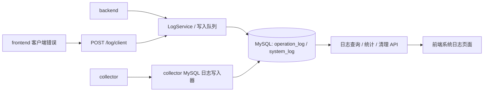

# 系统日志总体设计方案

## 一、设计目标

系统日志用于记录平台自身运行状态、用户操作审计和排障上下文，不包含设备点位报警、故障规则命中等业务报警数据。日志需要覆盖 backend、collector、frontend 三端，并通过统一接口在前端查看、筛选、追踪和清理。

目标：

- 统一记录 backend / collector / frontend 的系统运行日志和用户操作日志。
- INFO、WARN、ERROR、CRITICAL 默认长期落库。
- DEBUG 支持按需、限时开启，默认不落库。
- 前端支持日志查询、统计、详情、清理、策略配置和 DEBUG 开关。
- 支持定时清理、容量触发清理、手动清理。
- 日志写入失败不影响主业务和采集任务。
- 高频采集只记录摘要和关键事件，不逐点位写系统日志。

## 二、日志边界

应纳入系统日志：

- 系统启动、关闭、配置加载、初始化结果。
- 用户登录、登出、登录失败、权限拒绝。
- 用户对设备、点位、角色、菜单、日志策略等配置的新增、修改、删除、导入、导出。
- collector 设备连接、断开、掉线、重连成功、重连失败。
- collector 周期采集摘要，例如读取点位数、成功数、失败数、耗时、调度延迟。
- TDengine / MySQL 连接失败、写入失败、重试耗尽、恢复成功。
- 后端接口未处理异常、外部依赖异常、WebSocket 异常。
- 前端运行错误、未处理 Promise 异常、关键页面请求失败。
- 日志清理任务结果、DEBUG 开关变更记录。

不纳入系统日志：

- 点位实时值变化。
- 点位报警规则命中记录。
- 业务报警确认、恢复和历史报警明细。
- 高频采集原始明细。

## 三、总体架构

系统日志采用 MySQL 统一落库，前端通过后端 API 查询和管理。

### 3.1 backend 写入链路

backend 通过统一 `LogService` 写日志。业务接口只提交日志事件，实际写库由异步队列或后台任务完成。日志写入失败时仅输出控制台告警，不影响接口响应。

backend 记录范围：

- 启动、关闭、配置加载。
- 登录、登出、登录失败、权限拒绝。
- 用户、角色、菜单、设备、点位等配置操作。
- API 未处理异常。
- WebSocket 连接异常。
- 日志清理和 DEBUG 开关操作。

### 3.2 collector 写入链路

collector 复用现有 MySQL 配置，直接写入 `system_log`，不依赖后端服务可用性。

collector 记录范围：

- collector 启动、关闭、配置校验结果。
- 设备连接成功、连接失败、掉线、重连成功、重连失败。
- 每设备定时采集摘要。
- DataBuffer 满、丢点、聚合器 flush、BatchWriter 写入异常。
- TDengine 连接失败、写入失败、重连结果。
- OPC DA sidecar / center ingest 异常、未映射点位摘要。

高频采集日志按设备聚合，默认每 60 秒每台设备最多写一条摘要日志。

### 3.3 frontend 写入链路

frontend 不直接连接数据库，通过 `POST /api/device-monitor/log/client` 上报客户端错误。

frontend 记录范围：

- `window.onerror` 捕获的运行错误。
- `unhandledrejection` 捕获的 Promise 异常。
- Vue 全局 error handler 捕获的组件错误。
- 关键接口连续失败。
- 日志页面触发的策略变更和清理操作由后端写 `operation_log`。

前端上报必须限流，避免异常循环造成日志风暴。

## 四、数据库设计

### 4.1 operation_log

`operation_log` 用于用户操作审计。

| 字段 | 类型 | 说明 |
| --- | --- | --- |
| id | BIGINT PK | 主键 |
| log_time | DATETIME | 操作发生时间 |
| operator_id | BIGINT NULL | 操作人 ID |
| operator_name | VARCHAR(64) | 操作人名称 |
| module_name | VARCHAR(64) | 模块名，如 auth / device / point / log |
| action_name | VARCHAR(64) | 动作名，如 login / create / update / delete / cleanup |
| level | VARCHAR(16) | INFO / WARN / ERROR / CRITICAL |
| content | VARCHAR(500) | 展示文案 |
| detail_json | JSON NULL | 请求摘要、变更字段、业务上下文 |
| request_id | VARCHAR(64) | 请求 ID |
| ip | VARCHAR(64) | 客户端 IP |
| user_agent | VARCHAR(255) | 浏览器或客户端信息 |
| biz_type | VARCHAR(64) | 业务对象类型 |
| biz_id | VARCHAR(64) | 业务对象 ID |
| duration_ms | INT NULL | 操作耗时 |
| result_status | VARCHAR(32) | success / failed / denied |
| create_time | DATETIME | 入库时间 |

关键索引：

- `idx_operation_log_log_time(log_time)`
- `idx_operation_log_level_log_time(level, log_time)`
- `idx_operation_log_operator_log_time(operator_id, log_time)`
- `idx_operation_log_module_log_time(module_name, log_time)`
- `idx_operation_log_request_id(request_id)`

### 4.2 system_log

`system_log` 用于系统运行、采集运行、存储运行和前端运行日志。

| 字段 | 类型 | 说明 |
| --- | --- | --- |
| id | BIGINT PK | 主键 |
| log_time | DATETIME | 日志发生时间 |
| level | VARCHAR(16) | DEBUG / INFO / WARN / ERROR / CRITICAL |
| log_type | VARCHAR(32) | system / auth / operation / collect / storage / frontend / security / alarm |
| source | VARCHAR(64) | 日志来源，如 backend-api / collector-scheduler |
| device_id | BIGINT NULL | 关联设备 ID |
| device_code | VARCHAR(64) | 设备编号 |
| point_id | BIGINT NULL | 关联点位 ID，仅用于必要上下文 |
| host_name | VARCHAR(64) | 主机名 |
| service_name | VARCHAR(64) | 服务名，如 backend / collector / frontend |
| content | VARCHAR(500) | 展示文案 |
| detail_json | JSON NULL | 结构化上下文 |
| trace_id | VARCHAR(64) | 链路 ID |
| exception_stack | TEXT NULL | 异常堆栈 |
| elapsed_ms | INT NULL | 耗时 |
| create_time | DATETIME | 入库时间 |

关键索引：

- `idx_system_log_log_time(log_time)`
- `idx_system_log_level_log_time(level, log_time)`
- `idx_system_log_log_type_log_time(log_type, log_time)`
- `idx_system_log_source_log_time(source, log_time)`
- `idx_system_log_device_log_time(device_id, log_time)`
- `idx_system_log_trace_id(trace_id)`

### 4.3 log_retention_policy

`log_retention_policy` 用于保存日志清理策略和 DEBUG 落库策略。

| 字段 | 类型 | 默认值 | 说明 |
| --- | --- | --- | --- |
| id | BIGINT PK | 1 | 单行策略表 |
| enabled | TINYINT | 1 | 是否启用自动清理 |
| retention_days | INT | 7 | 保留天数 |
| max_total_mb | INT | 1024 | 日志总容量上限 |
| cleanup_time | VARCHAR(8) | 03:00 | 每日定时清理时间 |
| capacity_check_interval_minutes | INT | 30 | 容量检查间隔 |
| batch_size | INT | 5000 | 单批删除数量 |
| debug_db_enabled | TINYINT | 0 | DEBUG 是否允许落库 |
| debug_enabled_until | DATETIME NULL | NULL | DEBUG 自动关闭时间 |
| debug_reason | VARCHAR(255) | '' | 开启原因 |
| update_by | VARCHAR(64) | system | 最近修改人 |
| update_time | DATETIME | CURRENT_TIMESTAMP | 最近修改时间 |

默认策略为保留 7 天、总容量 1GB、每天 03:00 清理、每 30 分钟检查容量、DEBUG 默认不落库。

## 五、日志级别与类型

日志级别：

| 级别 | 默认落库 | 用途 |
| --- | --- | --- |
| DEBUG | 否 | 排障时限时开启，记录详细上下文 |
| INFO | 是 | 常规运行信息、成功操作、采集摘要 |
| WARN | 是 | 可恢复异常、性能抖动、重试、未映射点位 |
| ERROR | 是 | 操作失败、连接失败、写入失败、接口异常 |
| CRITICAL | 是 | 系统不可用、核心依赖不可用、数据写入完全中断 |

日志类型：

| 类型 | 说明 |
| --- | --- |
| system | 系统启动、关闭、配置加载、内部任务 |
| auth | 登录、登出、登录失败、权限拒绝 |
| operation | 用户操作审计 |
| collect | 设备采集、调度、设备连接状态 |
| storage | TDengine / MySQL 写入和连接 |
| frontend | 前端运行错误和关键请求失败 |
| security | 敏感操作、异常访问、权限风险 |
| alarm | 和报警模块有关的系统事件，不替代业务报警表 |

DEBUG 落库必须受开关控制。开关关闭时，DEBUG 可以继续写控制台或本地文件，但不能进入 MySQL 日志表。

## 六、API 设计

### 6.1 日志列表

`GET /api/device-monitor/log/list`

查询参数：

- `pageNo`
- `pageSize`
- `keyword`
- `startTime`
- `endTime`
- `level`
- `type`
- `kind`: `system / operation / all`
- `source`
- `serviceName`
- `deviceCode`
- `operatorName`
- `requestId`
- `resultStatus`

返回字段：

- `id`
- `kind`
- `time`
- `level`
- `type`
- `source`
- `serviceName`
- `moduleName`
- `actionName`
- `operatorName`
- `deviceCode`
- `content`
- `resultStatus`
- `durationMs`
- `requestId`
- `detail`

### 6.2 日志统计

`GET /api/device-monitor/log/stats`

返回内容：

- 今日日志总数。
- 今日 WARN / ERROR / CRITICAL 数。
- DEBUG 开关状态和剩余时间。
- 当前日志总容量。
- 最近一次清理时间。
- 按级别趋势。
- 按类型占比。
- 按来源占比。

### 6.3 日志策略

`GET /api/device-monitor/log/policy`

`PUT /api/device-monitor/log/policy`

策略字段：

- `enabled`
- `retentionDays`
- `maxTotalMb`
- `cleanupTime`
- `capacityCheckIntervalMinutes`
- `batchSize`
- `debugDbEnabled`
- `debugEnabledUntil`
- `debugReason`

### 6.4 DEBUG 开关

`POST /api/device-monitor/log/debug`

请求字段：

- `enabled`
- `durationMinutes`
- `reason`

行为：

- 只有 `R_SUPER` 可以操作。
- 开启时必须设置原因。
- 默认开启 60 分钟。
- 到期后后端自动关闭。
- 开启和关闭都写入 `operation_log` 与 `system_log`。

### 6.5 手动清理

`POST /api/device-monitor/log/cleanup`

请求字段：

- `mode`: `policy / beforeTime / range / currentFilter`
- `beforeTime`
- `startTime`
- `endTime`
- `kinds`
- `force`

行为：

- 只有 `R_SUPER` 可以操作。
- 清理最近 24 小时日志必须 `force=true`。
- 清理任务分批执行。
- 清理完成后写入 `system_log`。

### 6.6 前端客户端日志上报

`POST /api/device-monitor/log/client`

请求字段：

- `level`
- `type`
- `source`
- `content`
- `detail`
- `exceptionStack`
- `routePath`
- `userAgent`
- `traceId`

行为：

- 默认只接受 WARN / ERROR / CRITICAL 入库。
- DEBUG 上报只有 DEBUG 落库开关开启时才入库。
- 后端需要做频率限制和字段长度限制。

## 七、清理策略

默认策略：

- 保留 7 天。
- 总容量上限 1GB。
- 每天 03:00 清理。
- 每 30 分钟检查容量。

清理顺序：

1. 删除超过 7 天的日志。
2. 如果总容量仍超过 1GB，继续按时间从旧到新删除。
3. 默认保留最近 24 小时日志。
4. 清理最近 24 小时日志必须由 `R_SUPER` 强制确认。
5. 每批最多删除 `batch_size` 条，避免长事务和锁表。

每次清理必须记录：

- 触发方式：定时 / 容量 / 手动。
- 清理前容量。
- 清理后容量。
- 删除 `operation_log` 数量。
- 删除 `system_log` 数量。
- 耗时。
- 操作人。
- 是否强制清理。

## 八、DEBUG 策略

DEBUG 用于辅助排障，不作为长期日志级别。

规则：

- 默认关闭 DEBUG 落库。
- 只有 `R_SUPER` 可以开启和关闭。
- 开启时必须填写原因。
- 默认开启 60 分钟，到期自动关闭。
- 前端需要明显展示 DEBUG 正在记录以及剩余时间。
- DEBUG 状态变化必须写入 `operation_log` 和 `system_log`。
- DEBUG 日志也受容量清理策略约束。

使用流程：

1. 运维人员发现问题。
2. `R_SUPER` 在前端打开 DEBUG，填写原因，选择开启时长。
3. 系统开始记录 DEBUG 到数据库。
4. 运维复现问题并查看日志终端或日志管理页。
5. 到期自动关闭，或手动关闭。
6. 系统写入 DEBUG 关闭日志。

## 九、安全与性能

安全要求：

- 密码、token、cookie、Authorization、数据库密码等敏感字段不得入库。
- 请求参数需要脱敏后写入 `detail_json`。
- 前端客户端日志上报不得携带敏感原文。
- 清理日志、DEBUG 开关、策略变更仅 `R_SUPER` 可操作。

性能要求：

- 日志写入使用异步队列或后台任务。
- 日志写入失败不影响主业务。
- 高频采集只写摘要，不写逐点位明细。
- 查询接口必须分页。
- 表格默认不展示完整堆栈，大字段在详情抽屉按需展示。
- 前端终端模式只保留有限窗口，例如最近 1000 条。

## 十、分阶段实施

### 阶段一：数据库与查询 ✅ 已完成

- 建立 `operation_log`、`system_log`、`log_retention_policy`。 ✅
- 实现 `GET /log/list` 真实查询。 ✅
- 实现基础筛选、分页、详情字段返回。 ✅

### 阶段二：后端写入 🚧 进行中

- 后端启动、关闭、登录、登出、异常写入日志。 待实施
- 设备、点位、用户、角色、菜单等 mutation 接口写入操作日志。 待实施
- 日志写入失败不影响业务响应。 待实施

### 阶段三：collector 写入 ✅ 已完成

- collector 启停、设备上下线、重连、采集摘要、TDengine 写入异常入库。 ✅
- 高频采集日志按设备聚合。 ✅

### 阶段四：前端页面 ✅ 已完成

- 实现系统日志管理页扩展。 ✅
- 实现日志终端页。 ✅
- 实现详情抽屉、统计卡片、筛选、清理入口、DEBUG 状态展示。 ✅

### 阶段五：清理与 DEBUG 🚧 进行中

- 实现自动清理任务。 待实施
- 实现容量触发清理。 待实施
- 实现手动清理和清理历史。 ✅（API已实现）
- 实现 DEBUG 限时开启和自动关闭。 待实施（API已实现）

## 十一、验收标准

- 前端可以看到 backend、collector、frontend 三类日志。
- 日志列表支持时间、级别、类型、来源、设备、操作人、关键词筛选。
- 登录、登出、用户操作、设备掉线、采集摘要、存储失败都能形成可查日志。
- DEBUG 默认不入库，开启后可看到 DEBUG 日志，到期自动关闭。
- 默认清理策略为 7 天 + 1GB。
- 手动清理和自动清理都会记录清理结果。
- 日志写入失败不会导致业务接口失败或 collector 停止采集。
