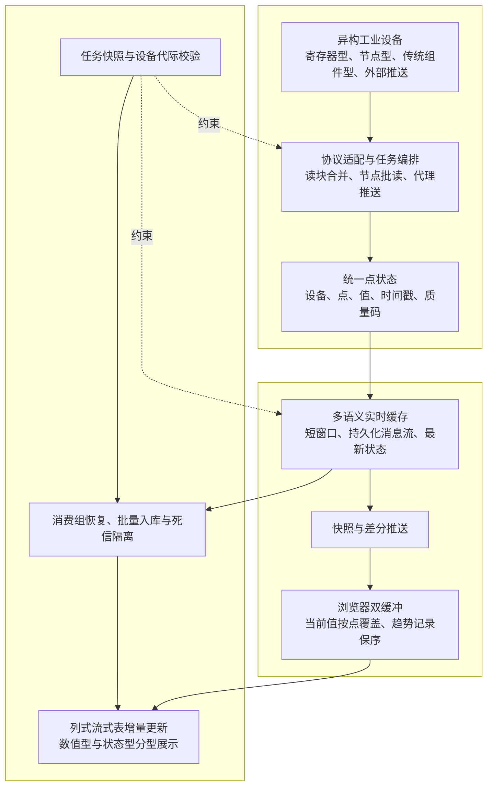
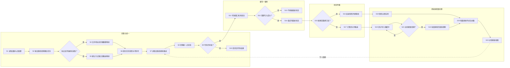

# 技术交底书

**案件名称**：一种多协议工业设备数据的统一采集与实时监控方法及系统

**技术联系人**：
- 姓名：
- 电话：
- 邮箱：

**专利类型**：发明

---

## 注意事项

（1）交底书应使代理人能看懂，尤其是背景技术和详细技术方案，一定要写得全面、清楚、完整；

（2）技术的公开程度，应以本领域普通技术人员不需付出创造性劳动即可进行实施为准。

（3）在与代理人沟通时，对于代理人咨询的技术问题，应给予回答并认真讲解，并且按要求及时正确地补充相应技术材料。

## 一、介绍相关技术背景，描述与本发明技术最相近的现有技术，并说明该现有技术存在的缺点

### 1.1 现有技术

#### 1.1.1 检索说明

本次检索以 Google Patents 等公开专利数据库为公开核验渠道，使用“工业设备、多协议、统一数据模型、实时监控、差分推送、高频数据、浏览器流式处理、列式分析”等关键词及其组合进行检索。以下文献均已通过公开号页面核验，技术方案与局限性根据公开摘要和说明书内容概括。

#### 1.1.2 多协议接入与标准化数据接口

| 公开文献 | 已公开的主要技术方案 | 适用场景 | 相对于本发明主线的局限 | 公开源 URL |
|---|---|---|---|---|
| CN111427321A，一种兼容多协议的 MES 数据采集系统及其方法 | 在数据采集程序中预置或扩展多种协议接口，将不同设备数据解析为名称、类型、发送时间和实际数据等标准格式，再通过标准化接口送入 MES | 数字化车间的多协议设备接入 | 已公开“多协议采集程序+标准化接口”，但未公开从协议差异化读块、统一点状态、多语义实时缓存，到首次全量快照、后续状态差分、浏览器刷新窗口合并及列式流式表增量更新的连续处理链 | https://patents.google.com/patent/CN111427321A/zh |
| CN115981253A，适用于火电厂多协议数据采集与数据回写的数据处理系统 | 将 OPC DA、MODBUS、IEC104、IEC102 等协议转换为统一发布订阅消息，经数据网关写入树形实时数据库，并支持数据回写 | 火电厂多生产系统数据汇聚 | 着重于协议转换、消息发布订阅、树形数据库和回写，未公开面向高频网页监控的快照/差分状态传播、前端双缓冲以及浏览器侧列式增量分析机制 | https://patents.google.com/patent/CN115981253A/zh |
| CN118101791A，一种基于多协议设备接入的物联网数据处理系统 | 设置多协议自适应数据融合、采集处理、实时/历史存储、网页监控展示及 API 模块，并将多种协议转换成统一消息协议 | 物联网设备接入、远程监控与管理 | 已概括多协议、存储和 WEB 展示的组合，但实时展示仅作功能性描述；未给出设备点状态差分、用户刷新周期内的按点合并、完整趋势记录批次及列式工作线程增量更新之间的约束关系 | https://patents.google.com/patent/CN118101791A/zh |

#### 1.1.3 高频工业数据传输与实时监控

| 公开文献 | 已公开的主要技术方案 | 适用场景 | 相对于本发明主线的局限 | 公开源 URL |
|---|---|---|---|---|
| CN105549556A，一种用于工业过程实时监控的数据采集传输系统及方法 | 对高频工业数据进行编号、类型判断和传输，支持广播、多播、订阅以及缺失数据补传，以减少带宽并提高实时性和可靠性 | 工业现场到云端、移动终端的实时监控 | 重点为编号、传输连续性和移动订阅；未解决多种工业协议在同一平台内统一建模后，如何将服务端状态增量与浏览器侧流式分析表协同更新 | https://patents.google.com/patent/CN105549556A/zh |
| CN109656210B，工业数据采集方法、系统及主系统 | 对新增数据点进行标记、序列化并上传云端，根据同步指令使数据模型与新增点同步 | OPC 数据点接入与云端模型同步 | 着重于新增点模型同步及云端应答，未公开针对连续高频点值的首次快照、后续差分和浏览器列式增量渲染链路 | https://patents.google.com/patent/CN109656210B/zh |

#### 1.1.4 检索总结及本发明的本质区别

检索表明，“支持多种工业协议”“转换为统一格式”“将实时数据显示在网页”分别均属于已有技术方向。因此，本发明不把上述孤立功能本身作为唯一创新点，也不把某一第三方图表组件作为发明对象。本发明的本质区别在于：围绕同一统一点标识和点状态元组，建立贯穿协议采集、实时缓存、服务端状态传播和浏览器列式处理的协同链路；该链路将协议特有的读取方式收敛为统一点记录，在订阅建立时发送全量状态快照，之后按状态元组变化形成差分集合；浏览器将差分集合分别写入按点覆盖的当前值缓冲和保序的趋势记录缓冲，并按用户刷新周期一次性更新界面状态和浏览器侧列式流式表。由此，在保持多协议设备统一呈现的同时，控制高频更新对网络、主线程和图表渲染的冲击。

### 1.2 现有技术存在的缺点

（1）多协议接入常停留在协议转换或统一接口层。不同协议的地址组织、连续读取能力、采样周期和外部推送方式差异较大，若仅在出口处转换格式，仍可能产生大量离散读取任务、重复配置和不一致的点状态语义。

（2）“实时网页展示”常被作为一个笼统模块描述，缺少服务端和浏览器之间的状态同步规则。持续发送完整数据集会增加序列化、网络传输和浏览器解析负担；只发送增量又容易在首次订阅或重连时缺少基线状态。

（3）高频消息到达频率与用户希望看到的界面刷新频率并不相同。若每条消息都立即修改响应式状态并重绘图表，浏览器主线程容易被高频更新占用；若简单丢弃中间消息，又会损失趋势分析所需的时序记录。

（4）传统前端图表常以完整数组替换或全量重算方式更新，大量点位、高采样频率和长时间运行叠加时，数据复制、聚合和绘制开销持续增长。

（5）设备配置热更新、采集任务并发和异步写入同时存在时，旧配置任务可能在新配置生效后继续写入；若实时最新值先于窗口或持久化流写入，还可能向监控端暴露一个尚未完成下游处理的批次。

（6）持久化失败若直接确认消息会造成数据丢失，若所有失败无限重试又会让明确坏数据长期阻塞消费队列，影响后续正常数据。

## 二、针对上述缺点，说明本发明所要解决的技术问题

本发明拟解决以下相互关联的技术问题：

（1）在同一工业数据平台中，如何把轮询型协议、节点型协议、传统组件型协议以及外部主动推送接口采集的数据，转换为具有统一设备标识、点标识、点组、采样周期、数据类型、值、时间戳和质量码的点状态记录，同时保留各协议适宜的读取优化方式。

（2）如何在建立实时订阅、持续更新以及断线重连的全过程中，使监控端既能获得完整基线，又只处理基线之后发生变化的点状态记录。

（3）如何把服务端高频状态传播与用户可配置的界面刷新周期解耦，在不丢失趋势记录的前提下，降低重复的当前值写入、响应式更新和图表重绘次数。

（4）如何在浏览器中使用列式流式数据结构和独立工作线程对新增记录进行增量更新，并按数据类型拆分显示，减少全量数组重建和主线程计算开销。

（5）如何通过配置代际校验、不可变任务快照、有限容量执行器、实时缓存写入顺序以及持久化消息确认规则，使多协议高频采集链路在配置切换、资源饱和和局部失败时仍保持数据语义一致。

## 三、本发明技术方案的详细阐述

### 3.1 背景与总体思路

本发明适用于需要在一个平台中接入多厂商、多年代工业设备并进行高频实时监控的场景。设备侧可同时存在基于寄存器或存储区连续读取的协议、基于节点标识读取的协议、依赖独立代理进程的传统协议，以及由边缘进程主动推送数据的接口协议。

本发明以“统一点状态记录”为贯穿链路的公共语义。协议适配层负责将设备地址和原始数据解析为统一点记录；采集编排层按设备和采样周期形成任务快照，并在协议允许时合并连续地址为读取块；实时缓存层同时维护最新状态、短窗口完整帧和持久化消息流；实时推送层在订阅建立时发送完整快照，并在其后发送相对于服务端基线的差分；浏览器接收层将快照立即应用，将差分分别写入当前值覆盖缓冲和趋势记录保序缓冲；达到用户设定刷新周期后，再批量更新界面和浏览器侧列式流式分析表。

上述各环节共享设备标识、点组、点标识、时间戳和质量码，使协议接入、当前值显示、趋势分析和历史持久化无需分别维护互不相容的数据定义。

### 3.2 系统框图

### 3.3 模块功能说明

#### 3.3.1 协议适配模块

协议适配模块针对不同工业协议提供统一连接、读取和关闭接口，但不强制各协议采用相同的底层读取方式。对于支持连续地址读取的协议，模块接收合并后的读取块并一次读取多个连续点；对于节点型协议，模块按节点集合批量读取；对于依赖特定位数运行环境或系统组件的传统协议，模块通过独立代理进程读取后以本地接口推送；对于外部主动上报设备，模块通过统一接收接口接收点值。

各协议适配结果均被转换为统一点状态记录。点状态至少包括设备标识、点标识、值、时间戳和质量码；与任务配置关联的字段还包括点组、采样周期、地址、数据类型、是否持久化以及配置版本。由此，上游协议差异不会传播到实时监控和历史写入模块。

#### 3.3.2 地址块合并与周期调度模块

该模块按设备和采样周期对点配置分组。对于允许连续读取的协议，根据地址区、数据类型、连续性和协议允许的最大读取范围合并读取块，并建立“统一点标识—读取块—块内偏移”的结果映射；对于不适宜合并的协议，保留节点或点集合读取方式。

调度时，一个采集任务对应一个设备的一个采样周期。不同周期的点位可形成独立任务，支持亚秒级采集。执行时间短于采样周期时等待剩余时间，执行时间达到或超过采样周期时不再附加等待，从而避免调度器主动累积额外延迟。

#### 3.3.3 任务快照与代际校验模块

每个采集任务创建时，将该任务涉及的采样周期、变量集合、读取块集合、结果映射和点组配置版本固化为不可变快照，并记录设备当前代际号。当设备配置新增、修改、删除或设备失效时，设备代际号递增。

采集任务在设备读取前、解析后和写入前至少执行一次代际校验；最终写入动作与代际校验在同一设备代际锁内完成。若任务携带的代际号不是设备当前代际号，则丢弃该任务结果，防止旧任务在新配置生效后覆盖实时状态。

#### 3.3.4 统一点状态与多语义实时缓存模块

统一点状态生成模块把协议原始返回值按任务快照中的映射还原为点状态记录，并将数据类型、时间戳和质量码转换为平台统一语义。外部推送路径也经过相同的点配置查找、时间戳解析、质量码映射和代际校验。

实时缓存模块为同一批点状态维护三种用途不同但标识一致的数据结构：

（1）短窗口完整帧，用于保留最近若干采集帧并支持短时回看；

（2）分片持久化消息流，用于由历史写入进程异步消费；

（3）最新点状态哈希，用于实时监控快速读取每个点的最新值、时间戳和质量码。

在一次采集周期内，先写短窗口和持久化消息流，二者成功后再写最新点状态。该“最新状态最后写入”约束使最新状态可作为该批次已完成前置缓存处理的可见标志；若短窗口或消息流写入失败，则不刷新最新状态。

#### 3.3.5 快照与差分推送模块

当浏览器订阅某设备及点组时，服务端读取对应最新点状态并发送一次全量快照，同时把该快照保存为该订阅键的比较基线。快照使首次打开或重连后的浏览器无需依赖此前消息即可恢复完整当前状态。

此后服务端按预设检测周期读取最新点状态，并将当前点状态元组与基线中同一点状态元组比较。仅将值、时间戳或质量码至少一项发生变化的点放入差分集合并推送，随后用差分集合更新服务端基线。若设备从有数据跳变为无数据，仅发送一次离线状态，持续离线期间不重复广播。

#### 3.3.6 浏览器双缓冲与刷新解耦模块

浏览器收到全量快照时，清空待处理缓冲并立即写入当前值、质量状态和趋势表，使页面快速建立正确基线。浏览器收到差分消息时不立即触发整页刷新，而执行两条并行路径：

（1）按点标识写入当前值覆盖缓冲和质量覆盖缓冲；同一刷新窗口内同一点多次更新时，后到状态覆盖先到状态，界面刷新时只写入该点的窗口末状态；

（2）将被选中用于趋势监控的记录按到达顺序追加到趋势记录保序缓冲，不因当前值覆盖而删除窗口内的中间趋势记录。

浏览器按用户设定的刷新周期批量清空两类缓冲：先把当前值和质量覆盖缓冲写入页面状态，再把趋势记录批次追加到受长度限制的本地记录集合，并把该批次增量送入列式流式表。由此，状态面板避免同一点在一个刷新窗口内重复触发响应式更新，而趋势分析仍保留窗口内记录。

#### 3.3.7 浏览器侧列式流式分析与分型展示模块

该模块在浏览器独立工作线程或等效隔离执行环境中创建列式流式表，表模式至少包括时间戳、点序号、点名称和值。首次需要显示时创建表并加载视图配置；后续只调用增量更新接口追加本次刷新窗口内的新记录，不重新构造全部历史数组。

在一种实施方式中，系统根据统一点配置中的数据类型集合，把趋势记录拆分为数值型记录和布尔/状态型记录，分别更新两个列式流式表。数值型视图使用连续数值轴，状态型视图使用离散状态语义；也可根据用户配置合并为一个视图。每次增量更新后仅刷新对应视图。浏览器本地记录超过预设上限时淘汰最早记录，使长期运行时内存占用受到约束。

#### 3.3.8 有限容量执行与可靠历史写入模块

设备读取、结果解析和实时缓存写入分别使用有限容量执行器。执行器以工作线程数和最大待处理数限制并发任务；容量达到上限时明确返回饱和状态，由上层记录指标并按策略延后或拒绝，避免无限排队导致采集延迟失控。

历史写入进程以消费组读取持久化消息流。消息先进入待处理列表，批量转换为多表写入请求。写入结果按行分为：已落库、明确坏数据和可重试错误。已落库行才执行确认；明确坏数据只有成功写入死信队列后才确认；连接错误、未知错误或分解深度达到上限的行不确认并保留重试。进程启动及周期运行时认领超过空闲阈值的待处理消息；只有超过最大投递次数且成功进入死信队列的消息才从待处理列表移除。

### 3.4 系统流程说明

流程具体包括：

S1，加载设备、协议、点地址、点组、数据类型、采样周期、是否持久化和配置版本。

S2—S6，根据协议能力建立读取块或节点集合，按设备和采样周期形成任务，并固化不可变任务快照和设备代际号。

S7—S10，执行设备读取或接收外部推送，转换为统一点状态记录；若任务代际已过期，则停止后续写入。

S11—S14，先以流水线方式写入短窗口和持久化消息流，成功后再刷新最新点状态，形成最新状态最后可见的写入次序。

S15—S17，新订阅或重连时发送全量快照；已有基线时比较当前点状态与基线，发送差分并更新基线。

S18—S22，浏览器立即应用快照；差分则进入当前值覆盖缓冲和趋势保序缓冲，达到用户刷新周期后批量写入页面状态和趋势记录。

S20、S23，将新增趋势记录增量写入浏览器侧列式流式表，并根据点数据类型刷新数值型视图、状态型视图或合并视图。

### 3.4.1 符号与公式

#### （1）符号与变量定义

| 符号 | 含义 | 下标、量纲或取值范围 |
|---|---|---|
| \(i\) | 统一点索引 | \(i=1,\ldots,N\) |
| \(k\) | 服务端状态检测周期索引 | 非负整数 |
| \(n\) | 浏览器刷新窗口索引 | 非负整数 |
| \(s_{i,k}\) | 第 \(k\) 个检测周期中点 \(i\) 的状态元组 | 由值、时间戳和质量码组成 |
| \(S_k\) | 第 \(k\) 个检测周期的全部点状态集合 | 点状态集合 |
| \(\Delta_k\) | 第 \(k\) 个检测周期相对前一基线的差分点集合 | \(\Delta_k\subseteq S_k\) |
| \(t_k\) | 第 \(k\) 个检测周期的时间 | 时间量 |
| \(\tau_u\) | 用户设定的浏览器刷新周期 | 正时间量 |
| \(B_n\) | 第 \(n\) 个刷新窗口内接收的全部差分点集合 | 点状态集合 |
| \(\hat{s}_{i,n}\) | 第 \(n\) 个刷新窗口结束时点 \(i\) 的界面状态 | 点状态元组 |
| \(k^*\) | 刷新窗口内点 \(i\) 最后一次更新对应的检测周期 | 非负整数 |
| \(R_n\) | 第 \(n\) 个刷新窗口内保序保存的趋势记录序列 | 有序记录序列 |
| \(L_{\max}\) | 浏览器本地趋势记录上限 | 正整数 |

#### （2）差分集合

服务端以订阅建立时的快照或前一检测周期更新后的基线为参照，形成差分集合：

\[
\Delta_k=\{s_{i,k}\mid s_{i,k}\neq s_{i,k-1},\ i=1,\ldots,N\} \tag{1}
\]

其中，状态元组中值、时间戳或质量码任一项不同，均视为点状态发生变化。首次订阅不使用式（1）裁剪，而直接发送 \(S_k\) 作为全量快照。

#### （3）刷新窗口合并

第 \(n\) 个浏览器刷新窗口的接收集合为：

\[
B_n=\bigcup_{(n-1)\tau_u<t_k\leq n\tau_u}\Delta_k \tag{2}
\]

对于当前值和质量状态，采用按点覆盖的窗口末状态：

\[
\hat{s}_{i,n}=s_{i,k^*},\quad k^*=\max\{k\mid s_{i,k}\in B_n\} \tag{3}
\]

若点 \(i\) 在该窗口内没有更新，则沿用上一窗口的 \(\hat{s}_{i,n-1}\)。式（3）只用于当前状态面板的合并，不删除趋势记录。

#### （4）趋势记录保序与容量约束

对用户选中的点，将窗口内记录按到达顺序组成 \(R_n\)，并整体增量写入列式流式表。浏览器本地保存的记录总数超过 \(L_{\max}\) 时，从最早记录开始淘汰，使保留记录数满足：

\[
0\leq |R|\leq L_{\max} \tag{4}
\]

由此，当前值路径通过式（3）减少同一点重复界面写入，趋势路径则保持刷新窗口内记录顺序，两者共享同一批差分但采用不同保留语义。

### 3.5 关键技术参数

| 参数 | 符号 | 建议或示例范围 | 作用及约束 |
|---|---|---|---|
| 服务端状态检测周期 | \(t_k-t_{k-1}\) | 可为 0.05—1 秒，实施例为 0.1 秒 | 决定最新状态比较频率，不作为权利要求的固定限制 |
| 用户浏览器刷新周期 | \(\tau_u\) | 可为 0.1—30 秒，实施例为 1 秒 | 用于将消息到达频率与界面刷新频率解耦，必须为正值 |
| 点数量 | \(N\) | 根据设备及点组配置确定 | 同一订阅键下参与快照和差分比较的点数 |
| 浏览器本地趋势记录上限 | \(L_{\max}\) | 可为 500—100000 条 | 超限时淘汰最早记录，避免长期运行时无界增长 |
| 设备采样周期 | — | 可为 0.01 秒以上的正值 | 按设备和采样周期形成任务；可与 \(\tau_u\) 不同 |
| 短窗口帧数 | — | 可为 2—100 帧，实施例为最近 10 帧 | 用于短时完整帧回看，不等同于历史数据库 |
| 有限执行器最大待处理数 | — | 大于零的整数 | 限制读取、解析或缓存写入排队深度 |
| 待处理消息最小空闲时长 | — | 根据网络和数据库响应设定 | 超过该时长的消息可被重新认领 |
| 最大投递次数 | — | 大于零的整数 | 超限且成功写入死信队列后才确认原消息 |

上述范围为便于实施和调优的示例，不作为权利要求范围的限定。实际参数可根据设备数量、采样频率、网络带宽、浏览器性能和历史数据库写入能力确定。

## 四、与现有技术相比，本发明具有哪些优点？

（1）多协议接入不是简单并列堆叠。协议适配器保留连续块读取、节点集合读取、代理进程和外部推送等差异化手段，同时在输出端统一为同一种点状态记录，兼顾采集效率与平台一致性。

（2）通过“首次全量快照+后续状态差分”建立明确的同步基线。新订阅和重连能够立即恢复完整当前状态，稳定连接期间仅处理相对于基线发生变化的点状态；设备持续离线时也不会重复广播相同离线事件。

（3）服务端消息检测频率、设备采样频率和用户界面刷新频率彼此解耦。浏览器在一个刷新窗口内对当前值按点覆盖，减少重复响应式写入；同时保序保存趋势记录，避免以简单节流方式牺牲趋势数据。

（4）浏览器侧列式流式表只接收新增记录，并在独立工作线程中完成数据组织、查询和视图刷新，避免每次更新都重建完整历史数组。数值型点和状态型点可分别使用适合其语义的视图。

（5）统一点标识、时间戳和质量码贯穿实时状态、趋势显示和历史持久化，使多协议设备在同一页面、同一接口和同一存储映射中被一致处理。

（6）不可变任务快照和设备代际门控阻止旧配置结果写入；“短窗口和消息流先写、最新状态后写”的次序减少监控端看见未完成批次的概率；有限执行器避免异步任务无界积压。

（7）历史写入对已落库、坏数据和可重试错误进行行级分流，确认、重试和死信隔离的条件互相约束，既避免连接类错误被误送死信，也避免坏数据永久阻塞正常数据。

## 五、本发明的技术关键点和欲保护点是什么？

### 5.1 独立权利要求建议覆盖的主链

（1）一种多协议工业设备数据的统一采集与实时监控方法，其核心步骤包括：根据协议类型选择相应读取或推送适配方式；把协议结果转换为共享点标识体系下的统一点状态记录；维护最新点状态；订阅建立时发送全量快照并建立比较基线；其后根据当前点状态与基线形成差分集合；浏览器将差分分别写入按点覆盖的当前状态缓冲和保序趋势缓冲；按用户刷新周期批量更新页面状态，并把趋势记录批次增量写入浏览器侧列式流式表进行展示。

（2）上述各步骤不是孤立功能的并列，而是以同一设备标识、点组、点标识、时间戳和质量码贯穿的连续数据处理关系。建议在独立权利要求中保留“全量快照建立基线—后续差分—双缓冲不同保留语义—列式表增量更新”这一组合，以区别仅具有多协议接入或普通 WEB 展示的现有技术。

### 5.2 从属权利要求建议保护的特征

（1）协议差异化采集：对于连续地址协议合并读取块并保存块内偏移映射；对于节点型协议批量读取节点集合；对于传统组件型协议通过独立代理进程读取并推送；外部主动推送路径使用与轮询路径一致的点状态转换和质量码语义。

（2）统一配置与任务：按设备和采样周期分组，任务中固化变量、读取块、结果映射、点组版本和设备代际号的不可变快照。

（3）配置代际门控：在读取、解析或写入阶段校验任务代际，并在同一设备代际锁内完成最终校验和写入，拒绝旧代际结果。

（4）多语义实时缓存及写入顺序：为同一统一点数据维护短窗口完整帧、分片持久化消息流和最新点状态；先写短窗口及消息流，成功后再写最新点状态。

（5）快照与差分：首次订阅或重连发送全量快照；后续按值、时间戳和质量码组成的状态元组比较形成差分；离线事件仅在在线到离线跳变时发送一次。

（6）浏览器双缓冲：同一刷新窗口内当前值和质量按点标识覆盖为末状态，趋势记录按到达顺序保留；达到刷新周期后再统一刷新页面并把趋势批次送入列式流式表。

（7）列式增量分析：在浏览器独立工作线程中创建具有时间戳、点序号、点名称和值字段的列式流式表，后续只增量追加新记录，并按数值型点和布尔/状态型点拆分或合并视图。

（8）有界执行：读取、解析和缓存写入执行器均设置最大待处理数，饱和时返回明确状态而非无限排队。

（9）可靠持久化：消费组消息在成功落库后确认；坏数据在成功进入死信队列后确认；连接错误、未知错误和未完成隔离的记录不确认并继续保留；支持待处理消息重新认领和确认失败重试。

（10）权利要求类型可包括方法、系统、电子设备、计算机可读存储介质及计算机程序产品；系统权利要求中的协议适配、统一点状态、快照差分、浏览器缓冲和列式增量处理模块应与方法步骤对应。

### 5.3 不宜单独作为核心保护点的内容

（1）仅表述“支持多种工业协议”或“提供统一平台”，容易被现有多协议网关、MES 采集系统和物联网平台覆盖。

（2）仅表述“通过 WebSocket 实时推送”属于通用通信手段，应与全量基线、状态差分及浏览器刷新窗口合并关系共同限定。

（3）不应把具体第三方可视化组件名称、特定前端框架名称或某数据库品牌本身写成创新点；应保护其在本方案中的技术角色、数据结构、处理步骤及与上下游的约束关系。

## 六、其它

### 6.1 实施例一：中心采集协议与高频实时监控

在一个通用制造场景中，平台同时接入寄存器型协议设备、节点型协议设备和基于专用组件的传统协议设备。管理员为每个点配置设备标识、点标识、点组、地址、数据类型、采样周期和是否持久化。平台按设备和采样周期生成任务，对寄存器型协议的连续地址进行读块合并，对节点型协议生成节点集合，对传统协议启动独立代理进程。

采集结果统一转换为点状态记录，先写入最近 10 帧短窗口和分片持久化消息流，再写最新点状态。浏览器订阅设备点组时获得一次全量快照；服务端此后每 0.1 秒检测最新状态并推送差分。浏览器刷新周期 \(\tau_u\) 设为 1 秒，因此在一个刷新窗口内到达的多个差分先进入缓冲。当前值面板对同一点只应用窗口末状态，趋势记录则按到达顺序批量追加到列式流式表。上述参数仅为示例，不作为权利要求限制。

### 6.2 实施例二：边缘代理主动推送

对于只能在特定位数运行环境中访问的传统协议设备，在边缘侧运行独立代理进程。代理进程读取设备点值后，将设备标识、点标识、值、原始时间戳和原始质量信息通过本地网络推送到中心接收接口。中心接收接口根据统一点配置校验设备和点标识，把原始质量信息映射为平台质量码，并为该点补充点组、采样周期、数据类型、是否持久化和配置版本。

中心随后使用与轮询采集相同的代际校验、实时缓存写入顺序、快照差分和浏览器双缓冲链路。因此，外部推送并非形成另一套监控系统，而是作为多协议统一平台中的一种采集入口。

### 6.3 实施例三：配置热更新期间的数据隔离

设备原配置对应代际号为第一代际。采集任务启动后，管理员修改了该设备点地址或采样周期，设备管理模块使代际号递增并基于新配置生成新任务。第一代际任务即使已完成设备读取，也会在解析或写入阶段因代际不匹配而被拒绝；新代际任务携带不可变的新配置快照并继续采集。由此避免旧地址数据在配置切换后覆盖新地址数据。

### 6.4 实施例四：历史写入局部失败

历史写入进程批量消费多个设备点记录。若部分行成功、某一行因数据格式明确错误而失败、另一些行因数据库连接中断而失败，则成功行标记为已落库并确认；明确坏行经逐步缩小批次定位后写入死信队列，只有死信写入成功才确认；连接错误行保留为可重试状态，不确认也不进入死信队列。连接恢复后，进程重新认领超过空闲阈值的待处理消息并继续写入，不阻塞后续正常批次。

### 6.5 可验证的技术效果

（1）协议侧：连续地址合并可把多个离散点读取转换为较少的块读取；统一点状态使外部推送和中心轮询共用后续处理链。

（2）传输侧：新订阅以完整快照建立基线，持续阶段只发送相对基线变化的状态记录，离线持续期间不重复发送相同离线事件。

（3）浏览器侧：当前值写入次数由“每条差分一次”降低为“每个刷新窗口内每个发生变化的点至多一次”；趋势记录仍按批次增量进入列式表，不因当前值覆盖而丢弃。

（4）一致性侧：旧代际任务无法在新配置生效后写入；前置实时缓存失败时最新状态不前移；历史消息只有在落库或成功隔离后才确认。
